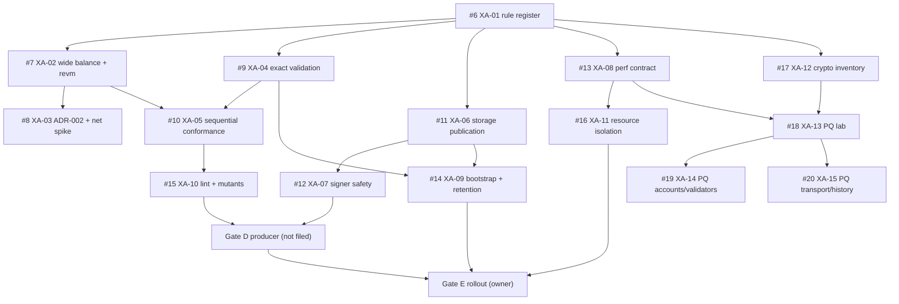

# Handoff: xOne architecture audit (2026-11-11)

State: Phases 0-4 complete. 16 issues created (#5 tracker, #6-#20), all bodies reconciled, 15 sub-issue links and 23 `blocked_by` links confirmed. No issue was reused (none existed). Stop point: this run ends with the backlog and this plan. Implementation, merges, live rollout, signing and protocol activation are separate scopes.

## Goal

An XDC-compatible Rust client, verified independently (own-state sequential replay, negative corpus, more than one test source), durable and signer-safe, with workload-scoped latency and resource targets. PQ migration research runs in parallel under explicit protocol constraints and never changes consensus bytes in this track.

## Coverage ledger

- Of 37 claims (`claims.csv`): 32 verified in source (two also use tracker reports or arithmetic), 3 reported only, 1 inference, 1 unverified/contradicted. Key contradictions: plan "WideBalance always 33 bytes" (encoding is unbounded); plan "followers may approximate" (rejected by Revision 1); reth-xdc nonce-unwind defect not found in source.
- Issues: XA-00 #5, XA-01 #6, XA-02 #7, XA-03 #8, XA-04 #9, XA-05 #10, XA-06 #11, XA-07 #12, XA-08 #13, XA-09 #14, XA-10 #15, XA-11 #16, XA-12 #17, XA-13 #18, XA-14 #19, XA-15 #20.
- Merged into others (dedupe): fault-injection harness -> XA-06 (storage) and XA-07 (vote path + simulator); mint-gate statistic -> XA-08; network spike S2 and SDK spike S3 -> XA-03; Revision 1 P0-6 gate DAG -> tracker #5.
- Deferred research (no issue): serial-equivalent parallel execution, core pinning/busy-polling, kernel bypass, MonadDb-style commitments (rejected: changes XDC commitments).
- Research boundary: families 1-4 from the review register (40 refs) were reused; this audit re-read only the version-sensitive items (revm, reth/evm2, alloy-trie, ethrex snap, EIP-8189, EEST, FIPS errata, RustCrypto/liboqs). Second pass over XDC client repos added no new issue-level mechanism. Besu-xdc not inspected (code search returned nothing).

## Revised DAG

Critical path: XA-01 -> XA-02 -> XA-05 -> XA-10 -> Gate D, and XA-01 -> XA-06 -> XA-07 -> Gate D. Parallel: XA-08, XA-12, XA-04.

## Next ready work

1. #6 XA-01 (no blockers): every rule switch at the geth pin in a typed, generated table. Gate: CI rejects drift and `Missing`; `Unscheduled` never activates; genesis hashes for 51/50/2040 match.
2. #11 XA-06 (after XA-01 page set; design can start now): cross-store protocol + fault model. Gate: every boundary x fault recovers or refuses with a typed error.
3. #7 XA-02 (after XA-01 spec pages for balance rules): boundary matrix on revm 43.0.3. Gate: all rows and encodings match geth and history without a revm fork.
4. #13 XA-08: measurement contract and eligible-turn statistic. Gate: three agreeing baseline runs.
5. #17 XA-12: crypto inventory. Gate: complete inventory, current bytes unchanged.

## Language ADR (input to ADR-001 record)

Rust stays preferred (owner decision; safe-code memory/data-race guarantees, revm/alloy ecosystem). Conditions: XA-02 passes without a revm fork and XA-03 records an acceptable pin strategy now that reth left revm. Go is the oracle/exporter and documented fallback core (shortest path to correctness, team skill; costs independence from the geth line). C++ (evmone/Silkworm): component use only with measured benefit; memory-safety cost. Java/C#: already represented by besu/nethermind; adds no diversity. Zig/Nim: no maintained EVM/XDC stack; would repeat xOneGo's own-EVM mistake. No speed ranking is claimed; XA-08 measurements decide optimizations.

## Execution loop

Select a ready issue -> establish failing evidence or a baseline -> one bounded change -> targeted checks -> relevant differential/fault/perf gate -> independent review -> PR (3-trailer identity) -> record result in the issue and tick #5. Full-range replay only at integration boundaries. Three unchanged failures -> written escalation. A safety fault stops the affected rollout.

## Unresolved decisions and blockers

- Owner: legal range for wide balances and the legacy-vs-geth BALANCE adjudication (XA-02).
- Owner: mint-gate minimums (Revision 1 proposes 200 turns, 72 h, 3 epoch changes, 5 restarts) (XA-08).
- Owner: separate safety store and cross-host fencing method (XA-07); timeout-signing record rule.
- Owner: ADR-002 option and reth/revm pin strategy (XA-03); whether reth-xdc continues (plan K7).
- PR #4 (skills `xone-rs-durability-signer-gate`, `xone-rs-pq-readiness`) is open; issues reference those skills.
- Sensitive, not in issues: one live XDC client was observed to persist its highest voted round only on round change (not before each vote). Route to that client's owners privately; see the coordinator report.
- Gaps: besu-xdc wide-balance representation not inspected; xOneGo parent go.mod and wide-balance RLP not located; reth-xdc sidecar fsync not verified.

## Resume

`cat .audit/session.json`; verify issues #5-#20 by marker (`<!-- xone-audit:XA-NN:`); do not recreate. Generator lives outside the repo (scratchpad `gen/`); bodies are reproducible from the issue text.
