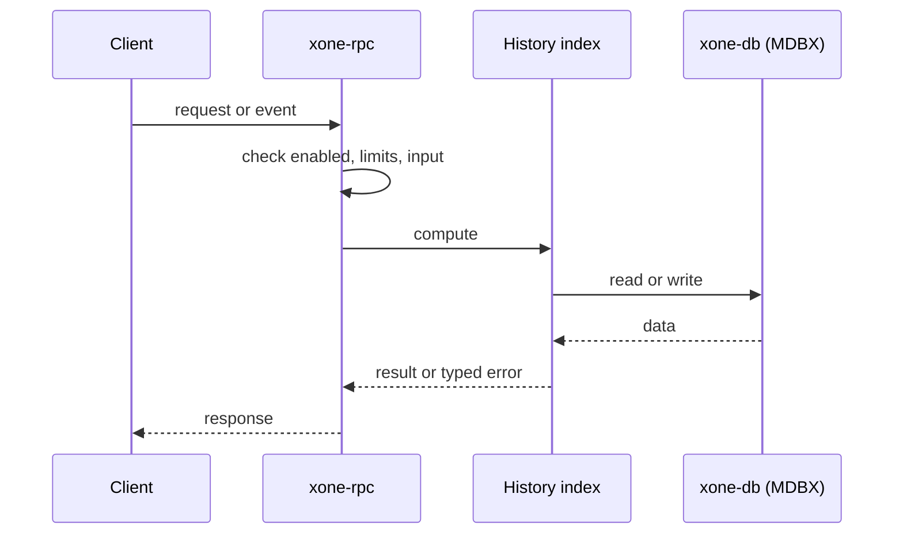
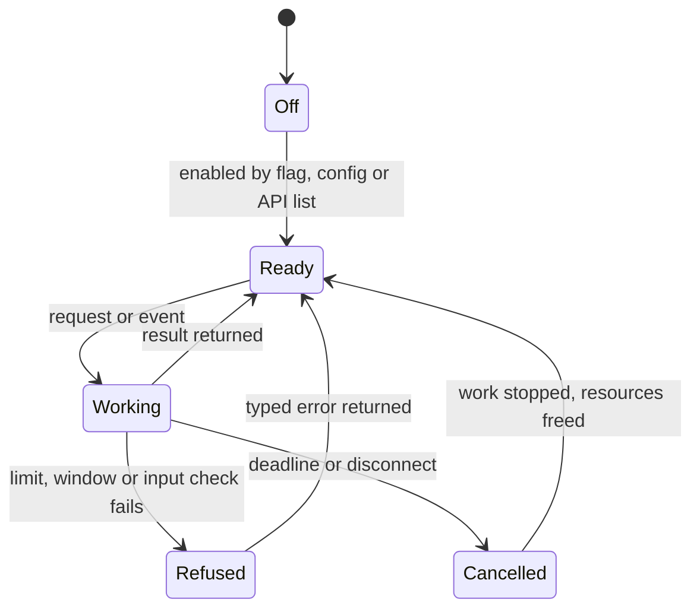
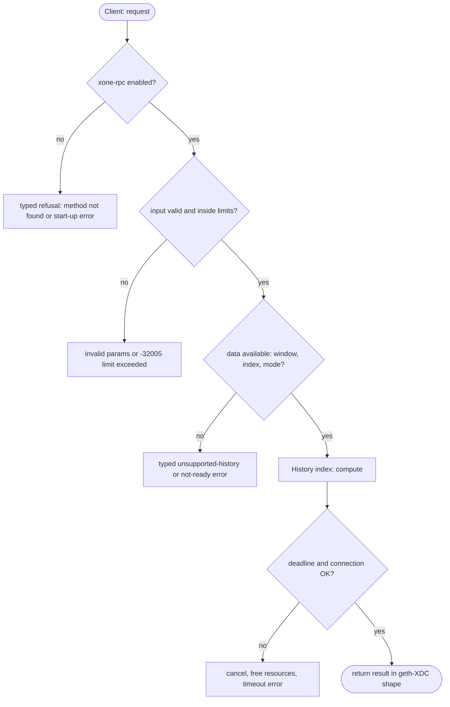

## What

xOne keeps the state of the newest 128 blocks and checkpoints only. `--gcmode archive` is refused with a typed error. A node operator cannot run an archive node, so `eth_getBalance`, `eth_call`, `eth_getStorageAt` and `debug_trace*` fail for older blocks. Explorers, indexers and audit tools need an archive node.

## Why

9 of the 10 selected competitors have this capability (file evidence at the audited commit):

- `ethereum/go-ethereum`: [cmd/utils/flags.go](https://github.com/ethereum/go-ethereum/blob/8059ff8beb3170eb8b977169ac51bb0423c97ee1/cmd/utils/flags.go)
- `bnb-chain/bsc`: [cmd/utils/flags.go](https://github.com/bnb-chain/bsc/blob/54afaff4da31ac9e49ba646a4f65104edac5a2f3/cmd/utils/flags.go)
- `0xPolygon/bor`: [cmd/utils/flags.go](https://github.com/0xPolygon/bor/blob/ee09efd5dd9ef75917368990b272581b0e2c2665/cmd/utils/flags.go)
- `XinFinOrg/XDPoSChain`: [cmd/utils/flags.go](https://github.com/XinFinOrg/XDPoSChain/blob/cb1ef79073c05f50b9df75b1e740387b9d72af99/cmd/utils/flags.go)
- `erigontech/erigon`: [db/kv/prune/storage_mode.go](https://github.com/erigontech/erigon/blob/bbb5524e53fb057e7d47a5066e152f1091ac4ba4/db/kv/prune/storage_mode.go)
- `paradigmxyz/reth`: [crates/node/core/src/args/pruning.rs](https://github.com/paradigmxyz/reth/blob/36600d5ff9628465475dd4c7608e2e9f2fe24273/crates/node/core/src/args/pruning.rs)
- `NethermindEth/nethermind`: [src/Nethermind/Nethermind.Db/IPruningConfig.cs](https://github.com/NethermindEth/nethermind/blob/a7dd73052e696ad934d228aad3f33e660701fdb7/src/Nethermind/Nethermind.Db/IPruningConfig.cs)
- `besu-eth/besu`: [app/src/main/java/org/hyperledger/besu/cli/BesuCommand.java](https://github.com/besu-eth/besu/blob/2b839d96863d01210f45a6f62127e6229e5b0889/app/src/main/java/org/hyperledger/besu/cli/BesuCommand.java)
- `status-im/nimbus-eth1`: [execution_chain/conf.nim](https://github.com/status-im/nimbus-eth1/blob/5e3fd7e9d19177980cc1c086c46c4e1dcf38eced/execution_chain/conf.nim)

Priority: P0: a whole node type (archive) is missing; 9 of 10 selected competitors have it.

Our code today: bin/xone/src/flags.rs (--gcmode archive refused), crates/xone-node/src/config.rs (128-block state window).

Related xOneRS issues: #27, #121, #145, #149. This issue adds the capability; it does not replace their gates.

## 80% of the way to

1. `crates/xone-state`: keep the per-block changesets that unwind already writes (`changeset.rs`) without the retention cut when archive mode is on; add a historical `StateProvider` that answers account and slot reads at block N from the newest changeset at or above N plus the current flat state (the reth/erigon history-index model, not a full trie per block).
2. `crates/xone-db` (`mdbx.rs`): two index tables, `AccountHistory` and `StorageHistory`, keyed by (address[, slot], block-shard) with block-number lists; written in the same commit as the block.
3. `crates/xone-node/src/config.rs`: accept `gcmode archive`; store the mode in the datadir marker; refuse a mode change on an existing datadir (typed error).
4. `crates/xone-rpc/src/eth.rs`: `state_at` uses the historical provider when the block is outside the window; remove the unsupported-history refusal for archive nodes (#121).
5. Tests: replay net2040 0..21,600 in archive mode; for 500 random (block, account) pairs compare `eth_getBalance`/`eth_getStorageAt` with the xdc02 archive; restart and unwind tests keep the indexes consistent.

Acceptance criteria:

- [ ] `xone --gcmode archive` follows net2040 from genesis to head.
- [ ] 500 random historical `eth_getBalance`/`eth_getStorageAt`/`eth_call` reads equal the xdc02 archive.
- [ ] Datadir growth per 100k blocks is measured and recorded in docs/ops.

## ASD-STE100

1. The node MUST accept `--gcmode archive` on an empty datadir.
2. The node MUST refuse a change of gcmode on a datadir that holds a chain. The error MUST name the stored mode.
3. In archive mode, the node MUST answer state reads for each block from genesis to head.
4. The state value at block N MUST be equal to the value from the geth-XDC archive at block N.
5. An unwind MUST remove the history entries above the new head in the same commit.

## Diagrams



## Images

None.

## Prompt

```text
You work in XDCIndia/xOneRS (Rust XDC client). Implement GAP-0001: Archive node mode: keep historical state for every block (--gcmode archive).

Context: xOne keeps the state of the newest 128 blocks and checkpoints only. `--gcmode archive` is refused with a typed error. A node operator cannot run an archive node, so `eth_getBalance`, `eth_call`, `eth_getStorageAt` and `debug_trace*` fail for older blocks. Explorers, indexers and audit tools need an archive node.

Reference behaviour: geth-XDC at XDCIndia/go-ethereum 6fc8e8c2088b7f18264f5663036669d04fa7becf (conformance/PIN). Where geth-XDC lacks the feature, follow the first competitor in the Why section and record the choice in the PR.

Steps:
1. `crates/xone-state`: keep the per-block changesets that unwind already writes (`changeset.rs`) without the retention cut when archive mode is on; add a historical `StateProvider` that answers account and slot reads at block N from the newest changeset at or above N plus the current flat state (the reth/erigon history-index model, not a full trie per block).
2. `crates/xone-db` (`mdbx.rs`): two index tables, `AccountHistory` and `StorageHistory`, keyed by (address[, slot], block-shard) with block-number lists; written in the same commit as the block.
3. `crates/xone-node/src/config.rs`: accept `gcmode archive`; store the mode in the datadir marker; refuse a mode change on an existing datadir (typed error).
4. `crates/xone-rpc/src/eth.rs`: `state_at` uses the historical provider when the block is outside the window; remove the unsupported-history refusal for archive nodes (#121).
5. Tests: replay net2040 0..21,600 in archive mode; for 500 random (block, account) pairs compare `eth_getBalance`/`eth_getStorageAt` with the xdc02 archive; restart and unwind tests keep the indexes consistent.

Rules: one branch `feat/gap-0001-archive` from main, one PR that closes this issue. Write the tests and vectors first. Keep consensus, execution and storage formats unchanged. Run `cargo fmt --check`, `cargo clippy --all-targets -- -D warnings`, `cargo test --locked`, `ci/check-layering.sh` and `ci/check-fixtures.sh`. Update docs/cli/flags.md with `UPDATE_DOCS=1 cargo test -p xone flags_doc` if you add a flag. Hand back in 25 lines or fewer: files changed, tests added, acceptance results.
```

## Workflow

1. Maintainer: confirms priority P0 and assigns the issue.
2. Engineer: creates branch `feat/gap-0001-archive` from `main`.
3. Engineer: writes the failing tests and the parity vectors (xdc02 archive or the reference client).
4. Engineer: implements the change in the files of Layout.
5. Engineer: runs the gates (fmt, clippy, test, layering, fixtures) and the parity check.
6. Engineer: opens one PR that says `Closes #<this issue>` and lists the acceptance results.
7. Reviewer: checks each acceptance criterion and the ASD-STE100 requirements.
8. Maintainer: merges.
9. Operator: enables the feature on one net2040 node and records the result in this issue.

## Loop

Runtime: Each imported block appends history entries in the block commit. No timer.

Develop-verify: write a vector, implement, diff the answer against the xdc02 geth-XDC archive (or the reference client), fix, repeat until 0 mismatches. A retry after a failed gate starts from the failing vector.

## Graph



## Layout

```text
Files touched:
  bin/xone/src/flags.rs
  crates/xone-db
  crates/xone-node/src/config.rs
  crates/xone-rpc/src/eth.rs
  crates/xone-state
```

## Flow



## Summary

Gap: Archive node mode: keep historical state for every block (--gcmode archive) is missing or partial in xOneRS; 9 of 10 selected competitors have it.
Fix: implement it as in "80% of the way to", with geth-XDC behaviour as the reference.
Acceptance: `xone --gcmode archive` follows net2040 from genesis to head.

<!-- gap-audit:GAP-0001 -->
