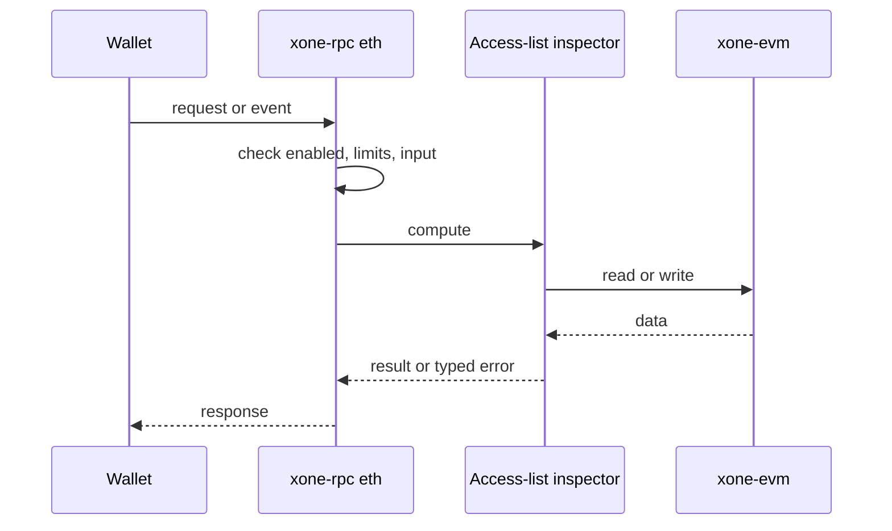
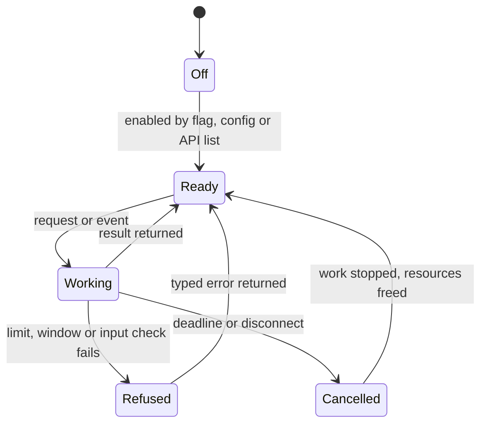
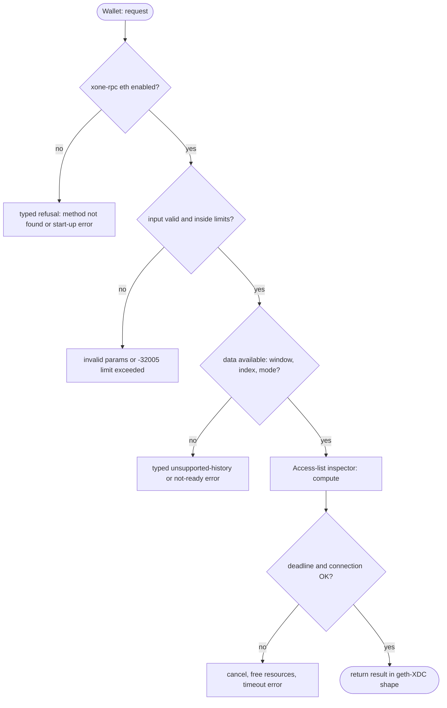

## What

`eth_createAccessList` answers `-32601`. Wallets and SDKs (ethers, viem) call it to build EIP-2930 type-1 and type-2 transactions with lower gas. XDC enabled EIP-2930 at its Berlin fork.

## Why

10 of the 10 selected competitors have this capability (file evidence at the audited commit):

- `ethereum/go-ethereum`: [internal/ethapi/api.go](https://github.com/ethereum/go-ethereum/blob/8059ff8beb3170eb8b977169ac51bb0423c97ee1/internal/ethapi/api.go)
- `bnb-chain/bsc`: [internal/ethapi/api.go](https://github.com/bnb-chain/bsc/blob/54afaff4da31ac9e49ba646a4f65104edac5a2f3/internal/ethapi/api.go)
- `0xPolygon/bor`: [internal/ethapi/api.go](https://github.com/0xPolygon/bor/blob/ee09efd5dd9ef75917368990b272581b0e2c2665/internal/ethapi/api.go)
- `XinFinOrg/XDPoSChain`: [internal/ethapi/api.go](https://github.com/XinFinOrg/XDPoSChain/blob/cb1ef79073c05f50b9df75b1e740387b9d72af99/internal/ethapi/api.go)
- `paradigmxyz/reth`: [crates/rpc/rpc-eth-api/src/core.rs](https://github.com/paradigmxyz/reth/blob/36600d5ff9628465475dd4c7608e2e9f2fe24273/crates/rpc/rpc-eth-api/src/core.rs)
- `erigontech/erigon`: [rpc/jsonrpc/eth_call.go](https://github.com/erigontech/erigon/blob/bbb5524e53fb057e7d47a5066e152f1091ac4ba4/rpc/jsonrpc/eth_call.go)
- `lambdaclass/ethrex`: [crates/networking/rpc/eth/account.rs](https://github.com/lambdaclass/ethrex/blob/740ea493880b6c073b81537010df75e143c615c2/crates/networking/rpc/eth/account.rs)
- `NethermindEth/nethermind`: [src/Nethermind/Nethermind.JsonRpc/Modules/Eth/IEthRpcModule.cs](https://github.com/NethermindEth/nethermind/blob/a7dd73052e696ad934d228aad3f33e660701fdb7/src/Nethermind/Nethermind.JsonRpc/Modules/Eth/IEthRpcModule.cs)
- `besu-eth/besu`: [ethereum/api/src/main/java/org/hyperledger/besu/ethereum/api/jsonrpc/internal/methods/EthCreateAccessList.java](https://github.com/besu-eth/besu/blob/2b839d96863d01210f45a6f62127e6229e5b0889/ethereum/api/src/main/java/org/hyperledger/besu/ethereum/api/jsonrpc/internal/methods/EthCreateAccessList.java)
- `status-im/nimbus-eth1`: [execution_chain/rpc/server_api.nim](https://github.com/status-im/nimbus-eth1/blob/5e3fd7e9d19177980cc1c086c46c4e1dcf38eced/execution_chain/rpc/server_api.nim)

Priority: P1: 10 of 10 selected competitors have it (rule: 8+ = P1).

Our code today: none.

Related xOneRS issues: #42. This issue adds the capability; it does not replace their gates.

## 80% of the way to

1. `crates/xone-rpc/src/eth.rs`: register `eth_createAccessList(call, block)` (C2).
2. `crates/xone-evm`: an access-list inspector that records touched addresses and slots, excluding sender, recipient and active precompiles; iterate until the list is stable as geth `AccessListTracer`.
3. Answer `{accessList, gasUsed, error?}` as geth.
4. Tests: byte-compare 100 calls with the xdc02 archive.

Acceptance criteria:

- [ ] 100 calls equal the xdc02 archive.

## ASD-STE100

1. The node MUST serve `eth_createAccessList`.
2. The access list MUST NOT contain the sender, the recipient or the precompiles of the active fork.
3. The answer MUST be equal to the geth-XDC answer for the same input.

## Diagrams



## Images

None.

## Prompt

```text
You work in XDCIndia/xOneRS (Rust XDC client). Implement GAP-0004: eth_createAccessList.

Context: `eth_createAccessList` answers `-32601`. Wallets and SDKs (ethers, viem) call it to build EIP-2930 type-1 and type-2 transactions with lower gas. XDC enabled EIP-2930 at its Berlin fork.

Reference behaviour: geth-XDC at XDCIndia/go-ethereum 6fc8e8c2088b7f18264f5663036669d04fa7becf (conformance/PIN). Where geth-XDC lacks the feature, follow the first competitor in the Why section and record the choice in the PR.

Steps:
1. `crates/xone-rpc/src/eth.rs`: register `eth_createAccessList(call, block)` (C2).
2. `crates/xone-evm`: an access-list inspector that records touched addresses and slots, excluding sender, recipient and active precompiles; iterate until the list is stable as geth `AccessListTracer`.
3. Answer `{accessList, gasUsed, error?}` as geth.
4. Tests: byte-compare 100 calls with the xdc02 archive.

Rules: one branch `feat/gap-0004-accesslist` from main, one PR that closes this issue. Write the tests and vectors first. Keep consensus, execution and storage formats unchanged. Run `cargo fmt --check`, `cargo clippy --all-targets -- -D warnings`, `cargo test --locked`, `ci/check-layering.sh` and `ci/check-fixtures.sh`. Update docs/cli/flags.md with `UPDATE_DOCS=1 cargo test -p xone flags_doc` if you add a flag. Hand back in 25 lines or fewer: files changed, tests added, acceptance results.
```

## Workflow

1. Maintainer: confirms priority P1 and assigns the issue.
2. Engineer: creates branch `feat/gap-0004-accesslist` from `main`.
3. Engineer: writes the failing tests and the parity vectors (xdc02 archive or the reference client).
4. Engineer: implements the change in the files of Layout.
5. Engineer: runs the gates (fmt, clippy, test, layering, fixtures) and the parity check.
6. Engineer: opens one PR that says `Closes #<this issue>` and lists the acceptance results.
7. Reviewer: checks each acceptance criterion and the ASD-STE100 requirements.
8. Maintainer: merges.
9. Operator: enables the feature on one net2040 node and records the result in this issue.

## Loop

Runtime: Iterate the call until the access list does not change (bounded by 10 runs).

Develop-verify: write a vector, implement, diff the answer against the xdc02 geth-XDC archive (or the reference client), fix, repeat until 0 mismatches. A retry after a failed gate starts from the failing vector.

## Graph



## Layout

```text
Files touched:
  crates/xone-evm
  crates/xone-rpc/src/eth.rs
```

## Flow



## Summary

Gap: eth_createAccessList is missing or partial in xOneRS; 10 of 10 selected competitors have it.
Fix: implement it as in "80% of the way to", with geth-XDC behaviour as the reference.
Acceptance: 100 calls equal the xdc02 archive.

<!-- gap-audit:GAP-0004 -->
