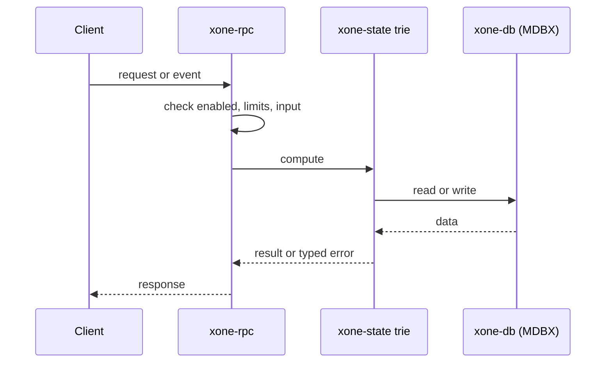
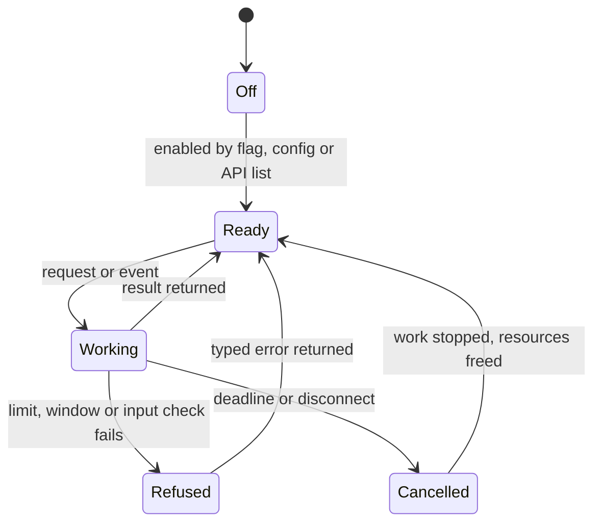
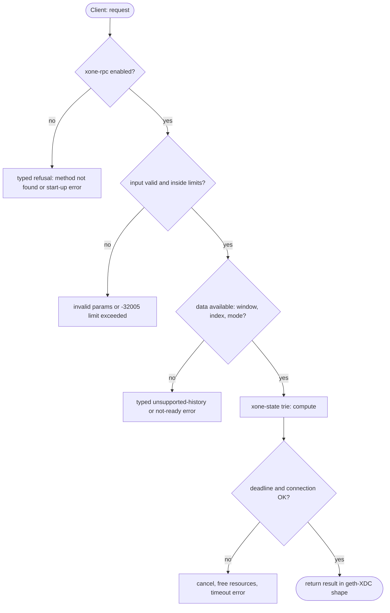

## What

`eth_getProof` answers `-32601`. ADR-008 put it out of scope because the node had no proof walker. The node now builds and checks range proofs for snap/1 (`crates/xone-snap/src/proof.rs`) and verifies `eth_getProof` answers from a gap RPC (`rpcproof.rs`). Bridges, light clients, rollups and the `--snap.gap-rpc` path of other xOne nodes need a server for this method.

## Why

9 of the 10 selected competitors have this capability (file evidence at the audited commit):

- `ethereum/go-ethereum`: [internal/ethapi/api.go](https://github.com/ethereum/go-ethereum/blob/8059ff8beb3170eb8b977169ac51bb0423c97ee1/internal/ethapi/api.go)
- `bnb-chain/bsc`: [internal/ethapi/api.go](https://github.com/bnb-chain/bsc/blob/54afaff4da31ac9e49ba646a4f65104edac5a2f3/internal/ethapi/api.go)
- `0xPolygon/bor`: [internal/ethapi/api.go](https://github.com/0xPolygon/bor/blob/ee09efd5dd9ef75917368990b272581b0e2c2665/internal/ethapi/api.go)
- `paradigmxyz/reth`: [crates/rpc/rpc-eth-api/src/core.rs](https://github.com/paradigmxyz/reth/blob/36600d5ff9628465475dd4c7608e2e9f2fe24273/crates/rpc/rpc-eth-api/src/core.rs)
- `erigontech/erigon`: [rpc/jsonrpc/eth_call.go](https://github.com/erigontech/erigon/blob/bbb5524e53fb057e7d47a5066e152f1091ac4ba4/rpc/jsonrpc/eth_call.go)
- `lambdaclass/ethrex`: [crates/networking/rpc/eth/account.rs](https://github.com/lambdaclass/ethrex/blob/740ea493880b6c073b81537010df75e143c615c2/crates/networking/rpc/eth/account.rs)
- `NethermindEth/nethermind`: [src/Nethermind/Nethermind.JsonRpc/Modules/Eth/IEthRpcModule.cs](https://github.com/NethermindEth/nethermind/blob/a7dd73052e696ad934d228aad3f33e660701fdb7/src/Nethermind/Nethermind.JsonRpc/Modules/Eth/IEthRpcModule.cs)
- `besu-eth/besu`: [ethereum/api/src/main/java/org/hyperledger/besu/ethereum/api/jsonrpc/internal/methods/EthGetProof.java](https://github.com/besu-eth/besu/blob/2b839d96863d01210f45a6f62127e6229e5b0889/ethereum/api/src/main/java/org/hyperledger/besu/ethereum/api/jsonrpc/internal/methods/EthGetProof.java)
- `status-im/nimbus-eth1`: [execution_chain/rpc/server_api.nim](https://github.com/status-im/nimbus-eth1/blob/5e3fd7e9d19177980cc1c086c46c4e1dcf38eced/execution_chain/rpc/server_api.nim)

Priority: P1: 9 of 10 selected competitors have it (rule: 8+ = P1).

Our code today: crates/xone-rpc/src/eth.rs (-32601), spec/rpc/scope-adr-008.md (out); proof code exists in crates/xone-snap/src/proof.rs.

Related xOneRS issues: #42, #37. This issue adds the capability; it does not replace their gates.

## 80% of the way to

1. `crates/xone-state/src/trie.rs`: add `account_proof(root, addr)` and `storage_proof(storage_root, slot)` that return the node RLP list from the root to the leaf; reuse the node encoder of the snap server.
2. `crates/xone-rpc/src/eth.rs`: register `eth_getProof(address, [slots], block)` in class C2; the answer has geth's shape (`accountProof`, `balance`, `codeHash`, `nonce`, `storageHash`, `storageProof[]`).
3. Wide balance: encode the XDC account RLP exactly as the trie holds it (`crates/xone-primitives/src/wide_balance.rs`).
4. Window: blocks inside the state window only, until archive mode (GAP archive) lands; outside it return the typed unsupported-history error.
5. Amend `spec/rpc/scope-adr-008.md` (move `eth_getProof` to in).
6. Tests: verify each answer with `crates/xone-snap/src/rpcproof.rs`; byte-compare 200 answers with the xdc02 archive.

Acceptance criteria:

- [ ] 200 random proofs byte-equal to the xdc02 archive.
- [ ] Every answer verifies with `rpcproof.rs`.
- [ ] A second xOne node uses this node as `--snap.gap-rpc` and completes a snap sync.

## ASD-STE100

1. The node MUST serve `eth_getProof` for each block in the state window.
2. Each proof MUST verify against the state root of the block header.
3. The answer MUST be byte-equal to the answer of geth-XDC for the same input.
4. For a block outside the window, the node MUST return the typed unsupported-history error.

## Diagrams



## Images

None.

## Prompt

```text
You work in XDCIndia/xOneRS (Rust XDC client). Implement GAP-0006: eth_getProof: account and storage Merkle proofs.

Context: `eth_getProof` answers `-32601`. ADR-008 put it out of scope because the node had no proof walker. The node now builds and checks range proofs for snap/1 (`crates/xone-snap/src/proof.rs`) and verifies `eth_getProof` answers from a gap RPC (`rpcproof.rs`). Bridges, light clients, rollups and the `--snap.gap-rpc` path of other xOne nodes need a server for this method.

Reference behaviour: geth-XDC at XDCIndia/go-ethereum 6fc8e8c2088b7f18264f5663036669d04fa7becf (conformance/PIN). Where geth-XDC lacks the feature, follow the first competitor in the Why section and record the choice in the PR.

Steps:
1. `crates/xone-state/src/trie.rs`: add `account_proof(root, addr)` and `storage_proof(storage_root, slot)` that return the node RLP list from the root to the leaf; reuse the node encoder of the snap server.
2. `crates/xone-rpc/src/eth.rs`: register `eth_getProof(address, [slots], block)` in class C2; the answer has geth's shape (`accountProof`, `balance`, `codeHash`, `nonce`, `storageHash`, `storageProof[]`).
3. Wide balance: encode the XDC account RLP exactly as the trie holds it (`crates/xone-primitives/src/wide_balance.rs`).
4. Window: blocks inside the state window only, until archive mode (GAP archive) lands; outside it return the typed unsupported-history error.
5. Amend `spec/rpc/scope-adr-008.md` (move `eth_getProof` to in).
6. Tests: verify each answer with `crates/xone-snap/src/rpcproof.rs`; byte-compare 200 answers with the xdc02 archive.

Rules: one branch `feat/gap-0006-getproof` from main, one PR that closes this issue. Write the tests and vectors first. Keep consensus, execution and storage formats unchanged. Run `cargo fmt --check`, `cargo clippy --all-targets -- -D warnings`, `cargo test --locked`, `ci/check-layering.sh` and `ci/check-fixtures.sh`. Update docs/cli/flags.md with `UPDATE_DOCS=1 cargo test -p xone flags_doc` if you add a flag. Hand back in 25 lines or fewer: files changed, tests added, acceptance results.
```

## Workflow

1. Maintainer: confirms priority P1 and assigns the issue.
2. Engineer: creates branch `feat/gap-0006-getproof` from `main`.
3. Engineer: writes the failing tests and the parity vectors (xdc02 archive or the reference client).
4. Engineer: implements the change in the files of Layout.
5. Engineer: runs the gates (fmt, clippy, test, layering, fixtures) and the parity check.
6. Engineer: opens one PR that says `Closes #<this issue>` and lists the acceptance results.
7. Reviewer: checks each acceptance criterion and the ASD-STE100 requirements.
8. Maintainer: merges.
9. Operator: enables the feature on one net2040 node and records the result in this issue.

## Loop

Runtime: None.

Develop-verify: write a vector, implement, diff the answer against the xdc02 geth-XDC archive (or the reference client), fix, repeat until 0 mismatches. A retry after a failed gate starts from the failing vector.

## Graph



## Layout

```text
Files touched:
  crates/xone-primitives/src/wide_balance.rs
  crates/xone-rpc/src/eth.rs
  crates/xone-snap/src/proof.rs
  crates/xone-snap/src/rpcproof.rs
  crates/xone-state/src/trie.rs
  spec/rpc/scope-adr-008.md
```

## Flow



## Summary

Gap: eth_getProof: account and storage Merkle proofs is missing or partial in xOneRS; 9 of 10 selected competitors have it.
Fix: implement it as in "80% of the way to", with geth-XDC behaviour as the reference.
Acceptance: 200 random proofs byte-equal to the xdc02 archive.

<!-- gap-audit:GAP-0006 -->
