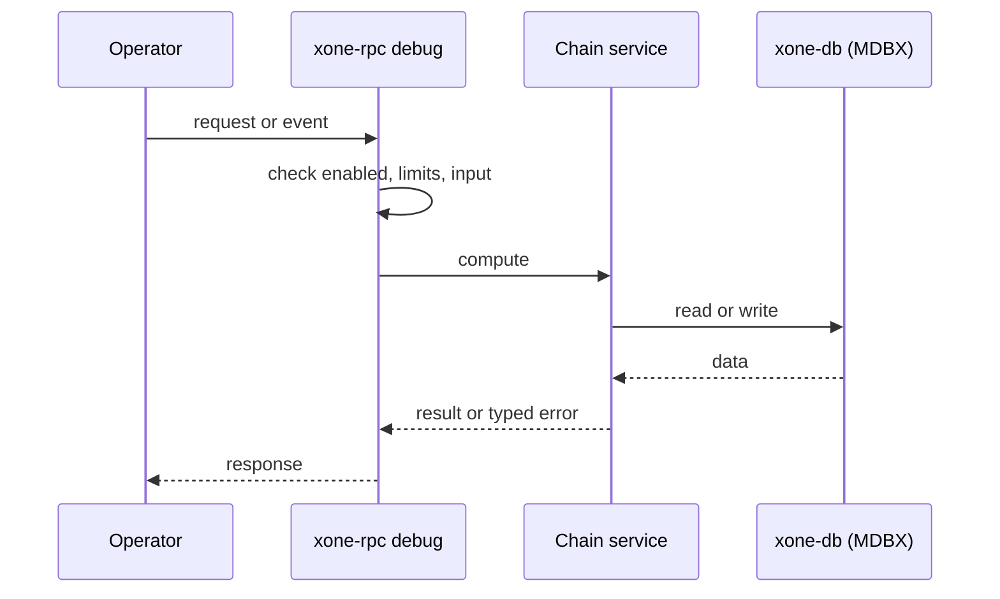
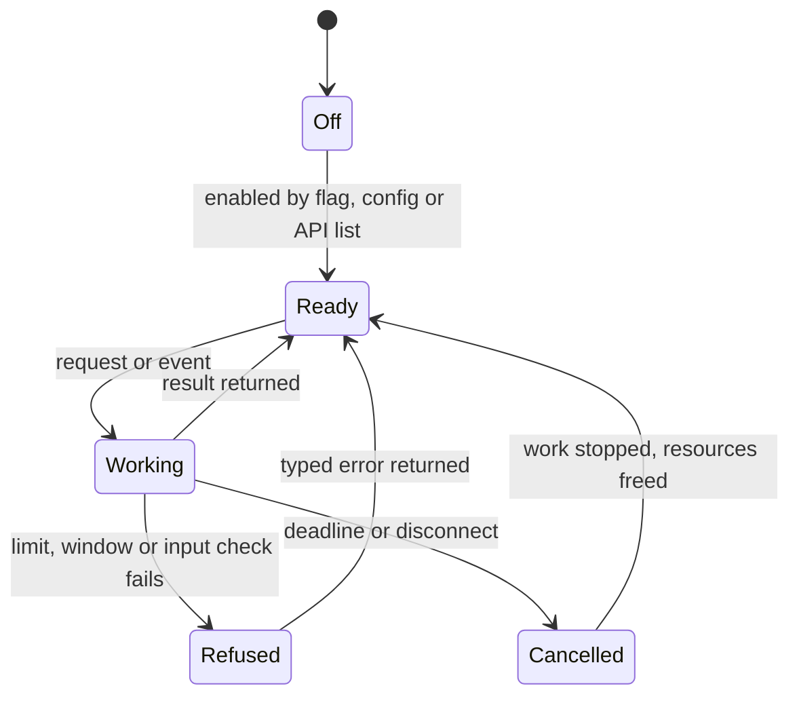
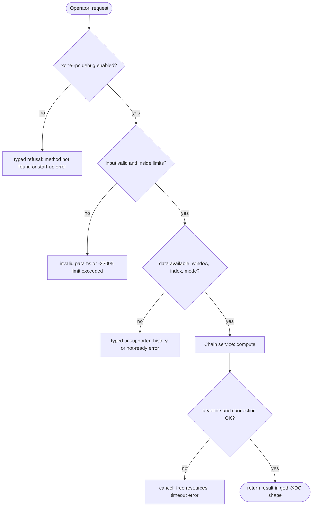

## What

When a block fails validation, an operator cannot read it back: there is no `debug_getBadBlocks`. Raw receipts and raw transactions are not served, and an operator cannot roll the head back over RPC (`debug_setHead`). For a consensus client these are the first tools in a divergence investigation.

## Why

9 of the 10 selected competitors have this capability (file evidence at the audited commit):

- `ethereum/go-ethereum`: [eth/api_debug.go](https://github.com/ethereum/go-ethereum/blob/8059ff8beb3170eb8b977169ac51bb0423c97ee1/eth/api_debug.go)
- `XinFinOrg/XDPoSChain`: [eth/api_debug.go](https://github.com/XinFinOrg/XDPoSChain/blob/cb1ef79073c05f50b9df75b1e740387b9d72af99/eth/api_debug.go)
- `bnb-chain/bsc`: [eth/api_debug.go](https://github.com/bnb-chain/bsc/blob/54afaff4da31ac9e49ba646a4f65104edac5a2f3/eth/api_debug.go)
- `0xPolygon/bor`: [eth/api_debug.go](https://github.com/0xPolygon/bor/blob/ee09efd5dd9ef75917368990b272581b0e2c2665/eth/api_debug.go)
- `paradigmxyz/reth`: [crates/rpc/rpc-api/src/debug.rs](https://github.com/paradigmxyz/reth/blob/36600d5ff9628465475dd4c7608e2e9f2fe24273/crates/rpc/rpc-api/src/debug.rs)
- `lambdaclass/ethrex`: [crates/networking/rpc/debug/bad_blocks.rs](https://github.com/lambdaclass/ethrex/blob/740ea493880b6c073b81537010df75e143c615c2/crates/networking/rpc/debug/bad_blocks.rs)
- `lambdaclass/ethrex`: [crates/networking/rpc/debug/set_head.rs](https://github.com/lambdaclass/ethrex/blob/740ea493880b6c073b81537010df75e143c615c2/crates/networking/rpc/debug/set_head.rs)
- `NethermindEth/nethermind`: [src/Nethermind/Nethermind.JsonRpc/Modules/DebugModule/IDebugRpcModule.cs](https://github.com/NethermindEth/nethermind/blob/a7dd73052e696ad934d228aad3f33e660701fdb7/src/Nethermind/Nethermind.JsonRpc/Modules/DebugModule/IDebugRpcModule.cs)
- `besu-eth/besu`: [ethereum/api/src/main/java/org/hyperledger/besu/ethereum/api/jsonrpc/internal/methods/DebugGetBadBlocks.java](https://github.com/besu-eth/besu/blob/2b839d96863d01210f45a6f62127e6229e5b0889/ethereum/api/src/main/java/org/hyperledger/besu/ethereum/api/jsonrpc/internal/methods/DebugGetBadBlocks.java)
- `erigontech/erigon`: [rpc/jsonrpc/debug_api.go](https://github.com/erigontech/erigon/blob/bbb5524e53fb057e7d47a5066e152f1091ac4ba4/rpc/jsonrpc/debug_api.go)

Priority: P1: 9 of 10 selected competitors have it (rule: 8+ = P1).

Our code today: crates/xone-rpc/src/debug.rs (getRawHeader and getRawBlock only).

Related xOneRS issues: #33, #12, #42. This issue adds the capability; it does not replace their gates.

## 80% of the way to

1. `crates/xone-node/src/services/chain.rs`: keep the last 10 rejected blocks with the rejection reason in a bounded ring (memory, plus a JSON dump file under the datadir).
2. `crates/xone-rpc/src/debug.rs`: `debug_getBadBlocks` (`{hash, block, rlp}` as geth), `debug_getRawReceipts`, `debug_getRawTransaction`, `debug_setHead` (admin-gated; calls the existing set-head path in `xone-sync`, spec/chain/reorg-and-set-head.md), `debug_chaindbProperty` (MDBX stats).
3. `debug_setHead` MUST respect the committed-block floor and the signer safety record (ADR-010).
4. Tests: inject a bad block in a devnet; read it back; set-head below the floor is refused.

Acceptance criteria:

- [ ] A rejected devnet block is returned by `debug_getBadBlocks` with its reason.
- [ ] Raw receipts equal the xdc02 archive for 50 blocks.
- [ ] set-head floor and producer refusal tested.

## ASD-STE100

1. The node MUST keep the last 10 rejected blocks and their rejection reasons.
2. `debug_setHead` MUST refuse a target below the committed-block floor.
3. `debug_setHead` MUST NOT run while the node produces blocks.

## Diagrams



## Images

None.

## Prompt

```text
You work in XDCIndia/xOneRS (Rust XDC client). Implement GAP-0009: debug diagnostics: getBadBlocks, getRawReceipts, getRawTransaction, setHead, chaindbProperty.

Context: When a block fails validation, an operator cannot read it back: there is no `debug_getBadBlocks`. Raw receipts and raw transactions are not served, and an operator cannot roll the head back over RPC (`debug_setHead`). For a consensus client these are the first tools in a divergence investigation.

Reference behaviour: geth-XDC at XDCIndia/go-ethereum 6fc8e8c2088b7f18264f5663036669d04fa7becf (conformance/PIN). Where geth-XDC lacks the feature, follow the first competitor in the Why section and record the choice in the PR.

Steps:
1. `crates/xone-node/src/services/chain.rs`: keep the last 10 rejected blocks with the rejection reason in a bounded ring (memory, plus a JSON dump file under the datadir).
2. `crates/xone-rpc/src/debug.rs`: `debug_getBadBlocks` (`{hash, block, rlp}` as geth), `debug_getRawReceipts`, `debug_getRawTransaction`, `debug_setHead` (admin-gated; calls the existing set-head path in `xone-sync`, spec/chain/reorg-and-set-head.md), `debug_chaindbProperty` (MDBX stats).
3. `debug_setHead` MUST respect the committed-block floor and the signer safety record (ADR-010).
4. Tests: inject a bad block in a devnet; read it back; set-head below the floor is refused.

Rules: one branch `feat/gap-0009-debugdiag` from main, one PR that closes this issue. Write the tests and vectors first. Keep consensus, execution and storage formats unchanged. Run `cargo fmt --check`, `cargo clippy --all-targets -- -D warnings`, `cargo test --locked`, `ci/check-layering.sh` and `ci/check-fixtures.sh`. Update docs/cli/flags.md with `UPDATE_DOCS=1 cargo test -p xone flags_doc` if you add a flag. Hand back in 25 lines or fewer: files changed, tests added, acceptance results.
```

## Workflow

1. Maintainer: confirms priority P1 and assigns the issue.
2. Engineer: creates branch `feat/gap-0009-debugdiag` from `main`.
3. Engineer: writes the failing tests and the parity vectors (xdc02 archive or the reference client).
4. Engineer: implements the change in the files of Layout.
5. Engineer: runs the gates (fmt, clippy, test, layering, fixtures) and the parity check.
6. Engineer: opens one PR that says `Closes #<this issue>` and lists the acceptance results.
7. Reviewer: checks each acceptance criterion and the ASD-STE100 requirements.
8. Maintainer: merges.
9. Operator: enables the feature on one net2040 node and records the result in this issue.

## Loop

Runtime: None.

Develop-verify: write a vector, implement, diff the answer against the xdc02 geth-XDC archive (or the reference client), fix, repeat until 0 mismatches. A retry after a failed gate starts from the failing vector.

## Graph



## Layout

```text
Files touched:
  crates/xone-node/src/services/chain.rs
  crates/xone-rpc/src/debug.rs
  spec/chain/reorg-and-set-head.md
```

## Flow



## Summary

Gap: debug diagnostics: getBadBlocks, getRawReceipts, getRawTransaction, setHead, chaindbProperty is missing or partial in xOneRS; 9 of 10 selected competitors have it.
Fix: implement it as in "80% of the way to", with geth-XDC behaviour as the reference.
Acceptance: A rejected devnet block is returned by `debug_getBadBlocks` with its reason.

<!-- gap-audit:GAP-0009 -->
