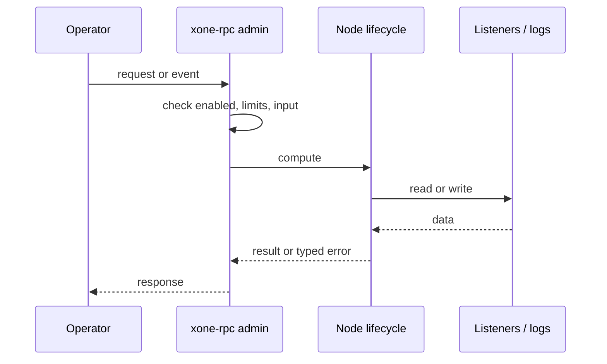
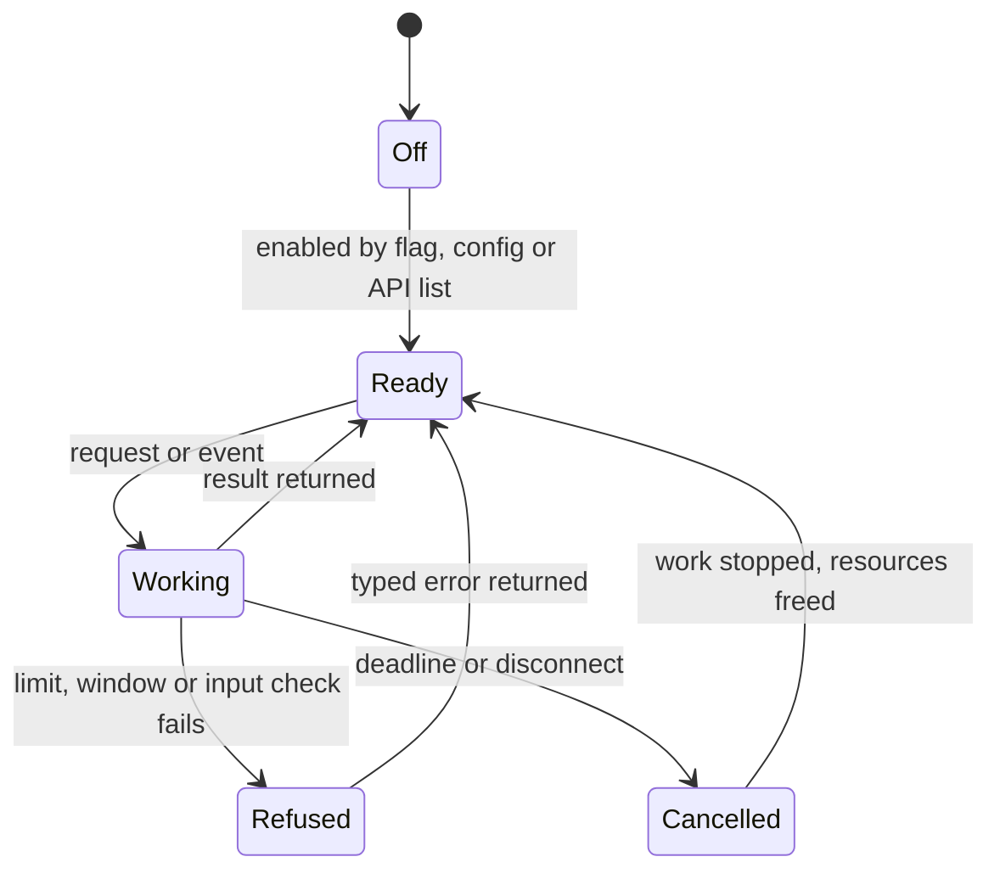
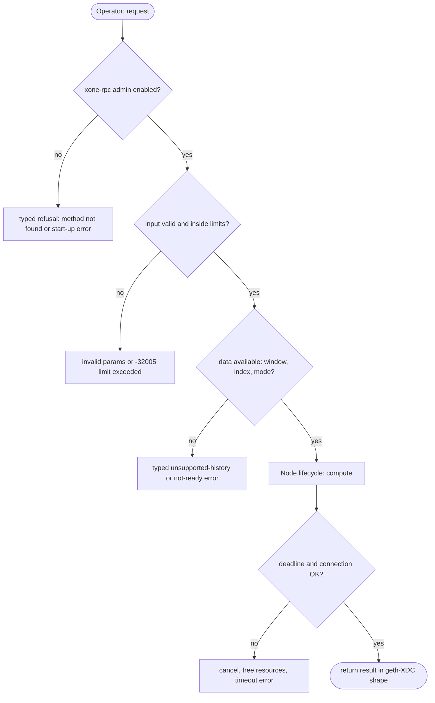

## What

An operator cannot change a running node without a restart: no `admin_startHTTP`/`stopHTTP`/`startWS`/`stopWS`, no `admin_exportChain`/`importChain`, no `admin_peerEvents` subscription, no `admin_removeTrustedPeer`, no `admin_datadir`, and no runtime log level (`debug_verbosity` in geth, `admin_changeLogLevel` in Besu). A restart of a validator costs turns.

## Why

8 of the 10 selected competitors have this capability (file evidence at the audited commit):

- `ethereum/go-ethereum`: [node/api.go](https://github.com/ethereum/go-ethereum/blob/8059ff8beb3170eb8b977169ac51bb0423c97ee1/node/api.go)
- `ethereum/go-ethereum`: [eth/api_admin.go](https://github.com/ethereum/go-ethereum/blob/8059ff8beb3170eb8b977169ac51bb0423c97ee1/eth/api_admin.go)
- `ethereum/go-ethereum`: [internal/debug/api.go](https://github.com/ethereum/go-ethereum/blob/8059ff8beb3170eb8b977169ac51bb0423c97ee1/internal/debug/api.go)
- `XinFinOrg/XDPoSChain`: [eth/api_admin.go](https://github.com/XinFinOrg/XDPoSChain/blob/cb1ef79073c05f50b9df75b1e740387b9d72af99/eth/api_admin.go)
- `bnb-chain/bsc`: [eth/api_admin.go](https://github.com/bnb-chain/bsc/blob/54afaff4da31ac9e49ba646a4f65104edac5a2f3/eth/api_admin.go)
- `0xPolygon/bor`: [eth/api_admin.go](https://github.com/0xPolygon/bor/blob/ee09efd5dd9ef75917368990b272581b0e2c2665/eth/api_admin.go)
- `paradigmxyz/reth`: [crates/rpc/rpc/src/admin.rs](https://github.com/paradigmxyz/reth/blob/36600d5ff9628465475dd4c7608e2e9f2fe24273/crates/rpc/rpc/src/admin.rs)
- `NethermindEth/nethermind`: [src/Nethermind/Nethermind.JsonRpc/Modules/Admin/IAdminRpcModule.cs](https://github.com/NethermindEth/nethermind/blob/a7dd73052e696ad934d228aad3f33e660701fdb7/src/Nethermind/Nethermind.JsonRpc/Modules/Admin/IAdminRpcModule.cs)
- `besu-eth/besu`: [ethereum/api/src/main/java/org/hyperledger/besu/ethereum/api/jsonrpc/internal/methods/AdminChangeLogLevel.java](https://github.com/besu-eth/besu/blob/2b839d96863d01210f45a6f62127e6229e5b0889/ethereum/api/src/main/java/org/hyperledger/besu/ethereum/api/jsonrpc/internal/methods/AdminChangeLogLevel.java)
- `lambdaclass/ethrex`: [crates/networking/rpc/rpc.rs](https://github.com/lambdaclass/ethrex/blob/740ea493880b6c073b81537010df75e143c615c2/crates/networking/rpc/rpc.rs)

Priority: P1: 8 of 10 selected competitors have it (rule: 8+ = P1).

Our code today: crates/xone-rpc/src/admin.rs (nodeInfo, peers, addPeer, addTrustedPeer, removePeer).

Related xOneRS issues: #42, #60. This issue adds the capability; it does not replace their gates.

## 80% of the way to

1. `crates/xone-rpc/src/admin.rs`: add the methods; each listener change goes through the node lifecycle (`crates/xone-node/src/lifecycle.rs`) with the same policy checks as start-up (`policy.rs`).
2. `debug_verbosity(level)` and `debug_vmodule` set the filter of the tracing layer in `crates/xone-node/src/observe/logs.rs`.
3. `admin_exportChain` reuses `xone-sync/src/export.rs`; `importChain` is refused while the node follows the tip.
4. Tests: start/stop listeners at runtime; log level change visible in the log; export file equals `xone export` output.

Acceptance criteria:

- [ ] Each method tested on a devnet node; export output byte-equal to `xone export`.

## ASD-STE100

1. Each admin method MUST be served only when the API list names `admin` (or `debug` for verbosity).
2. A listener started at runtime MUST use the same access policy as a listener started from flags.
3. The node MUST refuse `admin_importChain` while it follows the network.

## Diagrams



## Images

None.

## Prompt

```text
You work in XDCIndia/xOneRS (Rust XDC client). Implement GAP-0012: Admin and runtime operations: start/stop RPC listeners, exportChain/importChain, peerEvents, removeTrustedPeer, runtime log level.

Context: An operator cannot change a running node without a restart: no `admin_startHTTP`/`stopHTTP`/`startWS`/`stopWS`, no `admin_exportChain`/`importChain`, no `admin_peerEvents` subscription, no `admin_removeTrustedPeer`, no `admin_datadir`, and no runtime log level (`debug_verbosity` in geth, `admin_changeLogLevel` in Besu). A restart of a validator costs turns.

Reference behaviour: geth-XDC at XDCIndia/go-ethereum 6fc8e8c2088b7f18264f5663036669d04fa7becf (conformance/PIN). Where geth-XDC lacks the feature, follow the first competitor in the Why section and record the choice in the PR.

Steps:
1. `crates/xone-rpc/src/admin.rs`: add the methods; each listener change goes through the node lifecycle (`crates/xone-node/src/lifecycle.rs`) with the same policy checks as start-up (`policy.rs`).
2. `debug_verbosity(level)` and `debug_vmodule` set the filter of the tracing layer in `crates/xone-node/src/observe/logs.rs`.
3. `admin_exportChain` reuses `xone-sync/src/export.rs`; `importChain` is refused while the node follows the tip.
4. Tests: start/stop listeners at runtime; log level change visible in the log; export file equals `xone export` output.

Rules: one branch `feat/gap-0012-adminops` from main, one PR that closes this issue. Write the tests and vectors first. Keep consensus, execution and storage formats unchanged. Run `cargo fmt --check`, `cargo clippy --all-targets -- -D warnings`, `cargo test --locked`, `ci/check-layering.sh` and `ci/check-fixtures.sh`. Update docs/cli/flags.md with `UPDATE_DOCS=1 cargo test -p xone flags_doc` if you add a flag. Hand back in 25 lines or fewer: files changed, tests added, acceptance results.
```

## Workflow

1. Maintainer: confirms priority P1 and assigns the issue.
2. Engineer: creates branch `feat/gap-0012-adminops` from `main`.
3. Engineer: writes the failing tests and the parity vectors (xdc02 archive or the reference client).
4. Engineer: implements the change in the files of Layout.
5. Engineer: runs the gates (fmt, clippy, test, layering, fixtures) and the parity check.
6. Engineer: opens one PR that says `Closes #<this issue>` and lists the acceptance results.
7. Reviewer: checks each acceptance criterion and the ASD-STE100 requirements.
8. Maintainer: merges.
9. Operator: enables the feature on one net2040 node and records the result in this issue.

## Loop

Runtime: None.

Develop-verify: write a vector, implement, diff the answer against the xdc02 geth-XDC archive (or the reference client), fix, repeat until 0 mismatches. A retry after a failed gate starts from the failing vector.

## Graph



## Layout

```text
Files touched:
  crates/xone-node/src/lifecycle.rs
  crates/xone-node/src/observe/logs.rs
  crates/xone-rpc/src/admin.rs
```

## Flow



## Summary

Gap: Admin and runtime operations: start/stop RPC listeners, exportChain/importChain, peerEvents, removeTrustedPeer, runtime log level is missing or partial in xOneRS; 8 of 10 selected competitors have it.
Fix: implement it as in "80% of the way to", with geth-XDC behaviour as the reference.
Acceptance: Each method tested on a devnet node; export output byte-equal to `xone export`.

<!-- gap-audit:GAP-0012 -->
