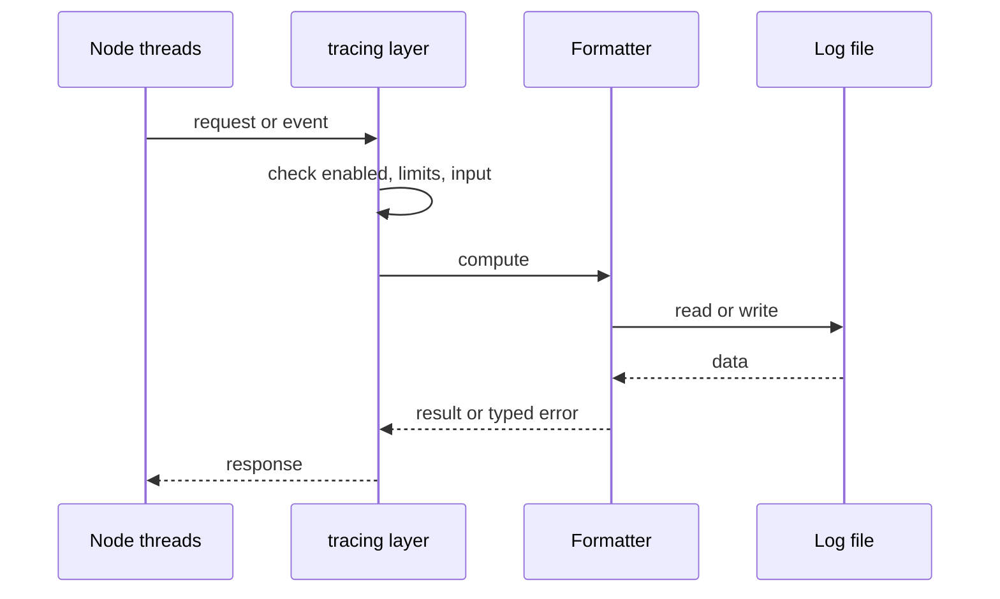
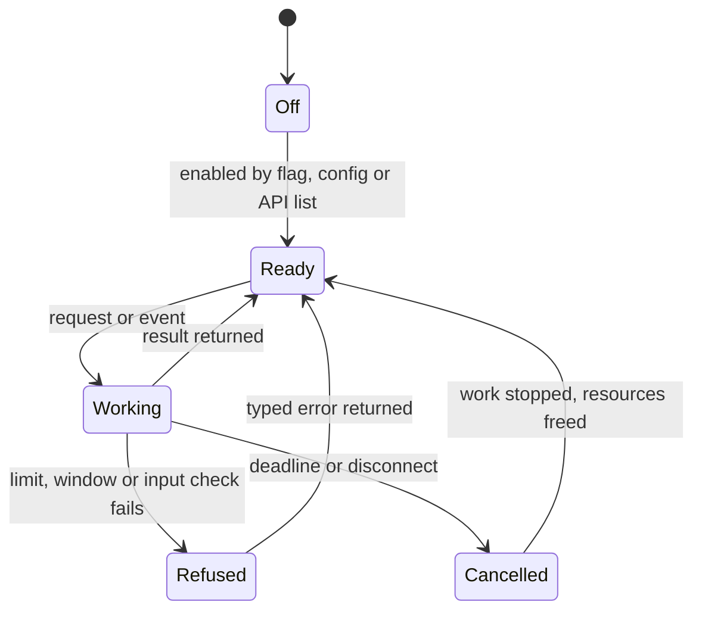
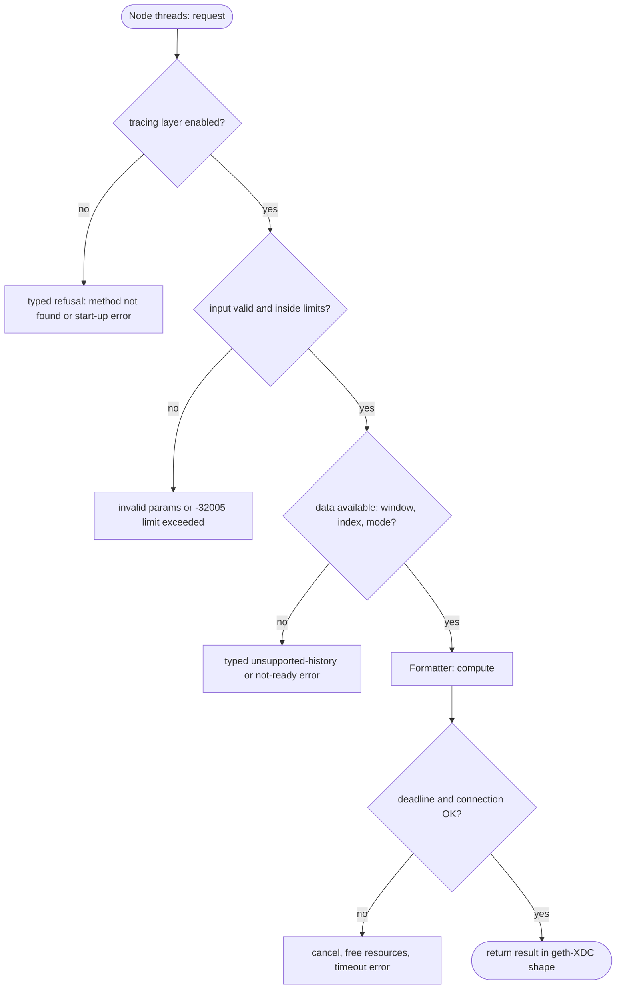

## What

xOne writes text logs only. Loki, Elasticsearch and Datadog pipelines parse JSON lines without custom regex rules. geth-XDC has `--log.format json`; reth, Erigon, Nethermind and Nimbus have equivalents.

## Why

8 of the 10 selected competitors have this capability (file evidence at the audited commit):

- `ethereum/go-ethereum`: [internal/debug/flags.go](https://github.com/ethereum/go-ethereum/blob/8059ff8beb3170eb8b977169ac51bb0423c97ee1/internal/debug/flags.go)
- `XinFinOrg/XDPoSChain`: [internal/debug/flags.go](https://github.com/XinFinOrg/XDPoSChain/blob/cb1ef79073c05f50b9df75b1e740387b9d72af99/internal/debug/flags.go)
- `bnb-chain/bsc`: [internal/debug/flags.go](https://github.com/bnb-chain/bsc/blob/54afaff4da31ac9e49ba646a4f65104edac5a2f3/internal/debug/flags.go)
- `0xPolygon/bor`: [internal/debug/flags.go](https://github.com/0xPolygon/bor/blob/ee09efd5dd9ef75917368990b272581b0e2c2665/internal/debug/flags.go)
- `erigontech/erigon`: [node/logging/flags.go](https://github.com/erigontech/erigon/blob/bbb5524e53fb057e7d47a5066e152f1091ac4ba4/node/logging/flags.go)
- `paradigmxyz/reth`: [crates/node/core/src/args/log.rs](https://github.com/paradigmxyz/reth/blob/36600d5ff9628465475dd4c7608e2e9f2fe24273/crates/node/core/src/args/log.rs)
- `NethermindEth/nethermind`: [src/Nethermind/Nethermind.Runner/NLog.config](https://github.com/NethermindEth/nethermind/blob/a7dd73052e696ad934d228aad3f33e660701fdb7/src/Nethermind/Nethermind.Runner/NLog.config)
- `status-im/nimbus-eth1`: [execution_chain/conf.nim](https://github.com/status-im/nimbus-eth1/blob/5e3fd7e9d19177980cc1c086c46c4e1dcf38eced/execution_chain/conf.nim)

Priority: P1: 8 of 10 selected competitors have it (rule: 8+ = P1).

Our code today: crates/xone-node/src/observe/logs.rs (text format only).

Related xOneRS issues: #41. This issue adds the capability; it does not replace their gates.

## 80% of the way to

1. `crates/xone-node/src/observe/logs.rs`: a JSON formatter (one object per line: `t`, `lvl`, `target`, `msg`, fields) next to the text formatter; the byte budgets and rotation stay as they are.
2. `--log.format text|json` flag and `log.format` config key; regenerate docs/cli/flags.md.
3. Tests: every line of a devnet run parses as JSON; secret-redaction tests run on both formats.

Acceptance criteria:

- [ ] `jq` parses every line of a 10-minute devnet log.
- [ ] Redaction tests pass in both formats.

## ASD-STE100

1. The node MUST write one JSON object per line when `--log.format json` is set.
2. The JSON output MUST obey the same byte budgets and redaction rules as the text output.

## Diagrams



## Images

None.

## Prompt

```text
You work in XDCIndia/xOneRS (Rust XDC client). Implement GAP-0013: Structured JSON log output (--log.format json).

Context: xOne writes text logs only. Loki, Elasticsearch and Datadog pipelines parse JSON lines without custom regex rules. geth-XDC has `--log.format json`; reth, Erigon, Nethermind and Nimbus have equivalents.

Reference behaviour: geth-XDC at XDCIndia/go-ethereum 6fc8e8c2088b7f18264f5663036669d04fa7becf (conformance/PIN). Where geth-XDC lacks the feature, follow the first competitor in the Why section and record the choice in the PR.

Steps:
1. `crates/xone-node/src/observe/logs.rs`: a JSON formatter (one object per line: `t`, `lvl`, `target`, `msg`, fields) next to the text formatter; the byte budgets and rotation stay as they are.
2. `--log.format text|json` flag and `log.format` config key; regenerate docs/cli/flags.md.
3. Tests: every line of a devnet run parses as JSON; secret-redaction tests run on both formats.

Rules: one branch `feat/gap-0013-jsonlogs` from main, one PR that closes this issue. Write the tests and vectors first. Keep consensus, execution and storage formats unchanged. Run `cargo fmt --check`, `cargo clippy --all-targets -- -D warnings`, `cargo test --locked`, `ci/check-layering.sh` and `ci/check-fixtures.sh`. Update docs/cli/flags.md with `UPDATE_DOCS=1 cargo test -p xone flags_doc` if you add a flag. Hand back in 25 lines or fewer: files changed, tests added, acceptance results.
```

## Workflow

1. Maintainer: confirms priority P1 and assigns the issue.
2. Engineer: creates branch `feat/gap-0013-jsonlogs` from `main`.
3. Engineer: writes the failing tests and the parity vectors (xdc02 archive or the reference client).
4. Engineer: implements the change in the files of Layout.
5. Engineer: runs the gates (fmt, clippy, test, layering, fixtures) and the parity check.
6. Engineer: opens one PR that says `Closes #<this issue>` and lists the acceptance results.
7. Reviewer: checks each acceptance criterion and the ASD-STE100 requirements.
8. Maintainer: merges.
9. Operator: enables the feature on one net2040 node and records the result in this issue.

## Loop

Runtime: None.

Develop-verify: write a vector, implement, diff the answer against the xdc02 geth-XDC archive (or the reference client), fix, repeat until 0 mismatches. A retry after a failed gate starts from the failing vector.

## Graph



## Layout

```text
Files touched:
  crates/xone-node/src/observe/logs.rs
  docs/cli/flags.md
```

## Flow



## Summary

Gap: Structured JSON log output (--log.format json) is missing or partial in xOneRS; 8 of 10 selected competitors have it.
Fix: implement it as in "80% of the way to", with geth-XDC behaviour as the reference.
Acceptance: `jq` parses every line of a 10-minute devnet log.

<!-- gap-audit:GAP-0013 -->
