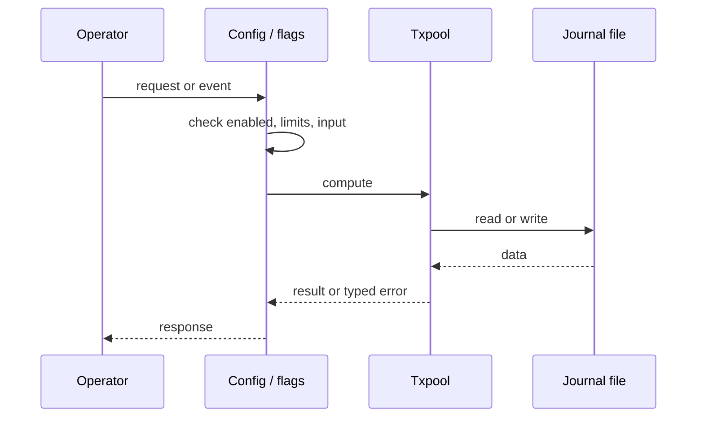
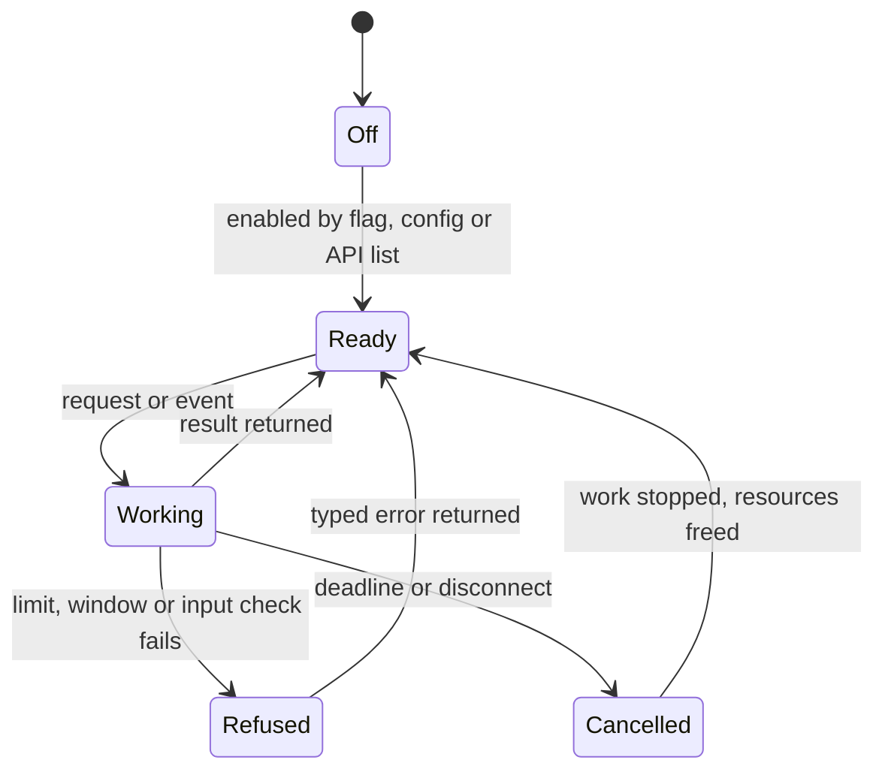
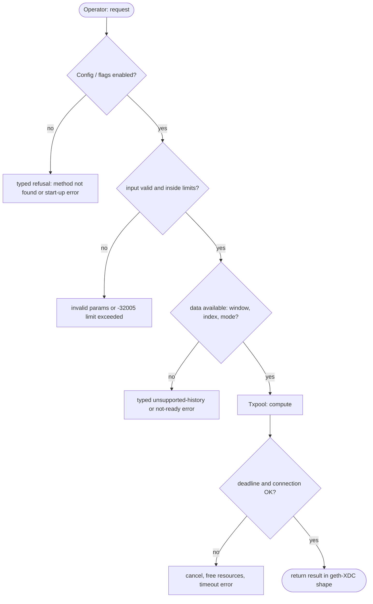

## What

The pool uses fixed geth defaults. An operator cannot set `--txpool.pricelimit`, `pricebump`, `accountslots`, `globalslots`, `accountqueue`, `globalqueue` or `lifetime`, cannot mark local accounts that bypass the price floor and eviction, and loses locally submitted transactions on restart (no journal). RPC providers and exchanges that run their own node depend on these controls.

## Why

8 of the 10 selected competitors have this capability (file evidence at the audited commit):

- `ethereum/go-ethereum`: [cmd/utils/flags.go](https://github.com/ethereum/go-ethereum/blob/8059ff8beb3170eb8b977169ac51bb0423c97ee1/cmd/utils/flags.go)
- `bnb-chain/bsc`: [cmd/utils/flags.go](https://github.com/bnb-chain/bsc/blob/54afaff4da31ac9e49ba646a4f65104edac5a2f3/cmd/utils/flags.go)
- `0xPolygon/bor`: [cmd/utils/flags.go](https://github.com/0xPolygon/bor/blob/ee09efd5dd9ef75917368990b272581b0e2c2665/cmd/utils/flags.go)
- `XinFinOrg/XDPoSChain`: [cmd/utils/flags.go](https://github.com/XinFinOrg/XDPoSChain/blob/cb1ef79073c05f50b9df75b1e740387b9d72af99/cmd/utils/flags.go)
- `ethereum/go-ethereum`: [core/txpool/locals/journal.go](https://github.com/ethereum/go-ethereum/blob/8059ff8beb3170eb8b977169ac51bb0423c97ee1/core/txpool/locals/journal.go)
- `bnb-chain/bsc`: [core/txpool/locals/journal.go](https://github.com/bnb-chain/bsc/blob/54afaff4da31ac9e49ba646a4f65104edac5a2f3/core/txpool/locals/journal.go)
- `0xPolygon/bor`: [core/txpool/locals/journal.go](https://github.com/0xPolygon/bor/blob/ee09efd5dd9ef75917368990b272581b0e2c2665/core/txpool/locals/journal.go)
- `erigontech/erigon`: [cmd/txpool/main.go](https://github.com/erigontech/erigon/blob/bbb5524e53fb057e7d47a5066e152f1091ac4ba4/cmd/txpool/main.go)
- `paradigmxyz/reth`: [crates/node/core/src/args/txpool.rs](https://github.com/paradigmxyz/reth/blob/36600d5ff9628465475dd4c7608e2e9f2fe24273/crates/node/core/src/args/txpool.rs)
- `NethermindEth/nethermind`: [src/Nethermind/Nethermind.TxPool/ITxPoolConfig.cs](https://github.com/NethermindEth/nethermind/blob/a7dd73052e696ad934d228aad3f33e660701fdb7/src/Nethermind/Nethermind.TxPool/ITxPoolConfig.cs)
- `besu-eth/besu`: [app/src/main/java/org/hyperledger/besu/cli/options/TransactionPoolOptions.java](https://github.com/besu-eth/besu/blob/2b839d96863d01210f45a6f62127e6229e5b0889/app/src/main/java/org/hyperledger/besu/cli/options/TransactionPoolOptions.java)

Priority: P1: 8 of 10 selected competitors have it (rule: 8+ = P1).

Our code today: crates/xone-builder/src/txpool/mod.rs (geth DefaultConfig fixed; 'no journal, no locals').

Related xOneRS issues: #36, #63, #16. This issue adds the capability; it does not replace their gates.

## 80% of the way to

1. `crates/xone-builder/src/txpool/mod.rs`: make `Config` fields settable; flags and `[txpool]` config keys with geth-XDC names and defaults.
2. Locals: `--txpool.locals <addr,...>` and `--txpool.nolocals`; locals are exempt from the price floor and from eviction, as geth `legacypool`.
3. Journal: `<datadir>/transactions.rlp`, append on local add, rotate every `--txpool.rejournal` (1 h), reload on start (geth `core/txpool/locals/journal.go`).
4. Special transactions (0x89/0x90) keep their own rules (#36).
5. Tests: each flag changes the bound; locals survive restart; journal rotation.

Acceptance criteria:

- [ ] Flag tests for each limit.
- [ ] Local transactions survive a restart (test).
- [ ] Special-transaction rules unchanged (#36 scenarios pass).

## ASD-STE100

1. Each txpool limit MUST be settable from a flag and from the config file.
2. Local transactions MUST be written to the journal. The node MUST reload them at start.
3. A local transaction MUST NOT be evicted for price.

## Diagrams



## Images

None.

## Prompt

```text
You work in XDCIndia/xOneRS (Rust XDC client). Implement GAP-0014: Txpool operator controls: --txpool.* limits, local accounts and a persistent local-transaction journal.

Context: The pool uses fixed geth defaults. An operator cannot set `--txpool.pricelimit`, `pricebump`, `accountslots`, `globalslots`, `accountqueue`, `globalqueue` or `lifetime`, cannot mark local accounts that bypass the price floor and eviction, and loses locally submitted transactions on restart (no journal). RPC providers and exchanges that run their own node depend on these controls.

Reference behaviour: geth-XDC at XDCIndia/go-ethereum 6fc8e8c2088b7f18264f5663036669d04fa7becf (conformance/PIN). Where geth-XDC lacks the feature, follow the first competitor in the Why section and record the choice in the PR.

Steps:
1. `crates/xone-builder/src/txpool/mod.rs`: make `Config` fields settable; flags and `[txpool]` config keys with geth-XDC names and defaults.
2. Locals: `--txpool.locals <addr,...>` and `--txpool.nolocals`; locals are exempt from the price floor and from eviction, as geth `legacypool`.
3. Journal: `<datadir>/transactions.rlp`, append on local add, rotate every `--txpool.rejournal` (1 h), reload on start (geth `core/txpool/locals/journal.go`).
4. Special transactions (0x89/0x90) keep their own rules (#36).
5. Tests: each flag changes the bound; locals survive restart; journal rotation.

Rules: one branch `feat/gap-0014-txpoolops` from main, one PR that closes this issue. Write the tests and vectors first. Keep consensus, execution and storage formats unchanged. Run `cargo fmt --check`, `cargo clippy --all-targets -- -D warnings`, `cargo test --locked`, `ci/check-layering.sh` and `ci/check-fixtures.sh`. Update docs/cli/flags.md with `UPDATE_DOCS=1 cargo test -p xone flags_doc` if you add a flag. Hand back in 25 lines or fewer: files changed, tests added, acceptance results.
```

## Workflow

1. Maintainer: confirms priority P1 and assigns the issue.
2. Engineer: creates branch `feat/gap-0014-txpoolops` from `main`.
3. Engineer: writes the failing tests and the parity vectors (xdc02 archive or the reference client).
4. Engineer: implements the change in the files of Layout.
5. Engineer: runs the gates (fmt, clippy, test, layering, fixtures) and the parity check.
6. Engineer: opens one PR that says `Closes #<this issue>` and lists the acceptance results.
7. Reviewer: checks each acceptance criterion and the ASD-STE100 requirements.
8. Maintainer: merges.
9. Operator: enables the feature on one net2040 node and records the result in this issue.

## Loop

Runtime: Rotate the journal every --txpool.rejournal (default 1 h).

Develop-verify: write a vector, implement, diff the answer against the xdc02 geth-XDC archive (or the reference client), fix, repeat until 0 mismatches. A retry after a failed gate starts from the failing vector.

## Graph



## Layout

```text
Files touched:
  crates/xone-builder/src/txpool/mod.rs
```

## Flow



## Summary

Gap: Txpool operator controls: --txpool.* limits, local accounts and a persistent local-transaction journal is missing or partial in xOneRS; 8 of 10 selected competitors have it.
Fix: implement it as in "80% of the way to", with geth-XDC behaviour as the reference.
Acceptance: Flag tests for each limit.

<!-- gap-audit:GAP-0014 -->
