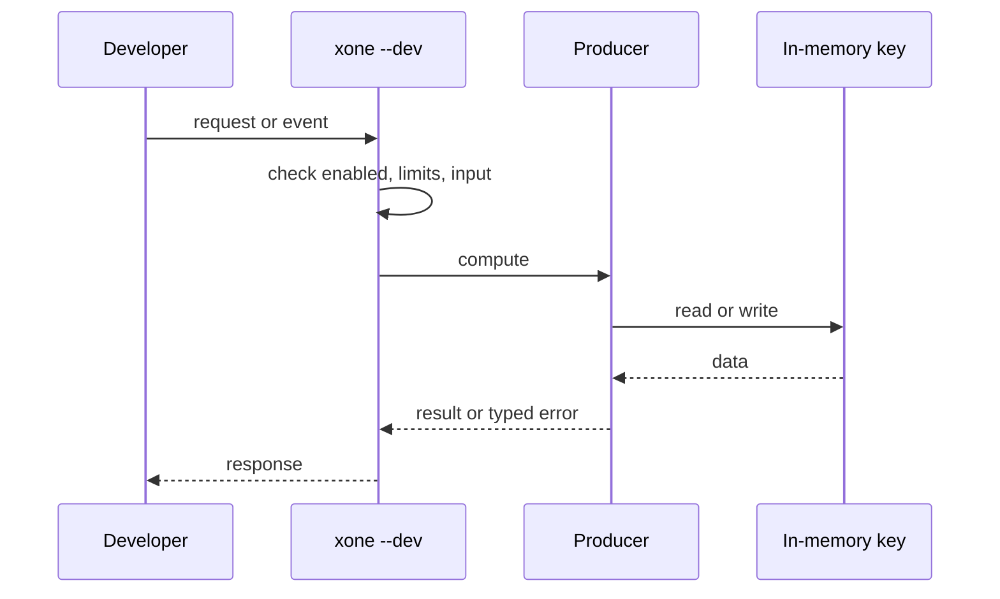
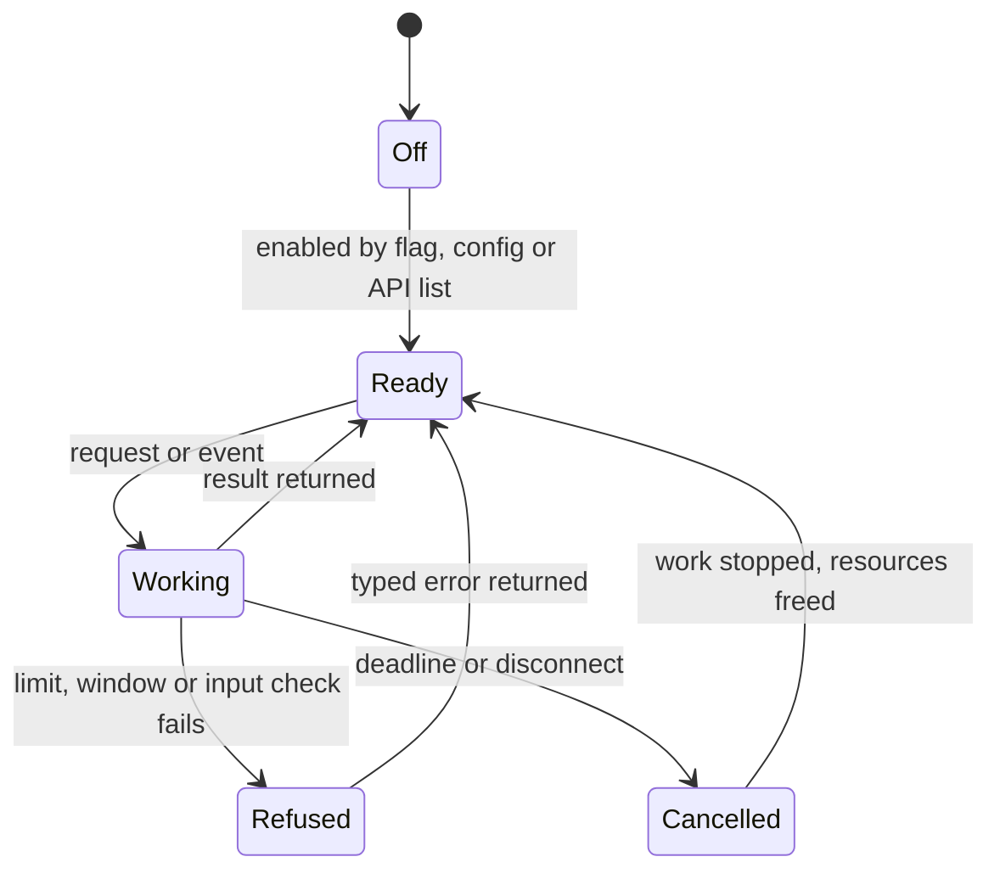
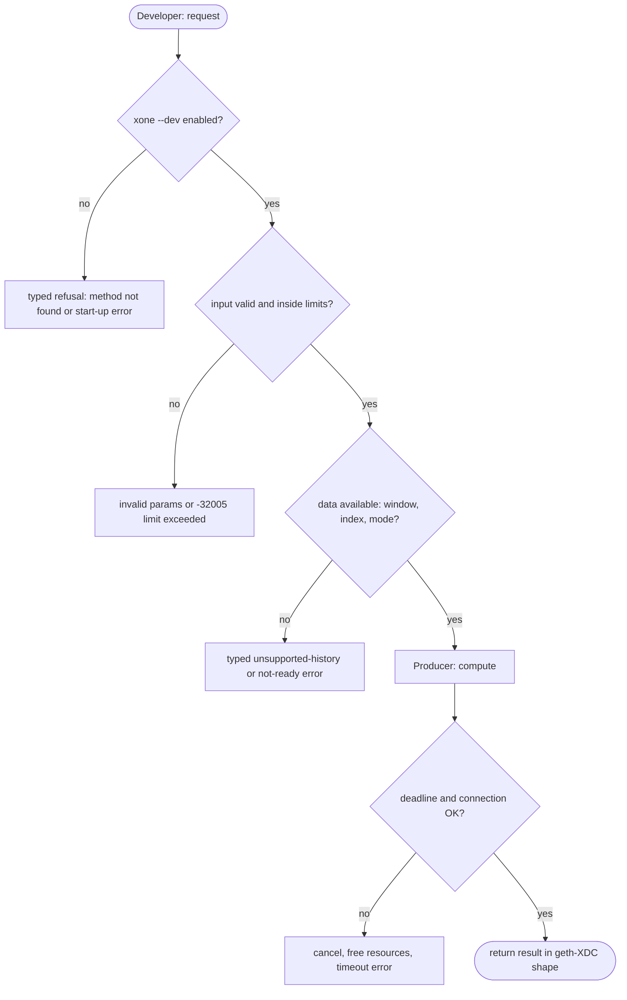

## What

Dapp developers start geth, reth or Erigon with `--dev` and get a one-node chain with a funded account in one command. xOne needs a generated genesis, a keystore and several flags (ops/devnet). XDC dapp developers cannot test against xOne quickly.

## Why

8 of the 10 selected competitors have this capability (file evidence at the audited commit):

- `ethereum/go-ethereum`: [cmd/utils/flags.go](https://github.com/ethereum/go-ethereum/blob/8059ff8beb3170eb8b977169ac51bb0423c97ee1/cmd/utils/flags.go)
- `XinFinOrg/XDPoSChain`: [cmd/utils/flags.go](https://github.com/XinFinOrg/XDPoSChain/blob/cb1ef79073c05f50b9df75b1e740387b9d72af99/cmd/utils/flags.go)
- `bnb-chain/bsc`: [cmd/utils/flags.go](https://github.com/bnb-chain/bsc/blob/54afaff4da31ac9e49ba646a4f65104edac5a2f3/cmd/utils/flags.go)
- `0xPolygon/bor`: [cmd/utils/flags.go](https://github.com/0xPolygon/bor/blob/ee09efd5dd9ef75917368990b272581b0e2c2665/cmd/utils/flags.go)
- `paradigmxyz/reth`: [crates/node/core/src/args/dev.rs](https://github.com/paradigmxyz/reth/blob/36600d5ff9628465475dd4c7608e2e9f2fe24273/crates/node/core/src/args/dev.rs)
- `erigontech/erigon`: [cmd/utils/flags.go](https://github.com/erigontech/erigon/blob/bbb5524e53fb057e7d47a5066e152f1091ac4ba4/cmd/utils/flags.go)
- `lambdaclass/ethrex`: [crates/blockchain/dev/dev.rs](https://github.com/lambdaclass/ethrex/blob/740ea493880b6c073b81537010df75e143c615c2/crates/blockchain/dev/dev.rs)
- `NethermindEth/nethermind`: [src/Nethermind/Chains/spaceneth.json](https://github.com/NethermindEth/nethermind/blob/a7dd73052e696ad934d228aad3f33e660701fdb7/src/Nethermind/Chains/spaceneth.json)

Priority: P1: 8 of 10 selected competitors have it (rule: 8+ = P1).

Our code today: ops/devnet/gen.py and sim/ (scripts; no one-flag dev chain).

Related xOneRS issues: #25, #43. This issue adds the capability; it does not replace their gates.

## 80% of the way to

1. `bin/xone/src/flags.rs`: `--dev` and `--dev.period <s>`; implies an ephemeral datadir (temp dir unless `--datadir`), `--http`, a fresh chain id 1337 genesis with every XDC fork at block 0 and V2 from block 1.
2. One generated validator key in memory; the producer seals alone (quorum of 1); a funded developer account printed at start.
3. Refuse `--dev` with `--networkid` 50 or 51 and with a keystore flag.
4. Tests: `xone --dev` produces blocks; a contract deploy and call through ethers succeed.

Acceptance criteria:

- [ ] `xone --dev` seals blocks every period; ethers deploy/call test passes.

## ASD-STE100

1. `--dev` MUST start a one-validator chain with no other input.
2. `--dev` MUST refuse chain ids 50 and 51.
3. The dev validator key MUST NOT be written to disk.

## Diagrams



## Images

None.

## Prompt

```text
You work in XDCIndia/xOneRS (Rust XDC client). Implement GAP-0015: Developer mode: single-node instant XDPoS chain (xone --dev).

Context: Dapp developers start geth, reth or Erigon with `--dev` and get a one-node chain with a funded account in one command. xOne needs a generated genesis, a keystore and several flags (ops/devnet). XDC dapp developers cannot test against xOne quickly.

Reference behaviour: geth-XDC at XDCIndia/go-ethereum 6fc8e8c2088b7f18264f5663036669d04fa7becf (conformance/PIN). Where geth-XDC lacks the feature, follow the first competitor in the Why section and record the choice in the PR.

Steps:
1. `bin/xone/src/flags.rs`: `--dev` and `--dev.period <s>`; implies an ephemeral datadir (temp dir unless `--datadir`), `--http`, a fresh chain id 1337 genesis with every XDC fork at block 0 and V2 from block 1.
2. One generated validator key in memory; the producer seals alone (quorum of 1); a funded developer account printed at start.
3. Refuse `--dev` with `--networkid` 50 or 51 and with a keystore flag.
4. Tests: `xone --dev` produces blocks; a contract deploy and call through ethers succeed.

Rules: one branch `feat/gap-0015-devmode` from main, one PR that closes this issue. Write the tests and vectors first. Keep consensus, execution and storage formats unchanged. Run `cargo fmt --check`, `cargo clippy --all-targets -- -D warnings`, `cargo test --locked`, `ci/check-layering.sh` and `ci/check-fixtures.sh`. Update docs/cli/flags.md with `UPDATE_DOCS=1 cargo test -p xone flags_doc` if you add a flag. Hand back in 25 lines or fewer: files changed, tests added, acceptance results.
```

## Workflow

1. Maintainer: confirms priority P1 and assigns the issue.
2. Engineer: creates branch `feat/gap-0015-devmode` from `main`.
3. Engineer: writes the failing tests and the parity vectors (xdc02 archive or the reference client).
4. Engineer: implements the change in the files of Layout.
5. Engineer: runs the gates (fmt, clippy, test, layering, fixtures) and the parity check.
6. Engineer: opens one PR that says `Closes #<this issue>` and lists the acceptance results.
7. Reviewer: checks each acceptance criterion and the ASD-STE100 requirements.
8. Maintainer: merges.
9. Operator: enables the feature on one net2040 node and records the result in this issue.

## Loop

Runtime: The producer seals one block every --dev.period seconds.

Develop-verify: write a vector, implement, diff the answer against the xdc02 geth-XDC archive (or the reference client), fix, repeat until 0 mismatches. A retry after a failed gate starts from the failing vector.

## Graph



## Layout

```text
Files touched:
  bin/xone/src/flags.rs
  ops/devnet/gen.py
```

## Flow



## Summary

Gap: Developer mode: single-node instant XDPoS chain (xone --dev) is missing or partial in xOneRS; 8 of 10 selected competitors have it.
Fix: implement it as in "80% of the way to", with geth-XDC behaviour as the reference.
Acceptance: `xone --dev` seals blocks every period; ethers deploy/call test passes.

<!-- gap-audit:GAP-0015 -->
