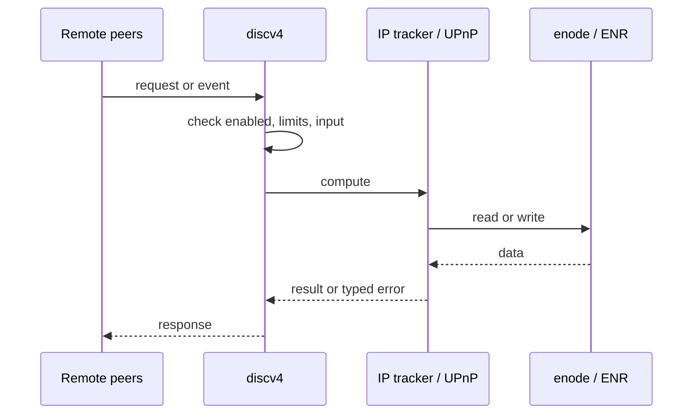
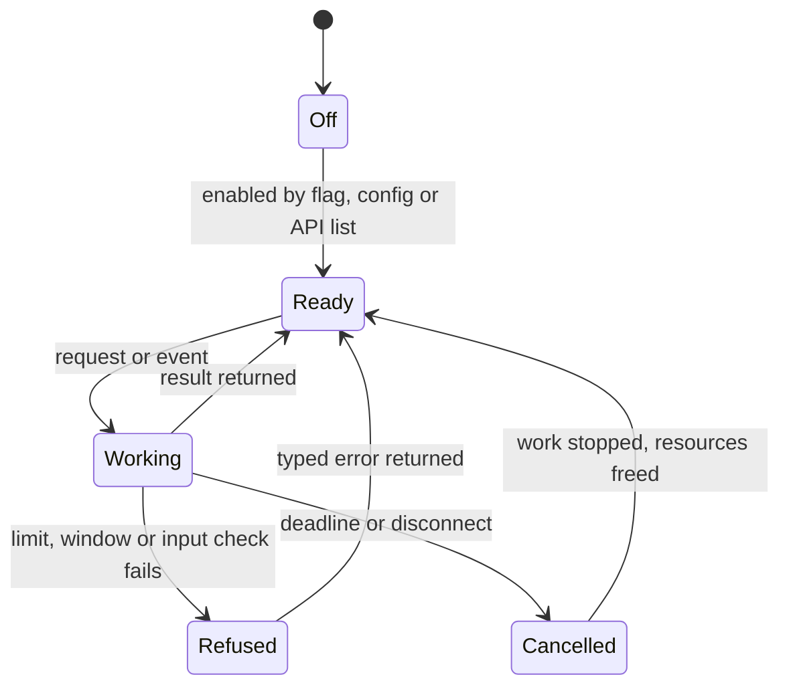
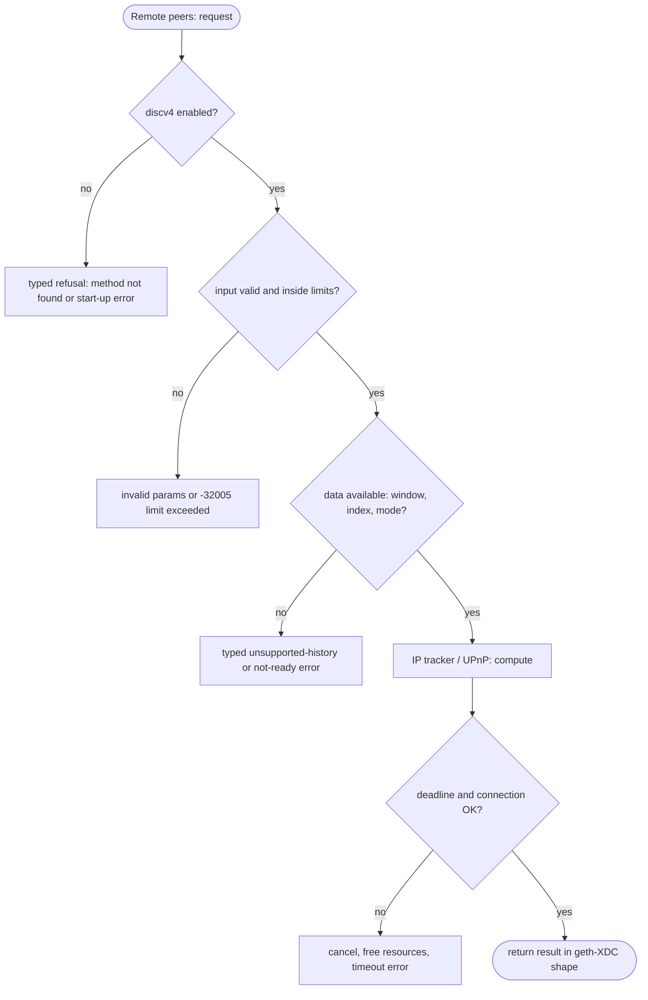

## What

`--nat` accepts `any`, `none`, `upnp` and `pmp`, but only `extip:<IP>` works. Without it the node advertises `127.0.0.1` in its enode and discovery records, so other XDC nodes cannot dial it. geth-XDC learns its external address from discovery pongs and from UPnP/NAT-PMP.

## Why

8 of the 10 selected competitors have this capability (file evidence at the audited commit):

- `ethereum/go-ethereum`: [p2p/nat/nat.go](https://github.com/ethereum/go-ethereum/blob/8059ff8beb3170eb8b977169ac51bb0423c97ee1/p2p/nat/nat.go)
- `XinFinOrg/XDPoSChain`: [p2p/nat/nat.go](https://github.com/XinFinOrg/XDPoSChain/blob/cb1ef79073c05f50b9df75b1e740387b9d72af99/p2p/nat/nat.go)
- `bnb-chain/bsc`: [p2p/nat/nat.go](https://github.com/bnb-chain/bsc/blob/54afaff4da31ac9e49ba646a4f65104edac5a2f3/p2p/nat/nat.go)
- `0xPolygon/bor`: [p2p/nat/nat.go](https://github.com/0xPolygon/bor/blob/ee09efd5dd9ef75917368990b272581b0e2c2665/p2p/nat/nat.go)
- `erigontech/erigon`: [p2p/nat/nat.go](https://github.com/erigontech/erigon/blob/bbb5524e53fb057e7d47a5066e152f1091ac4ba4/p2p/nat/nat.go)
- `paradigmxyz/reth`: [crates/net/nat/src/lib.rs](https://github.com/paradigmxyz/reth/blob/36600d5ff9628465475dd4c7608e2e9f2fe24273/crates/net/nat/src/lib.rs)
- `besu-eth/besu`: [app/src/main/java/org/hyperledger/besu/cli/options/NatOptions.java](https://github.com/besu-eth/besu/blob/2b839d96863d01210f45a6f62127e6229e5b0889/app/src/main/java/org/hyperledger/besu/cli/options/NatOptions.java)
- `NethermindEth/nethermind`: [src/Nethermind/Nethermind.Network/Config/NetworkConfig.cs](https://github.com/NethermindEth/nethermind/blob/a7dd73052e696ad934d228aad3f33e660701fdb7/src/Nethermind/Nethermind.Network/Config/NetworkConfig.cs)

Priority: P1: 8 of 10 selected competitors have it (rule: 8+ = P1).

Our code today: crates/xone-node/src/services/net.rs (only extip:<IP>; otherwise the enode advertises 127.0.0.1).

Related xOneRS issues: #32. This issue adds the capability; it does not replace their gates.

## 80% of the way to

1. `crates/xone-net/src/discv4.rs`: record the `to` endpoint of received pongs; when 3+ distinct peers agree, use that IP as the advertised endpoint (geth `p2p/enode` IP tracker).
2. `crates/xone-node/src/services/net.rs`: `--nat any` = try UPnP then NAT-PMP then the pong tracker; `none` = listen address; refuse unknown values with a typed error.
3. UPnP/NAT-PMP through a maintained crate (`igd-next`, `natpmp`) if it passes `deny.toml`; else pong tracker only and a typed refusal for `upnp`/`pmp`.
4. Update `admin_nodeInfo` and the ethstats node info when the address changes.
5. Tests: pong-tracker unit tests; devnet node behind a NAT namespace becomes dialable.

Acceptance criteria:

- [ ] A node started without --nat on a public host advertises its public IP within 2 minutes.
- [ ] Unknown --nat value fails at start.

## ASD-STE100

1. The node MUST NOT advertise a loopback address when it listens on a public interface.
2. The node MUST accept only the documented `--nat` values. Other values MUST fail at start.
3. The node MUST change its advertised address only after 3 or more peers report the same address.

## Diagrams



## Images

None.

## Prompt

```text
You work in XDCIndia/xOneRS (Rust XDC client). Implement GAP-0016: External address detection and NAT traversal: --nat any|upnp|pmp, advertised endpoint from discovery.

Context: `--nat` accepts `any`, `none`, `upnp` and `pmp`, but only `extip:<IP>` works. Without it the node advertises `127.0.0.1` in its enode and discovery records, so other XDC nodes cannot dial it. geth-XDC learns its external address from discovery pongs and from UPnP/NAT-PMP.

Reference behaviour: geth-XDC at XDCIndia/go-ethereum 6fc8e8c2088b7f18264f5663036669d04fa7becf (conformance/PIN). Where geth-XDC lacks the feature, follow the first competitor in the Why section and record the choice in the PR.

Steps:
1. `crates/xone-net/src/discv4.rs`: record the `to` endpoint of received pongs; when 3+ distinct peers agree, use that IP as the advertised endpoint (geth `p2p/enode` IP tracker).
2. `crates/xone-node/src/services/net.rs`: `--nat any` = try UPnP then NAT-PMP then the pong tracker; `none` = listen address; refuse unknown values with a typed error.
3. UPnP/NAT-PMP through a maintained crate (`igd-next`, `natpmp`) if it passes `deny.toml`; else pong tracker only and a typed refusal for `upnp`/`pmp`.
4. Update `admin_nodeInfo` and the ethstats node info when the address changes.
5. Tests: pong-tracker unit tests; devnet node behind a NAT namespace becomes dialable.

Rules: one branch `feat/gap-0016-nat` from main, one PR that closes this issue. Write the tests and vectors first. Keep consensus, execution and storage formats unchanged. Run `cargo fmt --check`, `cargo clippy --all-targets -- -D warnings`, `cargo test --locked`, `ci/check-layering.sh` and `ci/check-fixtures.sh`. Update docs/cli/flags.md with `UPDATE_DOCS=1 cargo test -p xone flags_doc` if you add a flag. Hand back in 25 lines or fewer: files changed, tests added, acceptance results.
```

## Workflow

1. Maintainer: confirms priority P1 and assigns the issue.
2. Engineer: creates branch `feat/gap-0016-nat` from `main`.
3. Engineer: writes the failing tests and the parity vectors (xdc02 archive or the reference client).
4. Engineer: implements the change in the files of Layout.
5. Engineer: runs the gates (fmt, clippy, test, layering, fixtures) and the parity check.
6. Engineer: opens one PR that says `Closes #<this issue>` and lists the acceptance results.
7. Reviewer: checks each acceptance criterion and the ASD-STE100 requirements.
8. Maintainer: merges.
9. Operator: enables the feature on one net2040 node and records the result in this issue.

## Loop

Runtime: Re-check the external address every 5 minutes.

Develop-verify: write a vector, implement, diff the answer against the xdc02 geth-XDC archive (or the reference client), fix, repeat until 0 mismatches. A retry after a failed gate starts from the failing vector.

## Graph



## Layout

```text
Files touched:
  crates/xone-net/src/discv4.rs
  crates/xone-node/src/services/net.rs
```

## Flow



## Summary

Gap: External address detection and NAT traversal: --nat any|upnp|pmp, advertised endpoint from discovery is missing or partial in xOneRS; 8 of 10 selected competitors have it.
Fix: implement it as in "80% of the way to", with geth-XDC behaviour as the reference.
Acceptance: A node started without --nat on a public host advertises its public IP within 2 minutes.

<!-- gap-audit:GAP-0016 -->
