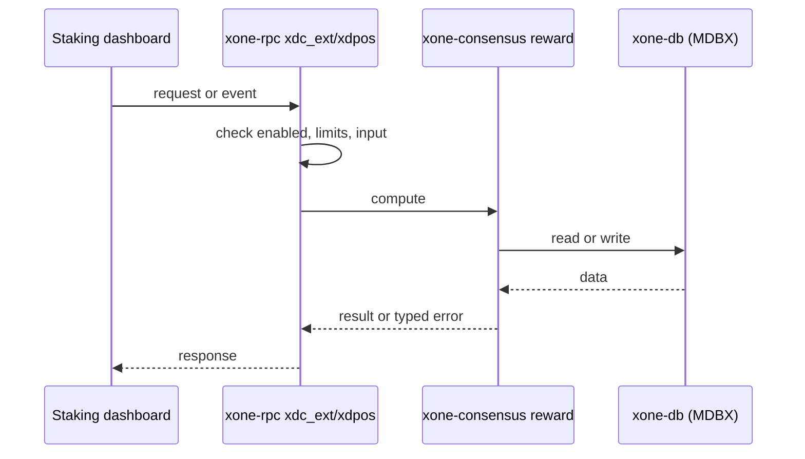
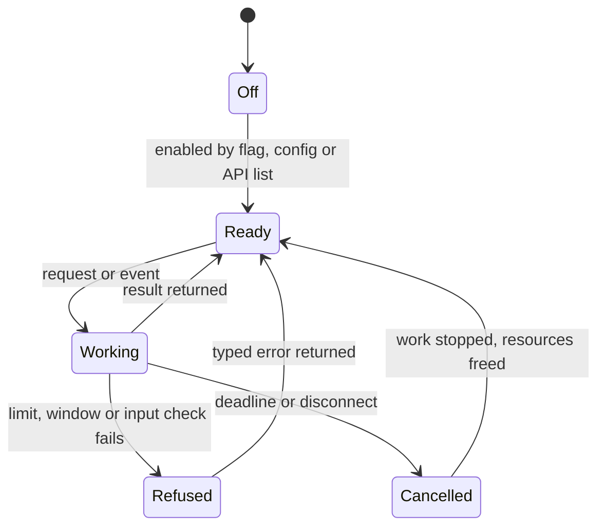
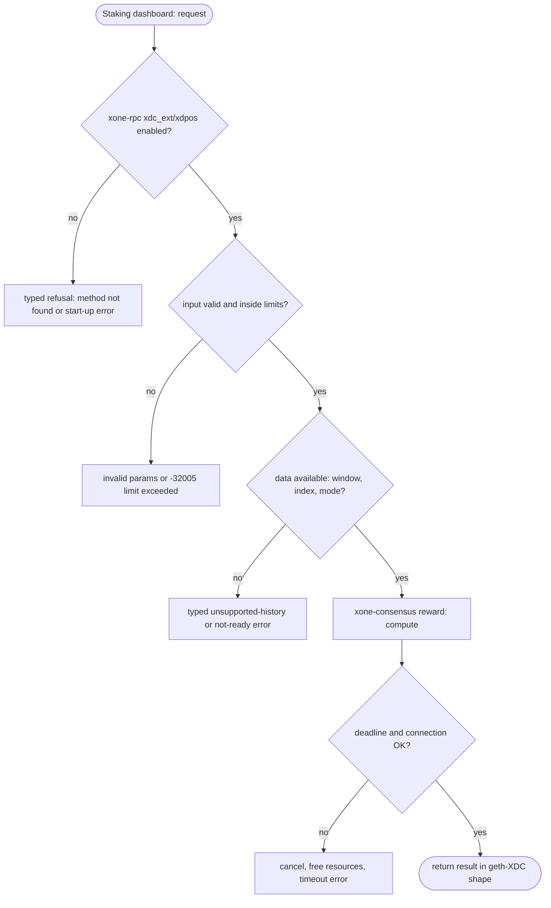

## What

The canonical XDC clients serve methods that xOne does not: `eth_getRewardByHash`, `eth_getStakerROI`, `eth_getStakerROIMasternode`, `eth_getTransactionAndReceiptProof`, `eth_getAccountInfo`, `eth_getCheckpointFromEpoch`, `eth_getStorageValues`, `XDPoS_getV2BlockByHash`, and in XDPoSChain also `XDPoS_getConfig` and `XDPoS_getSigningTxCountByEpoch`. The oracle pin has the first eight (`XDCIndia/go-ethereum@6fc8e8c2` `internal/ethapi/api_xdc.go`, `consensus/XDPoS/api_extended.go`). Staking dashboards, reward explorers and bridges read them.

## Why

1 of the 10 selected competitors have this capability (file evidence at the audited commit):

- `XinFinOrg/XDPoSChain`: [internal/ethapi/api.go](https://github.com/XinFinOrg/XDPoSChain/blob/cb1ef79073c05f50b9df75b1e740387b9d72af99/internal/ethapi/api.go)
- `XinFinOrg/XDPoSChain`: [internal/ethapi/api.go](https://github.com/XinFinOrg/XDPoSChain/blob/cb1ef79073c05f50b9df75b1e740387b9d72af99/internal/ethapi/api.go)
- `XinFinOrg/XDPoSChain`: [internal/ethapi/api.go](https://github.com/XinFinOrg/XDPoSChain/blob/cb1ef79073c05f50b9df75b1e740387b9d72af99/internal/ethapi/api.go)
- `XinFinOrg/XDPoSChain`: [consensus/XDPoS/api.go](https://github.com/XinFinOrg/XDPoSChain/blob/cb1ef79073c05f50b9df75b1e740387b9d72af99/consensus/XDPoS/api.go)
- `XinFinOrg/XDPoSChain`: [consensus/XDPoS/api.go](https://github.com/XinFinOrg/XDPoSChain/blob/cb1ef79073c05f50b9df75b1e740387b9d72af99/consensus/XDPoS/api.go)
- geth-XDC oracle pin `XDCIndia/go-ethereum@6fc8e8c2`: [internal/ethapi/api_xdc.go](https://github.com/XDCIndia/go-ethereum/blob/6fc8e8c2088b7f18264f5663036669d04fa7becf/internal/ethapi/api_xdc.go), [consensus/XDPoS/api_extended.go](https://github.com/XDCIndia/go-ethereum/blob/6fc8e8c2088b7f18264f5663036669d04fa7becf/consensus/XDPoS/api_extended.go)

Priority: P1 (raised from the count rule): the canonical XDC clients serve these methods, and the geth-XDC oracle pin has most of them.

Our code today: crates/xone-rpc/src/xdc_ext.rs, xdpos.rs (14 XDPoS methods + 7 eth XDC extensions).

Related xOneRS issues: #42, #30. This issue adds the capability; it does not replace their gates.

## 80% of the way to

1. `crates/xone-rpc/src/xdc_ext.rs`: the eth extensions; rewards from the reward computation of `crates/xone-consensus/src/reward` (no reward files on disk: compute from the checkpoint and cache per epoch); ROI from the same data as geth-XDC `GetStakerROI`.
2. `eth_getTransactionAndReceiptProof`: trie proofs over the block's tx and receipt roots (geth-XDC shape).
3. `crates/xone-rpc/src/xdpos.rs`: `getV2BlockByHash`, `getConfig` (round-indexed V2 config of `xone-chainspec`), `getSigningTxCountByEpoch`.
4. Amend #42's exact method set and `xdpos-namespace.md`.
5. Tests: parity vectors against the xdc02 archive (Apothem and net2040).

Acceptance criteria:

- [ ] Parity vectors for each method equal the xdc02 archive on Apothem and net2040.

## ASD-STE100

1. The node MUST serve each listed method.
2. Each answer MUST be equal to the geth-XDC answer for the same input. Where only XDPoSChain has the method, the answer MUST be equal to XDPoSChain.
3. Reward answers MUST come from the same reward rules that the node uses for block validation.

## Diagrams



## Images

None.

## Prompt

```text
You work in XDCIndia/xOneRS (Rust XDC client). Implement GAP-0017: XDC RPC extensions served by geth-XDC and XDPoSChain: eth_getRewardByHash, eth_getStakerROI*, eth_getTransactionAndReceiptProof, eth_getAccountInfo, eth_getCheckpointFromEpoch, XDPoS_getV2BlockByHash and siblings.

Context: The canonical XDC clients serve methods that xOne does not: `eth_getRewardByHash`, `eth_getStakerROI`, `eth_getStakerROIMasternode`, `eth_getTransactionAndReceiptProof`, `eth_getAccountInfo`, `eth_getCheckpointFromEpoch`, `eth_getStorageValues`, `XDPoS_getV2BlockByHash`, and in XDPoSChain also `XDPoS_getConfig` and `XDPoS_getSigningTxCountByEpoch`. The oracle pin has the first eight (`XDCIndia/go-ethereum@6fc8e8c2` `internal/ethapi/api_xdc.go`, `consensus/XDPoS/api_extended.go`). Staking dashboards, reward explorers and bridges read them.

Reference behaviour: geth-XDC at XDCIndia/go-ethereum 6fc8e8c2088b7f18264f5663036669d04fa7becf (conformance/PIN). Where geth-XDC lacks the feature, follow the first competitor in the Why section and record the choice in the PR.

Steps:
1. `crates/xone-rpc/src/xdc_ext.rs`: the eth extensions; rewards from the reward computation of `crates/xone-consensus/src/reward` (no reward files on disk: compute from the checkpoint and cache per epoch); ROI from the same data as geth-XDC `GetStakerROI`.
2. `eth_getTransactionAndReceiptProof`: trie proofs over the block's tx and receipt roots (geth-XDC shape).
3. `crates/xone-rpc/src/xdpos.rs`: `getV2BlockByHash`, `getConfig` (round-indexed V2 config of `xone-chainspec`), `getSigningTxCountByEpoch`.
4. Amend #42's exact method set and `xdpos-namespace.md`.
5. Tests: parity vectors against the xdc02 archive (Apothem and net2040).

Rules: one branch `feat/gap-0017-xdcext` from main, one PR that closes this issue. Write the tests and vectors first. Keep consensus, execution and storage formats unchanged. Run `cargo fmt --check`, `cargo clippy --all-targets -- -D warnings`, `cargo test --locked`, `ci/check-layering.sh` and `ci/check-fixtures.sh`. Update docs/cli/flags.md with `UPDATE_DOCS=1 cargo test -p xone flags_doc` if you add a flag. Hand back in 25 lines or fewer: files changed, tests added, acceptance results.
```

## Workflow

1. Maintainer: confirms priority P1 and assigns the issue.
2. Engineer: creates branch `feat/gap-0017-xdcext` from `main`.
3. Engineer: writes the failing tests and the parity vectors (xdc02 archive or the reference client).
4. Engineer: implements the change in the files of Layout.
5. Engineer: runs the gates (fmt, clippy, test, layering, fixtures) and the parity check.
6. Engineer: opens one PR that says `Closes #<this issue>` and lists the acceptance results.
7. Reviewer: checks each acceptance criterion and the ASD-STE100 requirements.
8. Maintainer: merges.
9. Operator: enables the feature on one net2040 node and records the result in this issue.

## Loop

Runtime: None.

Develop-verify: write a vector, implement, diff the answer against the xdc02 geth-XDC archive (or the reference client), fix, repeat until 0 mismatches. A retry after a failed gate starts from the failing vector.

## Graph



## Layout

```text
Files touched:
  crates/xone-consensus/src/reward
  crates/xone-rpc/src/xdc_ext.rs
  crates/xone-rpc/src/xdpos.rs
```

## Flow



## Summary

Gap: XDC RPC extensions served by geth-XDC and XDPoSChain: eth_getRewardByHash, eth_getStakerROI*, eth_getTransactionAndReceiptProof, eth_getAccountInfo, eth_getCheckpointFromEpoch, XDPoS_getV2BlockByHash and siblings is missing or partial in xOneRS; 1 of 10 selected competitors have it.
Fix: implement it as in "80% of the way to", with geth-XDC behaviour as the reference.
Acceptance: Parity vectors for each method equal the xdc02 archive on Apothem and net2040.

<!-- gap-audit:GAP-0017 -->
