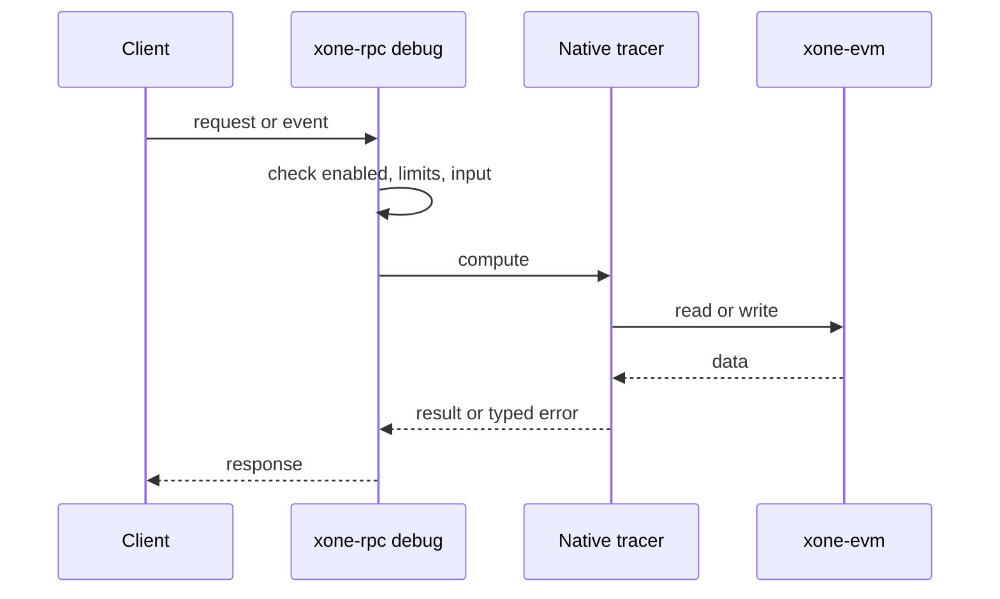
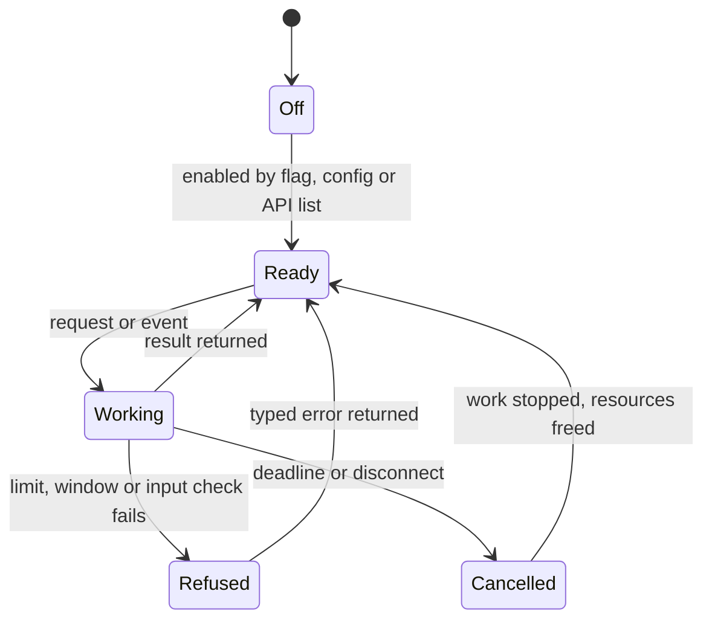
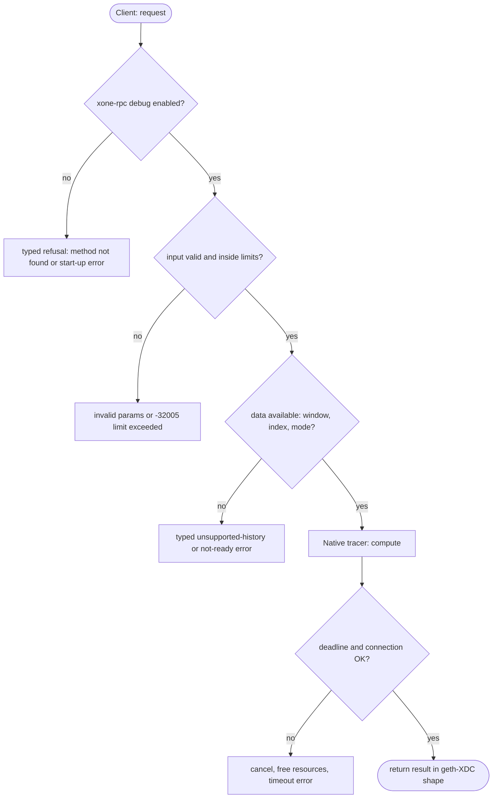

## What

xOne serves two native tracers. `flatCallTracer` (Parity-style flat traces through `debug_*`), `4byteTracer` (selector statistics) and `muxTracer` (several tracers in one run) answer `tracer not found`. Explorers use `flatCallTracer` for internal-transaction tables.

## Why

7 of the 10 selected competitors have this capability (file evidence at the audited commit):

- `ethereum/go-ethereum`: [eth/tracers/native/call_flat.go](https://github.com/ethereum/go-ethereum/blob/8059ff8beb3170eb8b977169ac51bb0423c97ee1/eth/tracers/native/call_flat.go)
- `bnb-chain/bsc`: [eth/tracers/native/call_flat.go](https://github.com/bnb-chain/bsc/blob/54afaff4da31ac9e49ba646a4f65104edac5a2f3/eth/tracers/native/call_flat.go)
- `0xPolygon/bor`: [eth/tracers/native/call_flat.go](https://github.com/0xPolygon/bor/blob/ee09efd5dd9ef75917368990b272581b0e2c2665/eth/tracers/native/call_flat.go)
- `XinFinOrg/XDPoSChain`: [eth/tracers/native/call_flat.go](https://github.com/XinFinOrg/XDPoSChain/blob/cb1ef79073c05f50b9df75b1e740387b9d72af99/eth/tracers/native/call_flat.go)
- `ethereum/go-ethereum`: [eth/tracers/native/4byte.go](https://github.com/ethereum/go-ethereum/blob/8059ff8beb3170eb8b977169ac51bb0423c97ee1/eth/tracers/native/4byte.go)
- `ethereum/go-ethereum`: [eth/tracers/native/mux.go](https://github.com/ethereum/go-ethereum/blob/8059ff8beb3170eb8b977169ac51bb0423c97ee1/eth/tracers/native/mux.go)
- `erigontech/erigon`: [execution/tracing/tracers/native/call_flat.go](https://github.com/erigontech/erigon/blob/bbb5524e53fb057e7d47a5066e152f1091ac4ba4/execution/tracing/tracers/native/call_flat.go)
- `erigontech/erigon`: [execution/tracing/tracers/native/4byte.go](https://github.com/erigontech/erigon/blob/bbb5524e53fb057e7d47a5066e152f1091ac4ba4/execution/tracing/tracers/native/4byte.go)
- `NethermindEth/nethermind`: [src/Nethermind/Nethermind.Blockchain/Tracing/GethStyle/Custom/Native/FourByte/Native4ByteTracer.cs](https://github.com/NethermindEth/nethermind/blob/a7dd73052e696ad934d228aad3f33e660701fdb7/src/Nethermind/Nethermind.Blockchain/Tracing/GethStyle/Custom/Native/FourByte/Native4ByteTracer.cs)
- `besu-eth/besu`: [ethereum/api/src/main/java/org/hyperledger/besu/ethereum/api/jsonrpc/internal/methods/DebugTraceTransaction.java](https://github.com/besu-eth/besu/blob/2b839d96863d01210f45a6f62127e6229e5b0889/ethereum/api/src/main/java/org/hyperledger/besu/ethereum/api/jsonrpc/internal/methods/DebugTraceTransaction.java)

Priority: P2: 7 of 10 selected competitors have it (rule: 5-7 = P2).

Our code today: crates/xone-rpc/src/debug.rs (callTracer and prestateTracer only).

Related xOneRS issues: #42. This issue adds the capability; it does not replace their gates.

## 80% of the way to

1. `crates/xone-evm`: implement the three tracers as revm inspectors over the existing call-frame recorder; output names and error mapping as `eth/tracers/native/call_flat.go` (`call_flat_error_mapping`).
2. `crates/xone-rpc/src/debug.rs`: dispatch by name; `muxTracer` config is a map of tracer name to config.
3. Tests: byte-compare with the xdc02 archive on 50 transactions each.

Acceptance criteria:

- [ ] 50 transactions per tracer byte-equal to the xdc02 archive.

## ASD-STE100

1. The node MUST accept the names `flatCallTracer`, `4byteTracer`, `muxTracer` and `noopTracer`.
2. The output of each tracer MUST be equal to geth-XDC output for the same transaction.

## Diagrams



## Images

None.

## Prompt

```text
You work in XDCIndia/xOneRS (Rust XDC client). Implement GAP-0018: Additional native tracers: 4byteTracer, flatCallTracer, muxTracer, noopTracer.

Context: xOne serves two native tracers. `flatCallTracer` (Parity-style flat traces through `debug_*`), `4byteTracer` (selector statistics) and `muxTracer` (several tracers in one run) answer `tracer not found`. Explorers use `flatCallTracer` for internal-transaction tables.

Reference behaviour: geth-XDC at XDCIndia/go-ethereum 6fc8e8c2088b7f18264f5663036669d04fa7becf (conformance/PIN). Where geth-XDC lacks the feature, follow the first competitor in the Why section and record the choice in the PR.

Steps:
1. `crates/xone-evm`: implement the three tracers as revm inspectors over the existing call-frame recorder; output names and error mapping as `eth/tracers/native/call_flat.go` (`call_flat_error_mapping`).
2. `crates/xone-rpc/src/debug.rs`: dispatch by name; `muxTracer` config is a map of tracer name to config.
3. Tests: byte-compare with the xdc02 archive on 50 transactions each.

Rules: one branch `feat/gap-0018-nativetracers` from main, one PR that closes this issue. Write the tests and vectors first. Keep consensus, execution and storage formats unchanged. Run `cargo fmt --check`, `cargo clippy --all-targets -- -D warnings`, `cargo test --locked`, `ci/check-layering.sh` and `ci/check-fixtures.sh`. Update docs/cli/flags.md with `UPDATE_DOCS=1 cargo test -p xone flags_doc` if you add a flag. Hand back in 25 lines or fewer: files changed, tests added, acceptance results.
```

## Workflow

1. Maintainer: confirms priority P2 and assigns the issue.
2. Engineer: creates branch `feat/gap-0018-nativetracers` from `main`.
3. Engineer: writes the failing tests and the parity vectors (xdc02 archive or the reference client).
4. Engineer: implements the change in the files of Layout.
5. Engineer: runs the gates (fmt, clippy, test, layering, fixtures) and the parity check.
6. Engineer: opens one PR that says `Closes #<this issue>` and lists the acceptance results.
7. Reviewer: checks each acceptance criterion and the ASD-STE100 requirements.
8. Maintainer: merges.
9. Operator: enables the feature on one net2040 node and records the result in this issue.

## Loop

Runtime: None.

Develop-verify: write a vector, implement, diff the answer against the xdc02 geth-XDC archive (or the reference client), fix, repeat until 0 mismatches. A retry after a failed gate starts from the failing vector.

## Graph



## Layout

```text
Files touched:
  crates/xone-evm
  crates/xone-rpc/src/debug.rs
```

## Flow



## Summary

Gap: Additional native tracers: 4byteTracer, flatCallTracer, muxTracer, noopTracer is missing or partial in xOneRS; 7 of 10 selected competitors have it.
Fix: implement it as in "80% of the way to", with geth-XDC behaviour as the reference.
Acceptance: 50 transactions per tracer byte-equal to the xdc02 archive.

<!-- gap-audit:GAP-0018 -->
