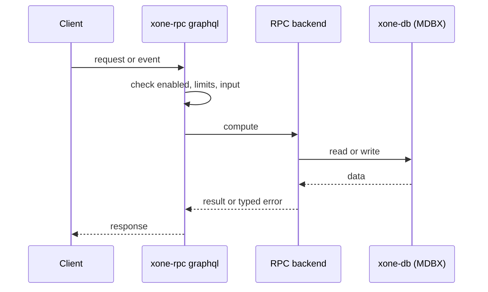
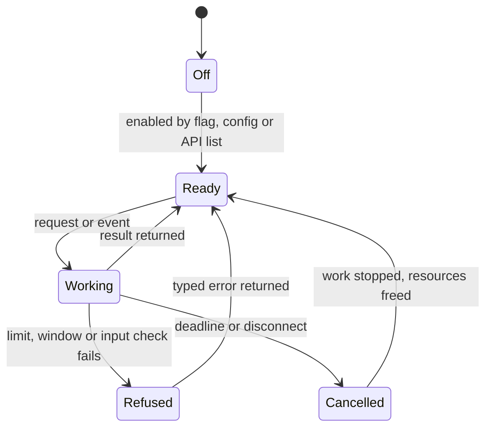
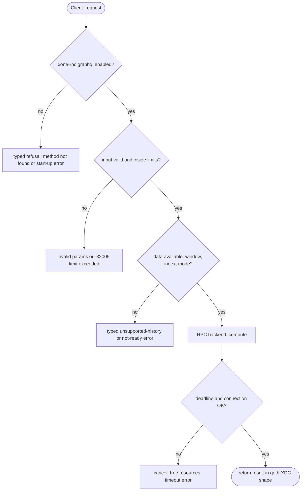

## What

xOne has no GraphQL endpoint. geth, Erigon, Besu and Nimbus serve EIP-1767 GraphQL at `/graphql`. Some indexers fetch a block, its transactions and receipts in one GraphQL query instead of many JSON-RPC calls.

## Why

6 of the 10 selected competitors have this capability (file evidence at the audited commit):

- `ethereum/go-ethereum`: [graphql/graphql.go](https://github.com/ethereum/go-ethereum/blob/8059ff8beb3170eb8b977169ac51bb0423c97ee1/graphql/graphql.go)
- `bnb-chain/bsc`: [graphql/graphql.go](https://github.com/bnb-chain/bsc/blob/54afaff4da31ac9e49ba646a4f65104edac5a2f3/graphql/graphql.go)
- `0xPolygon/bor`: [graphql/graphql.go](https://github.com/0xPolygon/bor/blob/ee09efd5dd9ef75917368990b272581b0e2c2665/graphql/graphql.go)
- `erigontech/erigon`: [cmd/rpcdaemon/graphql/graphql.go](https://github.com/erigontech/erigon/blob/bbb5524e53fb057e7d47a5066e152f1091ac4ba4/cmd/rpcdaemon/graphql/graphql.go)
- `besu-eth/besu`: [ethereum/api/src/main/java/org/hyperledger/besu/ethereum/api/graphql/GraphQLHttpService.java](https://github.com/besu-eth/besu/blob/2b839d96863d01210f45a6f62127e6229e5b0889/ethereum/api/src/main/java/org/hyperledger/besu/ethereum/api/graphql/GraphQLHttpService.java)
- `status-im/nimbus-eth1`: [execution_chain/rpc.nim](https://github.com/status-im/nimbus-eth1/blob/5e3fd7e9d19177980cc1c086c46c4e1dcf38eced/execution_chain/rpc.nim)

Priority: P2: 6 of 10 selected competitors have it (rule: 5-7 = P2).

Our code today: none (spec/rpc/scope-adr-008.md: GraphQL out).

Related xOneRS issues: #42, #16. This issue adds the capability; it does not replace their gates.

## 80% of the way to

1. `crates/xone-rpc/src/graphql.rs` (new) behind `--graphql`: the EIP-1767 schema (geth `graphql/schema.go`) on the HTTP listener at `/graphql`, same CORS and vhost policy.
2. Resolvers call the same backend functions as the JSON-RPC handlers; per-query cost counted in RPC quota units (ADR-007).
3. Use a maintained crate (async-graphql) if it passes `deny.toml`; otherwise a minimal executor for the fixed schema.
4. Tests: geth `graphql/graphql_test.go` queries against a devnet.

Acceptance criteria:

- [ ] geth graphql test queries pass against a devnet node.
- [ ] Quota enforcement tested.

## ASD-STE100

1. The node MUST serve GraphQL only when `--graphql` is set.
2. Each query MUST count against the RPC quota of its connection.
3. The schema MUST be the EIP-1767 schema.

## Diagrams



## Images

None.

## Prompt

```text
You work in XDCIndia/xOneRS (Rust XDC client). Implement GAP-0021: GraphQL endpoint (EIP-1767).

Context: xOne has no GraphQL endpoint. geth, Erigon, Besu and Nimbus serve EIP-1767 GraphQL at `/graphql`. Some indexers fetch a block, its transactions and receipts in one GraphQL query instead of many JSON-RPC calls.

Reference behaviour: geth-XDC at XDCIndia/go-ethereum 6fc8e8c2088b7f18264f5663036669d04fa7becf (conformance/PIN). Where geth-XDC lacks the feature, follow the first competitor in the Why section and record the choice in the PR.

Steps:
1. `crates/xone-rpc/src/graphql.rs` (new) behind `--graphql`: the EIP-1767 schema (geth `graphql/schema.go`) on the HTTP listener at `/graphql`, same CORS and vhost policy.
2. Resolvers call the same backend functions as the JSON-RPC handlers; per-query cost counted in RPC quota units (ADR-007).
3. Use a maintained crate (async-graphql) if it passes `deny.toml`; otherwise a minimal executor for the fixed schema.
4. Tests: geth `graphql/graphql_test.go` queries against a devnet.

Rules: one branch `feat/gap-0021-graphql` from main, one PR that closes this issue. Write the tests and vectors first. Keep consensus, execution and storage formats unchanged. Run `cargo fmt --check`, `cargo clippy --all-targets -- -D warnings`, `cargo test --locked`, `ci/check-layering.sh` and `ci/check-fixtures.sh`. Update docs/cli/flags.md with `UPDATE_DOCS=1 cargo test -p xone flags_doc` if you add a flag. Hand back in 25 lines or fewer: files changed, tests added, acceptance results.
```

## Workflow

1. Maintainer: confirms priority P2 and assigns the issue.
2. Engineer: creates branch `feat/gap-0021-graphql` from `main`.
3. Engineer: writes the failing tests and the parity vectors (xdc02 archive or the reference client).
4. Engineer: implements the change in the files of Layout.
5. Engineer: runs the gates (fmt, clippy, test, layering, fixtures) and the parity check.
6. Engineer: opens one PR that says `Closes #<this issue>` and lists the acceptance results.
7. Reviewer: checks each acceptance criterion and the ASD-STE100 requirements.
8. Maintainer: merges.
9. Operator: enables the feature on one net2040 node and records the result in this issue.

## Loop

Runtime: None.

Develop-verify: write a vector, implement, diff the answer against the xdc02 geth-XDC archive (or the reference client), fix, repeat until 0 mismatches. A retry after a failed gate starts from the failing vector.

## Graph



## Layout

```text
Files touched:
  crates/xone-rpc/src/graphql.rs
  spec/rpc/scope-adr-008.md
```

## Flow



## Summary

Gap: GraphQL endpoint (EIP-1767) is missing or partial in xOneRS; 6 of 10 selected competitors have it.
Fix: implement it as in "80% of the way to", with geth-XDC behaviour as the reference.
Acceptance: geth graphql test queries pass against a devnet node.

<!-- gap-audit:GAP-0021 -->
