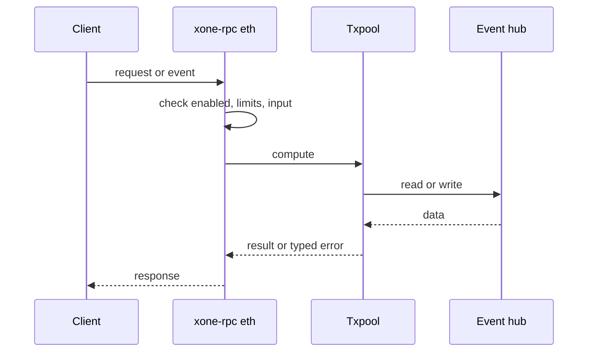
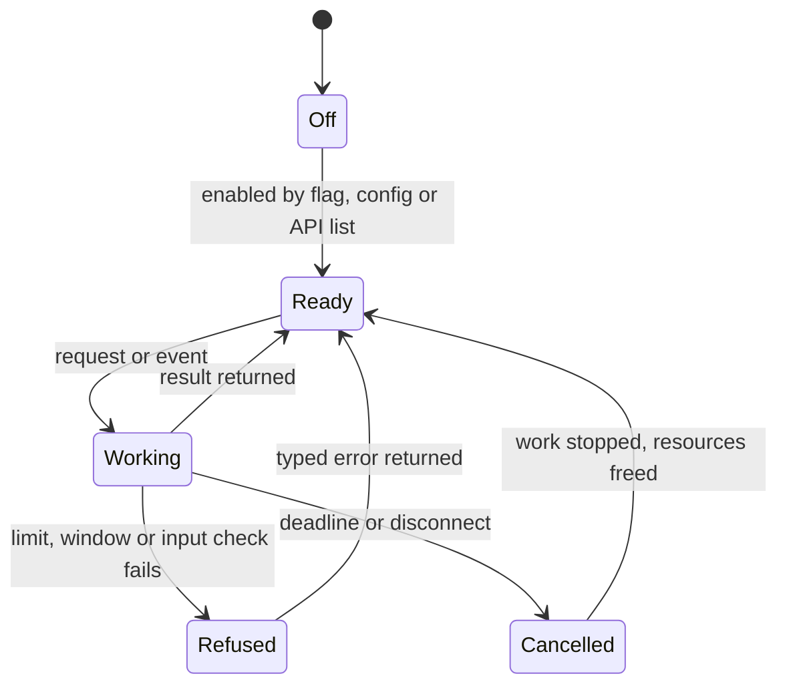
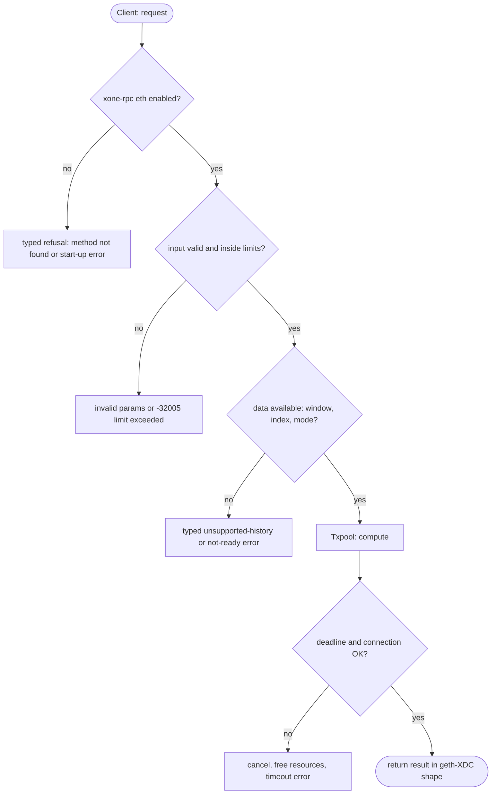

## What

EIP-7966 adds `eth_sendRawTransactionSync`: the node accepts a raw transaction and answers with its receipt when it is included, or an error after a timeout. With 2-second XDC blocks, this removes a polling loop from payment and checkout integrations.

## Why

6 of the 10 selected competitors have this capability (file evidence at the audited commit):

- `paradigmxyz/reth`: [crates/rpc/rpc-eth-api/src/core.rs](https://github.com/paradigmxyz/reth/blob/36600d5ff9628465475dd4c7608e2e9f2fe24273/crates/rpc/rpc-eth-api/src/core.rs)
- `ethereum/go-ethereum`: [internal/ethapi/api.go](https://github.com/ethereum/go-ethereum/blob/8059ff8beb3170eb8b977169ac51bb0423c97ee1/internal/ethapi/api.go)
- `bnb-chain/bsc`: [internal/ethapi/api.go](https://github.com/bnb-chain/bsc/blob/54afaff4da31ac9e49ba646a4f65104edac5a2f3/internal/ethapi/api.go)
- `0xPolygon/bor`: [internal/ethapi/api.go](https://github.com/0xPolygon/bor/blob/ee09efd5dd9ef75917368990b272581b0e2c2665/internal/ethapi/api.go)
- `erigontech/erigon`: [rpc/jsonrpc/send_transaction.go](https://github.com/erigontech/erigon/blob/bbb5524e53fb057e7d47a5066e152f1091ac4ba4/rpc/jsonrpc/send_transaction.go)
- `NethermindEth/nethermind`: [src/Nethermind/Nethermind.JsonRpc/Modules/Eth/IEthRpcModule.cs](https://github.com/NethermindEth/nethermind/blob/a7dd73052e696ad934d228aad3f33e660701fdb7/src/Nethermind/Nethermind.JsonRpc/Modules/Eth/IEthRpcModule.cs)

Priority: P2: 6 of 10 selected competitors have it (rule: 5-7 = P2).

Our code today: none.

Related xOneRS issues: #42. This issue adds the capability; it does not replace their gates.

## 80% of the way to

1. `crates/xone-rpc/src/eth.rs`: register the method (C2); add to the pool as `eth_sendRawTransaction`; wait on the new-head event hub for the receipt up to a timeout (default 2 s, max from config).
2. Bound the number of waiting requests per connection; cancel on disconnect.
3. Tests: devnet send-and-wait; timeout error code as the EIP.

Acceptance criteria:

- [ ] Devnet send-and-wait returns the receipt; timeout path tested.

## ASD-STE100

1. The node MUST return the receipt when the transaction is in a block before the timeout.
2. The node MUST return the EIP-7966 timeout error when the timeout expires.
3. The node MUST limit the number of waiting requests.

## Diagrams



## Images

None.

## Prompt

```text
You work in XDCIndia/xOneRS (Rust XDC client). Implement GAP-0022: eth_sendRawTransactionSync (EIP-7966): send and wait for the receipt.

Context: EIP-7966 adds `eth_sendRawTransactionSync`: the node accepts a raw transaction and answers with its receipt when it is included, or an error after a timeout. With 2-second XDC blocks, this removes a polling loop from payment and checkout integrations.

Reference behaviour: geth-XDC at XDCIndia/go-ethereum 6fc8e8c2088b7f18264f5663036669d04fa7becf (conformance/PIN). Where geth-XDC lacks the feature, follow the first competitor in the Why section and record the choice in the PR.

Steps:
1. `crates/xone-rpc/src/eth.rs`: register the method (C2); add to the pool as `eth_sendRawTransaction`; wait on the new-head event hub for the receipt up to a timeout (default 2 s, max from config).
2. Bound the number of waiting requests per connection; cancel on disconnect.
3. Tests: devnet send-and-wait; timeout error code as the EIP.

Rules: one branch `feat/gap-0022-sendsync` from main, one PR that closes this issue. Write the tests and vectors first. Keep consensus, execution and storage formats unchanged. Run `cargo fmt --check`, `cargo clippy --all-targets -- -D warnings`, `cargo test --locked`, `ci/check-layering.sh` and `ci/check-fixtures.sh`. Update docs/cli/flags.md with `UPDATE_DOCS=1 cargo test -p xone flags_doc` if you add a flag. Hand back in 25 lines or fewer: files changed, tests added, acceptance results.
```

## Workflow

1. Maintainer: confirms priority P2 and assigns the issue.
2. Engineer: creates branch `feat/gap-0022-sendsync` from `main`.
3. Engineer: writes the failing tests and the parity vectors (xdc02 archive or the reference client).
4. Engineer: implements the change in the files of Layout.
5. Engineer: runs the gates (fmt, clippy, test, layering, fixtures) and the parity check.
6. Engineer: opens one PR that says `Closes #<this issue>` and lists the acceptance results.
7. Reviewer: checks each acceptance criterion and the ASD-STE100 requirements.
8. Maintainer: merges.
9. Operator: enables the feature on one net2040 node and records the result in this issue.

## Loop

Runtime: Wait on new-head events until the receipt exists or the timeout expires.

Develop-verify: write a vector, implement, diff the answer against the xdc02 geth-XDC archive (or the reference client), fix, repeat until 0 mismatches. A retry after a failed gate starts from the failing vector.

## Graph



## Layout

```text
Files touched:
  crates/xone-rpc/src/eth.rs
```

## Flow



## Summary

Gap: eth_sendRawTransactionSync (EIP-7966): send and wait for the receipt is missing or partial in xOneRS; 6 of 10 selected competitors have it.
Fix: implement it as in "80% of the way to", with geth-XDC behaviour as the reference.
Acceptance: Devnet send-and-wait returns the receipt; timeout path tested.

<!-- gap-audit:GAP-0022 -->
