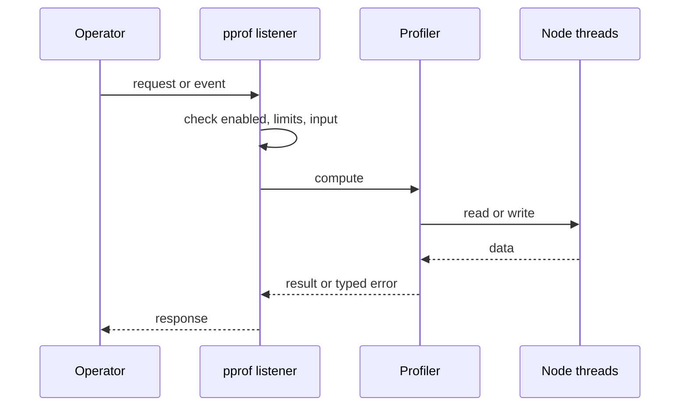
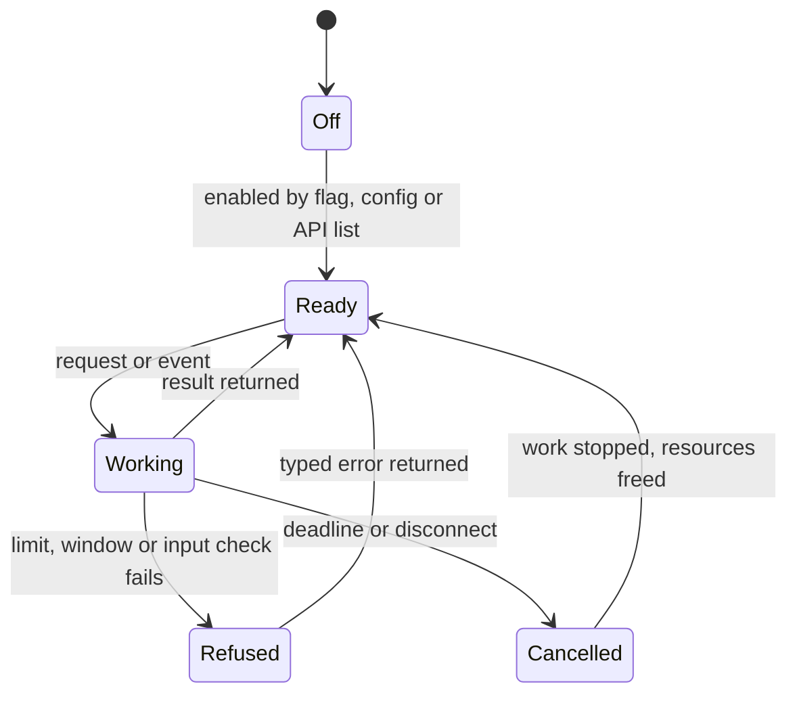
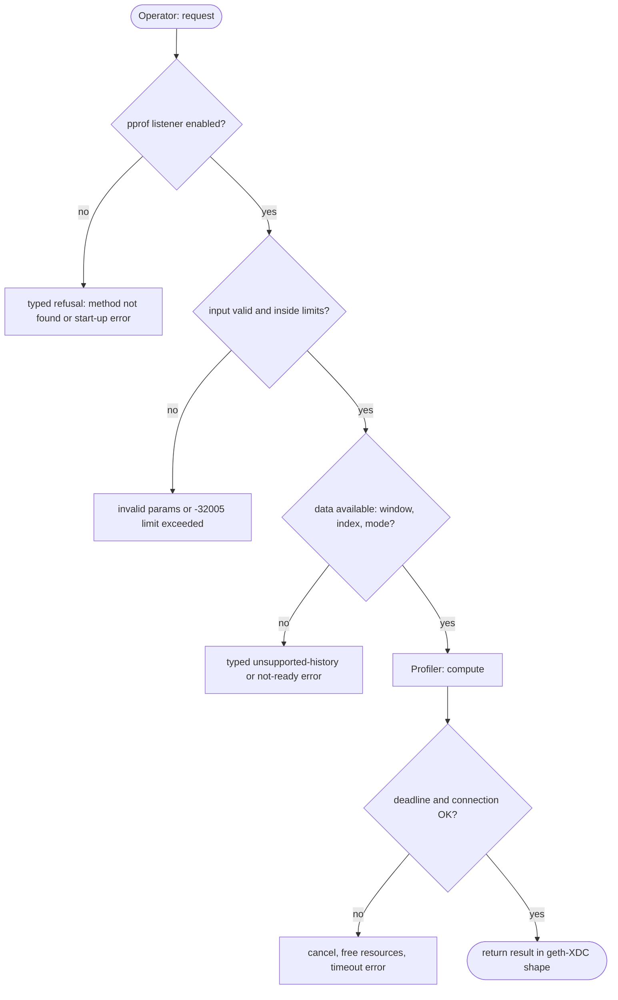

## What

`--pprof`, `--pprof.addr` and `--pprof.port` are accepted and documented, but the node starts no profiling listener. An operator who follows geth-XDC practice gets no error and no profile. CPU and heap profiles are the main tool for sync-throughput and memory incidents (#139, #145, #149).

## Why

6 of the 10 selected competitors have this capability (file evidence at the audited commit):

- `ethereum/go-ethereum`: [internal/debug/flags.go](https://github.com/ethereum/go-ethereum/blob/8059ff8beb3170eb8b977169ac51bb0423c97ee1/internal/debug/flags.go)
- `XinFinOrg/XDPoSChain`: [internal/debug/flags.go](https://github.com/XinFinOrg/XDPoSChain/blob/cb1ef79073c05f50b9df75b1e740387b9d72af99/internal/debug/flags.go)
- `bnb-chain/bsc`: [internal/debug/flags.go](https://github.com/bnb-chain/bsc/blob/54afaff4da31ac9e49ba646a4f65104edac5a2f3/internal/debug/flags.go)
- `0xPolygon/bor`: [internal/debug/flags.go](https://github.com/0xPolygon/bor/blob/ee09efd5dd9ef75917368990b272581b0e2c2665/internal/debug/flags.go)
- `erigontech/erigon`: [node/debug/api.go](https://github.com/erigontech/erigon/blob/bbb5524e53fb057e7d47a5066e152f1091ac4ba4/node/debug/api.go)
- `paradigmxyz/reth`: [crates/node/metrics/Cargo.toml](https://github.com/paradigmxyz/reth/blob/36600d5ff9628465475dd4c7608e2e9f2fe24273/crates/node/metrics/Cargo.toml)

Priority: P2: 6 of 10 selected competitors have it (rule: 5-7 = P2).

Our code today: bin/xone/src/flags.rs and crates/xone-node/src/config.rs parse --pprof*; no listener in crates/xone-node.

Related xOneRS issues: #41, #13. This issue adds the capability; it does not replace their gates.

## 80% of the way to

1. `crates/xone-node/src/observe/pprof.rs` (new): a loopback-default listener with `/debug/pprof/profile?seconds=N` (CPU, `pprof` crate, protobuf output readable by `go tool pprof`) and `/debug/pprof/heap` (jemalloc heap profile via `tikv-jemalloc-ctl`, as reth `crates/node/metrics`).
2. Switch the global allocator to jemalloc behind a feature if heap profiles are wanted; measure the effect on replay throughput first.
3. If the work is deferred, make `--pprof` fail with a typed error instead of a silent no-op.
4. Tests: fetch a 5-second CPU profile from a running devnet node; parse it with `go tool pprof -top`.

Acceptance criteria:

- [ ] `go tool pprof` reads a CPU profile from a running node.
- [ ] No silent no-op flag remains.

## ASD-STE100

1. When `--pprof` is set, the node MUST serve CPU and heap profiles on the pprof address.
2. The default address MUST be 127.0.0.1.
3. If the build has no profiler, `--pprof` MUST fail at start with a typed error.

## Diagrams



## Images

None.

## Prompt

```text
You work in XDCIndia/xOneRS (Rust XDC client). Implement GAP-0023: Profiling endpoint: --pprof is accepted but nothing listens.

Context: `--pprof`, `--pprof.addr` and `--pprof.port` are accepted and documented, but the node starts no profiling listener. An operator who follows geth-XDC practice gets no error and no profile. CPU and heap profiles are the main tool for sync-throughput and memory incidents (#139, #145, #149).

Reference behaviour: geth-XDC at XDCIndia/go-ethereum 6fc8e8c2088b7f18264f5663036669d04fa7becf (conformance/PIN). Where geth-XDC lacks the feature, follow the first competitor in the Why section and record the choice in the PR.

Steps:
1. `crates/xone-node/src/observe/pprof.rs` (new): a loopback-default listener with `/debug/pprof/profile?seconds=N` (CPU, `pprof` crate, protobuf output readable by `go tool pprof`) and `/debug/pprof/heap` (jemalloc heap profile via `tikv-jemalloc-ctl`, as reth `crates/node/metrics`).
2. Switch the global allocator to jemalloc behind a feature if heap profiles are wanted; measure the effect on replay throughput first.
3. If the work is deferred, make `--pprof` fail with a typed error instead of a silent no-op.
4. Tests: fetch a 5-second CPU profile from a running devnet node; parse it with `go tool pprof -top`.

Rules: one branch `feat/gap-0023-pprof` from main, one PR that closes this issue. Write the tests and vectors first. Keep consensus, execution and storage formats unchanged. Run `cargo fmt --check`, `cargo clippy --all-targets -- -D warnings`, `cargo test --locked`, `ci/check-layering.sh` and `ci/check-fixtures.sh`. Update docs/cli/flags.md with `UPDATE_DOCS=1 cargo test -p xone flags_doc` if you add a flag. Hand back in 25 lines or fewer: files changed, tests added, acceptance results.
```

## Workflow

1. Maintainer: confirms priority P2 and assigns the issue.
2. Engineer: creates branch `feat/gap-0023-pprof` from `main`.
3. Engineer: writes the failing tests and the parity vectors (xdc02 archive or the reference client).
4. Engineer: implements the change in the files of Layout.
5. Engineer: runs the gates (fmt, clippy, test, layering, fixtures) and the parity check.
6. Engineer: opens one PR that says `Closes #<this issue>` and lists the acceptance results.
7. Reviewer: checks each acceptance criterion and the ASD-STE100 requirements.
8. Maintainer: merges.
9. Operator: enables the feature on one net2040 node and records the result in this issue.

## Loop

Runtime: None.

Develop-verify: write a vector, implement, diff the answer against the xdc02 geth-XDC archive (or the reference client), fix, repeat until 0 mismatches. A retry after a failed gate starts from the failing vector.

## Graph



## Layout

```text
Files touched:
  bin/xone/src/flags.rs
  crates/node/metrics
  crates/xone-node
  crates/xone-node/src/config.rs
  crates/xone-node/src/observe/pprof.rs
```

## Flow



## Summary

Gap: Profiling endpoint: --pprof is accepted but nothing listens is missing or partial in xOneRS; 6 of 10 selected competitors have it.
Fix: implement it as in "80% of the way to", with geth-XDC behaviour as the reference.
Acceptance: `go tool pprof` reads a CPU profile from a running node.

<!-- gap-audit:GAP-0023 -->
