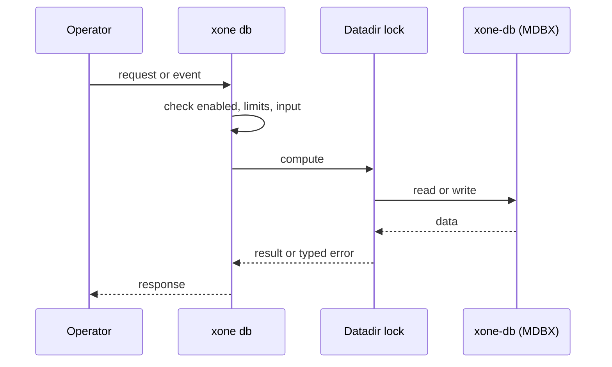
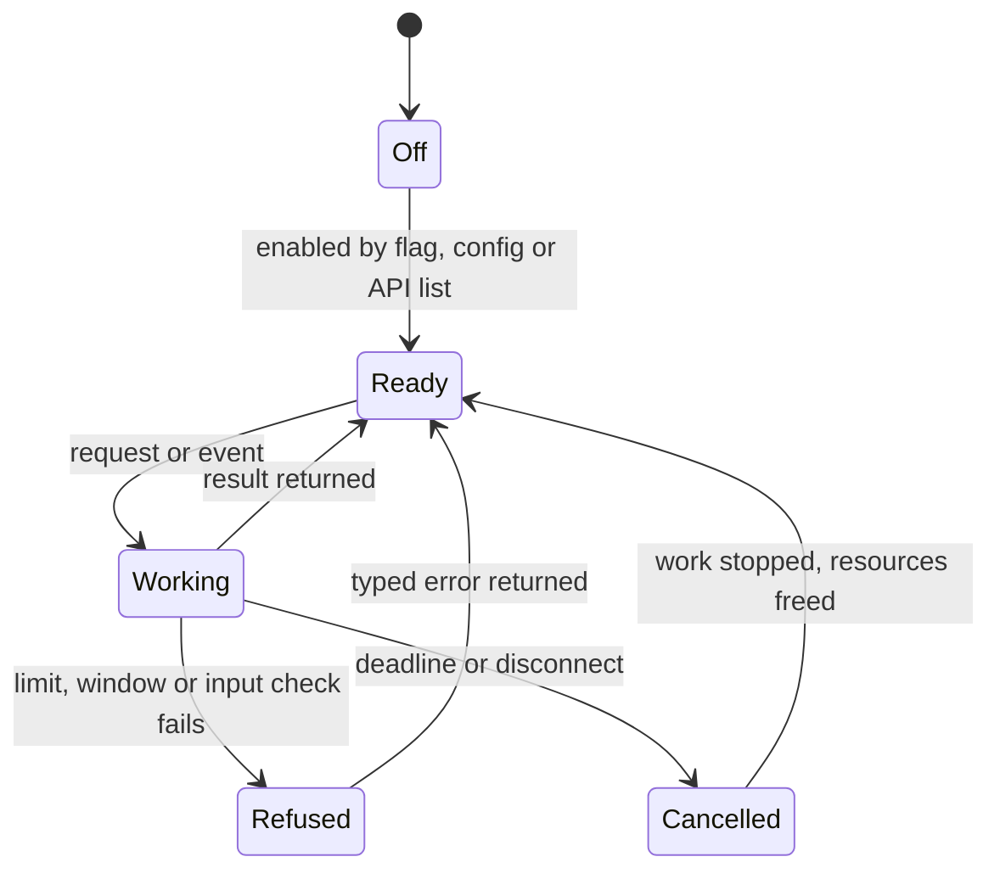
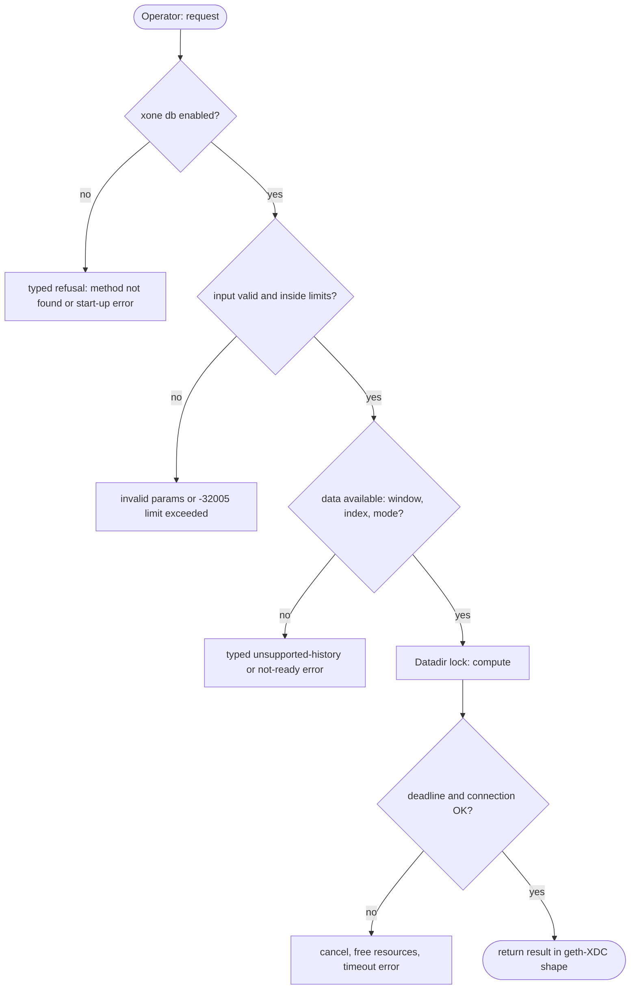

## What

An operator cannot see what fills the datadir or repair it offline. #149 found 13-72 GB differences between clients with no per-table breakdown. geth `db inspect`, reth `db stats` and `stage unwind`, and Besu `storage` subcommands answer these questions.

## Why

6 of the 10 selected competitors have this capability (file evidence at the audited commit):

- `ethereum/go-ethereum`: [cmd/geth/dbcmd.go](https://github.com/ethereum/go-ethereum/blob/8059ff8beb3170eb8b977169ac51bb0423c97ee1/cmd/geth/dbcmd.go)
- `bnb-chain/bsc`: [cmd/geth/dbcmd.go](https://github.com/bnb-chain/bsc/blob/54afaff4da31ac9e49ba646a4f65104edac5a2f3/cmd/geth/dbcmd.go)
- `0xPolygon/bor`: [cmd/geth/dbcmd.go](https://github.com/0xPolygon/bor/blob/ee09efd5dd9ef75917368990b272581b0e2c2665/cmd/geth/dbcmd.go)
- `XinFinOrg/XDPoSChain`: [cmd/XDC/dbcmd.go](https://github.com/XinFinOrg/XDPoSChain/blob/cb1ef79073c05f50b9df75b1e740387b9d72af99/cmd/XDC/dbcmd.go)
- `paradigmxyz/reth`: [crates/cli/commands/src/db/mod.rs](https://github.com/paradigmxyz/reth/blob/36600d5ff9628465475dd4c7608e2e9f2fe24273/crates/cli/commands/src/db/mod.rs)
- `paradigmxyz/reth`: [crates/cli/commands/src/stage/unwind.rs](https://github.com/paradigmxyz/reth/blob/36600d5ff9628465475dd4c7608e2e9f2fe24273/crates/cli/commands/src/stage/unwind.rs)
- `besu-eth/besu`: [app/src/main/java/org/hyperledger/besu/cli/subcommands/storage/StorageSubCommand.java](https://github.com/besu-eth/besu/blob/2b839d96863d01210f45a6f62127e6229e5b0889/app/src/main/java/org/hyperledger/besu/cli/subcommands/storage/StorageSubCommand.java)

Priority: P2: 6 of 10 selected competitors have it (rule: 5-7 = P2).

Our code today: none (bin/xone/src/cmd has import, export, snapshot only).

Related xOneRS issues: #149, #97, #33. This issue adds the capability; it does not replace their gates.

## 80% of the way to

1. `bin/xone/src/cmd/db.rs` (new): `db stats` (per MDBX table: entries, pages, bytes; static segments by kind), `db inspect` (the same plus key-prefix histograms), `db get <table> <key>`, `db compact` (copy-compact into a new file), `db unwind --to <n>` (runs the existing unwind path offline).
2. All commands take the datadir lock (#97); read-only commands open MDBX read-only.
3. `db unwind` refuses targets below the committed-block floor and writes the signer safety record rules (ADR-010).
4. Tests: stats on a net2040 datadir; unwind then restart re-imports to the same head hash.

Acceptance criteria:

- [ ] `xone db stats` output for net2040 and Apothem recorded in #149.
- [ ] Unwind/re-import test reaches the same head hash.

## ASD-STE100

1. Read-only db commands MUST open the database read-only.
2. Each db command MUST take the datadir lock.
3. `db unwind` MUST refuse a target below the committed-block floor.

## Diagrams



## Images

None.

## Prompt

```text
You work in XDCIndia/xOneRS (Rust XDC client). Implement GAP-0025: Database inspection and maintenance CLI: xone db stats / inspect / get / compact and offline unwind.

Context: An operator cannot see what fills the datadir or repair it offline. #149 found 13-72 GB differences between clients with no per-table breakdown. geth `db inspect`, reth `db stats` and `stage unwind`, and Besu `storage` subcommands answer these questions.

Reference behaviour: geth-XDC at XDCIndia/go-ethereum 6fc8e8c2088b7f18264f5663036669d04fa7becf (conformance/PIN). Where geth-XDC lacks the feature, follow the first competitor in the Why section and record the choice in the PR.

Steps:
1. `bin/xone/src/cmd/db.rs` (new): `db stats` (per MDBX table: entries, pages, bytes; static segments by kind), `db inspect` (the same plus key-prefix histograms), `db get <table> <key>`, `db compact` (copy-compact into a new file), `db unwind --to <n>` (runs the existing unwind path offline).
2. All commands take the datadir lock (#97); read-only commands open MDBX read-only.
3. `db unwind` refuses targets below the committed-block floor and writes the signer safety record rules (ADR-010).
4. Tests: stats on a net2040 datadir; unwind then restart re-imports to the same head hash.

Rules: one branch `feat/gap-0025-dbcli` from main, one PR that closes this issue. Write the tests and vectors first. Keep consensus, execution and storage formats unchanged. Run `cargo fmt --check`, `cargo clippy --all-targets -- -D warnings`, `cargo test --locked`, `ci/check-layering.sh` and `ci/check-fixtures.sh`. Update docs/cli/flags.md with `UPDATE_DOCS=1 cargo test -p xone flags_doc` if you add a flag. Hand back in 25 lines or fewer: files changed, tests added, acceptance results.
```

## Workflow

1. Maintainer: confirms priority P2 and assigns the issue.
2. Engineer: creates branch `feat/gap-0025-dbcli` from `main`.
3. Engineer: writes the failing tests and the parity vectors (xdc02 archive or the reference client).
4. Engineer: implements the change in the files of Layout.
5. Engineer: runs the gates (fmt, clippy, test, layering, fixtures) and the parity check.
6. Engineer: opens one PR that says `Closes #<this issue>` and lists the acceptance results.
7. Reviewer: checks each acceptance criterion and the ASD-STE100 requirements.
8. Maintainer: merges.
9. Operator: enables the feature on one net2040 node and records the result in this issue.

## Loop

Runtime: None.

Develop-verify: write a vector, implement, diff the answer against the xdc02 geth-XDC archive (or the reference client), fix, repeat until 0 mismatches. A retry after a failed gate starts from the failing vector.

## Graph



## Layout

```text
Files touched:
  bin/xone/src/cmd
  bin/xone/src/cmd/db.rs
```

## Flow



## Summary

Gap: Database inspection and maintenance CLI: xone db stats / inspect / get / compact and offline unwind is missing or partial in xOneRS; 6 of 10 selected competitors have it.
Fix: implement it as in "80% of the way to", with geth-XDC behaviour as the reference.
Acceptance: `xone db stats` output for net2040 and Apothem recorded in #149.

<!-- gap-audit:GAP-0025 -->
