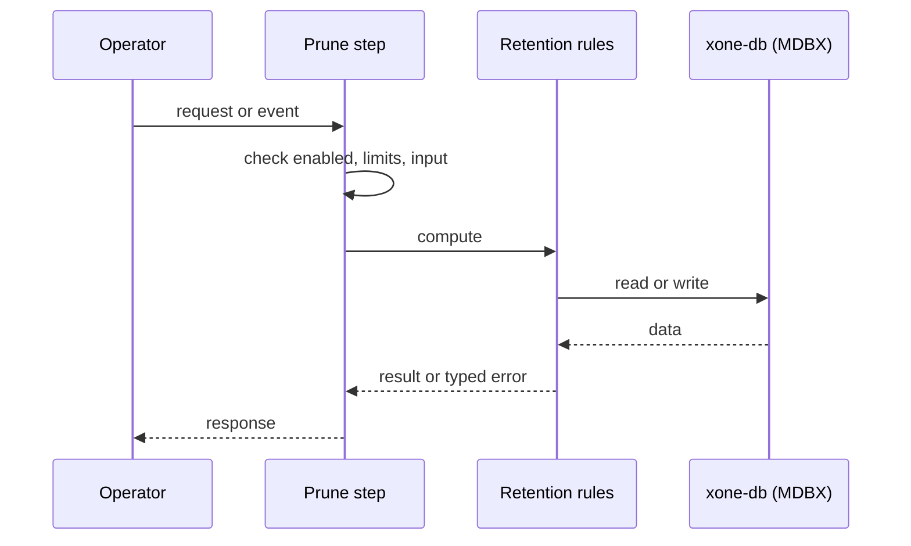
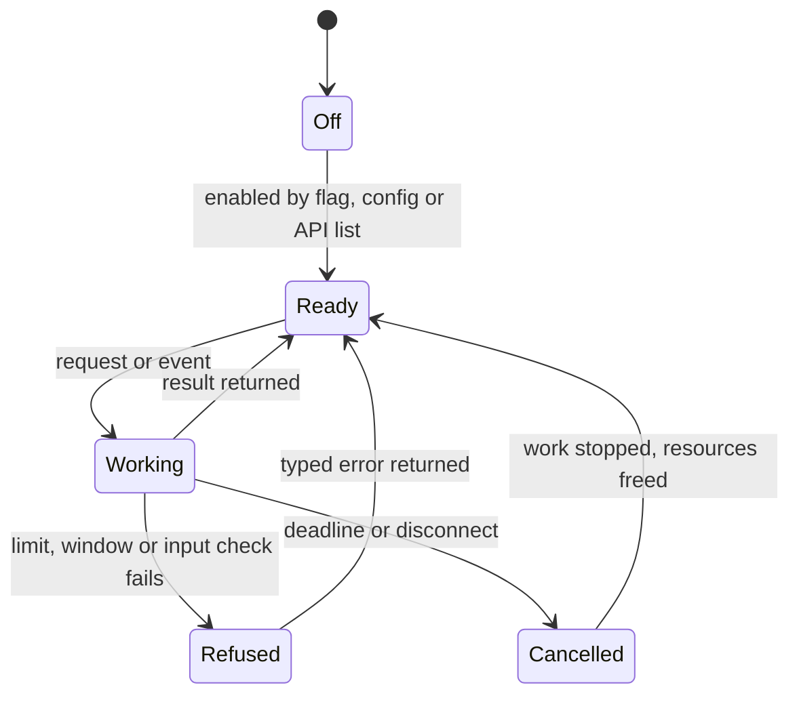
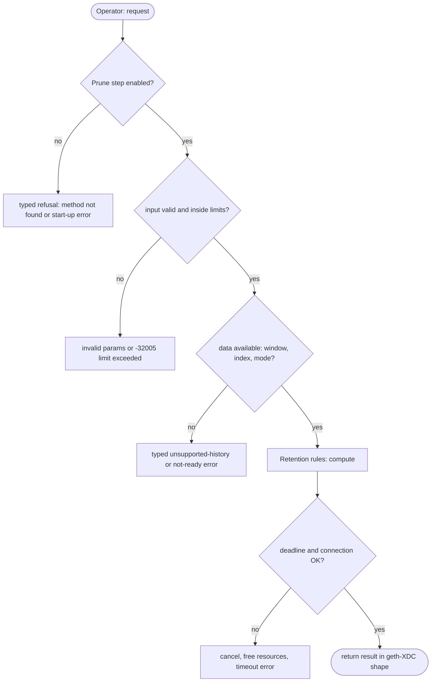

## What

A full xOne node keeps every block body and receipt forever. An operator who needs recent history only (an RPC node for wallets, a validator) cannot cap disk use. reth has per-segment prune distances, Erigon `--prune.mode`, Nethermind log retention, Besu and geth history pruning commands.

## Why

6 of the 10 selected competitors have this capability (file evidence at the audited commit):

- `ethereum/go-ethereum`: [cmd/geth/chaincmd.go](https://github.com/ethereum/go-ethereum/blob/8059ff8beb3170eb8b977169ac51bb0423c97ee1/cmd/geth/chaincmd.go)
- `0xPolygon/bor`: [core/rawdb/pruner.go](https://github.com/0xPolygon/bor/blob/ee09efd5dd9ef75917368990b272581b0e2c2665/core/rawdb/pruner.go)
- `paradigmxyz/reth`: [crates/node/core/src/args/pruning.rs](https://github.com/paradigmxyz/reth/blob/36600d5ff9628465475dd4c7608e2e9f2fe24273/crates/node/core/src/args/pruning.rs)
- `erigontech/erigon`: [db/kv/prune/prune.go](https://github.com/erigontech/erigon/blob/bbb5524e53fb057e7d47a5066e152f1091ac4ba4/db/kv/prune/prune.go)
- `NethermindEth/nethermind`: [src/Nethermind/Nethermind.Blockchain/Receipts/IPrunedLogsRetention.cs](https://github.com/NethermindEth/nethermind/blob/a7dd73052e696ad934d228aad3f33e660701fdb7/src/Nethermind/Nethermind.Blockchain/Receipts/IPrunedLogsRetention.cs)
- `besu-eth/besu`: [app/src/main/java/org/hyperledger/besu/cli/subcommands/storage/PrunePreMergeBlockDataSubCommand.java](https://github.com/besu-eth/besu/blob/2b839d96863d01210f45a6f62127e6229e5b0889/app/src/main/java/org/hyperledger/besu/cli/subcommands/storage/PrunePreMergeBlockDataSubCommand.java)
- `besu-eth/besu`: [ethereum/core/src/main/java/org/hyperledger/besu/ethereum/chain/ChainDataPruner.java](https://github.com/besu-eth/besu/blob/2b839d96863d01210f45a6f62127e6229e5b0889/ethereum/core/src/main/java/org/hyperledger/besu/ethereum/chain/ChainDataPruner.java)

Priority: P2: 6 of 10 selected competitors have it (rule: 5-7 = P2).

Our code today: --history.transactions only (bin/xone/src/flags.rs); block history kept in full.

Related xOneRS issues: #14, #149, #121. This issue adds the capability; it does not replace their gates.

## 80% of the way to

1. `crates/xone-node/src/config.rs`: `--history.bodies <n>`, `--history.receipts <n>`, `--history.logs <n>` (blocks to keep; 0 = all) with lower bounds from the consensus windows of spec/retention.md (epoch snapshots, gap blocks, the V2 lookback).
2. `crates/xone-sync` stage `finish.rs`: a prune step after each committed batch deletes old segments in bounded chunks; prune checkpoints in MDBX; static segments dropped whole.
3. `xone db prune` (with GAP dbcli) for an existing datadir.
4. RPC: requests for pruned data return the typed unsupported-history error (#121).
5. Tests: devnet run with small windows; restart; consensus checks across epoch switch still pass.

Acceptance criteria:

- [ ] net2040 node with 100k-block windows stays within the computed disk bound for 24 h.
- [ ] Epoch-switch and V2 lookback checks pass with the smallest allowed windows.

## ASD-STE100

1. The node MUST NOT prune data that a consensus rule still reads.
2. The node MUST prune in bounded chunks. Pruning MUST NOT stop block import for more than 100 ms.
3. An RPC request for pruned data MUST return the typed unsupported-history error.

## Diagrams



## Images

None.

## Prompt

```text
You work in XDCIndia/xOneRS (Rust XDC client). Implement GAP-0026: History pruning: configurable retention of bodies, receipts and logs, and pruning of an existing datadir.

Context: A full xOne node keeps every block body and receipt forever. An operator who needs recent history only (an RPC node for wallets, a validator) cannot cap disk use. reth has per-segment prune distances, Erigon `--prune.mode`, Nethermind log retention, Besu and geth history pruning commands.

Reference behaviour: geth-XDC at XDCIndia/go-ethereum 6fc8e8c2088b7f18264f5663036669d04fa7becf (conformance/PIN). Where geth-XDC lacks the feature, follow the first competitor in the Why section and record the choice in the PR.

Steps:
1. `crates/xone-node/src/config.rs`: `--history.bodies <n>`, `--history.receipts <n>`, `--history.logs <n>` (blocks to keep; 0 = all) with lower bounds from the consensus windows of spec/retention.md (epoch snapshots, gap blocks, the V2 lookback).
2. `crates/xone-sync` stage `finish.rs`: a prune step after each committed batch deletes old segments in bounded chunks; prune checkpoints in MDBX; static segments dropped whole.
3. `xone db prune` (with GAP dbcli) for an existing datadir.
4. RPC: requests for pruned data return the typed unsupported-history error (#121).
5. Tests: devnet run with small windows; restart; consensus checks across epoch switch still pass.

Rules: one branch `feat/gap-0026-history` from main, one PR that closes this issue. Write the tests and vectors first. Keep consensus, execution and storage formats unchanged. Run `cargo fmt --check`, `cargo clippy --all-targets -- -D warnings`, `cargo test --locked`, `ci/check-layering.sh` and `ci/check-fixtures.sh`. Update docs/cli/flags.md with `UPDATE_DOCS=1 cargo test -p xone flags_doc` if you add a flag. Hand back in 25 lines or fewer: files changed, tests added, acceptance results.
```

## Workflow

1. Maintainer: confirms priority P2 and assigns the issue.
2. Engineer: creates branch `feat/gap-0026-history` from `main`.
3. Engineer: writes the failing tests and the parity vectors (xdc02 archive or the reference client).
4. Engineer: implements the change in the files of Layout.
5. Engineer: runs the gates (fmt, clippy, test, layering, fixtures) and the parity check.
6. Engineer: opens one PR that says `Closes #<this issue>` and lists the acceptance results.
7. Reviewer: checks each acceptance criterion and the ASD-STE100 requirements.
8. Maintainer: merges.
9. Operator: enables the feature on one net2040 node and records the result in this issue.

## Loop

Runtime: The prune step runs after each committed import batch.

Develop-verify: write a vector, implement, diff the answer against the xdc02 geth-XDC archive (or the reference client), fix, repeat until 0 mismatches. A retry after a failed gate starts from the failing vector.

## Graph



## Layout

```text
Files touched:
  bin/xone/src/flags.rs
  crates/xone-node/src/config.rs
  crates/xone-sync
  spec/retention.md
```

## Flow



## Summary

Gap: History pruning: configurable retention of bodies, receipts and logs, and pruning of an existing datadir is missing or partial in xOneRS; 6 of 10 selected competitors have it.
Fix: implement it as in "80% of the way to", with geth-XDC behaviour as the reference.
Acceptance: net2040 node with 100k-block windows stays within the computed disk bound for 24 h.

<!-- gap-audit:GAP-0026 -->
