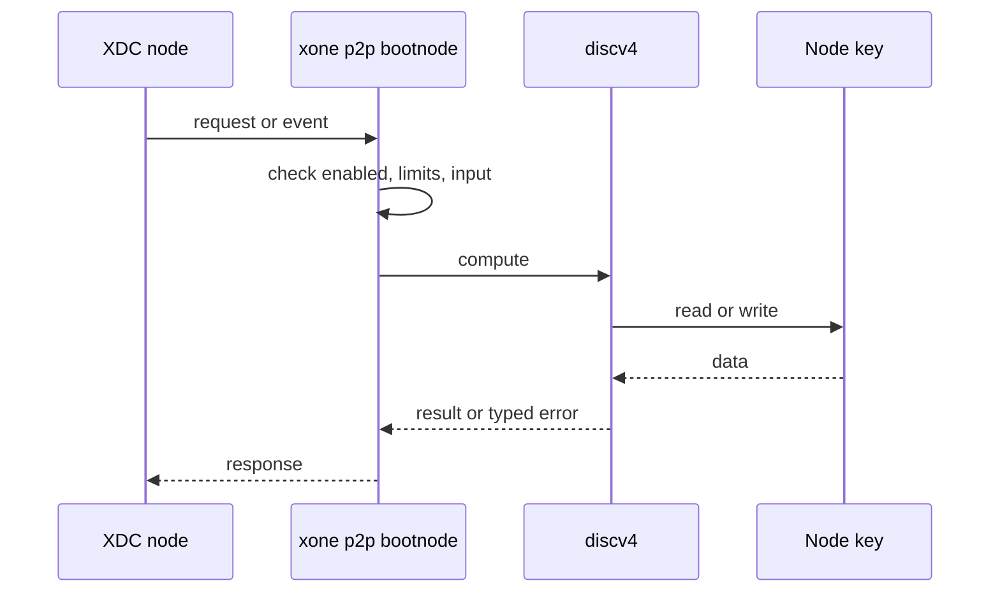
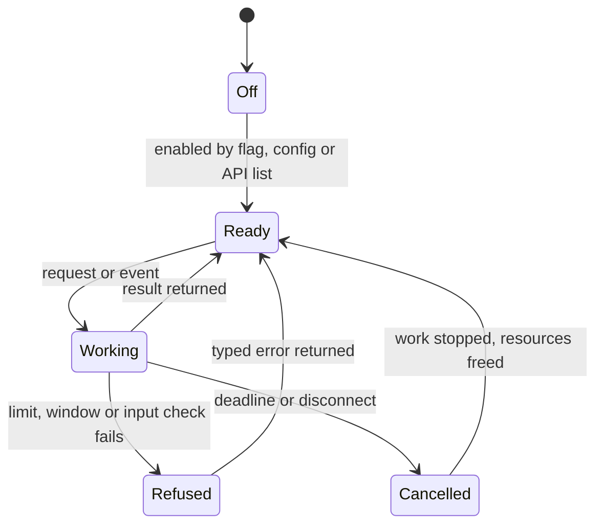
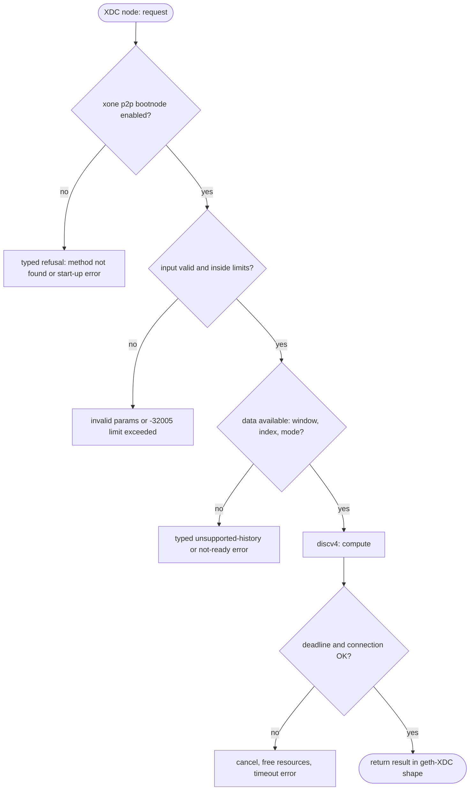

## What

XDC bootnodes run the `bootnode` binary of XDPoSChain. xOne cannot run as a discovery-only bootnode and has no tool to generate a node key, print an enode, or crawl the XDC discv4 network.

## Why

6 of the 10 selected competitors have this capability (file evidence at the audited commit):

- `ethereum/go-ethereum`: [cmd/devp2p/main.go](https://github.com/ethereum/go-ethereum/blob/8059ff8beb3170eb8b977169ac51bb0423c97ee1/cmd/devp2p/main.go)
- `XinFinOrg/XDPoSChain`: [cmd/bootnode/main.go](https://github.com/XinFinOrg/XDPoSChain/blob/cb1ef79073c05f50b9df75b1e740387b9d72af99/cmd/bootnode/main.go)
- `bnb-chain/bsc`: [cmd/bootnode/main.go](https://github.com/bnb-chain/bsc/blob/54afaff4da31ac9e49ba646a4f65104edac5a2f3/cmd/bootnode/main.go)
- `0xPolygon/bor`: [cmd/bootnode/main.go](https://github.com/0xPolygon/bor/blob/ee09efd5dd9ef75917368990b272581b0e2c2665/cmd/bootnode/main.go)
- `erigontech/erigon`: [cmd/bootnode/main.go](https://github.com/erigontech/erigon/blob/bbb5524e53fb057e7d47a5066e152f1091ac4ba4/cmd/bootnode/main.go)
- `paradigmxyz/reth`: [crates/cli/commands/src/p2p/bootnode.rs](https://github.com/paradigmxyz/reth/blob/36600d5ff9628465475dd4c7608e2e9f2fe24273/crates/cli/commands/src/p2p/bootnode.rs)

Priority: P2: 6 of 10 selected competitors have it (rule: 5-7 = P2).

Our code today: none (ops/bootnodes lists only; crates/xone-net/src/discv4.rs has the protocol).

Related xOneRS issues: #32. This issue adds the capability; it does not replace their gates.

## 80% of the way to

1. `bin/xone/src/cmd/p2p.rs` (new): `xone p2p bootnode --nodekey <file> --addr :30301 [--netrestrict]` runs discv4 only (XDC ping variant) with no chain; `xone p2p key generate|enode`; `xone p2p crawl --timeout` lists reachable XDC nodes with their client names.
2. Reuse `crates/xone-net/src/discv4.rs` and `crates/xone-signer/src/nodekey.rs`.
3. Tests: a devnet node discovers its peers through an xOne bootnode.

Acceptance criteria:

- [ ] Devnet nodes find each other through an xOne bootnode; crawl of net2040 lists the fleet.

## ASD-STE100

1. `xone p2p bootnode` MUST NOT open a datadir or a chain database.
2. The node key file MUST have mode 0600.

## Diagrams



## Images

None.

## Prompt

```text
You work in XDCIndia/xOneRS (Rust XDC client). Implement GAP-0027: Bootnode-only mode and devp2p tooling (discovery-only node, ENR/enode tools, crawler).

Context: XDC bootnodes run the `bootnode` binary of XDPoSChain. xOne cannot run as a discovery-only bootnode and has no tool to generate a node key, print an enode, or crawl the XDC discv4 network.

Reference behaviour: geth-XDC at XDCIndia/go-ethereum 6fc8e8c2088b7f18264f5663036669d04fa7becf (conformance/PIN). Where geth-XDC lacks the feature, follow the first competitor in the Why section and record the choice in the PR.

Steps:
1. `bin/xone/src/cmd/p2p.rs` (new): `xone p2p bootnode --nodekey <file> --addr :30301 [--netrestrict]` runs discv4 only (XDC ping variant) with no chain; `xone p2p key generate|enode`; `xone p2p crawl --timeout` lists reachable XDC nodes with their client names.
2. Reuse `crates/xone-net/src/discv4.rs` and `crates/xone-signer/src/nodekey.rs`.
3. Tests: a devnet node discovers its peers through an xOne bootnode.

Rules: one branch `feat/gap-0027-bootnode` from main, one PR that closes this issue. Write the tests and vectors first. Keep consensus, execution and storage formats unchanged. Run `cargo fmt --check`, `cargo clippy --all-targets -- -D warnings`, `cargo test --locked`, `ci/check-layering.sh` and `ci/check-fixtures.sh`. Update docs/cli/flags.md with `UPDATE_DOCS=1 cargo test -p xone flags_doc` if you add a flag. Hand back in 25 lines or fewer: files changed, tests added, acceptance results.
```

## Workflow

1. Maintainer: confirms priority P2 and assigns the issue.
2. Engineer: creates branch `feat/gap-0027-bootnode` from `main`.
3. Engineer: writes the failing tests and the parity vectors (xdc02 archive or the reference client).
4. Engineer: implements the change in the files of Layout.
5. Engineer: runs the gates (fmt, clippy, test, layering, fixtures) and the parity check.
6. Engineer: opens one PR that says `Closes #<this issue>` and lists the acceptance results.
7. Reviewer: checks each acceptance criterion and the ASD-STE100 requirements.
8. Maintainer: merges.
9. Operator: enables the feature on one net2040 node and records the result in this issue.

## Loop

Runtime: Discovery refreshes its table on the discv4 timer.

Develop-verify: write a vector, implement, diff the answer against the xdc02 geth-XDC archive (or the reference client), fix, repeat until 0 mismatches. A retry after a failed gate starts from the failing vector.

## Graph



## Layout

```text
Files touched:
  bin/xone/src/cmd/p2p.rs
  crates/xone-net/src/discv4.rs
  crates/xone-signer/src/nodekey.rs
  ops/bootnodes
```

## Flow



## Summary

Gap: Bootnode-only mode and devp2p tooling (discovery-only node, ENR/enode tools, crawler) is missing or partial in xOneRS; 6 of 10 selected competitors have it.
Fix: implement it as in "80% of the way to", with geth-XDC behaviour as the reference.
Acceptance: Devnet nodes find each other through an xOne bootnode; crawl of net2040 lists the fleet.

<!-- gap-audit:GAP-0027 -->
