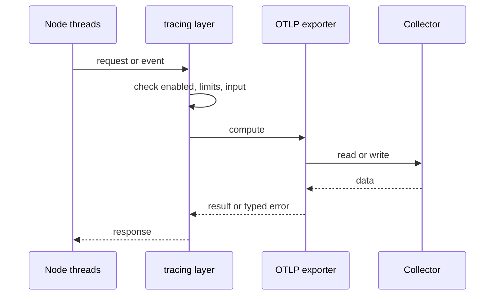
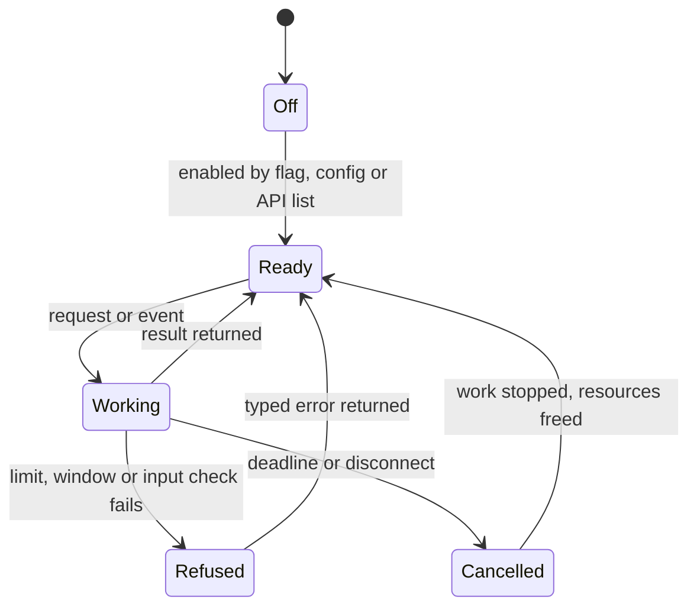
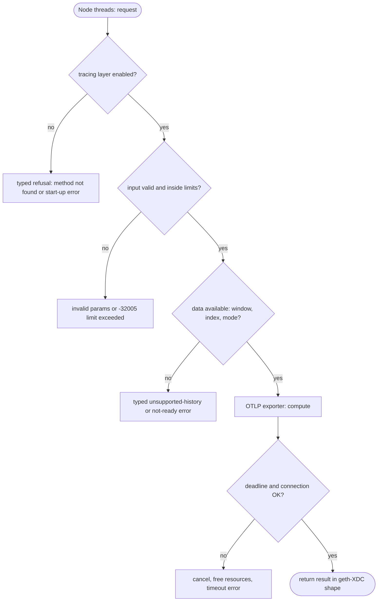

## What

xOne writes spans to its log only. reth, geth, Bor and Besu export traces (and Besu metrics) over OTLP to Jaeger, Tempo or Honeycomb. Operators who run several clients cannot follow a block import or an RPC call across services.

## Why

5 of the 10 selected competitors have this capability (file evidence at the audited commit):

- `paradigmxyz/reth`: [crates/tracing-otlp/Cargo.toml](https://github.com/paradigmxyz/reth/blob/36600d5ff9628465475dd4c7608e2e9f2fe24273/crates/tracing-otlp/Cargo.toml)
- `ethereum/go-ethereum`: [go.mod](https://github.com/ethereum/go-ethereum/blob/8059ff8beb3170eb8b977169ac51bb0423c97ee1/go.mod)
- `bnb-chain/bsc`: [go.mod](https://github.com/bnb-chain/bsc/blob/54afaff4da31ac9e49ba646a4f65104edac5a2f3/go.mod)
- `0xPolygon/bor`: [common/tracing/context.go](https://github.com/0xPolygon/bor/blob/ee09efd5dd9ef75917368990b272581b0e2c2665/common/tracing/context.go)
- `besu-eth/besu`: [metrics/core/src/main/java/org/hyperledger/besu/metrics/opentelemetry/OpenTelemetrySystem.java](https://github.com/besu-eth/besu/blob/2b839d96863d01210f45a6f62127e6229e5b0889/metrics/core/src/main/java/org/hyperledger/besu/metrics/opentelemetry/OpenTelemetrySystem.java)

Priority: P2: 5 of 10 selected competitors have it (rule: 5-7 = P2).

Our code today: none.

Related xOneRS issues: #41, #16. This issue adds the capability; it does not replace their gates.

## 80% of the way to

1. `crates/xone-node/src/observe`: an optional `tracing-opentelemetry` layer with an OTLP exporter behind `--tracing.otlp.endpoint` (off by default); sample ratio flag.
2. Spans: block import (fetch, verify, execute, commit), RPC request (method, class), BFT vote/timeout handling.
3. Bounded export queue (ADR-007): drop spans, never block the import thread.
4. Tests: export to a local OTLP collector in CI; queue-full drops counted in a metric.

Acceptance criteria:

- [ ] A local Jaeger shows block-import and RPC spans from a devnet node.
- [ ] Queue-full drop counter tested.

## ASD-STE100

1. The node MUST export traces only when an OTLP endpoint is set.
2. The export MUST NOT block block import or RPC. When the queue is full, the node MUST drop spans and count them.

## Diagrams



## Images

None.

## Prompt

```text
You work in XDCIndia/xOneRS (Rust XDC client). Implement GAP-0028: OpenTelemetry (OTLP) trace export.

Context: xOne writes spans to its log only. reth, geth, Bor and Besu export traces (and Besu metrics) over OTLP to Jaeger, Tempo or Honeycomb. Operators who run several clients cannot follow a block import or an RPC call across services.

Reference behaviour: geth-XDC at XDCIndia/go-ethereum 6fc8e8c2088b7f18264f5663036669d04fa7becf (conformance/PIN). Where geth-XDC lacks the feature, follow the first competitor in the Why section and record the choice in the PR.

Steps:
1. `crates/xone-node/src/observe`: an optional `tracing-opentelemetry` layer with an OTLP exporter behind `--tracing.otlp.endpoint` (off by default); sample ratio flag.
2. Spans: block import (fetch, verify, execute, commit), RPC request (method, class), BFT vote/timeout handling.
3. Bounded export queue (ADR-007): drop spans, never block the import thread.
4. Tests: export to a local OTLP collector in CI; queue-full drops counted in a metric.

Rules: one branch `feat/gap-0028-otlp` from main, one PR that closes this issue. Write the tests and vectors first. Keep consensus, execution and storage formats unchanged. Run `cargo fmt --check`, `cargo clippy --all-targets -- -D warnings`, `cargo test --locked`, `ci/check-layering.sh` and `ci/check-fixtures.sh`. Update docs/cli/flags.md with `UPDATE_DOCS=1 cargo test -p xone flags_doc` if you add a flag. Hand back in 25 lines or fewer: files changed, tests added, acceptance results.
```

## Workflow

1. Maintainer: confirms priority P2 and assigns the issue.
2. Engineer: creates branch `feat/gap-0028-otlp` from `main`.
3. Engineer: writes the failing tests and the parity vectors (xdc02 archive or the reference client).
4. Engineer: implements the change in the files of Layout.
5. Engineer: runs the gates (fmt, clippy, test, layering, fixtures) and the parity check.
6. Engineer: opens one PR that says `Closes #<this issue>` and lists the acceptance results.
7. Reviewer: checks each acceptance criterion and the ASD-STE100 requirements.
8. Maintainer: merges.
9. Operator: enables the feature on one net2040 node and records the result in this issue.

## Loop

Runtime: The exporter flushes batches on a timer (default 5 s).

Develop-verify: write a vector, implement, diff the answer against the xdc02 geth-XDC archive (or the reference client), fix, repeat until 0 mismatches. A retry after a failed gate starts from the failing vector.

## Graph



## Layout

```text
Files touched:
  crates/xone-node/src/observe
```

## Flow



## Summary

Gap: OpenTelemetry (OTLP) trace export is missing or partial in xOneRS; 5 of 10 selected competitors have it.
Fix: implement it as in "80% of the way to", with geth-XDC behaviour as the reference.
Acceptance: A local Jaeger shows block-import and RPC spans from a devnet node.

<!-- gap-audit:GAP-0028 -->
