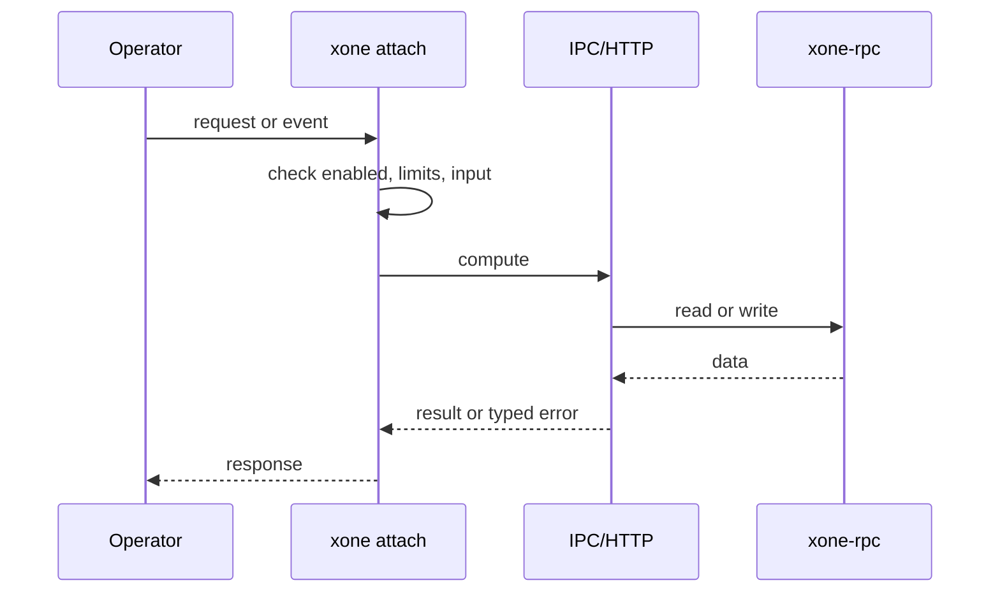
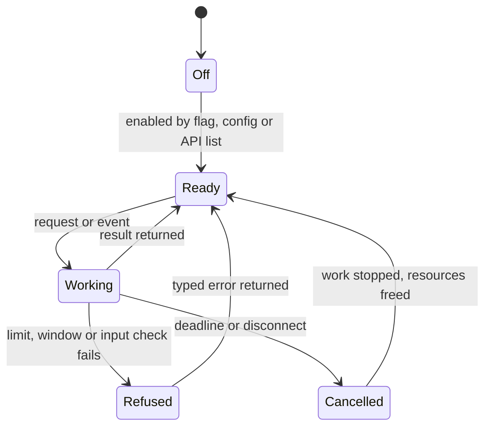
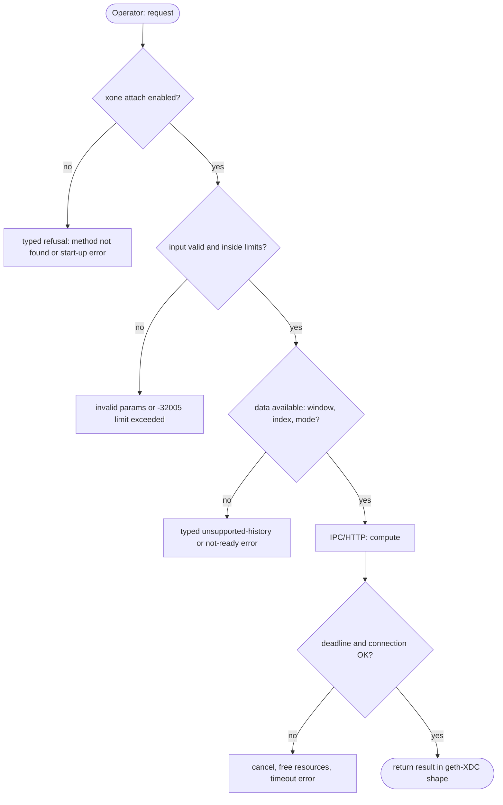

## What

XDC operator runbooks use `XDC attach` and then `eth.blockNumber`, `admin.peers`, `XDPoS.getMasternodes()`. xOne has no attach command, so operators must write curl calls.

## Why

5 of the 10 selected competitors have this capability (file evidence at the audited commit):

- `ethereum/go-ethereum`: [cmd/geth/consolecmd.go](https://github.com/ethereum/go-ethereum/blob/8059ff8beb3170eb8b977169ac51bb0423c97ee1/cmd/geth/consolecmd.go)
- `bnb-chain/bsc`: [cmd/geth/consolecmd.go](https://github.com/bnb-chain/bsc/blob/54afaff4da31ac9e49ba646a4f65104edac5a2f3/cmd/geth/consolecmd.go)
- `0xPolygon/bor`: [cmd/geth/consolecmd.go](https://github.com/0xPolygon/bor/blob/ee09efd5dd9ef75917368990b272581b0e2c2665/cmd/geth/consolecmd.go)
- `XinFinOrg/XDPoSChain`: [cmd/XDC/consolecmd.go](https://github.com/XinFinOrg/XDPoSChain/blob/cb1ef79073c05f50b9df75b1e740387b9d72af99/cmd/XDC/consolecmd.go)
- `lambdaclass/ethrex`: [tooling/repl/src/commands/admin.rs](https://github.com/lambdaclass/ethrex/blob/740ea493880b6c073b81537010df75e143c615c2/tooling/repl/src/commands/admin.rs)

Priority: P2: 5 of 10 selected competitors have it (rule: 5-7 = P2).

Our code today: none.

Related xOneRS issues: #39. This issue adds the capability; it does not replace their gates.

## 80% of the way to

1. `bin/xone/src/cmd/attach.rs` (new): connect to `<datadir>/xone.ipc` or a URL; a line REPL (`rustyline`) that maps `ns.method(args)` to JSON-RPC and pretty-prints the result; `--exec` for one command.
2. No JavaScript engine: support the geth console call syntax for method calls and literals only (document the limits).
3. Tests: `xone attach --exec 'eth.blockNumber'` against a devnet node.

Acceptance criteria:

- [ ] The common runbook commands (eth.blockNumber, net.peerCount, admin.peers, XDPoS.getMasternodes) work.

## ASD-STE100

1. `xone attach` MUST connect over IPC by default.
2. `--exec` MUST run one command and exit with a non-zero code on an RPC error.

## Diagrams



## Images

None.

## Prompt

```text
You work in XDCIndia/xOneRS (Rust XDC client). Implement GAP-0029: Interactive console: xone attach over IPC/HTTP.

Context: XDC operator runbooks use `XDC attach` and then `eth.blockNumber`, `admin.peers`, `XDPoS.getMasternodes()`. xOne has no attach command, so operators must write curl calls.

Reference behaviour: geth-XDC at XDCIndia/go-ethereum 6fc8e8c2088b7f18264f5663036669d04fa7becf (conformance/PIN). Where geth-XDC lacks the feature, follow the first competitor in the Why section and record the choice in the PR.

Steps:
1. `bin/xone/src/cmd/attach.rs` (new): connect to `<datadir>/xone.ipc` or a URL; a line REPL (`rustyline`) that maps `ns.method(args)` to JSON-RPC and pretty-prints the result; `--exec` for one command.
2. No JavaScript engine: support the geth console call syntax for method calls and literals only (document the limits).
3. Tests: `xone attach --exec 'eth.blockNumber'` against a devnet node.

Rules: one branch `feat/gap-0029-console` from main, one PR that closes this issue. Write the tests and vectors first. Keep consensus, execution and storage formats unchanged. Run `cargo fmt --check`, `cargo clippy --all-targets -- -D warnings`, `cargo test --locked`, `ci/check-layering.sh` and `ci/check-fixtures.sh`. Update docs/cli/flags.md with `UPDATE_DOCS=1 cargo test -p xone flags_doc` if you add a flag. Hand back in 25 lines or fewer: files changed, tests added, acceptance results.
```

## Workflow

1. Maintainer: confirms priority P2 and assigns the issue.
2. Engineer: creates branch `feat/gap-0029-console` from `main`.
3. Engineer: writes the failing tests and the parity vectors (xdc02 archive or the reference client).
4. Engineer: implements the change in the files of Layout.
5. Engineer: runs the gates (fmt, clippy, test, layering, fixtures) and the parity check.
6. Engineer: opens one PR that says `Closes #<this issue>` and lists the acceptance results.
7. Reviewer: checks each acceptance criterion and the ASD-STE100 requirements.
8. Maintainer: merges.
9. Operator: enables the feature on one net2040 node and records the result in this issue.

## Loop

Runtime: None.

Develop-verify: write a vector, implement, diff the answer against the xdc02 geth-XDC archive (or the reference client), fix, repeat until 0 mismatches. A retry after a failed gate starts from the failing vector.

## Graph



## Layout

```text
Files touched:
  bin/xone/src/cmd/attach.rs
```

## Flow



## Summary

Gap: Interactive console: xone attach over IPC/HTTP is missing or partial in xOneRS; 5 of 10 selected competitors have it.
Fix: implement it as in "80% of the way to", with geth-XDC behaviour as the reference.
Acceptance: The common runbook commands (eth.blockNumber, net.peerCount, admin.peers, XDPoS.getMasternodes) work.

<!-- gap-audit:GAP-0029 -->
