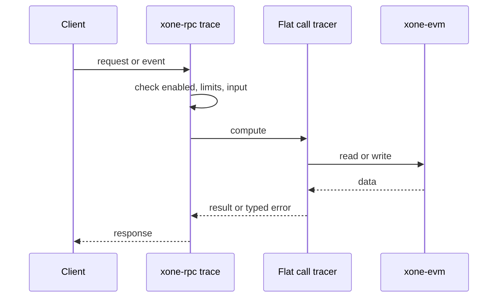
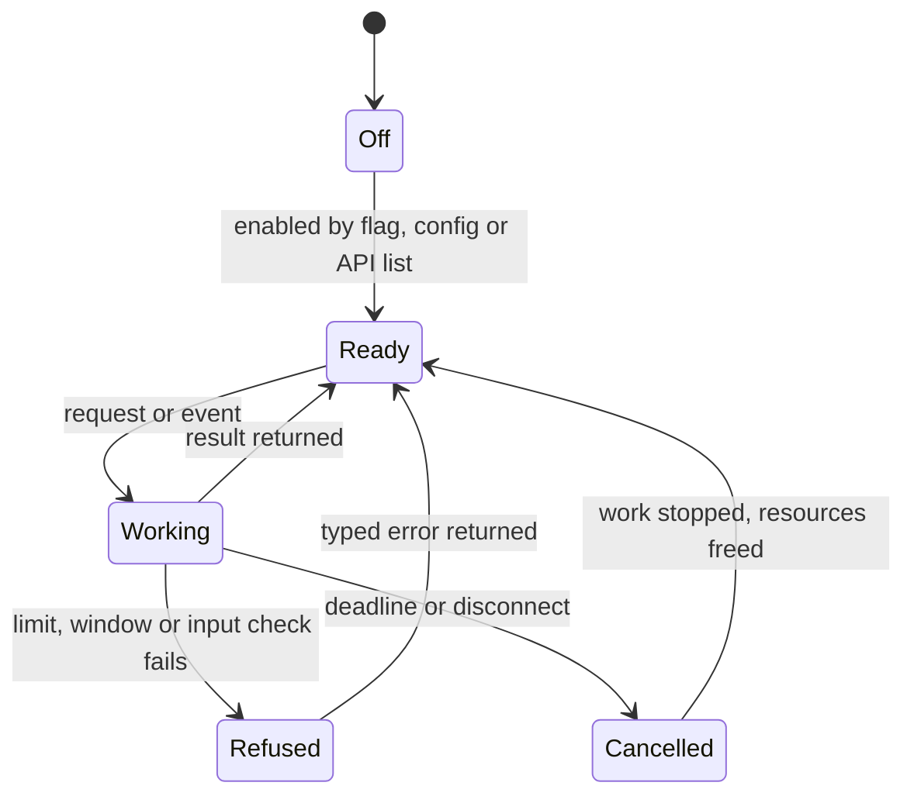
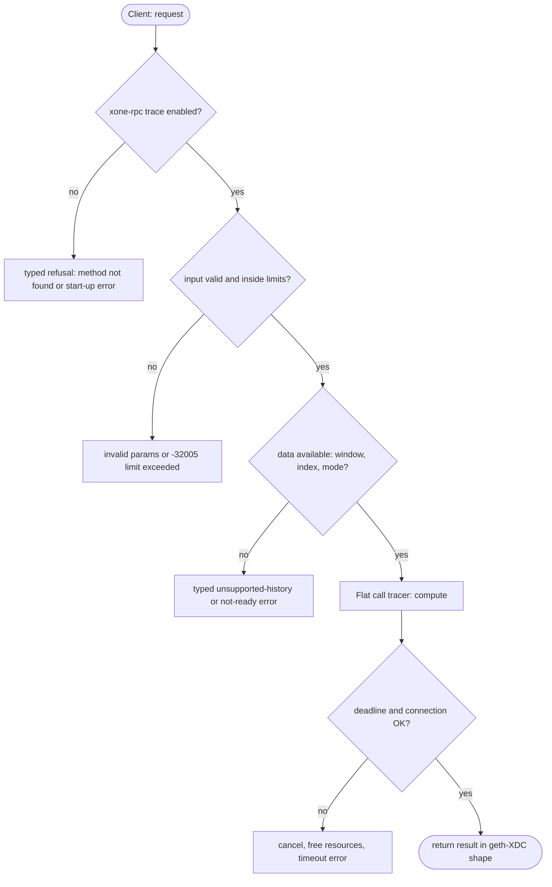

## What

xOne has no `trace_*` namespace. Blockscout, Otterscan back ends and accounting indexers read internal transfers with `trace_block`, `trace_filter` and `trace_replayBlockTransactions` (Parity format).

## Why

4 of the 10 selected competitors have this capability (file evidence at the audited commit):

- `paradigmxyz/reth`: [crates/rpc/rpc/src/trace.rs](https://github.com/paradigmxyz/reth/blob/36600d5ff9628465475dd4c7608e2e9f2fe24273/crates/rpc/rpc/src/trace.rs)
- `erigontech/erigon`: [rpc/jsonrpc/trace_api.go](https://github.com/erigontech/erigon/blob/bbb5524e53fb057e7d47a5066e152f1091ac4ba4/rpc/jsonrpc/trace_api.go)
- `NethermindEth/nethermind`: [src/Nethermind/Nethermind.JsonRpc/Modules/Trace/ITraceRpcModule.cs](https://github.com/NethermindEth/nethermind/blob/a7dd73052e696ad934d228aad3f33e660701fdb7/src/Nethermind/Nethermind.JsonRpc/Modules/Trace/ITraceRpcModule.cs)
- `besu-eth/besu`: [ethereum/api/src/main/java/org/hyperledger/besu/ethereum/api/jsonrpc/internal/methods/TraceFilter.java](https://github.com/besu-eth/besu/blob/2b839d96863d01210f45a6f62127e6229e5b0889/ethereum/api/src/main/java/org/hyperledger/besu/ethereum/api/jsonrpc/internal/methods/TraceFilter.java)

Priority: P3: 4 of 10 selected competitors have it (rule: 1-4 = P3).

Our code today: none (spec/rpc/scope-adr-008.md: trace_* out).

Related xOneRS issues: #42. This issue adds the capability; it does not replace their gates.

## 80% of the way to

1. Build on GAP flatCallTracer: the flat call frames are the `trace` output of the Parity format.
2. `crates/xone-rpc/src/trace.rs` (new): `trace_block`, `trace_transaction`, `trace_get`, `trace_filter` (bounded block range, from/to address sets, after/count), `trace_call`, `trace_replayBlockTransactions`, `trace_replayTransaction` with `trace` and `stateDiff` modes (`vmTrace` out).
3. `trace_filter` scans blocks in the state window (archive mode extends it) with the `eth_getLogs` range limits.
4. Tests: compare with an Erigon or Nethermind node on an Ethereum test chain for format, and with geth-XDC `flatCallTracer` output on net2040 for content.

Acceptance criteria:

- [ ] Blockscout indexes internal transactions from a net2040 xOne node.
- [ ] `trace_filter` range limit enforced (test).

## ASD-STE100

1. The node MUST serve the `trace` namespace only when `--http.api` or `--ws.api` names it.
2. `trace_filter` MUST refuse a block range above the configured limit.
3. The `trace` output MUST be equal to the `flatCallTracer` output of geth-XDC for the same transaction.

## Diagrams



## Images

None.

## Prompt

```text
You work in XDCIndia/xOneRS (Rust XDC client). Implement GAP-0030: Parity-style trace_* namespace (trace_block, trace_transaction, trace_filter, trace_replay*).

Context: xOne has no `trace_*` namespace. Blockscout, Otterscan back ends and accounting indexers read internal transfers with `trace_block`, `trace_filter` and `trace_replayBlockTransactions` (Parity format).

Reference behaviour: geth-XDC at XDCIndia/go-ethereum 6fc8e8c2088b7f18264f5663036669d04fa7becf (conformance/PIN). Where geth-XDC lacks the feature, follow the first competitor in the Why section and record the choice in the PR.

Steps:
1. Build on GAP flatCallTracer: the flat call frames are the `trace` output of the Parity format.
2. `crates/xone-rpc/src/trace.rs` (new): `trace_block`, `trace_transaction`, `trace_get`, `trace_filter` (bounded block range, from/to address sets, after/count), `trace_call`, `trace_replayBlockTransactions`, `trace_replayTransaction` with `trace` and `stateDiff` modes (`vmTrace` out).
3. `trace_filter` scans blocks in the state window (archive mode extends it) with the `eth_getLogs` range limits.
4. Tests: compare with an Erigon or Nethermind node on an Ethereum test chain for format, and with geth-XDC `flatCallTracer` output on net2040 for content.

Rules: one branch `feat/gap-0030-tracens` from main, one PR that closes this issue. Write the tests and vectors first. Keep consensus, execution and storage formats unchanged. Run `cargo fmt --check`, `cargo clippy --all-targets -- -D warnings`, `cargo test --locked`, `ci/check-layering.sh` and `ci/check-fixtures.sh`. Update docs/cli/flags.md with `UPDATE_DOCS=1 cargo test -p xone flags_doc` if you add a flag. Hand back in 25 lines or fewer: files changed, tests added, acceptance results.
```

## Workflow

1. Maintainer: confirms priority P3 and assigns the issue.
2. Engineer: creates branch `feat/gap-0030-tracens` from `main`.
3. Engineer: writes the failing tests and the parity vectors (xdc02 archive or the reference client).
4. Engineer: implements the change in the files of Layout.
5. Engineer: runs the gates (fmt, clippy, test, layering, fixtures) and the parity check.
6. Engineer: opens one PR that says `Closes #<this issue>` and lists the acceptance results.
7. Reviewer: checks each acceptance criterion and the ASD-STE100 requirements.
8. Maintainer: merges.
9. Operator: enables the feature on one net2040 node and records the result in this issue.

## Loop

Runtime: None.

Develop-verify: write a vector, implement, diff the answer against the xdc02 geth-XDC archive (or the reference client), fix, repeat until 0 mismatches. A retry after a failed gate starts from the failing vector.

## Graph



## Layout

```text
Files touched:
  crates/xone-rpc/src/trace.rs
  spec/rpc/scope-adr-008.md
```

## Flow



## Summary

Gap: Parity-style trace_* namespace (trace_block, trace_transaction, trace_filter, trace_replay*) is missing or partial in xOneRS; 4 of 10 selected competitors have it.
Fix: implement it as in "80% of the way to", with geth-XDC behaviour as the reference.
Acceptance: Blockscout indexes internal transactions from a net2040 xOne node.

<!-- gap-audit:GAP-0030 -->
