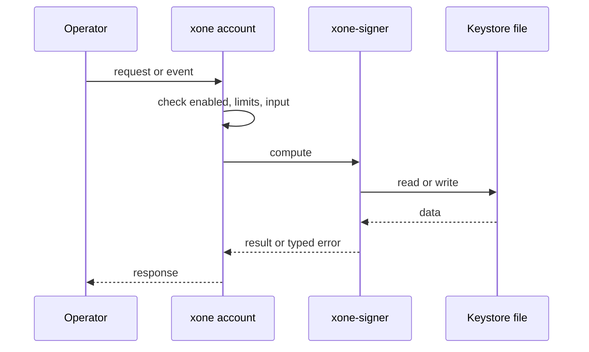
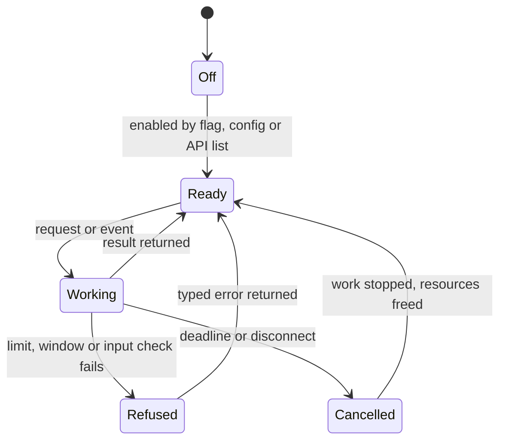
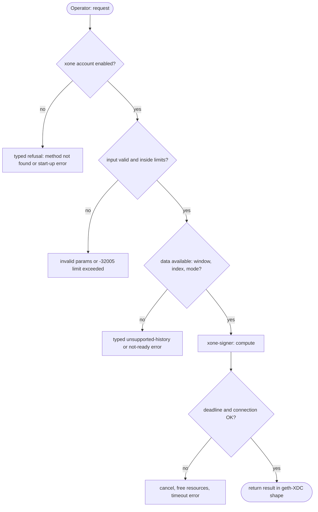

## What

xOne reads keystore v3 files but cannot create, import, list or re-encrypt them. Masternode set-up guides use `XDC account new` and `XDC account import`. An xOne operator needs a second client binary to make a validator key.

## Why

4 of the 10 selected competitors have this capability (file evidence at the audited commit):

- `ethereum/go-ethereum`: [cmd/geth/accountcmd.go](https://github.com/ethereum/go-ethereum/blob/8059ff8beb3170eb8b977169ac51bb0423c97ee1/cmd/geth/accountcmd.go)
- `bnb-chain/bsc`: [cmd/geth/accountcmd.go](https://github.com/bnb-chain/bsc/blob/54afaff4da31ac9e49ba646a4f65104edac5a2f3/cmd/geth/accountcmd.go)
- `0xPolygon/bor`: [cmd/geth/accountcmd.go](https://github.com/0xPolygon/bor/blob/ee09efd5dd9ef75917368990b272581b0e2c2665/cmd/geth/accountcmd.go)
- `XinFinOrg/XDPoSChain`: [cmd/XDC/accountcmd.go](https://github.com/XinFinOrg/XDPoSChain/blob/cb1ef79073c05f50b9df75b1e740387b9d72af99/cmd/XDC/accountcmd.go)

Priority: P3: 4 of 10 selected competitors have it (rule: 1-4 = P3).

Our code today: crates/xone-signer/src/local_keystore.rs (read only); no account subcommand in bin/xone/src/cmd.

Related xOneRS issues: #40, #61. This issue adds the capability; it does not replace their gates.

## 80% of the way to

1. `bin/xone/src/cmd/account.rs` (new): `account new`, `account import <keyfile>`, `account list`, `account update <addr>`; password from `--password` file or a prompt with no echo.
2. Write keystore v3 with scrypt (geth StandardScryptN/P), file mode 0600, geth file names (`UTC--<time>--<addr>`), in `<datadir>/keystore` or `--keystore`.
3. Reuse the bounded intake of #61 for import; zeroize secrets (`crates/xone-signer/src/secret.rs`).
4. Tests: geth decrypts files written by xOne and xOne decrypts files written by geth.

Acceptance criteria:

- [ ] Round-trip test with geth keystore vectors.
- [ ] File mode and no-secret-in-output tests.

## ASD-STE100

1. `xone account new` MUST write a keystore v3 file that geth-XDC can decrypt.
2. The command MUST NOT print or log the private key.
3. The keystore file MUST have mode 0600.

## Diagrams



## Images

None.

## Prompt

```text
You work in XDCIndia/xOneRS (Rust XDC client). Implement GAP-0031: Account management CLI: xone account new / import / list / update.

Context: xOne reads keystore v3 files but cannot create, import, list or re-encrypt them. Masternode set-up guides use `XDC account new` and `XDC account import`. An xOne operator needs a second client binary to make a validator key.

Reference behaviour: geth-XDC at XDCIndia/go-ethereum 6fc8e8c2088b7f18264f5663036669d04fa7becf (conformance/PIN). Where geth-XDC lacks the feature, follow the first competitor in the Why section and record the choice in the PR.

Steps:
1. `bin/xone/src/cmd/account.rs` (new): `account new`, `account import <keyfile>`, `account list`, `account update <addr>`; password from `--password` file or a prompt with no echo.
2. Write keystore v3 with scrypt (geth StandardScryptN/P), file mode 0600, geth file names (`UTC--<time>--<addr>`), in `<datadir>/keystore` or `--keystore`.
3. Reuse the bounded intake of #61 for import; zeroize secrets (`crates/xone-signer/src/secret.rs`).
4. Tests: geth decrypts files written by xOne and xOne decrypts files written by geth.

Rules: one branch `feat/gap-0031-accountcli` from main, one PR that closes this issue. Write the tests and vectors first. Keep consensus, execution and storage formats unchanged. Run `cargo fmt --check`, `cargo clippy --all-targets -- -D warnings`, `cargo test --locked`, `ci/check-layering.sh` and `ci/check-fixtures.sh`. Update docs/cli/flags.md with `UPDATE_DOCS=1 cargo test -p xone flags_doc` if you add a flag. Hand back in 25 lines or fewer: files changed, tests added, acceptance results.
```

## Workflow

1. Maintainer: confirms priority P3 and assigns the issue.
2. Engineer: creates branch `feat/gap-0031-accountcli` from `main`.
3. Engineer: writes the failing tests and the parity vectors (xdc02 archive or the reference client).
4. Engineer: implements the change in the files of Layout.
5. Engineer: runs the gates (fmt, clippy, test, layering, fixtures) and the parity check.
6. Engineer: opens one PR that says `Closes #<this issue>` and lists the acceptance results.
7. Reviewer: checks each acceptance criterion and the ASD-STE100 requirements.
8. Maintainer: merges.
9. Operator: enables the feature on one net2040 node and records the result in this issue.

## Loop

Runtime: None.

Develop-verify: write a vector, implement, diff the answer against the xdc02 geth-XDC archive (or the reference client), fix, repeat until 0 mismatches. A retry after a failed gate starts from the failing vector.

## Graph



## Layout

```text
Files touched:
  bin/xone/src/cmd
  bin/xone/src/cmd/account.rs
  crates/xone-signer/src/local_keystore.rs
  crates/xone-signer/src/secret.rs
```

## Flow



## Summary

Gap: Account management CLI: xone account new / import / list / update is missing or partial in xOneRS; 4 of 10 selected competitors have it.
Fix: implement it as in "80% of the way to", with geth-XDC behaviour as the reference.
Acceptance: Round-trip test with geth keystore vectors.

<!-- gap-audit:GAP-0031 -->
