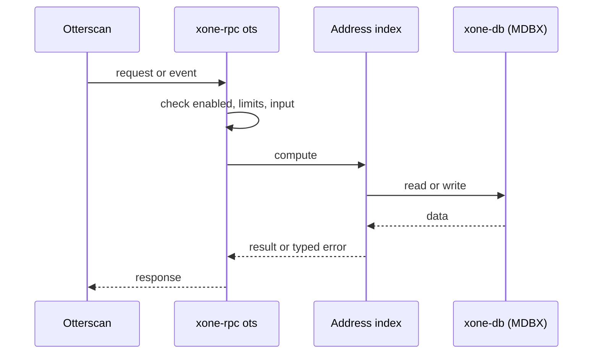
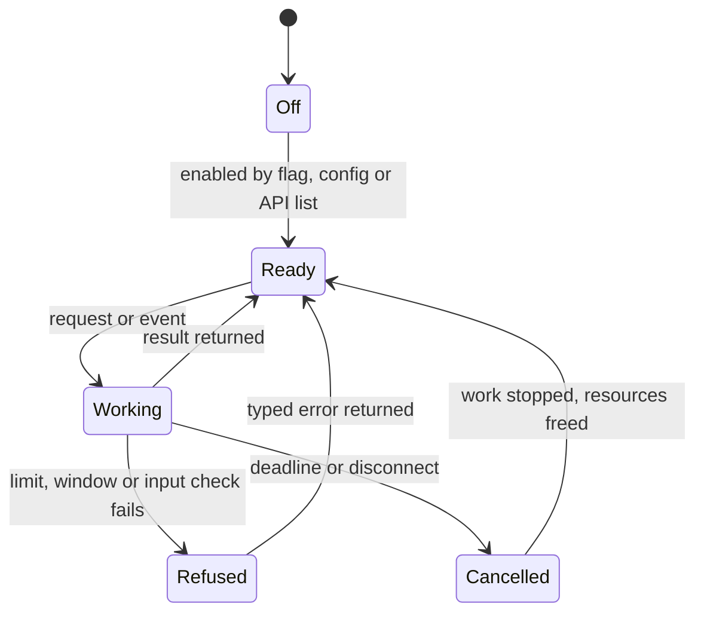
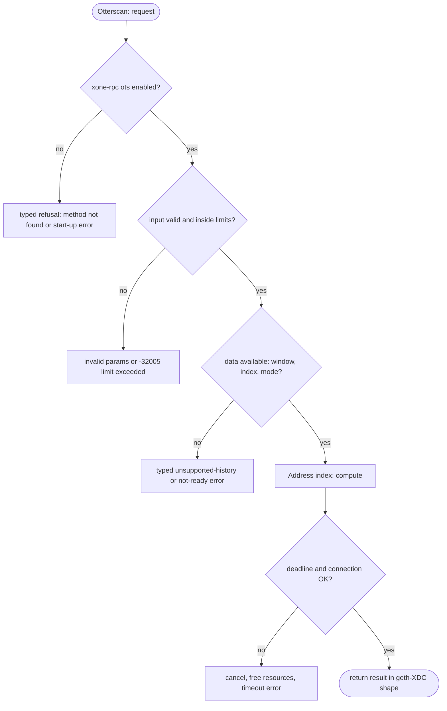

## What

Otterscan (a local block explorer) needs the `ots_*` namespace. Operators of Erigon, reth and Nethermind point Otterscan at their node. xOne operators cannot.

## Why

3 of the 10 selected competitors have this capability (file evidence at the audited commit):

- `erigontech/erigon`: [rpc/jsonrpc/otterscan_api.go](https://github.com/erigontech/erigon/blob/bbb5524e53fb057e7d47a5066e152f1091ac4ba4/rpc/jsonrpc/otterscan_api.go)
- `paradigmxyz/reth`: [crates/rpc/rpc/src/otterscan.rs](https://github.com/paradigmxyz/reth/blob/36600d5ff9628465475dd4c7608e2e9f2fe24273/crates/rpc/rpc/src/otterscan.rs)
- `NethermindEth/nethermind`: [src/Nethermind/Nethermind.JsonRpc.TraceStore/Ots/IOtsRpcModule.cs](https://github.com/NethermindEth/nethermind/blob/a7dd73052e696ad934d228aad3f33e660701fdb7/src/Nethermind/Nethermind.JsonRpc.TraceStore/Ots/IOtsRpcModule.cs)

Priority: P3: 3 of 10 selected competitors have it (rule: 1-4 = P3).

Our code today: none.

Related xOneRS issues: #42. This issue adds the capability; it does not replace their gates.

## 80% of the way to

1. `crates/xone-rpc/src/ots.rs` (new): `ots_getApiLevel`, `ots_getInternalOperations`, `ots_hasCode`, `ots_getTransactionError`, `ots_traceTransaction`, `ots_getBlockDetails`, `ots_getBlockTransactions`, `ots_getTransactionBySenderAndNonce`, `ots_getContractCreator`, `ots_searchTransactionsBefore/After`.
2. Search methods need an address-to-transaction index; add it as an optional MDBX table behind `--ots.index` (off by default).
3. Tests: run Otterscan against a net2040 node; method vectors from reth `crates/rpc/rpc/src/otterscan.rs` tests.

Acceptance criteria:

- [ ] Otterscan shows blocks, transactions, internal operations and address history from a net2040 xOne node.

## ASD-STE100

1. The node MUST serve `ots_*` only when the API list names `ots`.
2. The address index MUST be optional. It MUST be off by default.

## Diagrams



## Images

None.

## Prompt

```text
You work in XDCIndia/xOneRS (Rust XDC client). Implement GAP-0032: Otterscan ots_* namespace.

Context: Otterscan (a local block explorer) needs the `ots_*` namespace. Operators of Erigon, reth and Nethermind point Otterscan at their node. xOne operators cannot.

Reference behaviour: geth-XDC at XDCIndia/go-ethereum 6fc8e8c2088b7f18264f5663036669d04fa7becf (conformance/PIN). Where geth-XDC lacks the feature, follow the first competitor in the Why section and record the choice in the PR.

Steps:
1. `crates/xone-rpc/src/ots.rs` (new): `ots_getApiLevel`, `ots_getInternalOperations`, `ots_hasCode`, `ots_getTransactionError`, `ots_traceTransaction`, `ots_getBlockDetails`, `ots_getBlockTransactions`, `ots_getTransactionBySenderAndNonce`, `ots_getContractCreator`, `ots_searchTransactionsBefore/After`.
2. Search methods need an address-to-transaction index; add it as an optional MDBX table behind `--ots.index` (off by default).
3. Tests: run Otterscan against a net2040 node; method vectors from reth `crates/rpc/rpc/src/otterscan.rs` tests.

Rules: one branch `feat/gap-0032-otterscan` from main, one PR that closes this issue. Write the tests and vectors first. Keep consensus, execution and storage formats unchanged. Run `cargo fmt --check`, `cargo clippy --all-targets -- -D warnings`, `cargo test --locked`, `ci/check-layering.sh` and `ci/check-fixtures.sh`. Update docs/cli/flags.md with `UPDATE_DOCS=1 cargo test -p xone flags_doc` if you add a flag. Hand back in 25 lines or fewer: files changed, tests added, acceptance results.
```

## Workflow

1. Maintainer: confirms priority P3 and assigns the issue.
2. Engineer: creates branch `feat/gap-0032-otterscan` from `main`.
3. Engineer: writes the failing tests and the parity vectors (xdc02 archive or the reference client).
4. Engineer: implements the change in the files of Layout.
5. Engineer: runs the gates (fmt, clippy, test, layering, fixtures) and the parity check.
6. Engineer: opens one PR that says `Closes #<this issue>` and lists the acceptance results.
7. Reviewer: checks each acceptance criterion and the ASD-STE100 requirements.
8. Maintainer: merges.
9. Operator: enables the feature on one net2040 node and records the result in this issue.

## Loop

Runtime: Index entries are written in each block commit when the index is on.

Develop-verify: write a vector, implement, diff the answer against the xdc02 geth-XDC archive (or the reference client), fix, repeat until 0 mismatches. A retry after a failed gate starts from the failing vector.

## Graph



## Layout

```text
Files touched:
  crates/rpc/rpc/src/otterscan.rs
  crates/xone-rpc/src/ots.rs
```

## Flow



## Summary

Gap: Otterscan ots_* namespace is missing or partial in xOneRS; 3 of 10 selected competitors have it.
Fix: implement it as in "80% of the way to", with geth-XDC behaviour as the reference.
Acceptance: Otterscan shows blocks, transactions, internal operations and address history from a net2040 xOne node.

<!-- gap-audit:GAP-0032 -->
