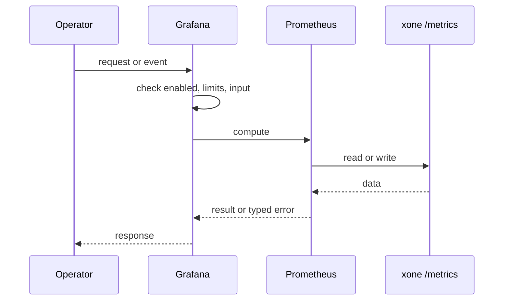
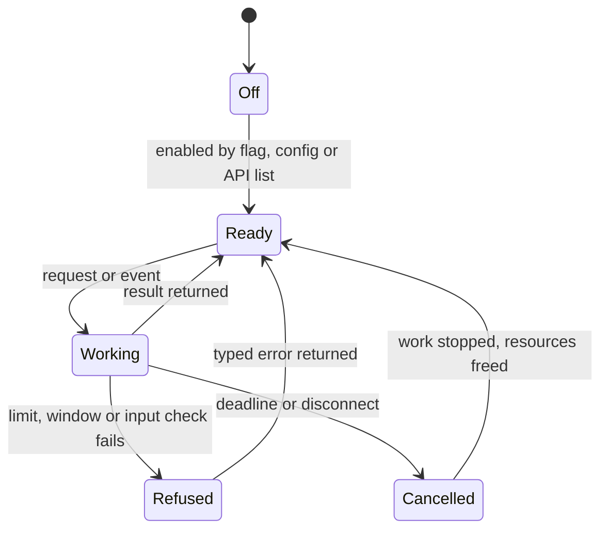
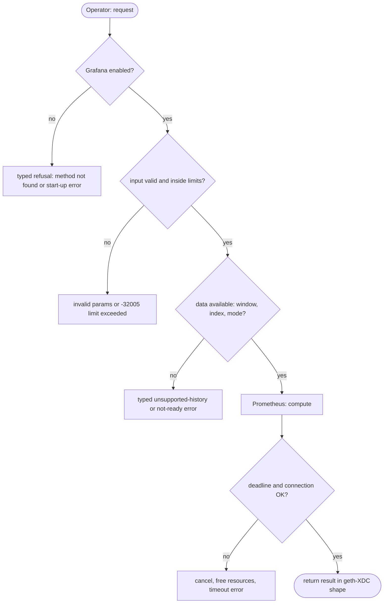

## What

xOne exports Prometheus metrics but ships no dashboard and no alert rules. reth, Erigon and ethrex ship Grafana dashboards and a compose file. A third-party operator must build panels by hand. The SkyNet board covers the XDCIndia fleet only.

## Why

3 of the 10 selected competitors have this capability (file evidence at the audited commit):

- `paradigmxyz/reth`: [etc/grafana/dashboards/overview.json](https://github.com/paradigmxyz/reth/blob/36600d5ff9628465475dd4c7608e2e9f2fe24273/etc/grafana/dashboards/overview.json)
- `erigontech/erigon`: [cmd/prometheus/dashboards/dashboard.yml](https://github.com/erigontech/erigon/blob/bbb5524e53fb057e7d47a5066e152f1091ac4ba4/cmd/prometheus/dashboards/dashboard.yml)
- `lambdaclass/ethrex`: [metrics/provisioning/grafana/dashboards/dashboard_config_l1.yaml](https://github.com/lambdaclass/ethrex/blob/740ea493880b6c073b81537010df75e143c615c2/metrics/provisioning/grafana/dashboards/dashboard_config_l1.yaml)

Priority: P3: 3 of 10 selected competitors have it (rule: 1-4 = P3).

Our code today: crates/xone-node/src/observe/metrics.rs (about 20 metric families); no dashboard or alert rules in the repo.

Related xOneRS issues: #41. This issue adds the capability; it does not replace their gates.

## 80% of the way to

1. `ops/grafana/xone-overview.json`: panels for head and head age, peers, import rate, queue depths, RPC in-flight by class, BFT round/QC/timeouts, missed eligible turns, storage bytes, log drops.
2. `ops/prometheus/alerts.yml`: head age > 30 s, peers < 3, missed eligible turns increase, queue overflow increase, storage > 85 % of the disk.
3. `ops/grafana/docker-compose.yml` for a local stack; `docs/ops/monitoring.md`.
4. Add metric families the panels need where missing (per-method RPC latency histogram, p2p messages in/out by code).
5. Test: CI loads the dashboard JSON and checks every metric name against `metrics.rs`.

Acceptance criteria:

- [ ] Dashboard imports into Grafana and shows data from a devnet node.
- [ ] CI check of metric names passes.

## ASD-STE100

1. The repository MUST contain a Grafana dashboard for the node metrics.
2. Each metric name in the dashboard MUST exist in the node.
3. The repository MUST contain alert rules for head age, peers and missed turns.

## Diagrams



## Images

None.

## Prompt

```text
You work in XDCIndia/xOneRS (Rust XDC client). Implement GAP-0033: Shipped Grafana dashboard and alert rules for the Prometheus metrics.

Context: xOne exports Prometheus metrics but ships no dashboard and no alert rules. reth, Erigon and ethrex ship Grafana dashboards and a compose file. A third-party operator must build panels by hand. The SkyNet board covers the XDCIndia fleet only.

Reference behaviour: geth-XDC at XDCIndia/go-ethereum 6fc8e8c2088b7f18264f5663036669d04fa7becf (conformance/PIN). Where geth-XDC lacks the feature, follow the first competitor in the Why section and record the choice in the PR.

Steps:
1. `ops/grafana/xone-overview.json`: panels for head and head age, peers, import rate, queue depths, RPC in-flight by class, BFT round/QC/timeouts, missed eligible turns, storage bytes, log drops.
2. `ops/prometheus/alerts.yml`: head age > 30 s, peers < 3, missed eligible turns increase, queue overflow increase, storage > 85 % of the disk.
3. `ops/grafana/docker-compose.yml` for a local stack; `docs/ops/monitoring.md`.
4. Add metric families the panels need where missing (per-method RPC latency histogram, p2p messages in/out by code).
5. Test: CI loads the dashboard JSON and checks every metric name against `metrics.rs`.

Rules: one branch `feat/gap-0033-grafana` from main, one PR that closes this issue. Write the tests and vectors first. Keep consensus, execution and storage formats unchanged. Run `cargo fmt --check`, `cargo clippy --all-targets -- -D warnings`, `cargo test --locked`, `ci/check-layering.sh` and `ci/check-fixtures.sh`. Update docs/cli/flags.md with `UPDATE_DOCS=1 cargo test -p xone flags_doc` if you add a flag. Hand back in 25 lines or fewer: files changed, tests added, acceptance results.
```

## Workflow

1. Maintainer: confirms priority P3 and assigns the issue.
2. Engineer: creates branch `feat/gap-0033-grafana` from `main`.
3. Engineer: writes the failing tests and the parity vectors (xdc02 archive or the reference client).
4. Engineer: implements the change in the files of Layout.
5. Engineer: runs the gates (fmt, clippy, test, layering, fixtures) and the parity check.
6. Engineer: opens one PR that says `Closes #<this issue>` and lists the acceptance results.
7. Reviewer: checks each acceptance criterion and the ASD-STE100 requirements.
8. Maintainer: merges.
9. Operator: enables the feature on one net2040 node and records the result in this issue.

## Loop

Runtime: Prometheus scrapes /metrics every 15 s.

Develop-verify: write a vector, implement, diff the answer against the xdc02 geth-XDC archive (or the reference client), fix, repeat until 0 mismatches. A retry after a failed gate starts from the failing vector.

## Graph



## Layout

```text
Files touched:
  crates/xone-node/src/observe/metrics.rs
  docs/ops/monitoring.md
  ops/grafana/docker-compose.yml
  ops/grafana/xone-overview.json
  ops/prometheus/alerts.yml
```

## Flow



## Summary

Gap: Shipped Grafana dashboard and alert rules for the Prometheus metrics is missing or partial in xOneRS; 3 of 10 selected competitors have it.
Fix: implement it as in "80% of the way to", with geth-XDC behaviour as the reference.
Acceptance: Dashboard imports into Grafana and shows data from a devnet node.

<!-- gap-audit:GAP-0033 -->
