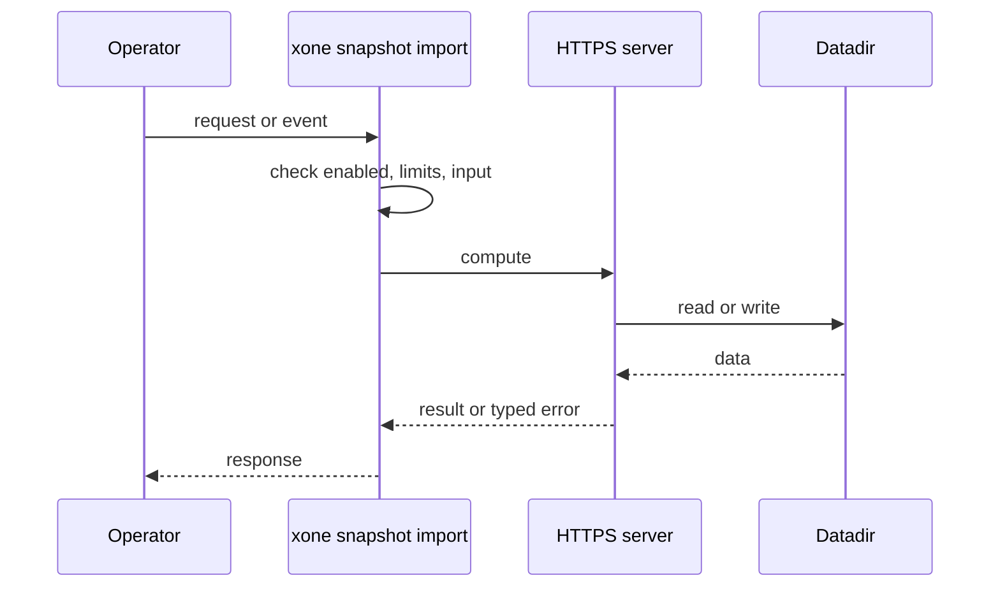
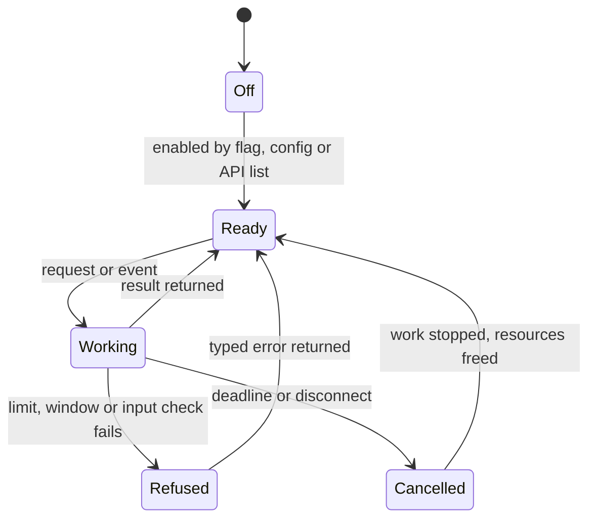
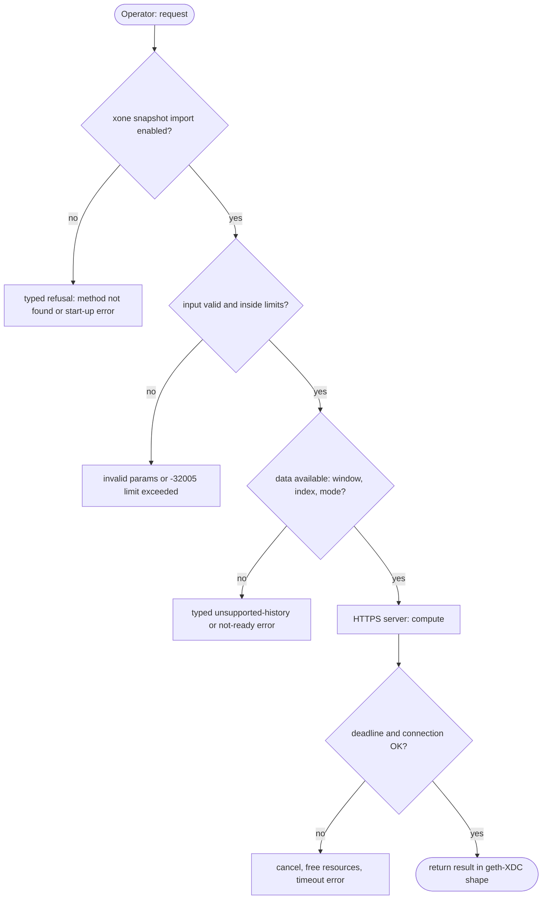

## What

`xone snapshot import` reads a local file. reth `download`, Erigon's downloader and Nethermind's snapshot plugin fetch the snapshot from a URL, resume a broken download and check a checksum. An operator of a new node must download and verify by hand.

## Why

3 of the 10 selected competitors have this capability (file evidence at the audited commit):

- `paradigmxyz/reth`: [crates/cli/commands/src/download/mod.rs](https://github.com/paradigmxyz/reth/blob/36600d5ff9628465475dd4c7608e2e9f2fe24273/crates/cli/commands/src/download/mod.rs)
- `NethermindEth/nethermind`: [src/Nethermind/Nethermind.Init.Snapshot/ISnapshotConfig.cs](https://github.com/NethermindEth/nethermind/blob/a7dd73052e696ad934d228aad3f33e660701fdb7/src/Nethermind/Nethermind.Init.Snapshot/ISnapshotConfig.cs)
- `erigontech/erigon`: [cmd/downloader/main.go](https://github.com/erigontech/erigon/blob/bbb5524e53fb057e7d47a5066e152f1091ac4ba4/cmd/downloader/main.go)

Priority: P3: 3 of 10 selected competitors have it (rule: 1-4 = P3).

Our code today: bin/xone/src/cmd/snapshot.rs (import from a local file only).

Related xOneRS issues: #38, #14. This issue adds the capability; it does not replace their gates.

## 80% of the way to

1. `bin/xone/src/cmd/snapshot.rs`: `--in https://...`; stream to `<datadir>/snapshot.part` with HTTP range resume; check the SHA-256 from `<url>.sha256` or `--sha256`; then the existing import with `--pins`.
2. Pins stay mandatory: the URL is not trusted (spec/bootstrap/snapshot-format.md).
3. Tests: local HTTP server with an interrupted transfer; wrong checksum refused.

Acceptance criteria:

- [ ] Interrupted-download and wrong-checksum tests pass.

## ASD-STE100

1. The import MUST verify the checksum before it opens the archive.
2. The import MUST still verify the pins. A URL MUST NOT replace the pins.
3. An interrupted download MUST resume from the last byte.

## Diagrams



## Images

None.

## Prompt

```text
You work in XDCIndia/xOneRS (Rust XDC client). Implement GAP-0034: Snapshot import from an HTTPS URL with checksum, resume and pins.

Context: `xone snapshot import` reads a local file. reth `download`, Erigon's downloader and Nethermind's snapshot plugin fetch the snapshot from a URL, resume a broken download and check a checksum. An operator of a new node must download and verify by hand.

Reference behaviour: geth-XDC at XDCIndia/go-ethereum 6fc8e8c2088b7f18264f5663036669d04fa7becf (conformance/PIN). Where geth-XDC lacks the feature, follow the first competitor in the Why section and record the choice in the PR.

Steps:
1. `bin/xone/src/cmd/snapshot.rs`: `--in https://...`; stream to `<datadir>/snapshot.part` with HTTP range resume; check the SHA-256 from `<url>.sha256` or `--sha256`; then the existing import with `--pins`.
2. Pins stay mandatory: the URL is not trusted (spec/bootstrap/snapshot-format.md).
3. Tests: local HTTP server with an interrupted transfer; wrong checksum refused.

Rules: one branch `feat/gap-0034-snapurl` from main, one PR that closes this issue. Write the tests and vectors first. Keep consensus, execution and storage formats unchanged. Run `cargo fmt --check`, `cargo clippy --all-targets -- -D warnings`, `cargo test --locked`, `ci/check-layering.sh` and `ci/check-fixtures.sh`. Update docs/cli/flags.md with `UPDATE_DOCS=1 cargo test -p xone flags_doc` if you add a flag. Hand back in 25 lines or fewer: files changed, tests added, acceptance results.
```

## Workflow

1. Maintainer: confirms priority P3 and assigns the issue.
2. Engineer: creates branch `feat/gap-0034-snapurl` from `main`.
3. Engineer: writes the failing tests and the parity vectors (xdc02 archive or the reference client).
4. Engineer: implements the change in the files of Layout.
5. Engineer: runs the gates (fmt, clippy, test, layering, fixtures) and the parity check.
6. Engineer: opens one PR that says `Closes #<this issue>` and lists the acceptance results.
7. Reviewer: checks each acceptance criterion and the ASD-STE100 requirements.
8. Maintainer: merges.
9. Operator: enables the feature on one net2040 node and records the result in this issue.

## Loop

Runtime: Retry the download with backoff (5 tries).

Develop-verify: write a vector, implement, diff the answer against the xdc02 geth-XDC archive (or the reference client), fix, repeat until 0 mismatches. A retry after a failed gate starts from the failing vector.

## Graph



## Layout

```text
Files touched:
  bin/xone/src/cmd/snapshot.rs
  spec/bootstrap/snapshot-format.md
```

## Flow



## Summary

Gap: Snapshot import from an HTTPS URL with checksum, resume and pins is missing or partial in xOneRS; 3 of 10 selected competitors have it.
Fix: implement it as in "80% of the way to", with geth-XDC behaviour as the reference.
Acceptance: Interrupted-download and wrong-checksum tests pass.

<!-- gap-audit:GAP-0034 -->
