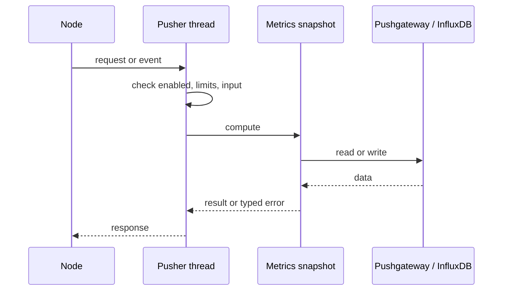
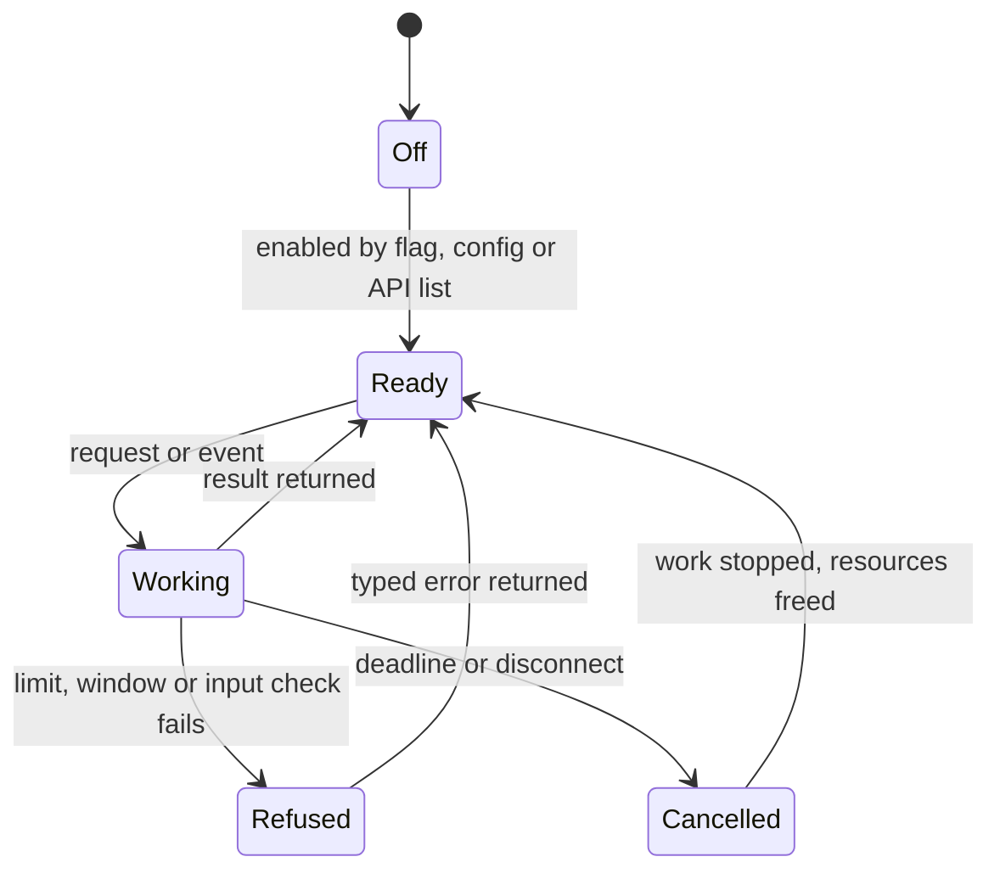
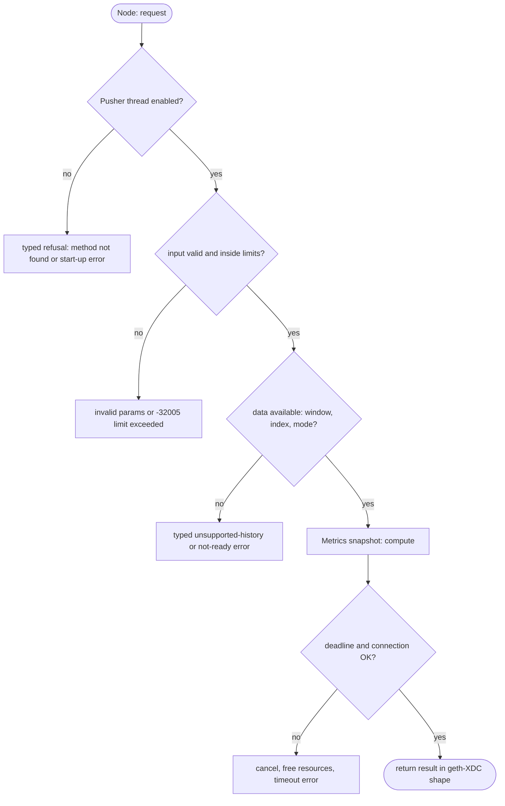

## What

xOne serves metrics for scraping only. A node behind NAT or a firewall, or a short-lived node, cannot push its metrics. geth-XDC and XDPoSChain push to InfluxDB (`--metrics.influxdb*`); reth, Nethermind and Besu push to a Prometheus Pushgateway.

## Why

7 of the 10 selected competitors have this capability (file evidence at the audited commit):

- `ethereum/go-ethereum`: [cmd/utils/flags.go](https://github.com/ethereum/go-ethereum/blob/8059ff8beb3170eb8b977169ac51bb0423c97ee1/cmd/utils/flags.go)
- `bnb-chain/bsc`: [cmd/utils/flags.go](https://github.com/bnb-chain/bsc/blob/54afaff4da31ac9e49ba646a4f65104edac5a2f3/cmd/utils/flags.go)
- `0xPolygon/bor`: [cmd/utils/flags.go](https://github.com/0xPolygon/bor/blob/ee09efd5dd9ef75917368990b272581b0e2c2665/cmd/utils/flags.go)
- `XinFinOrg/XDPoSChain`: [cmd/utils/flags.go](https://github.com/XinFinOrg/XDPoSChain/blob/cb1ef79073c05f50b9df75b1e740387b9d72af99/cmd/utils/flags.go)
- `NethermindEth/nethermind`: [src/Nethermind/Nethermind.Api/Monitoring/IMetricsConfig.cs](https://github.com/NethermindEth/nethermind/blob/a7dd73052e696ad934d228aad3f33e660701fdb7/src/Nethermind/Nethermind.Api/Monitoring/IMetricsConfig.cs)
- `paradigmxyz/reth`: [crates/node/metrics/src/server.rs](https://github.com/paradigmxyz/reth/blob/36600d5ff9628465475dd4c7608e2e9f2fe24273/crates/node/metrics/src/server.rs)
- `besu-eth/besu`: [app/src/main/java/org/hyperledger/besu/cli/options/MetricsOptions.java](https://github.com/besu-eth/besu/blob/2b839d96863d01210f45a6f62127e6229e5b0889/app/src/main/java/org/hyperledger/besu/cli/options/MetricsOptions.java)

Priority: P2: 7 of 10 selected competitors have it (rule: 5-7 = P2).

Our code today: crates/xone-node/src/observe/metrics.rs (pull /metrics only).

Related xOneRS issues: #41. This issue adds the capability; it does not replace their gates.

## 80% of the way to

1. `crates/xone-node/src/observe/push.rs` (new): a pusher thread that renders the same `Snapshot` as `/metrics` and sends it every `--metrics.push.interval` (default 15 s) to `--metrics.push.url` (Pushgateway text format) or to InfluxDB line protocol (`--metrics.influxdb.endpoint`, database, username, password file, tags as geth-XDC).
2. Credentials only from files, never from flags; redacted in logs and dumpconfig.
3. Bounded: one in-flight request, timeout 5 s, failures counted in `xone_metrics_push_failures_total`.
4. Tests: local Pushgateway and InfluxDB in CI; failure path does not block the node.

Acceptance criteria:

- [ ] Metrics arrive in a local Pushgateway and a local InfluxDB from a devnet node.
- [ ] Redaction and failure-counter tests pass.

## ASD-STE100

1. The node MUST push metrics only when a push URL is set.
2. A push failure MUST NOT block the node. The node MUST count the failure.
3. The node MUST NOT write a push password to the log or to dumpconfig.

## Diagrams



## Images

None.

## Prompt

```text
You work in XDCIndia/xOneRS (Rust XDC client). Implement GAP-0035: Metrics push: InfluxDB and Prometheus Pushgateway export.

Context: xOne serves metrics for scraping only. A node behind NAT or a firewall, or a short-lived node, cannot push its metrics. geth-XDC and XDPoSChain push to InfluxDB (`--metrics.influxdb*`); reth, Nethermind and Besu push to a Prometheus Pushgateway.

Reference behaviour: geth-XDC at XDCIndia/go-ethereum 6fc8e8c2088b7f18264f5663036669d04fa7becf (conformance/PIN). Where geth-XDC lacks the feature, follow the first competitor in the Why section and record the choice in the PR.

Steps:
1. `crates/xone-node/src/observe/push.rs` (new): a pusher thread that renders the same `Snapshot` as `/metrics` and sends it every `--metrics.push.interval` (default 15 s) to `--metrics.push.url` (Pushgateway text format) or to InfluxDB line protocol (`--metrics.influxdb.endpoint`, database, username, password file, tags as geth-XDC).
2. Credentials only from files, never from flags; redacted in logs and dumpconfig.
3. Bounded: one in-flight request, timeout 5 s, failures counted in `xone_metrics_push_failures_total`.
4. Tests: local Pushgateway and InfluxDB in CI; failure path does not block the node.

Rules: one branch `feat/gap-0035-metricspush` from main, one PR that closes this issue. Write the tests and vectors first. Keep consensus, execution and storage formats unchanged. Run `cargo fmt --check`, `cargo clippy --all-targets -- -D warnings`, `cargo test --locked`, `ci/check-layering.sh` and `ci/check-fixtures.sh`. Update docs/cli/flags.md with `UPDATE_DOCS=1 cargo test -p xone flags_doc` if you add a flag. Hand back in 25 lines or fewer: files changed, tests added, acceptance results.
```

## Workflow

1. Maintainer: confirms priority P2 and assigns the issue.
2. Engineer: creates branch `feat/gap-0035-metricspush` from `main`.
3. Engineer: writes the failing tests and the parity vectors (xdc02 archive or the reference client).
4. Engineer: implements the change in the files of Layout.
5. Engineer: runs the gates (fmt, clippy, test, layering, fixtures) and the parity check.
6. Engineer: opens one PR that says `Closes #<this issue>` and lists the acceptance results.
7. Reviewer: checks each acceptance criterion and the ASD-STE100 requirements.
8. Maintainer: merges.
9. Operator: enables the feature on one net2040 node and records the result in this issue.

## Loop

Runtime: Push every --metrics.push.interval (default 15 s); skip a cycle when the previous push is still in flight.

Develop-verify: write a vector, implement, diff the answer against the xdc02 geth-XDC archive (or the reference client), fix, repeat until 0 mismatches. A retry after a failed gate starts from the failing vector.

## Graph



## Layout

```text
Files touched:
  crates/xone-node/src/observe/metrics.rs
  crates/xone-node/src/observe/push.rs
```

## Flow



## Summary

Gap: Metrics push: InfluxDB and Prometheus Pushgateway export is missing or partial in xOneRS; 7 of 10 selected competitors have it.
Fix: implement it as in "80% of the way to", with geth-XDC behaviour as the reference.
Acceptance: Metrics arrive in a local Pushgateway and a local InfluxDB from a devnet node.

<!-- gap-audit:GAP-0035 -->
