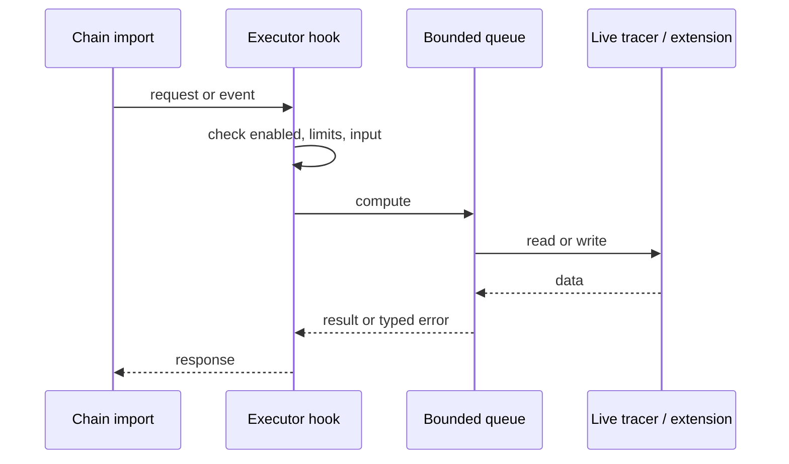
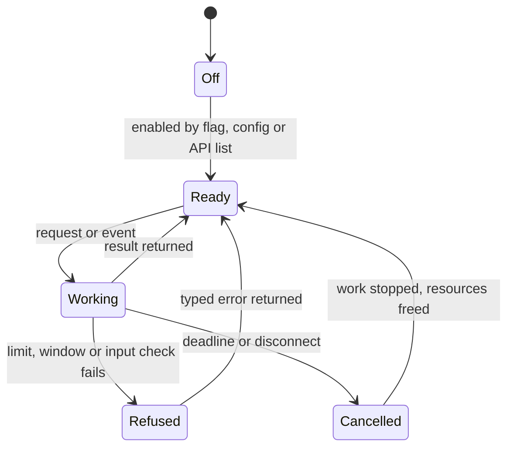
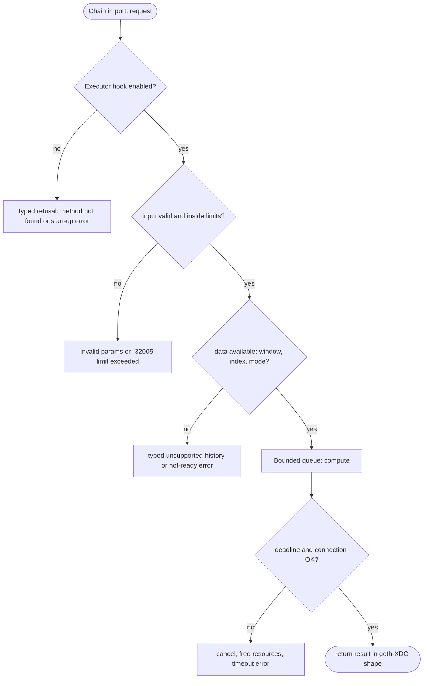

## What

An indexer that needs every internal call or every state change must re-trace each block over RPC. geth-XDC and XDPoSChain run a live tracer during import (`--vmtrace`), reth has execution extensions (ExEx) that receive committed and reverted chains, and Nethermind and Besu have plugin APIs with block events. xOne has no such hook.

## Why

7 of the 10 selected competitors have this capability (file evidence at the audited commit):

- `ethereum/go-ethereum`: [cmd/utils/flags.go](https://github.com/ethereum/go-ethereum/blob/8059ff8beb3170eb8b977169ac51bb0423c97ee1/cmd/utils/flags.go)
- `bnb-chain/bsc`: [cmd/utils/flags.go](https://github.com/bnb-chain/bsc/blob/54afaff4da31ac9e49ba646a4f65104edac5a2f3/cmd/utils/flags.go)
- `0xPolygon/bor`: [cmd/utils/flags.go](https://github.com/0xPolygon/bor/blob/ee09efd5dd9ef75917368990b272581b0e2c2665/cmd/utils/flags.go)
- `XinFinOrg/XDPoSChain`: [cmd/utils/flags.go](https://github.com/XinFinOrg/XDPoSChain/blob/cb1ef79073c05f50b9df75b1e740387b9d72af99/cmd/utils/flags.go)
- `ethereum/go-ethereum`: [eth/tracers/live/supply.go](https://github.com/ethereum/go-ethereum/blob/8059ff8beb3170eb8b977169ac51bb0423c97ee1/eth/tracers/live/supply.go)
- `paradigmxyz/reth`: [crates/exex/exex/src/lib.rs](https://github.com/paradigmxyz/reth/blob/36600d5ff9628465475dd4c7608e2e9f2fe24273/crates/exex/exex/src/lib.rs)
- `NethermindEth/nethermind`: [src/Nethermind/Nethermind.Api/Extensions/INethermindPlugin.cs](https://github.com/NethermindEth/nethermind/blob/a7dd73052e696ad934d228aad3f33e660701fdb7/src/Nethermind/Nethermind.Api/Extensions/INethermindPlugin.cs)
- `besu-eth/besu`: [plugin-api/src/main/java/org/hyperledger/besu/plugin/services/BesuEvents.java](https://github.com/besu-eth/besu/blob/2b839d96863d01210f45a6f62127e6229e5b0889/plugin-api/src/main/java/org/hyperledger/besu/plugin/services/BesuEvents.java)

Priority: P2: 7 of 10 selected competitors have it (rule: 5-7 = P2).

Our code today: none (traces are re-executed on request only: crates/xone-rpc/src/debug.rs).

Related xOneRS issues: #16, #34. This issue adds the capability; it does not replace their gates.

## 80% of the way to

1. Design first: an ADR that decides between (a) a built-in live tracer set selected by `--vmtrace <name>` with a JSON config, as geth-XDC, and (b) a Rust trait for compiled-in extensions as reth ExEx. A dynamic plugin loader is out (signer safety, ADR-010).
2. `crates/xone-executor`: call the hook with block start/end, tx start/end, call frames and state changes; the hook runs off the import thread through a bounded queue (ADR-007) and never changes execution.
3. Reorgs: the hook receives reverted blocks before the new chain, as reth `ExExNotification::ChainReorged`.
4. First built-in: the supply tracer (geth `eth/tracers/live/supply.go`) adapted to XDC rewards and burns.
5. Tests: supply totals over net2040 0..21,600 equal a recomputation from receipts; a slow hook drops events and counts them, import speed unchanged.

Acceptance criteria:

- [ ] ADR merged; supply tracer output verified on net2040 0..21,600.
- [ ] Import throughput with the hook on is within 5 % of hook off.

## ASD-STE100

1. A live hook MUST NOT change execution results or state roots.
2. A slow hook MUST NOT slow block import. The node MUST drop and count events when the hook queue is full.
3. On a reorg, the hook MUST receive the reverted blocks before the new blocks.

## Diagrams



## Images

None.

## Prompt

```text
You work in XDCIndia/xOneRS (Rust XDC client). Implement GAP-0036: Live chain-event hooks for in-process indexers (live tracer / execution extensions).

Context: An indexer that needs every internal call or every state change must re-trace each block over RPC. geth-XDC and XDPoSChain run a live tracer during import (`--vmtrace`), reth has execution extensions (ExEx) that receive committed and reverted chains, and Nethermind and Besu have plugin APIs with block events. xOne has no such hook.

Reference behaviour: geth-XDC at XDCIndia/go-ethereum 6fc8e8c2088b7f18264f5663036669d04fa7becf (conformance/PIN). Where geth-XDC lacks the feature, follow the first competitor in the Why section and record the choice in the PR.

Steps:
1. Design first: an ADR that decides between (a) a built-in live tracer set selected by `--vmtrace <name>` with a JSON config, as geth-XDC, and (b) a Rust trait for compiled-in extensions as reth ExEx. A dynamic plugin loader is out (signer safety, ADR-010).
2. `crates/xone-executor`: call the hook with block start/end, tx start/end, call frames and state changes; the hook runs off the import thread through a bounded queue (ADR-007) and never changes execution.
3. Reorgs: the hook receives reverted blocks before the new chain, as reth `ExExNotification::ChainReorged`.
4. First built-in: the supply tracer (geth `eth/tracers/live/supply.go`) adapted to XDC rewards and burns.
5. Tests: supply totals over net2040 0..21,600 equal a recomputation from receipts; a slow hook drops events and counts them, import speed unchanged.

Rules: one branch `feat/gap-0036-livehooks` from main, one PR that closes this issue. Write the tests and vectors first. Keep consensus, execution and storage formats unchanged. Run `cargo fmt --check`, `cargo clippy --all-targets -- -D warnings`, `cargo test --locked`, `ci/check-layering.sh` and `ci/check-fixtures.sh`. Update docs/cli/flags.md with `UPDATE_DOCS=1 cargo test -p xone flags_doc` if you add a flag. Hand back in 25 lines or fewer: files changed, tests added, acceptance results.
```

## Workflow

1. Maintainer: confirms priority P2 and assigns the issue.
2. Engineer: creates branch `feat/gap-0036-livehooks` from `main`.
3. Engineer: writes the failing tests and the parity vectors (xdc02 archive or the reference client).
4. Engineer: implements the change in the files of Layout.
5. Engineer: runs the gates (fmt, clippy, test, layering, fixtures) and the parity check.
6. Engineer: opens one PR that says `Closes #<this issue>` and lists the acceptance results.
7. Reviewer: checks each acceptance criterion and the ASD-STE100 requirements.
8. Maintainer: merges.
9. Operator: enables the feature on one net2040 node and records the result in this issue.

## Loop

Runtime: Events flow on each imported or reverted block.

Develop-verify: write a vector, implement, diff the answer against the xdc02 geth-XDC archive (or the reference client), fix, repeat until 0 mismatches. A retry after a failed gate starts from the failing vector.

## Graph



## Layout

```text
Files touched:
  crates/xone-executor
  crates/xone-rpc/src/debug.rs
```

## Flow



## Summary

Gap: Live chain-event hooks for in-process indexers (live tracer / execution extensions) is missing or partial in xOneRS; 7 of 10 selected competitors have it.
Fix: implement it as in "80% of the way to", with geth-XDC behaviour as the reference.
Acceptance: ADR merged; supply tracer output verified on net2040 0..21,600.

<!-- gap-audit:GAP-0036 -->
