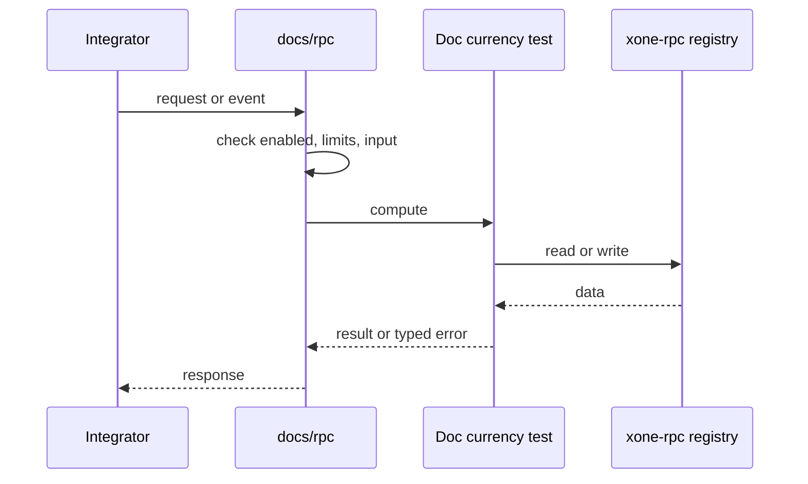
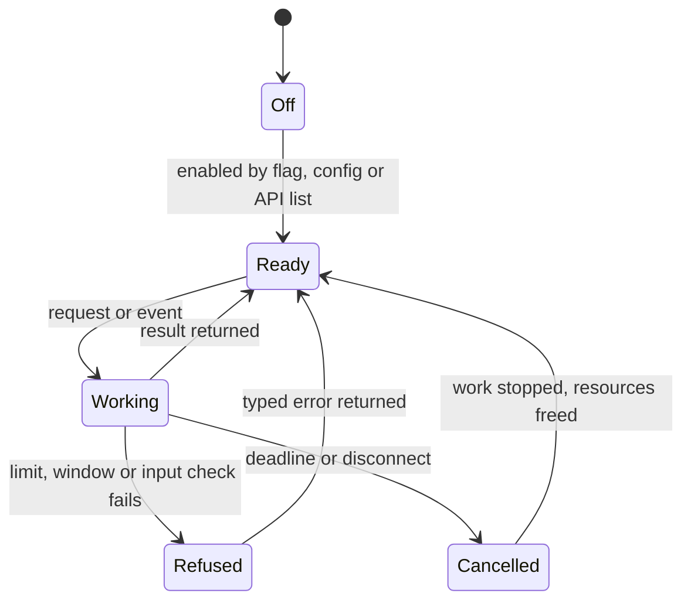
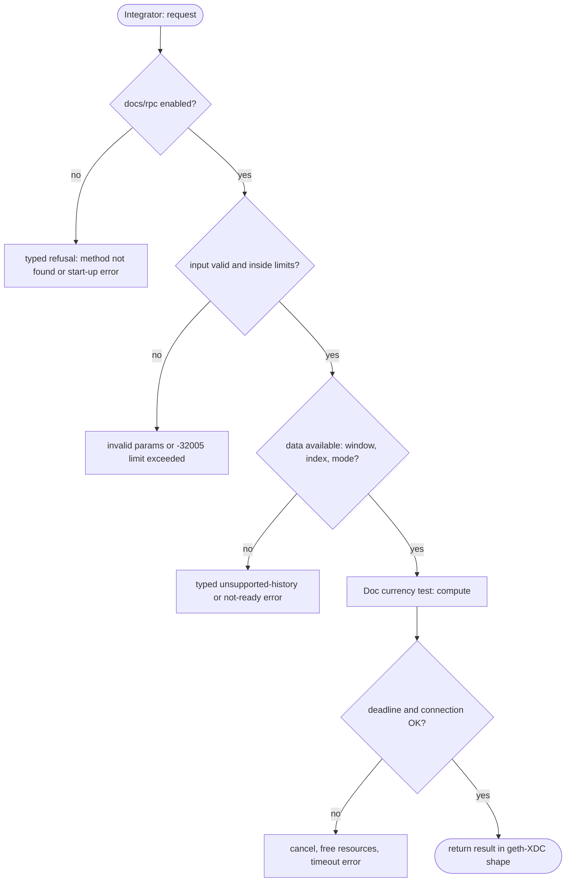

## What

An integrator cannot read which methods xOne serves, with which parameters, limits and error codes, without reading `spec/rpc` and the source. reth and XDPoSChain ship a per-method JSON-RPC reference in the repository; Erigon and Besu document their RPC daemons and trace APIs.

## Why

4 of the 10 selected competitors have this capability (file evidence at the audited commit):

- `paradigmxyz/reth`: [docs/vocs/docs/pages/jsonrpc/debug.mdx](https://github.com/paradigmxyz/reth/blob/36600d5ff9628465475dd4c7608e2e9f2fe24273/docs/vocs/docs/pages/jsonrpc/debug.mdx)
- `erigontech/erigon`: [docs/site/docs/fundamentals/modules/rpc-daemon.md](https://github.com/erigontech/erigon/blob/bbb5524e53fb057e7d47a5066e152f1091ac4ba4/docs/site/docs/fundamentals/modules/rpc-daemon.md)
- `XinFinOrg/XDPoSChain`: [docs/xdc/jsonrpc.md](https://github.com/XinFinOrg/XDPoSChain/blob/cb1ef79073c05f50b9df75b1e740387b9d72af99/docs/xdc/jsonrpc.md)
- `besu-eth/besu`: [docs/trace_rpc_apis.md](https://github.com/besu-eth/besu/blob/2b839d96863d01210f45a6f62127e6229e5b0889/docs/trace_rpc_apis.md)

Priority: P3: 4 of 10 selected competitors have it (rule: 1-4 = P3).

Our code today: spec/rpc/scope-adr-008.md, xdpos-namespace.md, xdc-eth-extensions.md (method lists and XDC specs; no per-method reference for the standard namespaces).

Related xOneRS issues: #42. This issue adds the capability; it does not replace their gates.

## 80% of the way to

1. `docs/rpc/` (new): one page per namespace (eth, net, web3, txpool, admin, debug, XDPoS, XDC eth extensions); for each method: parameters, result shape, quota class (ADR-007), errors (including the typed unsupported-history error), one curl example with a real net2040 answer.
2. Generate the method table from the registry (`crates/xone-rpc/src/api.rs`) in a test, as `flags_doc_is_current` does for flags, so the doc fails CI when a method is added or removed.
3. Mark each method's parity status against geth-XDC (vector file under `conformance/rpc`).
4. Link from README and docs/README.md.

Acceptance criteria:

- [ ] `docs/rpc/` covers 100 % of the registry; the currency test passes and fails on a removed method.

## ASD-STE100

1. The repository MUST document each served RPC method.
2. A test MUST fail when the registry and the documentation list different methods.
3. Each example MUST come from a real node answer.

## Diagrams



## Images

None.

## Prompt

```text
You work in XDCIndia/xOneRS (Rust XDC client). Implement GAP-0037: JSON-RPC reference documentation: every served method with parameters, result, errors and an example.

Context: An integrator cannot read which methods xOne serves, with which parameters, limits and error codes, without reading `spec/rpc` and the source. reth and XDPoSChain ship a per-method JSON-RPC reference in the repository; Erigon and Besu document their RPC daemons and trace APIs.

Reference behaviour: geth-XDC at XDCIndia/go-ethereum 6fc8e8c2088b7f18264f5663036669d04fa7becf (conformance/PIN). Where geth-XDC lacks the feature, follow the first competitor in the Why section and record the choice in the PR.

Steps:
1. `docs/rpc/` (new): one page per namespace (eth, net, web3, txpool, admin, debug, XDPoS, XDC eth extensions); for each method: parameters, result shape, quota class (ADR-007), errors (including the typed unsupported-history error), one curl example with a real net2040 answer.
2. Generate the method table from the registry (`crates/xone-rpc/src/api.rs`) in a test, as `flags_doc_is_current` does for flags, so the doc fails CI when a method is added or removed.
3. Mark each method's parity status against geth-XDC (vector file under `conformance/rpc`).
4. Link from README and docs/README.md.

Rules: one branch `feat/gap-0037-rpcdocs` from main, one PR that closes this issue. Write the tests and vectors first. Keep consensus, execution and storage formats unchanged. Run `cargo fmt --check`, `cargo clippy --all-targets -- -D warnings`, `cargo test --locked`, `ci/check-layering.sh` and `ci/check-fixtures.sh`. Update docs/cli/flags.md with `UPDATE_DOCS=1 cargo test -p xone flags_doc` if you add a flag. Hand back in 25 lines or fewer: files changed, tests added, acceptance results.
```

## Workflow

1. Maintainer: confirms priority P3 and assigns the issue.
2. Engineer: creates branch `feat/gap-0037-rpcdocs` from `main`.
3. Engineer: writes the failing tests and the parity vectors (xdc02 archive or the reference client).
4. Engineer: implements the change in the files of Layout.
5. Engineer: runs the gates (fmt, clippy, test, layering, fixtures) and the parity check.
6. Engineer: opens one PR that says `Closes #<this issue>` and lists the acceptance results.
7. Reviewer: checks each acceptance criterion and the ASD-STE100 requirements.
8. Maintainer: merges.
9. Operator: enables the feature on one net2040 node and records the result in this issue.

## Loop

Runtime: CI runs the doc currency test on each PR.

Develop-verify: write a vector, implement, diff the answer against the xdc02 geth-XDC archive (or the reference client), fix, repeat until 0 mismatches. A retry after a failed gate starts from the failing vector.

## Graph



## Layout

```text
Files touched:
  conformance/rpc
  crates/xone-rpc/src/api.rs
  docs/README.md
  docs/rpc
  spec/rpc/scope-adr-008.md
```

## Flow



## Summary

Gap: JSON-RPC reference documentation: every served method with parameters, result, errors and an example is missing or partial in xOneRS; 4 of 10 selected competitors have it.
Fix: implement it as in "80% of the way to", with geth-XDC behaviour as the reference.
Acceptance: `docs/rpc/` covers 100 % of the registry; the currency test passes and fails on a removed method.

<!-- gap-audit:GAP-0037 -->
