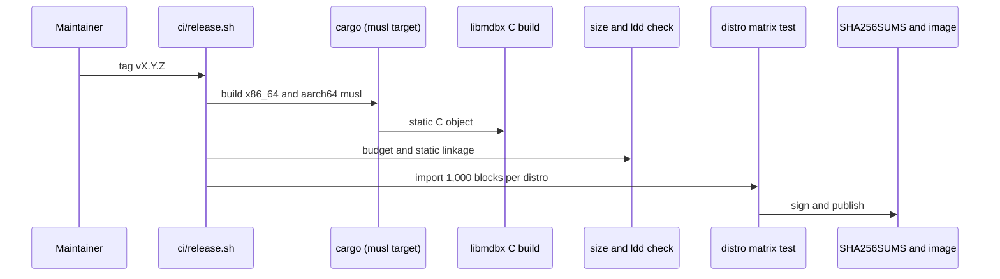
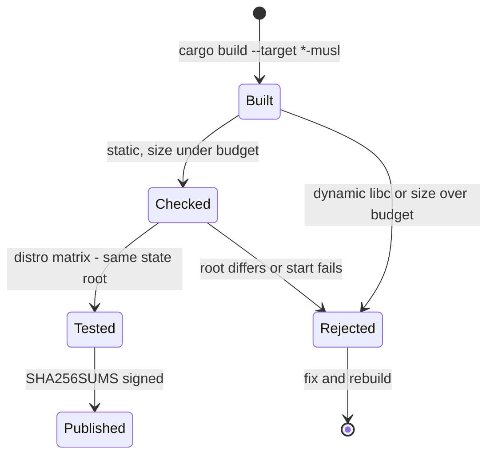
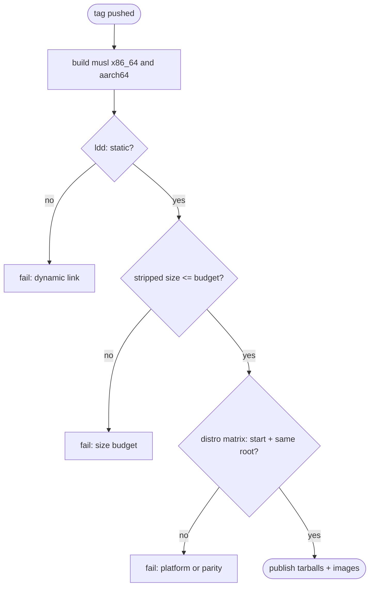

## What

The release binary is built on Ubuntu 24.04 and links glibc dynamically, so it needs GLIBC_2.38 and does not start on Ubuntu 22.04 or Debian 12. Only linux-x86_64 is built; aarch64 is listed as not covered. The binary is 19.4 MB and not stripped, and no size budget exists. Zig clients (Zeam, Phant) build for an explicit target triple per architecture and ship a scratch image. xOneRS can do the same with `x86_64-unknown-linux-musl` and `aarch64-unknown-linux-musl` (libmdbx is C and builds under musl), which also removes the host-libc term from the reproducible-build rule in docs/ops/release.md.

## Why

Strength of the Zig projects (Phant, Zeam) client family: C-level speed in tiny, self-contained binaries built for an explicit target (x86_64 and aarch64), shipped in a scratch image.

Evidence (competitor commits as in the first pass, `.gap-audit/gap-ledger.json`):

- `blockblaz/zeam`: [.github/workflows/auto-release.yml](https://github.com/blockblaz/zeam/blob/HEAD/.github/workflows/auto-release.yml) (`zig build -Dtarget=x86_64-linux-gnu` and `-Dtarget=aarch64-linux-gnu`, one release per arch)
- `blockblaz/zeam`: [Dockerfile.prebuilt](https://github.com/blockblaz/zeam/blob/HEAD/Dockerfile.prebuilt) (`FROM scratch` runtime with only the libraries `ldd` lists)
- `stateless-consensus/phant`: [build.zig](https://github.com/stateless-consensus/phant/blob/HEAD/build.zig) (`standardTargetOptions`: any target triple, static libraries for its C dependencies)
- `paradigmxyz/reth`: [Cargo.toml](https://github.com/paradigmxyz/reth/blob/36600d5ff9628465475dd4c7608e2e9f2fe24273/Cargo.toml) (release profiles; reth publishes x86_64 and aarch64 binaries)

Priority: P1 (impact on operators): the release binary needs GLIBC_2.38, so it does not start on Ubuntu 22.04 (glibc 2.35) or Debian 12 (2.36), which many XDC masternode hosts run. The Docker image hides this, a tarball install does not.

Our code today: `ci/release.sh` builds `target/release/xone` for the host only (linux-x86_64); `Dockerfile` says "it links glibc dynamically" on an `ubuntu:24.04` base; `docs/ops/release.md` "Not covered here": aarch64. Measured on the current build: `objdump -T target/release/xone` needs `GLIBC_2.38`; `ldd` lists libc, libm, libgcc_s; size 19.4 MB, not stripped; `Cargo.toml` has no `[profile.release]`.

Related xOneRS issues: #46 (closed; specified x86_64 and aarch64), #62, #22. This issue brings the strength; it does not replace their gates.

## 80% of the way to

1. `Cargo.toml`: add `[profile.release]` with `lto = "thin"`, `codegen-units = 1`, `strip = "symbols"`, `panic = "unwind"` (keep unwind: the node relies on bounded shutdown). Keep `debug = false`; ship a separate `.debug` file if the owner wants symbols.
2. `ci/release.sh`: build `--target x86_64-unknown-linux-musl` and `--target aarch64-unknown-linux-musl` (cross linker via `cargo zigbuild` or an aarch64 host; record the choice). The stamp `linux-x86_64` becomes `linux-<arch>-musl`. If musl costs more than 10 percent on the bench `transfers` workload, fall back to `*-linux-gnu.2.28` via `cargo zigbuild` (glibc floor pinned) and record why.
3. Allocator: musl malloc is slow; link `mimalloc` or `jemalloc` (reth uses jemalloc) in the binary crate only.
4. Size budget: `ci/check-release-tree.sh` fails when the stripped binary is above 25 MB (current 19.4 MB unstripped; set the number from the first musl build plus 20 percent).
5. `Dockerfile`: runtime stage `FROM scratch` (or distroless static) with the binary, CA certificates and `run-xone.sh` replaced by a direct entrypoint; one image per arch.
6. Tests: run the packaged binary in `ubuntu:20.04`, `ubuntu:22.04`, `debian:11`, `debian:12` and `alpine` containers: `xone --version` and a 1,000-block net2040 import from the RLP fixture; byte-equal state root to the glibc build.

Acceptance criteria:

- [ ] `ldd xone` says "not a dynamic executable" (or the GLIBC floor is 2.28 or lower) for both arches.
- [ ] The same release tarball starts and imports 1,000 net2040 blocks on Ubuntu 20.04, 22.04, 24.04, Debian 11, 12 and Alpine, with the same state root.
- [ ] An aarch64 tarball and image are produced by `ci/release.sh` and pass the same import.
- [ ] Stripped binary size is recorded in the release notes and under the CI budget; bench `transfers` throughput within 10 percent of the glibc build.

## ASD-STE100

1. The release MUST contain one binary for x86_64 and one binary for aarch64.
2. Each binary MUST start on Ubuntu 20.04 and later and on Debian 11 and later without extra libraries.
3. The binary MUST give the same state root as the glibc build for the same blocks.
4. CI MUST fail when the stripped binary is larger than the budget.
5. The release MUST NOT change consensus, execution or storage formats.

## Diagrams



## Images

None. Numbers (sizes, latencies, RSS) go in the PR description as tables.

## Prompt

```text
You work in XDCIndia/xOneRS (Rust XDC client). Implement GAP-0038: Self-contained release binaries: static musl (or a pinned glibc floor), aarch64, size budget and a minimal image.

Context: The release binary is built on Ubuntu 24.04 and links glibc dynamically, so it needs GLIBC_2.38 and does not start on Ubuntu 22.04 or Debian 12. Only linux-x86_64 is built; aarch64 is listed as not covered. The binary is 19.4 MB and not stripped, and no size budget exists. Zig clients (Zeam, Phant) build for an explicit target triple per architecture and ship a scratch image. xOneRS can do the same with `x86_64-unknown-linux-musl` and `aarch64-unknown-linux-musl` (libmdbx is C and builds under musl), which also removes the host-libc term from the reproducible-build rule in docs/ops/release.md.

Strength brought from Zig projects (Phant, Zeam): C-level speed in tiny, self-contained binaries built for an explicit target (x86_64 and aarch64), shipped in a scratch image. Read the evidence links in the Why section first.

Reference behaviour: geth-XDC at XDCIndia/go-ethereum 6fc8e8c2088b7f18264f5663036669d04fa7becf (conformance/PIN) for anything consensus-visible; this issue must not change consensus, execution or wire formats. Where geth-XDC lacks the feature, follow the first source in the Why section and record the choice in the PR.

Steps:
1. `Cargo.toml`: add `[profile.release]` with `lto = "thin"`, `codegen-units = 1`, `strip = "symbols"`, `panic = "unwind"` (keep unwind: the node relies on bounded shutdown). Keep `debug = false`; ship a separate `.debug` file if the owner wants symbols.
2. `ci/release.sh`: build `--target x86_64-unknown-linux-musl` and `--target aarch64-unknown-linux-musl` (cross linker via `cargo zigbuild` or an aarch64 host; record the choice). The stamp `linux-x86_64` becomes `linux-<arch>-musl`. If musl costs more than 10 percent on the bench `transfers` workload, fall back to `*-linux-gnu.2.28` via `cargo zigbuild` (glibc floor pinned) and record why.
3. Allocator: musl malloc is slow; link `mimalloc` or `jemalloc` (reth uses jemalloc) in the binary crate only.
4. Size budget: `ci/check-release-tree.sh` fails when the stripped binary is above 25 MB (current 19.4 MB unstripped; set the number from the first musl build plus 20 percent).
5. `Dockerfile`: runtime stage `FROM scratch` (or distroless static) with the binary, CA certificates and `run-xone.sh` replaced by a direct entrypoint; one image per arch.
6. Tests: run the packaged binary in `ubuntu:20.04`, `ubuntu:22.04`, `debian:11`, `debian:12` and `alpine` containers: `xone --version` and a 1,000-block net2040 import from the RLP fixture; byte-equal state root to the glibc build.

Rules: one branch `feat/gap-0038-staticbin` from main, one PR that closes this issue. Write the tests first. Keep consensus, execution and storage formats unchanged unless a step says otherwise (then amend the ADR in the same PR). Run `cargo fmt --check`, `cargo clippy --all-targets -- -D warnings`, `cargo test --locked`, `ci/check-layering.sh` and `ci/check-fixtures.sh`. Update docs/cli/flags.md with `UPDATE_DOCS=1 cargo test -p xone flags_doc` if you add a flag. Never touch live nodes or validator hosts. Hand back in 25 lines or fewer: files changed, tests added, acceptance results.
```

## Workflow

1. Maintainer: confirms priority P1 and assigns the issue.
2. Engineer: creates branch `feat/gap-0038-staticbin` from `main`.
3. Engineer: writes the failing tests (and the parity or byte-equality checks named in the steps).
4. Engineer: implements the change in the files of Layout.
5. Engineer: runs the gates (fmt, clippy, test, layering, fixtures) and the checks in the acceptance criteria.
6. Engineer: opens one PR that says `Closes #<this issue>` and lists the acceptance results.
7. Reviewer: checks each acceptance criterion and the ASD-STE100 requirements.
8. Maintainer: merges.
9. Operator: tries the feature on one net2040 test node (never a validator host) and records the result in this issue.

## Loop

Runtime: None at runtime. Release time: rebuild and rerun the distro matrix until every cell passes.

Develop-verify: write the check, implement, run it, fix, repeat until it passes. A retry after a failed gate starts from the failing check.

## Graph



## Layout

```text
Files touched:
  Cargo.toml
  ci/release.sh
  ci/check-release-tree.sh
  ci/test-release.sh
  Dockerfile
  docs/ops/release.md
  bin/xone/Cargo.toml
```

## Flow



## Summary

Strength: Zig projects (Phant, Zeam): C-level speed in tiny, self-contained binaries built for an explicit target (x86_64 and aarch64), shipped in a scratch image.
Gap: xOneRS does not have it (Self-contained release binaries: static musl (or a pinned glibc floor), aarch64, size budget and a minimal image).
Fix: as in "80% of the way to". Acceptance: `ldd xone` says "not a dynamic executable" (or the GLIBC floor is 2.28 or lower) for both arches.

<!-- gap-audit:GAP-0038 -->
