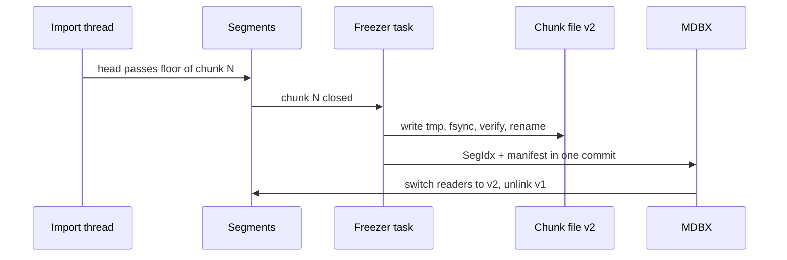
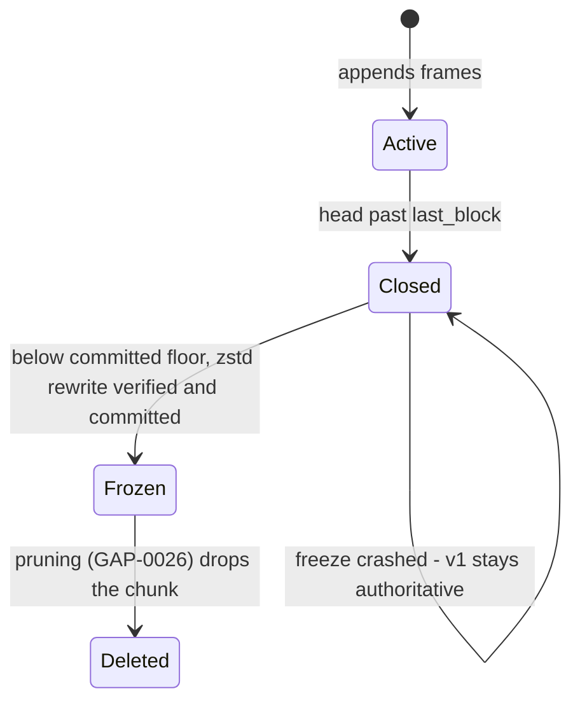
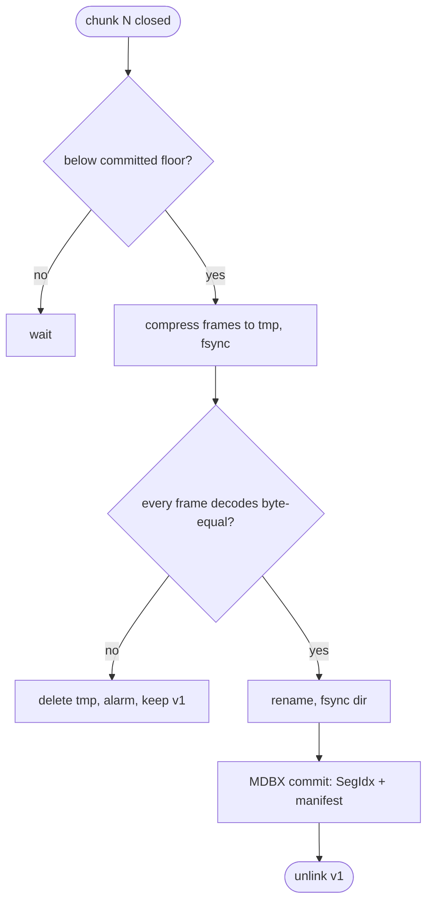

## What

XSEG segments store raw RLP frames. Headers, bodies and receipts compress well (repeated addresses, topics, zero words), and Erigon and reth both keep history compressed. A chunk is immutable once the head is past its last block and past the reorg floor. Compressing closed chunks cuts the history part of the datadir without a change to the hot path: the active chunk stays raw and the ADR-005 commit protocol is unchanged.

## Why

Strength of the Erigon (and Reth static files) client family: smallest archive: immutable history in compressed segment files (Erigon `.seg` with a pattern dictionary; reth NippyJar with zstd dictionaries).

Evidence (competitor commits as in the first pass, `.gap-audit/gap-ledger.json`):

- `erigontech/erigon`: [db/seg/compress.go](https://github.com/erigontech/erigon/blob/bbb5524e53fb057e7d47a5066e152f1091ac4ba4/db/seg/compress.go) (segment compressor: pattern dictionary plus Huffman)
- `erigontech/erigon`: [db/seg/decompress.go](https://github.com/erigontech/erigon/blob/bbb5524e53fb057e7d47a5066e152f1091ac4ba4/db/seg/decompress.go) (random access by offset into a compressed segment)
- `erigontech/erigon`: [docs/site/docs/get-started/hardware-requirements.mdx](https://github.com/erigontech/erigon/blob/bbb5524e53fb057e7d47a5066e152f1091ac4ba4/docs/site/docs/get-started/hardware-requirements.mdx) (an Ethereum archive node fits on one 4 TB drive)
- `paradigmxyz/reth`: [crates/storage/nippy-jar/src/compression/zstd.rs](https://github.com/paradigmxyz/reth/blob/36600d5ff9628465475dd4c7608e2e9f2fe24273/crates/storage/nippy-jar/src/compression/zstd.rs) (zstd with trained dictionaries per column)
- `paradigmxyz/reth`: [crates/static-file/static-file/src/static_file_producer.rs](https://github.com/paradigmxyz/reth/blob/36600d5ff9628465475dd4c7608e2e9f2fe24273/crates/static-file/static-file/src/static_file_producer.rs)

Priority: P2 (impact on operators): disk is the main cost of an XDC node and the xone-rs Apothem datadir is the largest of the xOne family (72 GB, #149). History grows with chain length; compression is the largest saving that does not change any format a peer or a consensus rule sees.

Our code today: `docs/adr/ADR-005-storage-and-publication.md` section 6.1: a frame is `payload_len | block | payload | crc32c` with raw RLP; `BLOCKS_PER_FILE = 100_000`; `crates/xone-db/src/segments.rs` has no compression; only the snapshot export (`crates/xone-sync/src/bootstrap/format.rs`) uses gzip. #149: xone-rs Apothem datadir 72 GB against 13 GB for xOneGo.

Related xOneRS issues: #149, #135, #152 (GAP-0001 archive), #177 (GAP-0026 pruning), #11. This issue brings the strength; it does not replace their gates.

## 80% of the way to

1. Spec first: amend ADR-005 with section 6.5 "frozen chunk": a chunk whose `last_block` is below `committed floor` (spec/retention.md row 12) is rewritten once as `XSEG` version 2: header flag `zstd`, per-frame zstd with a per-segment dictionary stored in the chunk header; `SegIdx` offsets point into the new file.
2. `crates/xone-db/src/segments.rs`: `freeze(chunk)` writes `<first>.seg.v2.tmp`, fsyncs, verifies every frame decodes to the same bytes and CRC, renames, fsyncs the directory, then commits the new `SegIdx` rows and manifest in one MDBX transaction; the old file is unlinked after the commit. A crash at any point leaves either the old or the new chunk authoritative (manifest decides).
3. Reader: version-1 and version-2 chunks are readable side by side; no migration is forced. `xone db compact-history` (with #176) freezes existing chunks offline.
4. Dictionary: train per segment kind from the first frozen chunk (zstd `dict_builder`); store the dictionary id in the chunk header.
5. Tests: ADR-005 fault plan rows K-freeze-1..4 (crash before rename, after rename, before MDBX commit, after commit); byte-equality of every frame of a net2040 and an Apothem chunk; size table before and after.

Acceptance criteria:

- [ ] Every ADR-005 fault test passes with freezing on, plus the four new freeze kill points.
- [ ] All frames read from a frozen chunk are byte-equal to the raw frames (net2040 0..head, Apothem 1M blocks).
- [ ] History bytes on disk for Apothem fall by at least 40 percent; the table goes in docs/ops and #149.
- [ ] `eth_getBlockByNumber` and `eth_getLogs` p99 on frozen ranges stay within 20 percent of raw ranges.

## ASD-STE100

1. The node MUST NOT compress the active chunk.
2. The node MUST freeze a chunk only when the chunk is below the committed floor.
3. A frame from a frozen chunk MUST be byte-equal to the original frame.
4. A crash during a freeze MUST leave one authoritative copy of each frame.
5. The node MUST read version 1 and version 2 chunks.

## Diagrams



## Images

None. Numbers (sizes, latencies, RSS) go in the PR description as tables.

## Prompt

```text
You work in XDCIndia/xOneRS (Rust XDC client). Implement GAP-0039: Compressed frozen segments: zstd for closed XSEG chunks of headers, bodies and receipts (and changesets once #135 moves them).

Context: XSEG segments store raw RLP frames. Headers, bodies and receipts compress well (repeated addresses, topics, zero words), and Erigon and reth both keep history compressed. A chunk is immutable once the head is past its last block and past the reorg floor. Compressing closed chunks cuts the history part of the datadir without a change to the hot path: the active chunk stays raw and the ADR-005 commit protocol is unchanged.

Strength brought from Erigon (and Reth static files): smallest archive: immutable history in compressed segment files (Erigon `.seg` with a pattern dictionary; reth NippyJar with zstd dictionaries). Read the evidence links in the Why section first.

Reference behaviour: geth-XDC at XDCIndia/go-ethereum 6fc8e8c2088b7f18264f5663036669d04fa7becf (conformance/PIN) for anything consensus-visible; this issue must not change consensus, execution or wire formats. Where geth-XDC lacks the feature, follow the first source in the Why section and record the choice in the PR.

Steps:
1. Spec first: amend ADR-005 with section 6.5 "frozen chunk": a chunk whose `last_block` is below `committed floor` (spec/retention.md row 12) is rewritten once as `XSEG` version 2: header flag `zstd`, per-frame zstd with a per-segment dictionary stored in the chunk header; `SegIdx` offsets point into the new file.
2. `crates/xone-db/src/segments.rs`: `freeze(chunk)` writes `<first>.seg.v2.tmp`, fsyncs, verifies every frame decodes to the same bytes and CRC, renames, fsyncs the directory, then commits the new `SegIdx` rows and manifest in one MDBX transaction; the old file is unlinked after the commit. A crash at any point leaves either the old or the new chunk authoritative (manifest decides).
3. Reader: version-1 and version-2 chunks are readable side by side; no migration is forced. `xone db compact-history` (with #176) freezes existing chunks offline.
4. Dictionary: train per segment kind from the first frozen chunk (zstd `dict_builder`); store the dictionary id in the chunk header.
5. Tests: ADR-005 fault plan rows K-freeze-1..4 (crash before rename, after rename, before MDBX commit, after commit); byte-equality of every frame of a net2040 and an Apothem chunk; size table before and after.

Rules: one branch `feat/gap-0039-segzstd` from main, one PR that closes this issue. Write the tests first. Keep consensus, execution and storage formats unchanged unless a step says otherwise (then amend the ADR in the same PR). Run `cargo fmt --check`, `cargo clippy --all-targets -- -D warnings`, `cargo test --locked`, `ci/check-layering.sh` and `ci/check-fixtures.sh`. Update docs/cli/flags.md with `UPDATE_DOCS=1 cargo test -p xone flags_doc` if you add a flag. Never touch live nodes or validator hosts. Hand back in 25 lines or fewer: files changed, tests added, acceptance results.
```

## Workflow

1. Maintainer: confirms priority P2 and assigns the issue.
2. Engineer: creates branch `feat/gap-0039-segzstd` from `main`.
3. Engineer: writes the failing tests (and the parity or byte-equality checks named in the steps).
4. Engineer: implements the change in the files of Layout.
5. Engineer: runs the gates (fmt, clippy, test, layering, fixtures) and the checks in the acceptance criteria.
6. Engineer: opens one PR that says `Closes #<this issue>` and lists the acceptance results.
7. Reviewer: checks each acceptance criterion and the ASD-STE100 requirements.
8. Maintainer: merges.
9. Operator: tries the feature on one net2040 test node (never a validator host) and records the result in this issue.

## Loop

Runtime: A freezer task wakes after each commit that moves the committed floor past a chunk end; one chunk at a time, at low priority (ADR-007 class P4).

Develop-verify: write the check, implement, run it, fix, repeat until it passes. A retry after a failed gate starts from the failing check.

## Graph



## Layout

```text
Files touched:
  docs/adr/ADR-005-storage-and-publication.md
  crates/xone-db/src/segments.rs
  crates/xone-db/src/manifest.rs
  crates/xone-db/src/recover.rs
  tests/fault/PLAN.md
  docs/ops/disk-state.md
```

## Flow



## Summary

Strength: Erigon (and Reth static files): smallest archive: immutable history in compressed segment files (Erigon `.seg` with a pattern dictionary; reth NippyJar with zstd dictionaries).
Gap: xOneRS does not have it (Compressed frozen segments: zstd for closed XSEG chunks of headers, bodies and receipts (and changesets once #135 moves them)).
Fix: as in "80% of the way to". Acceptance: Every ADR-005 fault test passes with freezing on, plus the four new freeze kill points.

<!-- gap-audit:GAP-0039 -->
