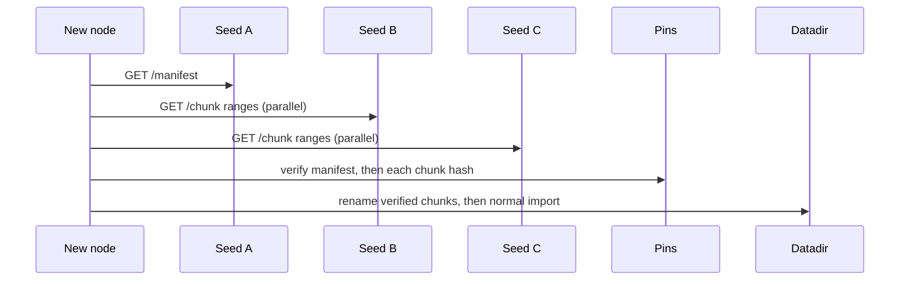
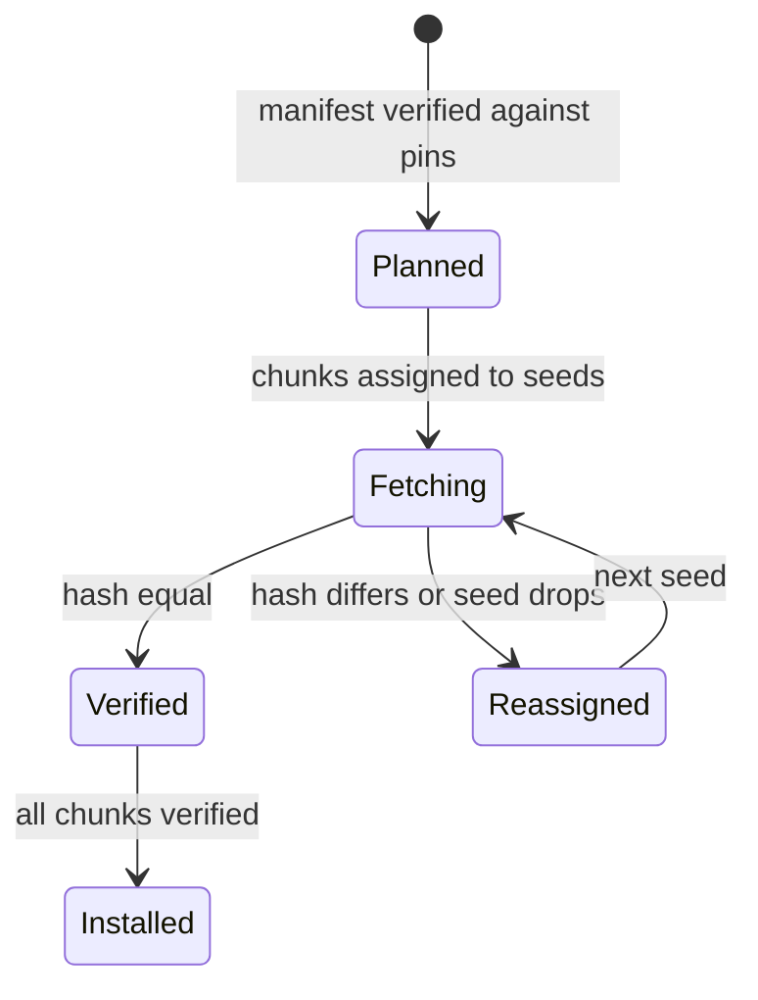
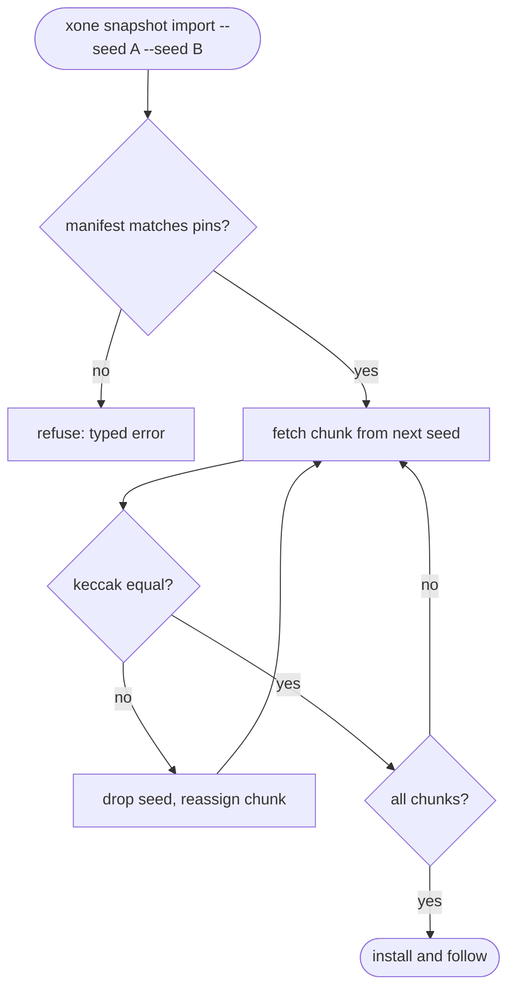

## What

Erigon nodes seed their finished snapshot files, and a new node downloads them from many peers by content hash. xOneRS has the right building block: committed XSEG chunks are immutable files with a CRC per frame and a keccak tail digest in the manifest. But no node serves them, and a new node can fetch history from one URL only. This issue keeps the plan #1 decision (HTTPS, no BitTorrent): each node may serve its closed chunks read-only over HTTP with a signed-by-pin manifest, and the importer fetches chunk ranges from several seeds in parallel and verifies each chunk by hash before use.

## Why

Strength of the Erigon client family: seeded distribution of immutable history: every node seeds its finished snapshot files and a new node downloads them from many peers by content hash.

Evidence (competitor commits as in the first pass, `.gap-audit/gap-ledger.json`):

- `erigontech/erigon`: [cmd/downloader/readme.md](https://github.com/erigontech/erigon/blob/bbb5524e53fb057e7d47a5066e152f1091ac4ba4/cmd/downloader/readme.md) ("Service to seed/download historical data (snapshots, immutable .seg files)"; new snapshots start seeding automatically)
- `erigontech/erigon`: [db/downloader/torrent_files.go](https://github.com/erigontech/erigon/blob/bbb5524e53fb057e7d47a5066e152f1091ac4ba4/db/downloader/torrent_files.go)
- `erigontech/erigon`: [db/downloader/chaintoml.go](https://github.com/erigontech/erigon/blob/bbb5524e53fb057e7d47a5066e152f1091ac4ba4/db/downloader/chaintoml.go) (published list of snapshot hashes per chain)
- `paradigmxyz/reth`: [crates/cli/commands/src/download/mod.rs](https://github.com/paradigmxyz/reth/blob/36600d5ff9628465475dd4c7608e2e9f2fe24273/crates/cli/commands/src/download/mod.rs) (HTTP download of a snapshot)

Priority: P3 (impact on operators): a new XDC node can already snap-sync state and import a pinned snapshot (#38); this removes the single-server dependency for history and spreads the load, but no operator is blocked without it.

Our code today: `bin/xone/src/cmd/snapshot.rs` exports and imports one archive with pins (#38, closed); GAP-0034 (#185) adds import from one HTTPS URL. Plan #1 (B3.7) and #38 say: hash-named segment files with a manifest over HTTPS; "no torrent; add it only if public demand appears". No node serves its chunks.

Related xOneRS issues: #38, #185 (GAP-0034), #14, #1 (B3.7: no torrent), #135. This issue brings the strength; it does not replace their gates.

## 80% of the way to

1. `spec/bootstrap/seeding.md`: chunk manifest = list of `(segment, first_block, last_block, keccak256(file))` for closed chunks, bound to the pinned anchor (spec/bootstrap-anchor.md); the manifest is data, the pins are the authority.
2. `crates/xone-node/src/services/`: optional `--history.serve <addr>` read-only HTTP listener (ADR-007 class P4, per-IP token bucket from `xone_primitives::limits`) that serves `/manifest` and `/chunk/<segment>/<first>.seg` with Range support; closed chunks only.
3. `bin/xone/src/cmd/snapshot.rs`: `--seed <url>` repeatable; fetch chunk list from each seed, assign chunks round-robin, resume by Range, verify keccak against the manifest and the manifest against the pins; a bad seed is dropped after one bad chunk.
4. Out: BitTorrent (plan #1 B3.7); revisit only with demand. Out: serving the active chunk or MDBX.
5. Tests: three local seeds, one serves a corrupted chunk and one disconnects mid-transfer; the import still finishes with byte-equal chunks and the same head.

Acceptance criteria:

- [ ] Import with three seeds, one bad and one dropping, finishes and the datadir is byte-equal to a single-source import.
- [ ] A chunk whose hash differs from the manifest is never written into the datadir.
- [ ] Serving is off by default; with it on, a 100 MB/s client cannot raise import p99 on the serving node by more than 10 percent.

## ASD-STE100

1. The node MUST serve only closed chunks.
2. The importer MUST verify each chunk hash before it uses the chunk.
3. The importer MUST verify the manifest against the pins.
4. The importer MUST stop using a seed that sends one bad chunk.
5. Serving MUST be off by default.

## Diagrams



## Images

None. Numbers (sizes, latencies, RSS) go in the PR description as tables.

## Prompt

```text
You work in XDCIndia/xOneRS (Rust XDC client). Implement GAP-0040: Seeded history distribution: nodes serve their committed XSEG chunks with a hash manifest, new nodes fetch from several seeds and verify.

Context: Erigon nodes seed their finished snapshot files, and a new node downloads them from many peers by content hash. xOneRS has the right building block: committed XSEG chunks are immutable files with a CRC per frame and a keccak tail digest in the manifest. But no node serves them, and a new node can fetch history from one URL only. This issue keeps the plan #1 decision (HTTPS, no BitTorrent): each node may serve its closed chunks read-only over HTTP with a signed-by-pin manifest, and the importer fetches chunk ranges from several seeds in parallel and verifies each chunk by hash before use.

Strength brought from Erigon: seeded distribution of immutable history: every node seeds its finished snapshot files and a new node downloads them from many peers by content hash. Read the evidence links in the Why section first.

Reference behaviour: geth-XDC at XDCIndia/go-ethereum 6fc8e8c2088b7f18264f5663036669d04fa7becf (conformance/PIN) for anything consensus-visible; this issue must not change consensus, execution or wire formats. Where geth-XDC lacks the feature, follow the first source in the Why section and record the choice in the PR.

Steps:
1. `spec/bootstrap/seeding.md`: chunk manifest = list of `(segment, first_block, last_block, keccak256(file))` for closed chunks, bound to the pinned anchor (spec/bootstrap-anchor.md); the manifest is data, the pins are the authority.
2. `crates/xone-node/src/services/`: optional `--history.serve <addr>` read-only HTTP listener (ADR-007 class P4, per-IP token bucket from `xone_primitives::limits`) that serves `/manifest` and `/chunk/<segment>/<first>.seg` with Range support; closed chunks only.
3. `bin/xone/src/cmd/snapshot.rs`: `--seed <url>` repeatable; fetch chunk list from each seed, assign chunks round-robin, resume by Range, verify keccak against the manifest and the manifest against the pins; a bad seed is dropped after one bad chunk.
4. Out: BitTorrent (plan #1 B3.7); revisit only with demand. Out: serving the active chunk or MDBX.
5. Tests: three local seeds, one serves a corrupted chunk and one disconnects mid-transfer; the import still finishes with byte-equal chunks and the same head.

Rules: one branch `feat/gap-0040-seeding` from main, one PR that closes this issue. Write the tests first. Keep consensus, execution and storage formats unchanged unless a step says otherwise (then amend the ADR in the same PR). Run `cargo fmt --check`, `cargo clippy --all-targets -- -D warnings`, `cargo test --locked`, `ci/check-layering.sh` and `ci/check-fixtures.sh`. Update docs/cli/flags.md with `UPDATE_DOCS=1 cargo test -p xone flags_doc` if you add a flag. Never touch live nodes or validator hosts. Hand back in 25 lines or fewer: files changed, tests added, acceptance results.
```

## Workflow

1. Maintainer: confirms priority P3 and assigns the issue.
2. Engineer: creates branch `feat/gap-0040-seeding` from `main`.
3. Engineer: writes the failing tests (and the parity or byte-equality checks named in the steps).
4. Engineer: implements the change in the files of Layout.
5. Engineer: runs the gates (fmt, clippy, test, layering, fixtures) and the checks in the acceptance criteria.
6. Engineer: opens one PR that says `Closes #<this issue>` and lists the acceptance results.
7. Reviewer: checks each acceptance criterion and the ASD-STE100 requirements.
8. Maintainer: merges.
9. Operator: tries the feature on one net2040 test node (never a validator host) and records the result in this issue.

## Loop

Runtime: Importer: retry a chunk on the next seed, at most 3 seeds per chunk, then fail with a typed error. Server: none (request driven).

Develop-verify: write the check, implement, run it, fix, repeat until it passes. A retry after a failed gate starts from the failing check.

## Graph



## Layout

```text
Files touched:
  spec/bootstrap/seeding.md
  crates/xone-node/src/services/
  bin/xone/src/cmd/snapshot.rs
  crates/xone-db/src/segments.rs
  docs/ops/snapshot.md
```

## Flow



## Summary

Strength: Erigon: seeded distribution of immutable history: every node seeds its finished snapshot files and a new node downloads them from many peers by content hash.
Gap: xOneRS does not have it (Seeded history distribution: nodes serve their committed XSEG chunks with a hash manifest, new nodes fetch from several seeds and verify).
Fix: as in "80% of the way to". Acceptance: Import with three seeds, one bad and one dropping, finishes and the datadir is byte-equal to a single-source import.

<!-- gap-audit:GAP-0040 -->
