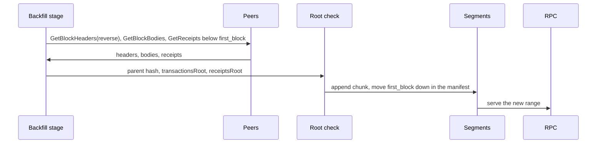
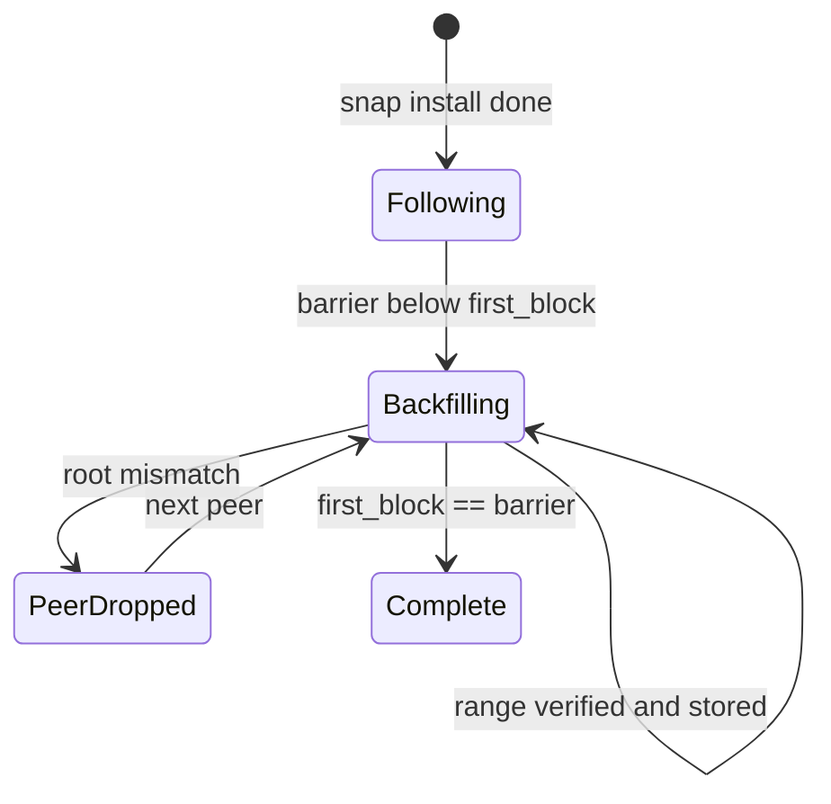
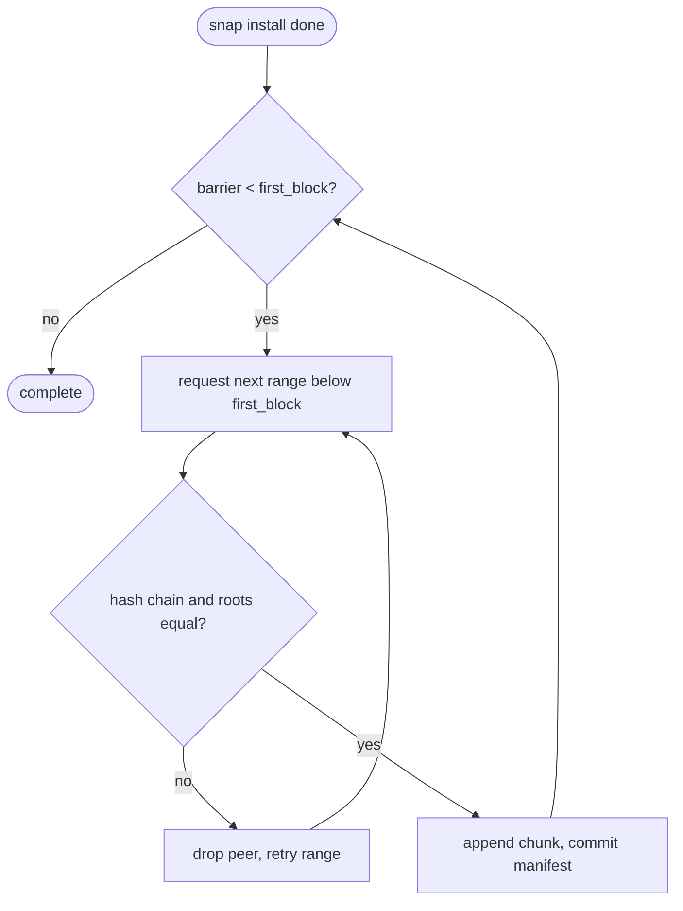

## What

After `--syncmode snap` the node executes from pivot + 1 and keeps only the history that the consensus rules need. Nethermind downloads headers, bodies and receipts below the pivot in the background while the node already follows the tip, back to a barrier the operator sets. The xOne snap client already has the `Need` ranges and verified header chains; a background backfill would make a snap node a full-history RPC node without a genesis replay. Receipts below the pivot cannot be re-executed (no state), so they are verified against `receiptsRoot` of the header.

## Why

Strength of the Nethermind client family: fast sync: state at a pivot plus FastBlocks, which downloads headers, bodies and receipts below the pivot in parallel, back to configurable barriers.

Evidence (competitor commits as in the first pass, `.gap-audit/gap-ledger.json`):

- `NethermindEth/nethermind`: [src/Nethermind/Nethermind.Synchronization/FastBlocks/BodiesSyncFeed.cs](https://github.com/NethermindEth/nethermind/blob/a7dd73052e696ad934d228aad3f33e660701fdb7/src/Nethermind/Nethermind.Synchronization/FastBlocks/BodiesSyncFeed.cs)
- `NethermindEth/nethermind`: [src/Nethermind/Nethermind.Synchronization/FastBlocks/FastBlocksAllocationStrategy.cs](https://github.com/NethermindEth/nethermind/blob/a7dd73052e696ad934d228aad3f33e660701fdb7/src/Nethermind/Nethermind.Synchronization/FastBlocks/FastBlocksAllocationStrategy.cs)
- `NethermindEth/nethermind`: [src/Nethermind/Nethermind.Blockchain/Synchronization/ISyncConfig.cs](https://github.com/NethermindEth/nethermind/blob/a7dd73052e696ad934d228aad3f33e660701fdb7/src/Nethermind/Nethermind.Blockchain/Synchronization/ISyncConfig.cs) (`DownloadBodiesInFastSync`, `DownloadReceiptsInFastSync`, `AncientBodiesBarrier`)
- Docs: https://docs.nethermind.io/fundamentals/sync

Priority: P2 (impact on operators): a snap-synced xone-rs node holds almost nothing below its pivot, so it cannot answer eth_getLogs, receipts or old blocks, and it serves GetBlockBodies poorly to peers (#125). An operator who wants a full-history RPC node today must full-sync from genesis.

Our code today: `spec/snap/completeness.md` and `spec/retention.md`: a snap node fetches only the ranges the first block after the pivot needs (rows 3, 7, 11; "none below the pivot" for reorg); `crates/xone-snap/src/client.rs` `Need { kind, first, last }`; `docs/ops/net2040-sync-modes.md`: snap datadir 72 MB. No background download below the pivot.

Related xOneRS issues: #37, #14, #125, #121, #177 (GAP-0026 retention). This issue brings the strength; it does not replace their gates.

## 80% of the way to

1. `spec/snap/backfill.md`: barriers `--history.bodies-from <n>` and `--history.receipts-from <n>` (default: the snap minimum; `0` means all); the headers chain is verified backward by parent hash from the pivot header, so no seal check is needed below the pivot.
2. `crates/xone-sync/src/stages/`: a `Backfill` stage that runs after the switch to execution at ADR-007 class P4; it asks peers (eth/100 GetBlockHeaders reverse, GetBlockBodies, GetReceipts) for ranges going down from the pivot, verifies `transactionsRoot` and `receiptsRoot`, and appends to the segments. Segments are append-only upward, so backfilled ranges go into separate chunks below the anchor chunk; the manifest gets a `first_block` per segment that moves down (ADR-005 section 10 already has `first_block`).
3. `crates/xone-rpc`: the typed unsupported-history refusal (#121) uses the new `first_block` instead of the pivot.
4. Peer allocation: prefer peers whose Status shows full history; drop a peer after one root mismatch (`crates/xone-net/src/peers`).
5. Tests: snap at a net2040 pivot, backfill to 0, then `eth_getLogs` over 0..pivot equals the xdc02 archive; kill -9 during backfill resumes; tip following never stalls (head lag under 10 blocks).

Acceptance criteria:

- [ ] Snap node with `--history.receipts-from 0` answers `eth_getLogs` and `eth_getTransactionReceipt` for every block from genesis, equal to the xdc02 archive.
- [ ] The head lag stays under 10 blocks during the whole backfill.
- [ ] kill -9 during backfill resumes without a re-download of finished ranges.
- [ ] A body or receipt list whose root differs from the header is never stored.

## ASD-STE100

1. The node MUST follow the tip while backfill runs.
2. The node MUST verify each body against `transactionsRoot` and each receipt list against `receiptsRoot` before it stores them.
3. The node MUST verify the header chain below the pivot by parent hash from the pivot header.
4. The node MUST NOT store history below the barrier that the operator set.
5. RPC MUST report the lowest stored block, not the pivot, in the unsupported-history error.

## Diagrams



## Images

None. Numbers (sizes, latencies, RSS) go in the PR description as tables.

## Prompt

```text
You work in XDCIndia/xOneRS (Rust XDC client). Implement GAP-0041: History backfill after snap sync: download headers, bodies and receipts below the pivot in the background, to a configurable barrier.

Context: After `--syncmode snap` the node executes from pivot + 1 and keeps only the history that the consensus rules need. Nethermind downloads headers, bodies and receipts below the pivot in the background while the node already follows the tip, back to a barrier the operator sets. The xOne snap client already has the `Need` ranges and verified header chains; a background backfill would make a snap node a full-history RPC node without a genesis replay. Receipts below the pivot cannot be re-executed (no state), so they are verified against `receiptsRoot` of the header.

Strength brought from Nethermind: fast sync: state at a pivot plus FastBlocks, which downloads headers, bodies and receipts below the pivot in parallel, back to configurable barriers. Read the evidence links in the Why section first.

Reference behaviour: geth-XDC at XDCIndia/go-ethereum 6fc8e8c2088b7f18264f5663036669d04fa7becf (conformance/PIN) for anything consensus-visible; this issue must not change consensus, execution or wire formats. Where geth-XDC lacks the feature, follow the first source in the Why section and record the choice in the PR.

Steps:
1. `spec/snap/backfill.md`: barriers `--history.bodies-from <n>` and `--history.receipts-from <n>` (default: the snap minimum; `0` means all); the headers chain is verified backward by parent hash from the pivot header, so no seal check is needed below the pivot.
2. `crates/xone-sync/src/stages/`: a `Backfill` stage that runs after the switch to execution at ADR-007 class P4; it asks peers (eth/100 GetBlockHeaders reverse, GetBlockBodies, GetReceipts) for ranges going down from the pivot, verifies `transactionsRoot` and `receiptsRoot`, and appends to the segments. Segments are append-only upward, so backfilled ranges go into separate chunks below the anchor chunk; the manifest gets a `first_block` per segment that moves down (ADR-005 section 10 already has `first_block`).
3. `crates/xone-rpc`: the typed unsupported-history refusal (#121) uses the new `first_block` instead of the pivot.
4. Peer allocation: prefer peers whose Status shows full history; drop a peer after one root mismatch (`crates/xone-net/src/peers`).
5. Tests: snap at a net2040 pivot, backfill to 0, then `eth_getLogs` over 0..pivot equals the xdc02 archive; kill -9 during backfill resumes; tip following never stalls (head lag under 10 blocks).

Rules: one branch `feat/gap-0041-backfill` from main, one PR that closes this issue. Write the tests first. Keep consensus, execution and storage formats unchanged unless a step says otherwise (then amend the ADR in the same PR). Run `cargo fmt --check`, `cargo clippy --all-targets -- -D warnings`, `cargo test --locked`, `ci/check-layering.sh` and `ci/check-fixtures.sh`. Update docs/cli/flags.md with `UPDATE_DOCS=1 cargo test -p xone flags_doc` if you add a flag. Never touch live nodes or validator hosts. Hand back in 25 lines or fewer: files changed, tests added, acceptance results.
```

## Workflow

1. Maintainer: confirms priority P2 and assigns the issue.
2. Engineer: creates branch `feat/gap-0041-backfill` from `main`.
3. Engineer: writes the failing tests (and the parity or byte-equality checks named in the steps).
4. Engineer: implements the change in the files of Layout.
5. Engineer: runs the gates (fmt, clippy, test, layering, fixtures) and the checks in the acceptance criteria.
6. Engineer: opens one PR that says `Closes #<this issue>` and lists the acceptance results.
7. Reviewer: checks each acceptance criterion and the ASD-STE100 requirements.
8. Maintainer: merges.
9. Operator: tries the feature on one net2040 test node (never a validator host) and records the result in this issue.

## Loop

Runtime: Backfill stage: one range in flight per peer, up to 4 peers; retry a range on another peer; pause when import queue depth is above the ADR-007 limit.

Develop-verify: write the check, implement, run it, fix, repeat until it passes. A retry after a failed gate starts from the failing check.

## Graph



## Layout

```text
Files touched:
  spec/snap/backfill.md
  crates/xone-sync/src/stages/
  crates/xone-db/src/segments.rs
  crates/xone-db/src/manifest.rs
  crates/xone-net/src/peers
  crates/xone-rpc/src/eth.rs
  bin/xone/src/flags.rs
  docs/cli/flags.md
```

## Flow



## Summary

Strength: Nethermind: fast sync: state at a pivot plus FastBlocks, which downloads headers, bodies and receipts below the pivot in parallel, back to configurable barriers.
Gap: xOneRS does not have it (History backfill after snap sync: download headers, bodies and receipts below the pivot in the background, to a configurable barrier).
Fix: as in "80% of the way to". Acceptance: Snap node with `--history.receipts-from 0` answers `eth_getLogs` and `eth_getTransactionReceipt` for every block from genesis, equal to the xdc02 archive.

<!-- gap-audit:GAP-0041 -->
