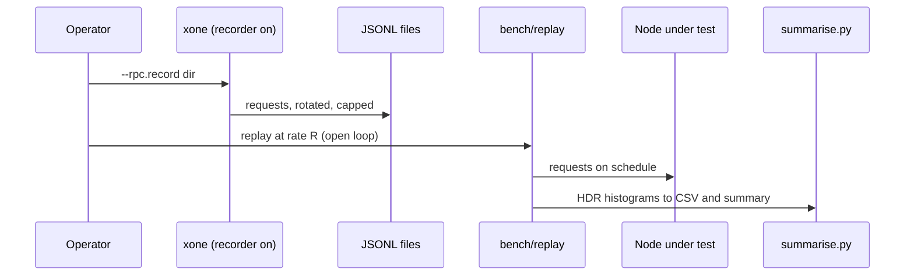
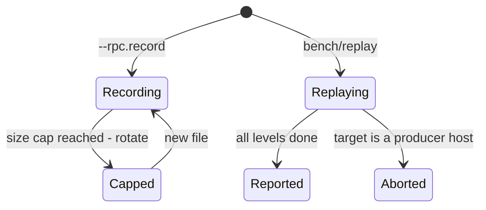
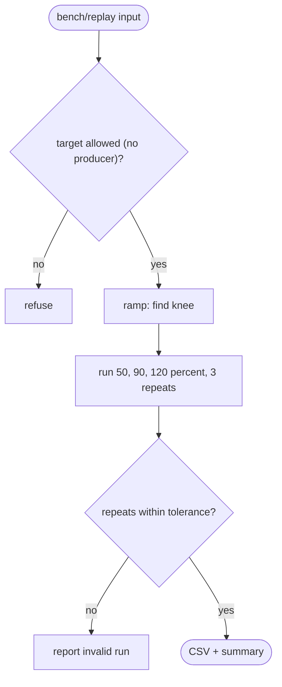

## What

Nethermind records the JSON-RPC requests a node receives (`RpcRecorderState`) and replays them with Kute to measure the node; ethrex has `tooling/rpc_bench`. xOneRS has a perf contract that demands open-loop, coordinated-omission-aware load and repeat runs, and workload specs, but no tool that sends the load. A recorder plus a replay tool gives operators and the perf gate the same numbers.

## Why

Strength of the Nethermind (and ethrex) client family: operator tooling: an RPC request recorder in the node and Kute, a tool that replays recorded traffic and measures the node.

Evidence (competitor commits as in the first pass, `.gap-audit/gap-ledger.json`):

- `NethermindEth/nethermind`: [tools/Kute/README.md](https://github.com/NethermindEth/nethermind/blob/a7dd73052e696ad934d228aad3f33e660701fdb7/tools/Kute/README.md) (replays recorded JSON-RPC messages, measures the node)
- `NethermindEth/nethermind`: [src/Nethermind/Nethermind.JsonRpc/IJsonRpcConfig.cs](https://github.com/NethermindEth/nethermind/blob/a7dd73052e696ad934d228aad3f33e660701fdb7/src/Nethermind/Nethermind.JsonRpc/IJsonRpcConfig.cs) (`RpcRecorderState`, `RpcRecorderBaseFilePath`)
- `lambdaclass/ethrex`: [tooling/rpc_bench/run_bench.sh](https://github.com/lambdaclass/ethrex/blob/740ea493880b6c073b81537010df75e143c615c2/tooling/rpc_bench/run_bench.sh)
- `lambdaclass/ethrex`: [tooling/rpc_bench/gen_workload.py](https://github.com/lambdaclass/ethrex/blob/740ea493880b6c073b81537010df75e143c615c2/tooling/rpc_bench/gen_workload.py)

Priority: P3 (impact on operators): RPC providers and explorers need capacity numbers for xone-rs before they move traffic to it; the perf contract (#13) requires an open-loop load generator that does not exist yet.

Our code today: `docs/perf.md` section 4 requires open-loop load (latency from the intended send time) and `bench/workloads/*.yaml` specify workloads, but `bench/` has only `collect/env.sh` and `summarise.py`: no load generator and no recorder. `conformance/rpc-parity` checks values, not load.

Related xOneRS issues: #13, #16, #42. This issue brings the strength; it does not replace their gates.

## 80% of the way to

1. `crates/xone-rpc/src/server.rs`: `--rpc.record <dir>` writes each request (method, params, transport, arrival time; never auth headers) as JSONL to size-capped rotating files; off by default; methods in a deny list (`admin_*`, signer paths) are never written.
2. `bench/replay/` (Rust bin in the workspace, not shipped in the release tarball): reads JSONL or a `bench/workloads/*.yaml` spec, sends at a fixed open-loop schedule (HDR histogram from the intended send time), levels 50/90/120 percent of the knee as perf.md section 4 says; output CSV + summary that `bench/collect/summarise.py` already reads.
3. Diff mode: send the same stream to xone-rs and to geth-XDC (xdc02, read only) and report latency side by side; values are not compared here (rpc-parity does that).
4. Tests: replay a 10,000-request recording against a test node; histogram counts equal sent counts; closed-loop mode is rejected.

Acceptance criteria:

- [ ] `bench/replay` runs `rpc-sync-interference.yaml` and a recorded file at three load levels and writes p50/p95/p99/p99.9/max per method.
- [ ] The recorder never writes an auth header or an `admin_*` call (test).
- [ ] A run record passes the pinned-field check of docs/perf.md section 2.

## ASD-STE100

1. The recorder MUST be off by default.
2. The recorder MUST NOT write secrets, auth headers or admin calls.
3. The replay tool MUST send on a fixed schedule and MUST measure from the intended send time.
4. The replay tool MUST NOT run against a validator or producer host.

## Diagrams



## Images

None. Numbers (sizes, latencies, RSS) go in the PR description as tables.

## Prompt

```text
You work in XDCIndia/xOneRS (Rust XDC client). Implement GAP-0042: RPC traffic recorder and open-loop replay benchmark (record real requests, replay them at a set rate, report latency per method).

Context: Nethermind records the JSON-RPC requests a node receives (`RpcRecorderState`) and replays them with Kute to measure the node; ethrex has `tooling/rpc_bench`. xOneRS has a perf contract that demands open-loop, coordinated-omission-aware load and repeat runs, and workload specs, but no tool that sends the load. A recorder plus a replay tool gives operators and the perf gate the same numbers.

Strength brought from Nethermind (and ethrex): operator tooling: an RPC request recorder in the node and Kute, a tool that replays recorded traffic and measures the node. Read the evidence links in the Why section first.

Reference behaviour: geth-XDC at XDCIndia/go-ethereum 6fc8e8c2088b7f18264f5663036669d04fa7becf (conformance/PIN) for anything consensus-visible; this issue must not change consensus, execution or wire formats. Where geth-XDC lacks the feature, follow the first source in the Why section and record the choice in the PR.

Steps:
1. `crates/xone-rpc/src/server.rs`: `--rpc.record <dir>` writes each request (method, params, transport, arrival time; never auth headers) as JSONL to size-capped rotating files; off by default; methods in a deny list (`admin_*`, signer paths) are never written.
2. `bench/replay/` (Rust bin in the workspace, not shipped in the release tarball): reads JSONL or a `bench/workloads/*.yaml` spec, sends at a fixed open-loop schedule (HDR histogram from the intended send time), levels 50/90/120 percent of the knee as perf.md section 4 says; output CSV + summary that `bench/collect/summarise.py` already reads.
3. Diff mode: send the same stream to xone-rs and to geth-XDC (xdc02, read only) and report latency side by side; values are not compared here (rpc-parity does that).
4. Tests: replay a 10,000-request recording against a test node; histogram counts equal sent counts; closed-loop mode is rejected.

Rules: one branch `feat/gap-0042-rpcreplay` from main, one PR that closes this issue. Write the tests first. Keep consensus, execution and storage formats unchanged unless a step says otherwise (then amend the ADR in the same PR). Run `cargo fmt --check`, `cargo clippy --all-targets -- -D warnings`, `cargo test --locked`, `ci/check-layering.sh` and `ci/check-fixtures.sh`. Update docs/cli/flags.md with `UPDATE_DOCS=1 cargo test -p xone flags_doc` if you add a flag. Never touch live nodes or validator hosts. Hand back in 25 lines or fewer: files changed, tests added, acceptance results.
```

## Workflow

1. Maintainer: confirms priority P3 and assigns the issue.
2. Engineer: creates branch `feat/gap-0042-rpcreplay` from `main`.
3. Engineer: writes the failing tests (and the parity or byte-equality checks named in the steps).
4. Engineer: implements the change in the files of Layout.
5. Engineer: runs the gates (fmt, clippy, test, layering, fixtures) and the checks in the acceptance criteria.
6. Engineer: opens one PR that says `Closes #<this issue>` and lists the acceptance results.
7. Reviewer: checks each acceptance criterion and the ASD-STE100 requirements.
8. Maintainer: merges.
9. Operator: tries the feature on one net2040 test node (never a validator host) and records the result in this issue.

## Loop

Runtime: Replay: fixed schedule per level; ramp then 3 repeats per level. Recorder: rotate at the size cap.

Develop-verify: write the check, implement, run it, fix, repeat until it passes. A retry after a failed gate starts from the failing check.

## Graph



## Layout

```text
Files touched:
  crates/xone-rpc/src/server.rs
  bench/replay/
  bench/README.md
  bench/collect/summarise.py
  docs/perf.md
  bin/xone/src/flags.rs
```

## Flow



## Summary

Strength: Nethermind (and ethrex): operator tooling: an RPC request recorder in the node and Kute, a tool that replays recorded traffic and measures the node.
Gap: xOneRS does not have it (RPC traffic recorder and open-loop replay benchmark (record real requests, replay them at a set rate, report latency per method)).
Fix: as in "80% of the way to". Acceptance: `bench/replay` runs `rpc-sync-interference.yaml` and a recorded file at three load levels and writes p50/p95/p99/p99.9/max per method.

<!-- gap-audit:GAP-0042 -->
