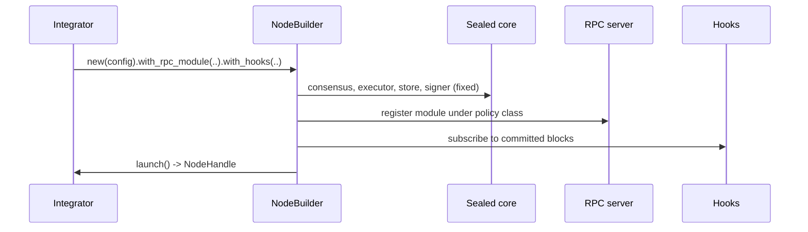
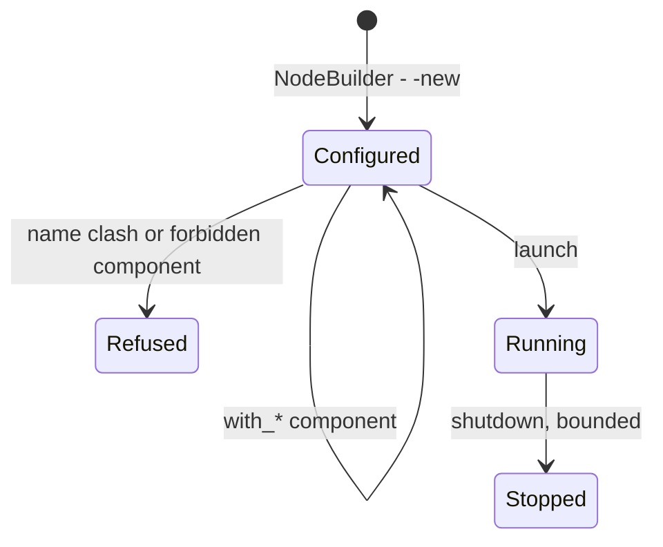
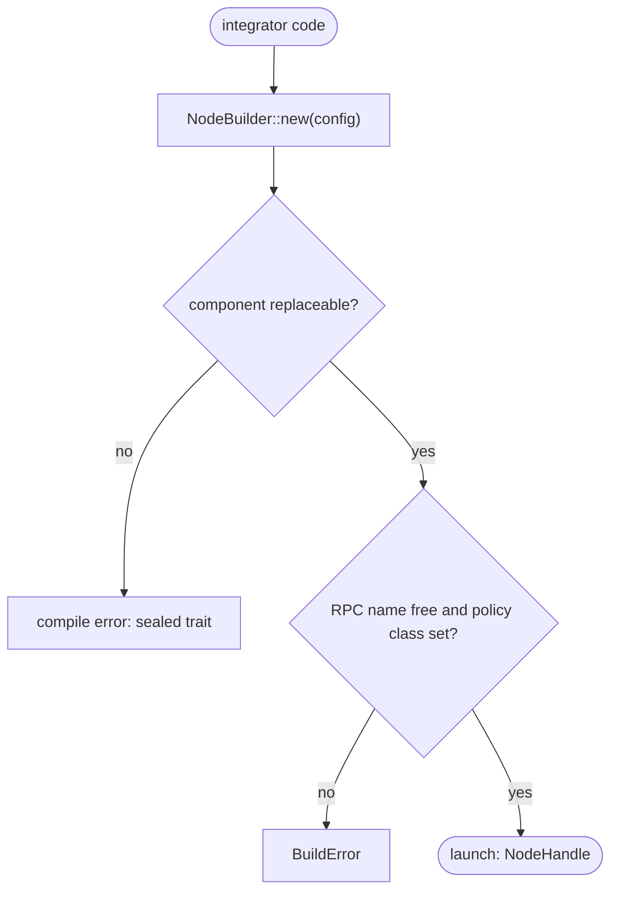

## What

reth is used as an SDK: a `NodeBuilder` assembles a node from typed components, and examples show a custom RPC module, a custom component and node event hooks. xOneRS has clean crates with an enforced layering, but the node is wired in fixed code, so an integrator who wants one extra RPC namespace or a txpool policy must fork. A small builder over the existing services, with the consensus, execution and storage paths kept sealed, gives a stable library surface without opening consensus code to plug-ins.

## Why

Strength of the Reth client family: used as an SDK: crates usable as a library, a typed NodeBuilder with replaceable components, and runnable examples (custom RPC, custom components, node event hooks).

Evidence (competitor commits as in the first pass, `.gap-audit/gap-ledger.json`):

- `paradigmxyz/reth`: [crates/node/builder/src/builder/mod.rs](https://github.com/paradigmxyz/reth/blob/36600d5ff9628465475dd4c7608e2e9f2fe24273/crates/node/builder/src/builder/mod.rs) (`NodeBuilder`)
- `paradigmxyz/reth`: [examples/custom-node-components](https://github.com/paradigmxyz/reth/blob/36600d5ff9628465475dd4c7608e2e9f2fe24273/examples/custom-node-components)
- `paradigmxyz/reth`: [examples/node-custom-rpc](https://github.com/paradigmxyz/reth/blob/36600d5ff9628465475dd4c7608e2e9f2fe24273/examples/node-custom-rpc)
- `paradigmxyz/reth`: [examples/node-event-hooks](https://github.com/paradigmxyz/reth/blob/36600d5ff9628465475dd4c7608e2e9f2fe24273/examples/node-event-hooks)
- Docs: https://reth.rs/sdk

Priority: P3 (impact on operators): node operators run the binary; the builder serves integrators (explorers, bridges, indexers) who today must fork the repo to add an RPC module. It also makes in-process hooks (#187) a stable surface.

Our code today: Workspace `publish = false` (Cargo.toml); `crates/xone-node/src/lib.rs` exports `Config`, `Node`, `Service` and the ADR-007 primitives but the composition of services lives in `bin/xone/src/` and `crates/xone-node/src/services/` with fixed types; no `examples/` directory; `ci/check-layering.sh` already enforces crate ranks.

Related xOneRS issues: #187 (GAP-0036 hooks), #8 (ADR-002 integration option), #42. This issue brings the strength; it does not replace their gates.

## 80% of the way to

1. `crates/xone-node/src/builder.rs`: `NodeBuilder::new(Config)` with `.with_rpc_module(name, Module)`, `.with_txpool_policy(impl Policy)`, `.with_hooks(impl Hooks)` (#187), `.launch() -> NodeHandle`; consensus, executor, store and signer are not replaceable (sealed traits).
2. `bin/xone/src/main.rs` uses the builder; behaviour unchanged (the flags_doc test and the gates prove it).
3. `examples/custom-rpc` (adds `myns_hello` over the RPC policy classes) and `examples/event-hooks` (prints each committed block); built in CI.
4. API docs: `#![deny(missing_docs)]` on the public items of `xone-node`; a `docs/sdk.md` page; semver note: the API is unstable until 1.0.
5. Out: publishing to crates.io (licence and name decision for the owner).

Acceptance criteria:

- [ ] `bin/xone` is built with `NodeBuilder` and every existing gate passes unchanged.
- [ ] `cargo run --example custom-rpc` serves `myns_hello` on a net2040 dev datadir; the example runs in CI.
- [ ] The public API of `xone-node` has docs for every item (`missing_docs` deny).

## ASD-STE100

1. The builder MUST NOT allow a change to consensus, execution, storage or signer components.
2. An added RPC module MUST go through the RPC policy classes and limits.
3. The binary built with the builder MUST behave as before (same flags, same answers).

## Diagrams



## Images

None. Numbers (sizes, latencies, RSS) go in the PR description as tables.

## Prompt

```text
You work in XDCIndia/xOneRS (Rust XDC client). Implement GAP-0043: xOneRS as a library: a documented NodeBuilder with replaceable components (RPC modules, txpool, network handlers) and runnable examples.

Context: reth is used as an SDK: a `NodeBuilder` assembles a node from typed components, and examples show a custom RPC module, a custom component and node event hooks. xOneRS has clean crates with an enforced layering, but the node is wired in fixed code, so an integrator who wants one extra RPC namespace or a txpool policy must fork. A small builder over the existing services, with the consensus, execution and storage paths kept sealed, gives a stable library surface without opening consensus code to plug-ins.

Strength brought from Reth: used as an SDK: crates usable as a library, a typed NodeBuilder with replaceable components, and runnable examples (custom RPC, custom components, node event hooks). Read the evidence links in the Why section first.

Reference behaviour: geth-XDC at XDCIndia/go-ethereum 6fc8e8c2088b7f18264f5663036669d04fa7becf (conformance/PIN) for anything consensus-visible; this issue must not change consensus, execution or wire formats. Where geth-XDC lacks the feature, follow the first source in the Why section and record the choice in the PR.

Steps:
1. `crates/xone-node/src/builder.rs`: `NodeBuilder::new(Config)` with `.with_rpc_module(name, Module)`, `.with_txpool_policy(impl Policy)`, `.with_hooks(impl Hooks)` (#187), `.launch() -> NodeHandle`; consensus, executor, store and signer are not replaceable (sealed traits).
2. `bin/xone/src/main.rs` uses the builder; behaviour unchanged (the flags_doc test and the gates prove it).
3. `examples/custom-rpc` (adds `myns_hello` over the RPC policy classes) and `examples/event-hooks` (prints each committed block); built in CI.
4. API docs: `#![deny(missing_docs)]` on the public items of `xone-node`; a `docs/sdk.md` page; semver note: the API is unstable until 1.0.
5. Out: publishing to crates.io (licence and name decision for the owner).

Rules: one branch `feat/gap-0043-sdk` from main, one PR that closes this issue. Write the tests first. Keep consensus, execution and storage formats unchanged unless a step says otherwise (then amend the ADR in the same PR). Run `cargo fmt --check`, `cargo clippy --all-targets -- -D warnings`, `cargo test --locked`, `ci/check-layering.sh` and `ci/check-fixtures.sh`. Update docs/cli/flags.md with `UPDATE_DOCS=1 cargo test -p xone flags_doc` if you add a flag. Never touch live nodes or validator hosts. Hand back in 25 lines or fewer: files changed, tests added, acceptance results.
```

## Workflow

1. Maintainer: confirms priority P3 and assigns the issue.
2. Engineer: creates branch `feat/gap-0043-sdk` from `main`.
3. Engineer: writes the failing tests (and the parity or byte-equality checks named in the steps).
4. Engineer: implements the change in the files of Layout.
5. Engineer: runs the gates (fmt, clippy, test, layering, fixtures) and the checks in the acceptance criteria.
6. Engineer: opens one PR that says `Closes #<this issue>` and lists the acceptance results.
7. Reviewer: checks each acceptance criterion and the ASD-STE100 requirements.
8. Maintainer: merges.
9. Operator: tries the feature on one net2040 test node (never a validator host) and records the result in this issue.

## Loop

Runtime: None at runtime beyond the node's own services.

Develop-verify: write the check, implement, run it, fix, repeat until it passes. A retry after a failed gate starts from the failing check.

## Graph



## Layout

```text
Files touched:
  crates/xone-node/src/builder.rs
  crates/xone-node/src/lib.rs
  crates/xone-node/src/services/
  bin/xone/src/main.rs
  examples/custom-rpc/
  examples/event-hooks/
  docs/sdk.md
  Cargo.toml
```

## Flow



## Summary

Strength: Reth: used as an SDK: crates usable as a library, a typed NodeBuilder with replaceable components, and runnable examples (custom RPC, custom components, node event hooks).
Gap: xOneRS does not have it (xOneRS as a library: a documented NodeBuilder with replaceable components (RPC modules, txpool, network handlers) and runnable examples).
Fix: as in "80% of the way to". Acceptance: `bin/xone` is built with `NodeBuilder` and every existing gate passes unchanged.

<!-- gap-audit:GAP-0043 -->
