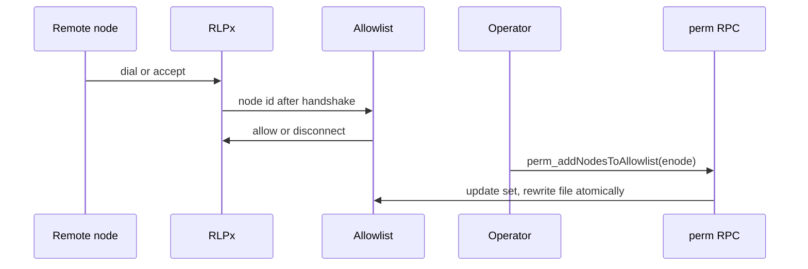
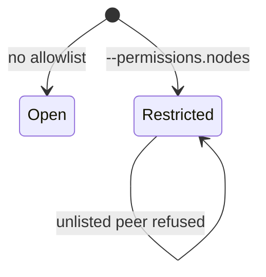
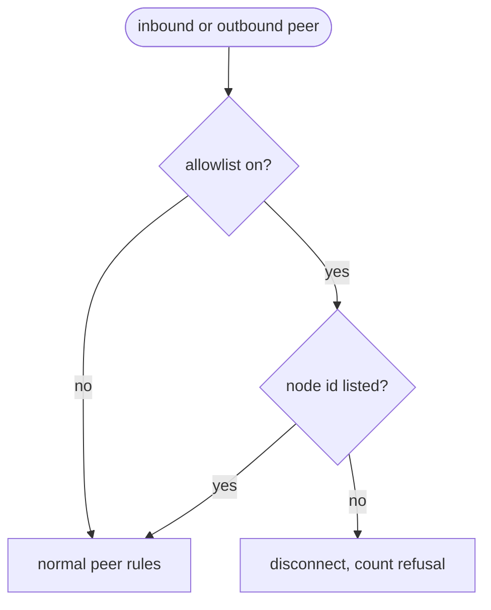

## What

Besu restricts peers to an allowlist of enode URLs, kept in a file and changed at runtime with `perm_addNodesToAllowlist` and siblings; connections to and from other nodes are refused. In xOneRS, static and trusted nodes add peers but do not exclude anyone, and the CIDR filter of GAP-0024 cannot tell two nodes behind one NAT apart. A node-identity allowlist lets a private XDPoS network or a validator behind sentries accept only known nodes. Account permissioning is not part of this issue (see the strengths section of feature-matrix.md: it changes which blocks a producer builds and is out for an XDC client).

## Why

Strength of the Besu client family: enterprise and permissioned networks: node permissioning by enode allowlist (local file, runtime perm_* RPC, optional on-chain rules).

Evidence (competitor commits as in the first pass, `.gap-audit/gap-ledger.json`):

- `besu-eth/besu`: [app/src/main/java/org/hyperledger/besu/cli/options/PermissionsOptions.java](https://github.com/besu-eth/besu/blob/2b839d96863d01210f45a6f62127e6229e5b0889/app/src/main/java/org/hyperledger/besu/cli/options/PermissionsOptions.java) (`--permissions-nodes-config-file-enabled`)
- `besu-eth/besu`: [ethereum/permissioning/src/main/java/org/hyperledger/besu/ethereum/permissioning/NodeLocalConfigPermissioningController.java](https://github.com/besu-eth/besu/blob/2b839d96863d01210f45a6f62127e6229e5b0889/ethereum/permissioning/src/main/java/org/hyperledger/besu/ethereum/permissioning/NodeLocalConfigPermissioningController.java)
- `besu-eth/besu`: [ethereum/api/src/main/java/org/hyperledger/besu/ethereum/api/jsonrpc/internal/methods/permissioning/PermAddNodesToAllowlist.java](https://github.com/besu-eth/besu/blob/2b839d96863d01210f45a6f62127e6229e5b0889/ethereum/api/src/main/java/org/hyperledger/besu/ethereum/api/jsonrpc/internal/methods/permissioning/PermAddNodesToAllowlist.java)
- Docs: https://besu.hyperledger.org/private-networks/concepts/permissioning

Priority: P3 (impact on operators): public XDC nodes do not need it; private XDPoS networks (net2040-style devnets, enterprise chains) and validator sentry set-ups do, and today they rely on --nodiscover plus firewall rules.

Our code today: `crates/xone-node/src/enode.rs` reads static-nodes.json and trusted-nodes.json (they add peers; they do not exclude others); `crates/xone-net/src/peers` scores peers; GAP-0024 (#175) adds CIDR `--netrestrict`; no identity allowlist.

Related xOneRS issues: #175 (GAP-0024 netrestrict), #32, #60. This issue brings the strength; it does not replace their gates.

## 80% of the way to

1. `crates/xone-net/src/peers`: `Allowlist` of node ids (from enode URLs); when set, discv4 neither answers nor adds unlisted nodes, RLPx dial and accept disconnect an unlisted id right after the handshake reveals it, with reason `0x03` (useless peer, geth `DiscUselessPeer`).
2. `--permissions.nodes <file>` (TOML/JSON list of enode URLs); reload on SIGHUP and on `perm_*` calls; the file is rewritten atomically (tmp, fsync, rename).
3. `crates/xone-rpc/src/admin.rs` or a new `perm` namespace: `perm_getNodesAllowlist`, `perm_addNodesToAllowlist`, `perm_removeNodesFromAllowlist`; admin-class (IPC only by default, #60).
4. Static and trusted nodes must be in the allowlist when it is on (start-up refuses otherwise, typed error).
5. Tests: four-node local network, one node not listed: it gets no connection in either direction and no discv4 answer; removal at runtime disconnects the peer.

Acceptance criteria:

- [ ] With the allowlist on, an unlisted node cannot connect in or out and gets no discv4 reply (test).
- [ ] `perm_removeNodesFromAllowlist` disconnects a connected peer within one second.
- [ ] A net2040-style private network of four nodes produces blocks with the allowlist on.

## ASD-STE100

1. When the allowlist is on, the node MUST refuse each peer that is not in the list, in and out.
2. The node MUST apply an allowlist change without a restart.
3. The node MUST write the allowlist file atomically.
4. The perm namespace MUST be admin class and MUST NOT be on public HTTP by default.

## Diagrams



## Images

None. Numbers (sizes, latencies, RSS) go in the PR description as tables.

## Prompt

```text
You work in XDCIndia/xOneRS (Rust XDC client). Implement GAP-0044: Node permissioning for private XDPoS networks: enode allowlist file, runtime perm_* RPC, refuse unlisted peers in and out.

Context: Besu restricts peers to an allowlist of enode URLs, kept in a file and changed at runtime with `perm_addNodesToAllowlist` and siblings; connections to and from other nodes are refused. In xOneRS, static and trusted nodes add peers but do not exclude anyone, and the CIDR filter of GAP-0024 cannot tell two nodes behind one NAT apart. A node-identity allowlist lets a private XDPoS network or a validator behind sentries accept only known nodes. Account permissioning is not part of this issue (see the strengths section of feature-matrix.md: it changes which blocks a producer builds and is out for an XDC client).

Strength brought from Besu: enterprise and permissioned networks: node permissioning by enode allowlist (local file, runtime perm_* RPC, optional on-chain rules). Read the evidence links in the Why section first.

Reference behaviour: geth-XDC at XDCIndia/go-ethereum 6fc8e8c2088b7f18264f5663036669d04fa7becf (conformance/PIN) for anything consensus-visible; this issue must not change consensus, execution or wire formats. Where geth-XDC lacks the feature, follow the first source in the Why section and record the choice in the PR.

Steps:
1. `crates/xone-net/src/peers`: `Allowlist` of node ids (from enode URLs); when set, discv4 neither answers nor adds unlisted nodes, RLPx dial and accept disconnect an unlisted id right after the handshake reveals it, with reason `0x03` (useless peer, geth `DiscUselessPeer`).
2. `--permissions.nodes <file>` (TOML/JSON list of enode URLs); reload on SIGHUP and on `perm_*` calls; the file is rewritten atomically (tmp, fsync, rename).
3. `crates/xone-rpc/src/admin.rs` or a new `perm` namespace: `perm_getNodesAllowlist`, `perm_addNodesToAllowlist`, `perm_removeNodesFromAllowlist`; admin-class (IPC only by default, #60).
4. Static and trusted nodes must be in the allowlist when it is on (start-up refuses otherwise, typed error).
5. Tests: four-node local network, one node not listed: it gets no connection in either direction and no discv4 answer; removal at runtime disconnects the peer.

Rules: one branch `feat/gap-0044-nodeperm` from main, one PR that closes this issue. Write the tests first. Keep consensus, execution and storage formats unchanged unless a step says otherwise (then amend the ADR in the same PR). Run `cargo fmt --check`, `cargo clippy --all-targets -- -D warnings`, `cargo test --locked`, `ci/check-layering.sh` and `ci/check-fixtures.sh`. Update docs/cli/flags.md with `UPDATE_DOCS=1 cargo test -p xone flags_doc` if you add a flag. Never touch live nodes or validator hosts. Hand back in 25 lines or fewer: files changed, tests added, acceptance results.
```

## Workflow

1. Maintainer: confirms priority P3 and assigns the issue.
2. Engineer: creates branch `feat/gap-0044-nodeperm` from `main`.
3. Engineer: writes the failing tests (and the parity or byte-equality checks named in the steps).
4. Engineer: implements the change in the files of Layout.
5. Engineer: runs the gates (fmt, clippy, test, layering, fixtures) and the checks in the acceptance criteria.
6. Engineer: opens one PR that says `Closes #<this issue>` and lists the acceptance results.
7. Reviewer: checks each acceptance criterion and the ASD-STE100 requirements.
8. Maintainer: merges.
9. Operator: tries the feature on one net2040 test node (never a validator host) and records the result in this issue.

## Loop

Runtime: None (event driven: handshake, discv4 packet, perm_* call, SIGHUP).

Develop-verify: write the check, implement, run it, fix, repeat until it passes. A retry after a failed gate starts from the failing check.

## Graph



## Layout

```text
Files touched:
  crates/xone-net/src/peers
  crates/xone-net/src/discv4.rs
  crates/xone-net/src/rlpx.rs
  crates/xone-node/src/enode.rs
  crates/xone-rpc/src/admin.rs
  bin/xone/src/flags.rs
  docs/cli/flags.md
```

## Flow



## Summary

Strength: Besu: enterprise and permissioned networks: node permissioning by enode allowlist (local file, runtime perm_* RPC, optional on-chain rules).
Gap: xOneRS does not have it (Node permissioning for private XDPoS networks: enode allowlist file, runtime perm_* RPC, refuse unlisted peers in and out).
Fix: as in "80% of the way to". Acceptance: With the allowlist on, an unlisted node cannot connect in or out and gets no discv4 reply (test).

<!-- gap-audit:GAP-0044 -->
