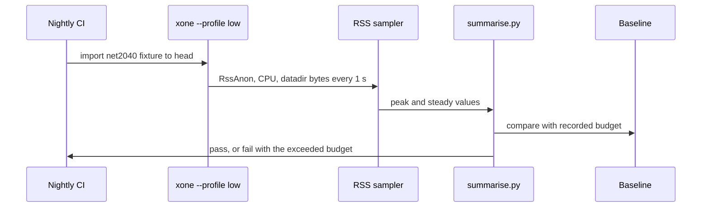
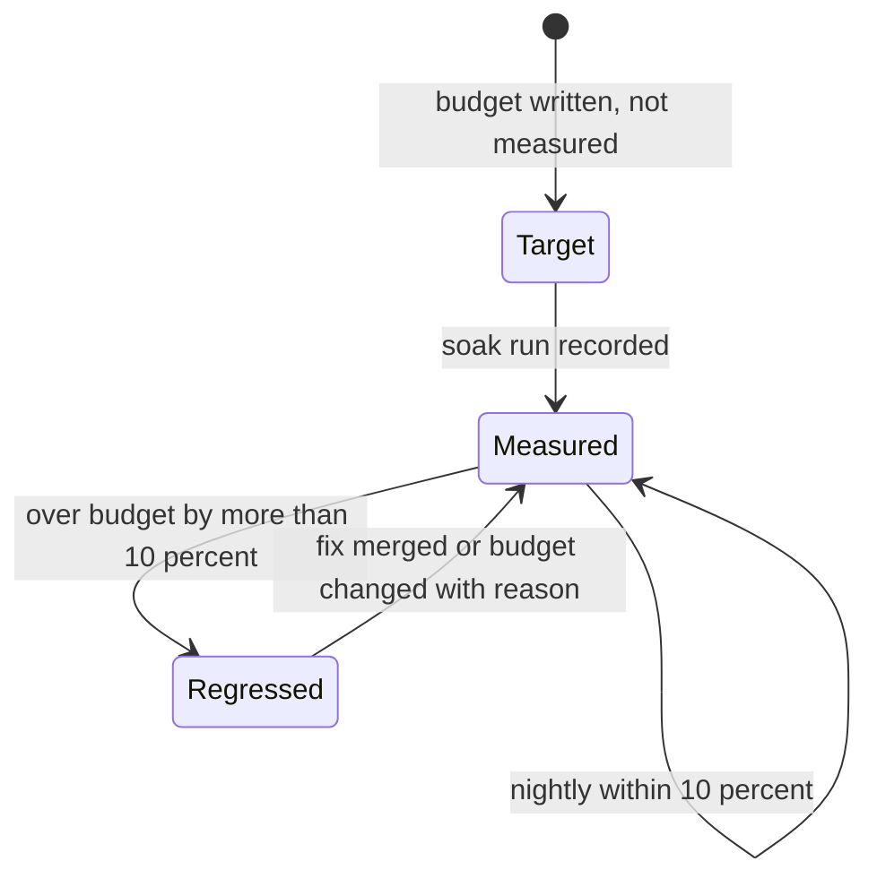
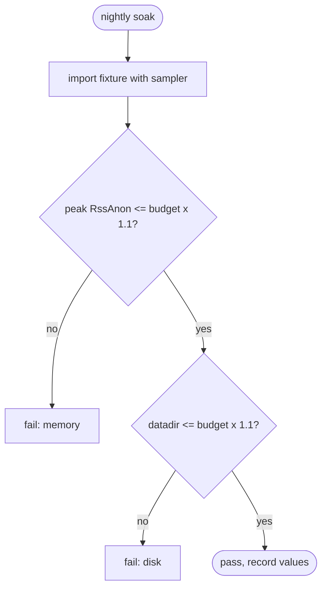

## What

Nimbus treats low resource use as a product feature: it documents a Raspberry Pi set-up and exposes cache sizes. xOneRS measures latency carefully (docs/perf.md) but has no resource ceilings: peak RSS on a 21,600-block net2040 full sync was 7.07 GB, and the only target is #145 for Apothem snap. Operators cannot size hardware from the docs, and a regression in memory or disk is found only on a live host.

## Why

Strength of the Nimbus client family: very low resources: a client designed and documented for small hardware (Raspberry Pi 4 class), with memory caps exposed as options.

Evidence (competitor commits as in the first pass, `.gap-audit/gap-ledger.json`):

- `status-im/nimbus-eth1`: [README.md](https://github.com/status-im/nimbus-eth1/blob/5e3fd7e9d19177980cc1c086c46c4e1dcf38eced/README.md) (section "Raspberry PI": builds and runs on a Raspberry Pi 4)
- `status-im/nimbus-eth1`: [execution_chain/conf.nim](https://github.com/status-im/nimbus-eth1/blob/5e3fd7e9d19177980cc1c086c46c4e1dcf38eced/execution_chain/conf.nim) (cache size options: `debug-rocksdb-row-cache-size`, `debug-rocksdb-block-cache-size`, `debug-rdb-vtx-cache-size`)
- Docs: https://nimbus.guide/pi-guide.html

Priority: P2 (impact on operators): hardware cost decides how many XDC operators run a node. The only measured numbers today are ad hoc (peak RSS 7.07 GB on net2040 full sync, 72 GB Apothem datadir), and only snap on Apothem has a target (#145, < 6 GB RSS).

Our code today: `docs/perf.md` has latency budgets (section 6) and the RSS/cgroup/page-cache rules, but no memory, CPU or disk ceiling per node type; `bin/xone/src/flags.rs` `--cache` ("Megabytes of memory for internal caches"); `docs/ops/net2040-follow.md`: peak RSS 7.07 GB; #145: < 6 GB target for Apothem snap only; no aarch64 build (GAP-0038).

Related xOneRS issues: #13, #145, #149, #16, #193 (GAP-0038, aarch64 build). This issue brings the strength; it does not replace their gates.

## 80% of the way to

1. `docs/perf.md` section 9 "Resource budgets": per node type (full, snap, minimal, producer) and network (net2040, Apothem, mainnet): steady-state RssAnon ceiling, peak RssAnon during sync, CPU cores at tip (p95), datadir bytes per 100k blocks; each number a target first, then measured by the section 2 procedure.
2. `--profile low` (`crates/xone-node/src/config.rs`, `Profile` exists): sets `--cache`, queue bounds, RPC concurrency and group-commit to values that hold the low-resource budget (target: 4 GB RAM, 2 cores, aarch64 or x86_64).
3. CI soak (nightly, not per PR): import the net2040 RLP fixture to head with `/usr/bin/time -v` and a 1 s RSS sampler; fail when peak RssAnon or datadir size is more than 10 percent above the recorded baseline.
4. Publish the hardware table in `docs/ops/` (minimum and recommended per node type), generated from the last soak.
5. Tests: the soak job itself; a unit test that `--profile low` values satisfy the ADR-007 bounds.

Acceptance criteria:

- [ ] docs/perf.md lists a budget per node type and network, each with a measured value or the word target.
- [ ] The nightly soak fails on an injected 20 percent memory regression (test by a debug allocation).
- [ ] A `--profile low` node follows net2040 at tip for 24 h within 4 GB cgroup memory on aarch64 or x86_64.

## ASD-STE100

1. Each node type MUST have a memory, CPU and disk budget in docs/perf.md.
2. The soak MUST measure RssAnon, not cgroup memory, for the memory budget.
3. The soak MUST fail when a budget is exceeded by more than 10 percent.
4. A budget number MUST say if it is measured or a target.

## Diagrams



## Images

None. Numbers (sizes, latencies, RSS) go in the PR description as tables.

## Prompt

```text
You work in XDCIndia/xOneRS (Rust XDC client). Implement GAP-0045: Resource budgets as measured targets: RSS, CPU and disk ceilings per node type, a low-resource profile and a CI regression soak.

Context: Nimbus treats low resource use as a product feature: it documents a Raspberry Pi set-up and exposes cache sizes. xOneRS measures latency carefully (docs/perf.md) but has no resource ceilings: peak RSS on a 21,600-block net2040 full sync was 7.07 GB, and the only target is #145 for Apothem snap. Operators cannot size hardware from the docs, and a regression in memory or disk is found only on a live host.

Strength brought from Nimbus: very low resources: a client designed and documented for small hardware (Raspberry Pi 4 class), with memory caps exposed as options. Read the evidence links in the Why section first.

Reference behaviour: geth-XDC at XDCIndia/go-ethereum 6fc8e8c2088b7f18264f5663036669d04fa7becf (conformance/PIN) for anything consensus-visible; this issue must not change consensus, execution or wire formats. Where geth-XDC lacks the feature, follow the first source in the Why section and record the choice in the PR.

Steps:
1. `docs/perf.md` section 9 "Resource budgets": per node type (full, snap, minimal, producer) and network (net2040, Apothem, mainnet): steady-state RssAnon ceiling, peak RssAnon during sync, CPU cores at tip (p95), datadir bytes per 100k blocks; each number a target first, then measured by the section 2 procedure.
2. `--profile low` (`crates/xone-node/src/config.rs`, `Profile` exists): sets `--cache`, queue bounds, RPC concurrency and group-commit to values that hold the low-resource budget (target: 4 GB RAM, 2 cores, aarch64 or x86_64).
3. CI soak (nightly, not per PR): import the net2040 RLP fixture to head with `/usr/bin/time -v` and a 1 s RSS sampler; fail when peak RssAnon or datadir size is more than 10 percent above the recorded baseline.
4. Publish the hardware table in `docs/ops/` (minimum and recommended per node type), generated from the last soak.
5. Tests: the soak job itself; a unit test that `--profile low` values satisfy the ADR-007 bounds.

Rules: one branch `feat/gap-0045-budgets` from main, one PR that closes this issue. Write the tests first. Keep consensus, execution and storage formats unchanged unless a step says otherwise (then amend the ADR in the same PR). Run `cargo fmt --check`, `cargo clippy --all-targets -- -D warnings`, `cargo test --locked`, `ci/check-layering.sh` and `ci/check-fixtures.sh`. Update docs/cli/flags.md with `UPDATE_DOCS=1 cargo test -p xone flags_doc` if you add a flag. Never touch live nodes or validator hosts. Hand back in 25 lines or fewer: files changed, tests added, acceptance results.
```

## Workflow

1. Maintainer: confirms priority P2 and assigns the issue.
2. Engineer: creates branch `feat/gap-0045-budgets` from `main`.
3. Engineer: writes the failing tests (and the parity or byte-equality checks named in the steps).
4. Engineer: implements the change in the files of Layout.
5. Engineer: runs the gates (fmt, clippy, test, layering, fixtures) and the checks in the acceptance criteria.
6. Engineer: opens one PR that says `Closes #<this issue>` and lists the acceptance results.
7. Reviewer: checks each acceptance criterion and the ASD-STE100 requirements.
8. Maintainer: merges.
9. Operator: tries the feature on one net2040 test node (never a validator host) and records the result in this issue.

## Loop

Runtime: Nightly soak; the sampler reads /proc every 1 s during the run.

Develop-verify: write the check, implement, run it, fix, repeat until it passes. A retry after a failed gate starts from the failing check.

## Graph



## Layout

```text
Files touched:
  docs/perf.md
  crates/xone-node/src/config.rs
  bench/collect/
  bench/README.md
  docs/ops/
  ci/
```

## Flow



## Summary

Strength: Nimbus: very low resources: a client designed and documented for small hardware (Raspberry Pi 4 class), with memory caps exposed as options.
Gap: xOneRS does not have it (Resource budgets as measured targets: RSS, CPU and disk ceilings per node type, a low-resource profile and a CI regression soak).
Fix: as in "80% of the way to". Acceptance: docs/perf.md lists a budget per node type and network, each with a measured value or the word target.

<!-- gap-audit:GAP-0045 -->
