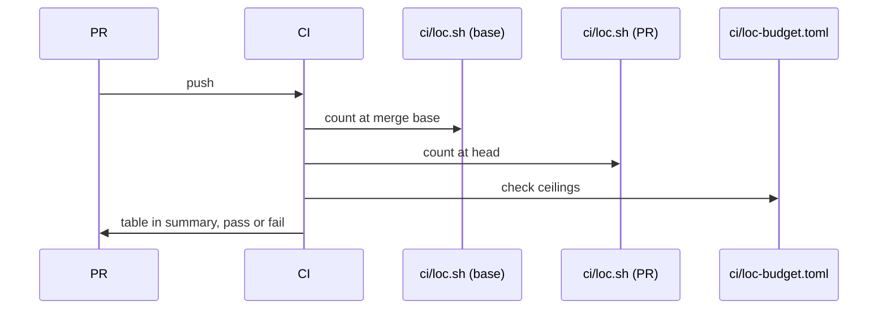
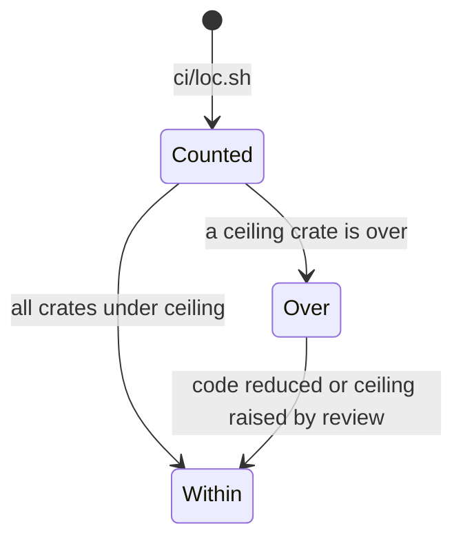
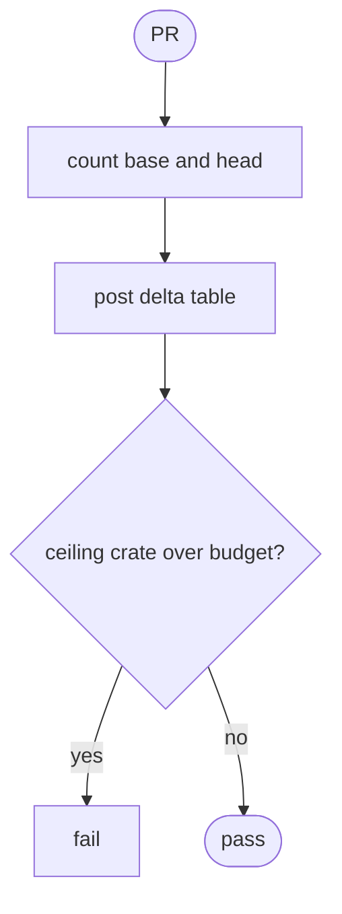

## What

ethrex counts lines of code per crate on each PR and posts the change, and runs a daily report, to keep the client small and readable. xOneRS already enforces crate layering and unsafe rules, but nothing shows when a PR grows the consensus or signer crates or pulls in many new dependencies. A report plus a ceiling for the crates that decide consensus keeps them reviewable.

## Why

Strength of the ethrex client family: small and readable: a lines-of-code report on every PR and a daily report, so the client stays small enough to read.

Evidence (competitor commits as in the first pass, `.gap-audit/gap-ledger.json`):

- `lambdaclass/ethrex`: [.github/workflows/pr_loc.yaml](https://github.com/lambdaclass/ethrex/blob/740ea493880b6c073b81537010df75e143c615c2/.github/workflows/pr_loc.yaml) ("PR Lines of Code Analysis": base and PR counted, diff posted)
- `lambdaclass/ethrex`: [.github/workflows/daily_loc_report.yaml](https://github.com/lambdaclass/ethrex/blob/740ea493880b6c073b81537010df75e143c615c2/.github/workflows/daily_loc_report.yaml)
- `lambdaclass/ethrex`: [tooling/loc/Cargo.toml](https://github.com/lambdaclass/ethrex/blob/740ea493880b6c073b81537010df75e143c615c2/tooling/loc/Cargo.toml)

Priority: P3 (impact on operators): no direct operator effect; it protects auditability of the consensus and signer path, which the security reviews (#44) and the assurance gate (#15) depend on.

Our code today: `ci/check-layering.sh` (crate ranks), `ci/unsafe-audit.sh`, `deny.toml` (cargo-deny licences and bans) exist; no line-count or dependency-count report, no ceiling.

Related xOneRS issues: #15, #44, #22. This issue brings the strength; it does not replace their gates.

## 80% of the way to

1. `ci/loc.sh`: count non-blank, non-comment Rust lines per crate (`tokei` pinned, or a 30-line script over `crates/*/src`), excluding tests and generated files; count unique dependencies from `cargo metadata --locked`.
2. `ci/loc-budget.toml`: ceilings for `xone-consensus`, `xone-evm`, `xone-signer`, `xone-primitives`; CI fails above the ceiling; raising a ceiling is a one-line reviewed change.
3. PR job: compare against the merge base and print a table (crate, before, after, delta) in the job summary.
4. Tests: `ci/tests/test_gates.py` gets a case where an over-ceiling fixture fails.

Acceptance criteria:

- [ ] Each PR shows a per-crate line and dependency delta.
- [ ] A PR that takes `xone-consensus` above its ceiling fails CI.
- [ ] The ceilings are set from the current main plus 15 percent and recorded.

## ASD-STE100

1. CI MUST report the line count of each crate on each PR.
2. CI MUST fail when a consensus or signer crate exceeds its ceiling.
3. A ceiling change MUST be a reviewed change of `ci/loc-budget.toml`.

## Diagrams



## Images

None. Numbers (sizes, latencies, RSS) go in the PR description as tables.

## Prompt

```text
You work in XDCIndia/xOneRS (Rust XDC client). Implement GAP-0046: Code-size budget in CI: per-crate line count and dependency count on every PR, with a ceiling for the consensus crates.

Context: ethrex counts lines of code per crate on each PR and posts the change, and runs a daily report, to keep the client small and readable. xOneRS already enforces crate layering and unsafe rules, but nothing shows when a PR grows the consensus or signer crates or pulls in many new dependencies. A report plus a ceiling for the crates that decide consensus keeps them reviewable.

Strength brought from ethrex: small and readable: a lines-of-code report on every PR and a daily report, so the client stays small enough to read. Read the evidence links in the Why section first.

Reference behaviour: geth-XDC at XDCIndia/go-ethereum 6fc8e8c2088b7f18264f5663036669d04fa7becf (conformance/PIN) for anything consensus-visible; this issue must not change consensus, execution or wire formats. Where geth-XDC lacks the feature, follow the first source in the Why section and record the choice in the PR.

Steps:
1. `ci/loc.sh`: count non-blank, non-comment Rust lines per crate (`tokei` pinned, or a 30-line script over `crates/*/src`), excluding tests and generated files; count unique dependencies from `cargo metadata --locked`.
2. `ci/loc-budget.toml`: ceilings for `xone-consensus`, `xone-evm`, `xone-signer`, `xone-primitives`; CI fails above the ceiling; raising a ceiling is a one-line reviewed change.
3. PR job: compare against the merge base and print a table (crate, before, after, delta) in the job summary.
4. Tests: `ci/tests/test_gates.py` gets a case where an over-ceiling fixture fails.

Rules: one branch `feat/gap-0046-locbudget` from main, one PR that closes this issue. Write the tests first. Keep consensus, execution and storage formats unchanged unless a step says otherwise (then amend the ADR in the same PR). Run `cargo fmt --check`, `cargo clippy --all-targets -- -D warnings`, `cargo test --locked`, `ci/check-layering.sh` and `ci/check-fixtures.sh`. Update docs/cli/flags.md with `UPDATE_DOCS=1 cargo test -p xone flags_doc` if you add a flag. Never touch live nodes or validator hosts. Hand back in 25 lines or fewer: files changed, tests added, acceptance results.
```

## Workflow

1. Maintainer: confirms priority P3 and assigns the issue.
2. Engineer: creates branch `feat/gap-0046-locbudget` from `main`.
3. Engineer: writes the failing tests (and the parity or byte-equality checks named in the steps).
4. Engineer: implements the change in the files of Layout.
5. Engineer: runs the gates (fmt, clippy, test, layering, fixtures) and the checks in the acceptance criteria.
6. Engineer: opens one PR that says `Closes #<this issue>` and lists the acceptance results.
7. Reviewer: checks each acceptance criterion and the ASD-STE100 requirements.
8. Maintainer: merges.
9. Operator: tries the feature on one net2040 test node (never a validator host) and records the result in this issue.

## Loop

Runtime: None at runtime; once per PR and once per day on main.

Develop-verify: write the check, implement, run it, fix, repeat until it passes. A retry after a failed gate starts from the failing check.

## Graph



## Layout

```text
Files touched:
  ci/loc.sh
  ci/loc-budget.toml
  ci/tests/test_gates.py
  Makefile
```

## Flow



## Summary

Strength: ethrex: small and readable: a lines-of-code report on every PR and a daily report, so the client stays small enough to read.
Gap: xOneRS does not have it (Code-size budget in CI: per-crate line count and dependency count on every PR, with a ceiling for the consensus crates).
Fix: as in "80% of the way to". Acceptance: Each PR shows a per-crate line and dependency delta.

<!-- gap-audit:GAP-0046 -->
