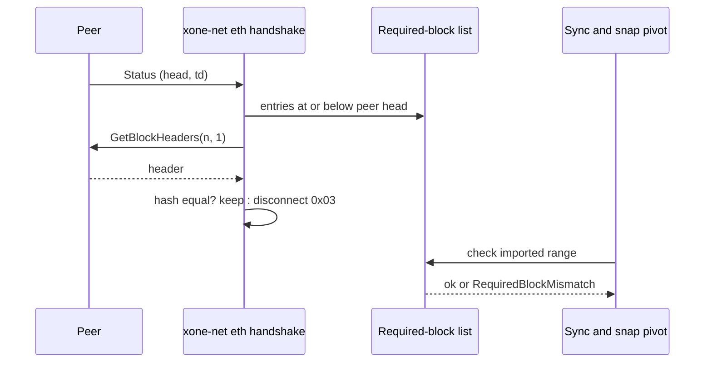
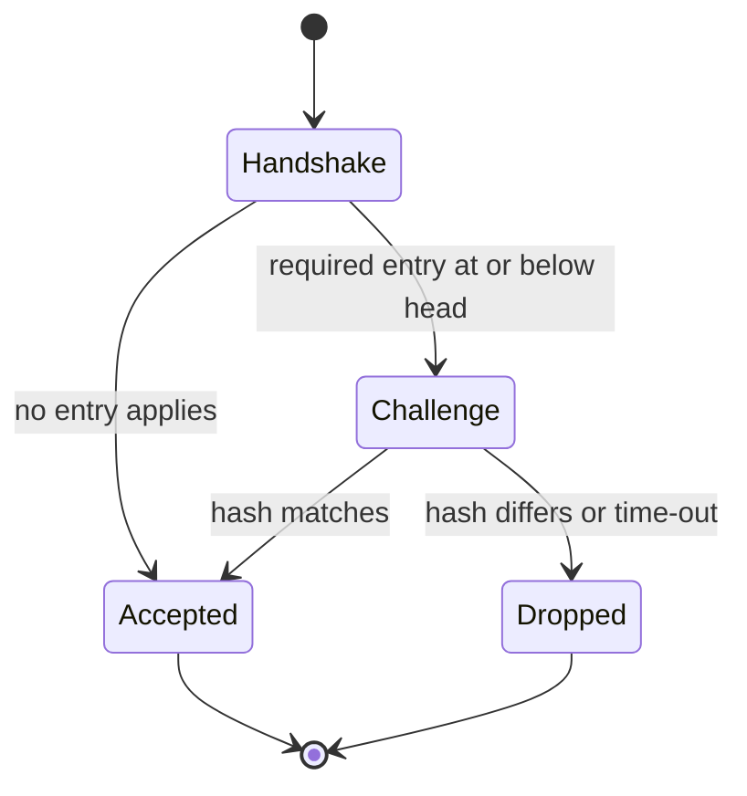
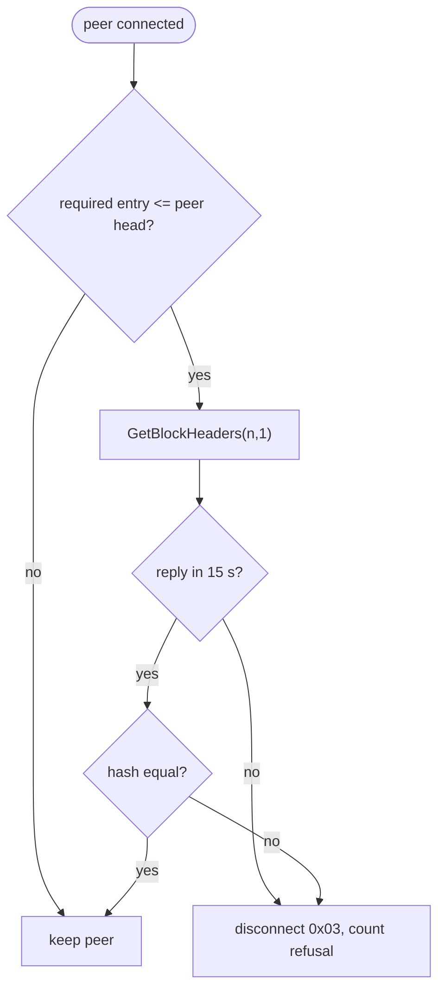

## What

geth-XDC refuses peers that do not have a given hash at a given height (`--eth.requiredblocks <n>=<hash>,...`), and for Apothem it ships one built-in entry: block 83,665,617 with hash `0x2432ce64...499c3f`, the first canonical block after the September 2026 Apothem reset. The oracle source notes that stale v2.8.2 peers still serve the abandoned pre-reset branch, at about 87.4M. xOneRS has no required-block check: `--snap.pins` constrains only a snap pivot, and full sync and live follow accept any peer whose headers verify. A new or restarted Apothem node can therefore spend its peer slots on, or sync towards, the abandoned branch.

## Why

5 of the 14 selected competitors have this capability; the geth-XDC oracle pin has it too (file evidence at the audited commit; competitor commits in `.gap-audit/gap-ledger.json`):

- `ethereum/go-ethereum`: [cmd/utils/flags.go](https://github.com/ethereum/go-ethereum/blob/8059ff8beb3170eb8b977169ac51bb0423c97ee1/cmd/utils/flags.go) (`eth.requiredblocks`)
- `ethereum/go-ethereum`: [eth/handler.go](https://github.com/ethereum/go-ethereum/blob/8059ff8beb3170eb8b977169ac51bb0423c97ee1/eth/handler.go) (`requiredBlocks` challenge after the handshake)
- `bnb-chain/bsc`: [cmd/utils/flags.go](https://github.com/bnb-chain/bsc/blob/54afaff4da31ac9e49ba646a4f65104edac5a2f3/cmd/utils/flags.go) (`eth.requiredblocks`)
- `0xPolygon/bor`: [internal/cli/server/flags.go](https://github.com/0xPolygon/bor/blob/ee09efd5dd9ef75917368990b272581b0e2c2665/internal/cli/server/flags.go) (`eth.requiredblocks`)
- `besu-eth/besu`: [app/src/main/java/org/hyperledger/besu/cli/BesuCommand.java](https://github.com/besu-eth/besu/blob/2b839d96863d01210f45a6f62127e6229e5b0889/app/src/main/java/org/hyperledger/besu/cli/BesuCommand.java) (`--required-blocks`)
- `besu-eth/besu`: [ethereum/eth/src/main/java/org/hyperledger/besu/ethereum/eth/peervalidation/RequiredBlocksPeerValidator.java](https://github.com/besu-eth/besu/blob/2b839d96863d01210f45a6f62127e6229e5b0889/ethereum/eth/src/main/java/org/hyperledger/besu/ethereum/eth/peervalidation/RequiredBlocksPeerValidator.java)
- `erigontech/erigon`: [cmd/utils/flags.go](https://github.com/erigontech/erigon/blob/bbb5524e53fb057e7d47a5066e152f1091ac4ba4/cmd/utils/flags.go) (`--whitelist`)
- geth-XDC oracle pin `XDCIndia/go-ethereum@6fc8e8c2`: [cmd/utils/flags.go](https://github.com/XDCIndia/go-ethereum/blob/6fc8e8c2088b7f18264f5663036669d04fa7becf/cmd/utils/flags.go) (`eth.requiredblocks` and the built-in Apothem entry for 83,665,617)
- Docs: https://geth.ethereum.org/docs/fundamentals/command-line-options (`--eth.requiredblocks`)

Priority: P1: an Apothem operator has no protection against the abandoned pre-reset branch today, and the canonical client ships the anchor by default (5 of 14 competitors plus geth-XDC).

Our code today: `crates/xone-node/src/services/snapsync.rs` (pivot anchor from `--snap.pins` or two peers, snap only); `crates/xone-net/src/eth` (handshake, no block challenge); `crates/xone-chainspec/src/networks.rs` (no anchor list)

Related xOneRS issues: #45 (Apothem follow gate), #14 (authenticated bootstrap anchor), #37, #98. This issue adds the capability; it does not replace their gates.

## 80% of the way to

1. `crates/xone-chainspec/src/networks.rs`: add `required_blocks: &[(u64, B256)]` per network; Apothem gets `(83_665_617, 0x2432ce6433608954ef6eaf2feba8f9a2fe90f5a913401eb07d5fa2f1bb499c3f)` copied from the oracle pin, mainnet and net2040 start empty.
2. `bin/xone/src/flags.rs`: `--eth.requiredblocks <n>=<hash>[,...]` (geth syntax); user entries override built-in entries at the same height; dumpconfig prints the merged list.
3. `crates/xone-net/src/eth`: after the status exchange, for each required entry at or below the peer's announced head, request that header (`GetBlockHeaders`, one header); a missing or different hash disconnects the peer with reason `0x03` and a counter `xone_peers_required_block_refused_total`; time-out 15 s as geth.
4. `crates/xone-sync` and `services/snapsync.rs`: a header chain that contains a required height with another hash is refused before import or pivot choice (typed error `RequiredBlockMismatch{number, want, got}`).
5. Tests: unit test of the flag parser and merge; an in-process two-peer test where one peer serves the wrong hash at the required height and is dropped; a sync test that refuses a chain through the wrong hash.

Acceptance criteria:

- [ ] A peer with a different hash at a required height is disconnected within 15 s (test).
- [ ] An Apothem node started with no flag uses the built-in 83,665,617 entry (dumpconfig shows it).
- [ ] Sync and snap pivot selection refuse a chain that crosses a required height with a different hash (typed error).

## ASD-STE100

1. The node MUST check each required block at each peer after the handshake.
2. The node MUST disconnect a peer that has a different hash at a required height.
3. The node MUST NOT import a chain that has a different hash at a required height.
4. An operator entry MUST replace a built-in entry at the same height.

## Diagrams



## Images

None. Measurements (timings, sizes) go in the PR description as tables.

## Prompt

```text
You work in XDCIndia/xOneRS (Rust XDC client). Implement GAP-0047: Required-block peer check with built-in network anchors (--eth.requiredblocks; Apothem reset block 83,665,617).

Context: geth-XDC refuses peers that do not have a given hash at a given height (`--eth.requiredblocks <n>=<hash>,...`), and for Apothem it ships one built-in entry: block 83,665,617 with hash `0x2432ce64...499c3f`, the first canonical block after the September 2026 Apothem reset. The oracle source notes that stale v2.8.2 peers still serve the abandoned pre-reset branch, at about 87.4M. xOneRS has no required-block check: `--snap.pins` constrains only a snap pivot, and full sync and live follow accept any peer whose headers verify. A new or restarted Apothem node can therefore spend its peer slots on, or sync towards, the abandoned branch.

Read the evidence links in the Why section first.

Reference behaviour: geth-XDC at XDCIndia/go-ethereum 6fc8e8c2088b7f18264f5663036669d04fa7becf (conformance/PIN) for anything consensus-visible or RPC-visible; this issue must not change consensus, execution or wire formats. Where geth-XDC lacks the feature, follow the first source in the Why section and record the choice in the PR.

Steps:
1. `crates/xone-chainspec/src/networks.rs`: add `required_blocks: &[(u64, B256)]` per network; Apothem gets `(83_665_617, 0x2432ce6433608954ef6eaf2feba8f9a2fe90f5a913401eb07d5fa2f1bb499c3f)` copied from the oracle pin, mainnet and net2040 start empty.
2. `bin/xone/src/flags.rs`: `--eth.requiredblocks <n>=<hash>[,...]` (geth syntax); user entries override built-in entries at the same height; dumpconfig prints the merged list.
3. `crates/xone-net/src/eth`: after the status exchange, for each required entry at or below the peer's announced head, request that header (`GetBlockHeaders`, one header); a missing or different hash disconnects the peer with reason `0x03` and a counter `xone_peers_required_block_refused_total`; time-out 15 s as geth.
4. `crates/xone-sync` and `services/snapsync.rs`: a header chain that contains a required height with another hash is refused before import or pivot choice (typed error `RequiredBlockMismatch{number, want, got}`).
5. Tests: unit test of the flag parser and merge; an in-process two-peer test where one peer serves the wrong hash at the required height and is dropped; a sync test that refuses a chain through the wrong hash.

Rules: one branch `feat/gap-0047-requiredblocks` from main, one PR that closes this issue. Write the tests first. Keep consensus, execution and storage formats unchanged unless a step says otherwise (then amend the ADR in the same PR). Run `cargo fmt --check`, `cargo clippy --all-targets -- -D warnings`, `cargo test --locked`, `ci/check-layering.sh` and `ci/check-fixtures.sh`. Update docs/cli/flags.md with `UPDATE_DOCS=1 cargo test -p xone flags_doc` if you add a flag. Never touch live nodes or validator hosts. Hand back in 25 lines or fewer: files changed, tests added, acceptance results.
```

## Workflow

1. Maintainer: confirms priority P1 and assigns the issue.
2. Engineer: creates branch `feat/gap-0047-requiredblocks` from `main`.
3. Engineer: writes the failing tests named in the steps (and the oracle vectors where the steps name them).
4. Engineer: implements the change in the files of Layout.
5. Engineer: runs the gates (fmt, clippy, test, layering, fixtures) and the checks in the acceptance criteria.
6. Engineer: opens one PR that says `Closes #<this issue>` and lists the acceptance results.
7. Reviewer: checks each acceptance criterion and the ASD-STE100 requirements.
8. Maintainer: merges.
9. Operator: tries the feature on one net2040 or Apothem test node (never a validator host) and records the result in this issue.

## Loop

Runtime: one challenge per peer connection (event driven); no cron. Develop-verify: write the check, implement, run it, fix, repeat until it passes.

## Graph



## Layout

```text
Files touched:
  crates/xone-chainspec/src/networks.rs
  crates/xone-net/src/eth
  crates/xone-sync/src/chain
  crates/xone-node/src/services/snapsync.rs
  bin/xone/src/flags.rs
  docs/cli/flags.md

Example:
xone --apothem --eth.requiredblocks 83665617=0x2432ce64...499c3f
log: peer refused  id=ab12..  reason=required-block  number=83665617  got=0x5e1f..
```

## Flow



## Summary

Gap: xOneRS cannot refuse peers or chains on the abandoned Apothem pre-reset branch; geth-XDC ships a required block for it.
Fix: Required-block list per network plus `--eth.requiredblocks`, checked at the handshake and before import or pivot choice.
Acceptance: A wrong-hash peer is dropped in 15 s, the Apothem default is active without flags, and sync refuses a mismatching chain.

<!-- gap-audit:GAP-0047 -->
