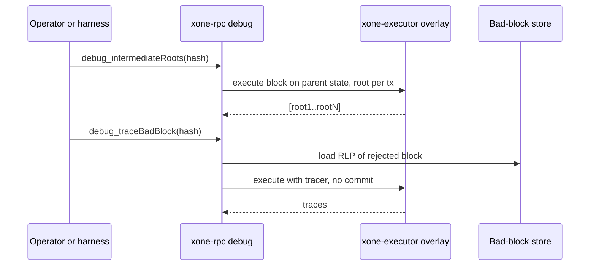
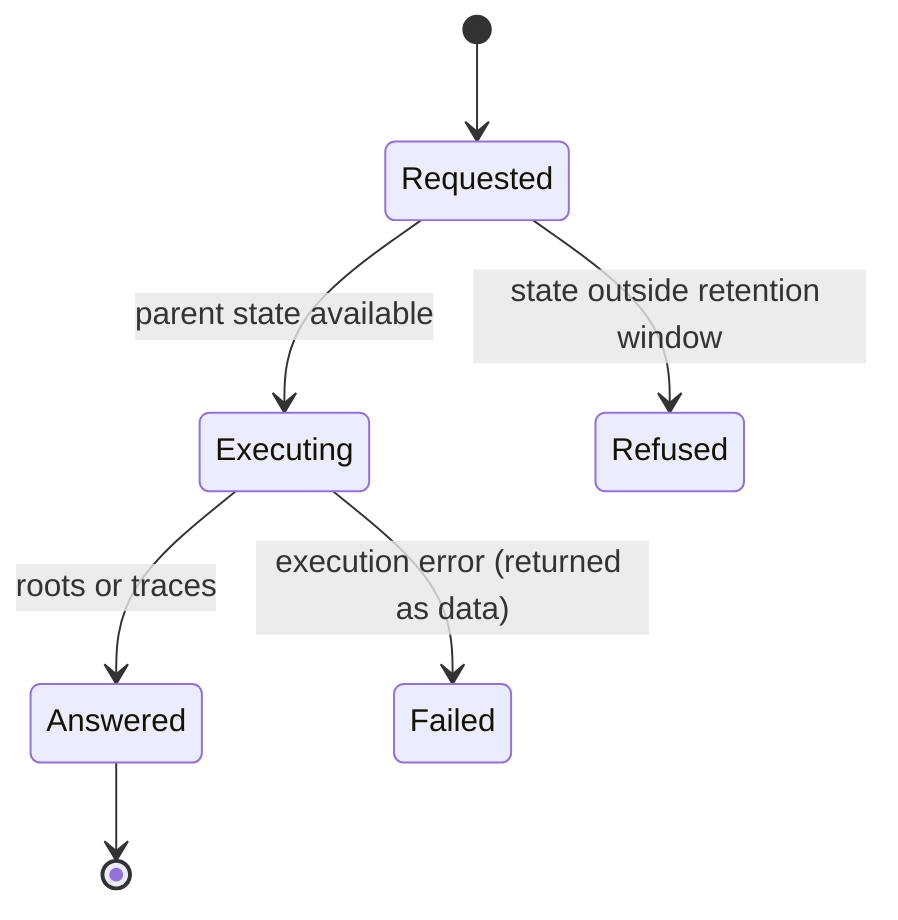
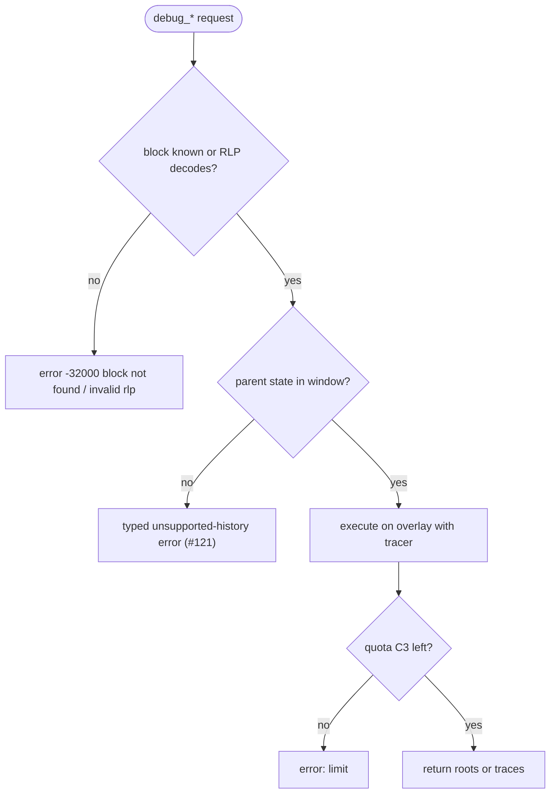

## What

When xOneRS and geth-XDC disagree on a state root, the first question is which transaction diverged. geth-XDC answers it with `debug_intermediateRoots` (state root after each transaction), traces a rejected block with `debug_traceBadBlock` and `debug_standardTraceBadBlockToFile`, traces an RLP block that was never imported with `debug_traceBlock`, and streams traces of a range with `debug_traceChain`. xOneRS serves only `debug_traceTransaction` and `debug_traceBlockBy*` with two tracers; spec/rpc/scope-adr-008.md lists `debug_traceBlock` (raw) as out. The conformance harness must therefore bisect by replaying whole blocks.

## Why

9 of the 14 selected competitors have this capability; the geth-XDC oracle pin has it too (file evidence at the audited commit; competitor commits in `.gap-audit/gap-ledger.json`):

- `ethereum/go-ethereum`: [eth/tracers/api.go](https://github.com/ethereum/go-ethereum/blob/8059ff8beb3170eb8b977169ac51bb0423c97ee1/eth/tracers/api.go) (`IntermediateRoots`, `TraceBadBlock`, `StandardTraceBlockToFile`, `TraceChain`)
- `bnb-chain/bsc`: [eth/tracers/api.go](https://github.com/bnb-chain/bsc/blob/54afaff4da31ac9e49ba646a4f65104edac5a2f3/eth/tracers/api.go)
- `0xPolygon/bor`: [eth/tracers/api.go](https://github.com/0xPolygon/bor/blob/ee09efd5dd9ef75917368990b272581b0e2c2665/eth/tracers/api.go)
- `XinFinOrg/XDPoSChain`: [eth/tracers/api.go](https://github.com/XinFinOrg/XDPoSChain/blob/cb1ef79073c05f50b9df75b1e740387b9d72af99/eth/tracers/api.go) (`IntermediateRoots`, `TraceBadBlock`)
- `besu-eth/besu`: [ethereum/api/src/main/java/org/hyperledger/besu/ethereum/api/jsonrpc/internal/methods/DebugStandardTraceBadBlockToFile.java](https://github.com/besu-eth/besu/blob/2b839d96863d01210f45a6f62127e6229e5b0889/ethereum/api/src/main/java/org/hyperledger/besu/ethereum/api/jsonrpc/internal/methods/DebugStandardTraceBadBlockToFile.java)
- `NethermindEth/nethermind`: [src/Nethermind/Nethermind.JsonRpc/Modules/DebugModule/IDebugRpcModule.cs](https://github.com/NethermindEth/nethermind/blob/a7dd73052e696ad934d228aad3f33e660701fdb7/src/Nethermind/Nethermind.JsonRpc/Modules/DebugModule/IDebugRpcModule.cs) (`debug_traceBadBlock`, `debug_intermediateRoots`)
- `paradigmxyz/reth`: [crates/rpc/rpc-api/src/debug.rs](https://github.com/paradigmxyz/reth/blob/36600d5ff9628465475dd4c7608e2e9f2fe24273/crates/rpc/rpc-api/src/debug.rs) (`debug_intermediateRoots`, `debug_standardTraceBadBlockToFile`)
- `harmony-one/harmony`: [hmy/tracers/api.go](https://github.com/harmony-one/harmony/blob/a41e194761c81fe846994864e789a7d306bbc439/hmy/tracers/api.go)
- `kaiachain/kaia`: [node/cn/tracers/api.go](https://github.com/kaiachain/kaia/blob/0f9ad843d1ccb7381cc43070ce13002cca7b1ed9/node/cn/tracers/api.go)
- geth-XDC oracle pin `XDCIndia/go-ethereum@6fc8e8c2`: [eth/tracers/api.go](https://github.com/XDCIndia/go-ethereum/blob/6fc8e8c2088b7f18264f5663036669d04fa7becf/eth/tracers/api.go) (lines 207-494: `TraceChain`, `TraceBlock`, `TraceBadBlock`, `StandardTraceBlockToFile`, `IntermediateRoots`)
- geth-XDC oracle pin `XDCIndia/go-ethereum@6fc8e8c2`: [eth/api_debug_replay.go](https://github.com/XDCIndia/go-ethereum/blob/6fc8e8c2088b7f18264f5663036669d04fa7becf/eth/api_debug_replay.go) (`debug_replayBadBlock`)
- Docs: https://geth.ethereum.org/docs/interacting-with-geth/rpc/ns-debug

Priority: P1: maintainers and operators chasing a state-root divergence (the P0 class of this project) have no per-transaction root today (base P2), raised because 9 of 14 competitors and both canonical XDC clients serve it. Reverses the ADR-008 'debug_traceBlock (raw) out' line; the ADR change is part of the work.

Our code today: `crates/xone-rpc/src/debug.rs` (traceTransaction, traceBlockByNumber/Hash; callTracer and prestateTracer), `spec/rpc/scope-adr-008.md` (raw traceBlock out), no bad-block store (GAP-0009, #160)

Related xOneRS issues: #160 (GAP-0009 getBadBlocks store), #154 (GAP-0003 struct logger), #10, #42. This issue adds the capability; it does not replace their gates.

## 80% of the way to

1. `crates/xone-executor/src/lib.rs`: an `on_tx_end` hook that, when asked, computes the state root after each transaction on an overlay (`overlay.rs`) without committing; used only by RPC.
2. `crates/xone-rpc/src/debug.rs`: `debug_intermediateRoots(hash, cfg)` (class C3), `debug_traceBlock(rlp, cfg)` (decode, execute on the parent state, never import), `debug_traceBadBlock(hash, cfg)` and `debug_standardTraceBadBlockToFile` / `debug_standardTraceBlockToFile` (JSON lines per transaction in `<datadir>/trace/`, admin class, IPC only by default).
3. `debug_traceChain(start, end, cfg)` as a WebSocket subscription with the C3 quota per block; cancel on unsubscribe.
4. Read bad blocks from the store of GAP-0009 (#160); if that issue is not merged, keep the last 10 rejected blocks in memory with their RLP and the error.
5. Tests: intermediate roots of a known Apothem block equal geth-XDC (vector under `conformance/vectors/rpc/apothem/`); the last root equals the header root; traceBlock of a block with a bad state root returns traces and does not import it.
6. Amend `spec/rpc/scope-adr-008.md` in the same PR.

Acceptance criteria:

- [ ] `debug_intermediateRoots` equals the geth-XDC answer on 3 Apothem blocks (vectors).
- [ ] `debug_traceBlock` on an RLP block leaves the chain head and the database unchanged (test).
- [ ] A rejected block can be traced by hash with `debug_traceBadBlock` after the rejection (test).

## ASD-STE100

1. The node MUST NOT write state when it computes intermediate roots.
2. The node MUST NOT import a block that it receives through debug_traceBlock.
3. The file tracers MUST be admin class and MUST write only below the datadir.
4. Each method MUST use the C3 quota.

## Diagrams



## Images

None. Measurements (timings, sizes) go in the PR description as tables.

## Prompt

```text
You work in XDCIndia/xOneRS (Rust XDC client). Implement GAP-0048: Divergence tracing: debug_intermediateRoots, debug_traceBadBlock, debug_traceBlock (raw RLP), debug_standardTraceBlockToFile and debug_traceChain.

Context: When xOneRS and geth-XDC disagree on a state root, the first question is which transaction diverged. geth-XDC answers it with `debug_intermediateRoots` (state root after each transaction), traces a rejected block with `debug_traceBadBlock` and `debug_standardTraceBadBlockToFile`, traces an RLP block that was never imported with `debug_traceBlock`, and streams traces of a range with `debug_traceChain`. xOneRS serves only `debug_traceTransaction` and `debug_traceBlockBy*` with two tracers; spec/rpc/scope-adr-008.md lists `debug_traceBlock` (raw) as out. The conformance harness must therefore bisect by replaying whole blocks.

Read the evidence links in the Why section first.

Reference behaviour: geth-XDC at XDCIndia/go-ethereum 6fc8e8c2088b7f18264f5663036669d04fa7becf (conformance/PIN) for anything consensus-visible or RPC-visible; this issue must not change consensus, execution or wire formats. Where geth-XDC lacks the feature, follow the first source in the Why section and record the choice in the PR.

Steps:
1. `crates/xone-executor/src/lib.rs`: an `on_tx_end` hook that, when asked, computes the state root after each transaction on an overlay (`overlay.rs`) without committing; used only by RPC.
2. `crates/xone-rpc/src/debug.rs`: `debug_intermediateRoots(hash, cfg)` (class C3), `debug_traceBlock(rlp, cfg)` (decode, execute on the parent state, never import), `debug_traceBadBlock(hash, cfg)` and `debug_standardTraceBadBlockToFile` / `debug_standardTraceBlockToFile` (JSON lines per transaction in `<datadir>/trace/`, admin class, IPC only by default).
3. `debug_traceChain(start, end, cfg)` as a WebSocket subscription with the C3 quota per block; cancel on unsubscribe.
4. Read bad blocks from the store of GAP-0009 (#160); if that issue is not merged, keep the last 10 rejected blocks in memory with their RLP and the error.
5. Tests: intermediate roots of a known Apothem block equal geth-XDC (vector under `conformance/vectors/rpc/apothem/`); the last root equals the header root; traceBlock of a block with a bad state root returns traces and does not import it.
6. Amend `spec/rpc/scope-adr-008.md` in the same PR.

Rules: one branch `feat/gap-0048-divergence-trace` from main, one PR that closes this issue. Write the tests first. Keep consensus, execution and storage formats unchanged unless a step says otherwise (then amend the ADR in the same PR). Run `cargo fmt --check`, `cargo clippy --all-targets -- -D warnings`, `cargo test --locked`, `ci/check-layering.sh` and `ci/check-fixtures.sh`. Update docs/cli/flags.md with `UPDATE_DOCS=1 cargo test -p xone flags_doc` if you add a flag. Never touch live nodes or validator hosts. Hand back in 25 lines or fewer: files changed, tests added, acceptance results.
```

## Workflow

1. Maintainer: confirms priority P1 and assigns the issue.
2. Engineer: creates branch `feat/gap-0048-divergence-trace` from `main`.
3. Engineer: writes the failing tests named in the steps (and the oracle vectors where the steps name them).
4. Engineer: implements the change in the files of Layout.
5. Engineer: runs the gates (fmt, clippy, test, layering, fixtures) and the checks in the acceptance criteria.
6. Engineer: opens one PR that says `Closes #<this issue>` and lists the acceptance results.
7. Reviewer: checks each acceptance criterion and the ASD-STE100 requirements.
8. Maintainer: merges.
9. Operator: tries the feature on one net2040 or Apothem test node (never a validator host) and records the result in this issue.

## Loop

Runtime: none (per request); `debug_traceChain` streams until the range ends or the client unsubscribes. Develop-verify: compare with the geth-XDC vectors after each change.

## Graph



## Layout

```text
Files touched:
  crates/xone-executor/src/lib.rs
  crates/xone-executor/src/overlay.rs
  crates/xone-rpc/src/debug.rs
  crates/xone-rpc/src/subscriptions.rs
  spec/rpc/scope-adr-008.md
  conformance/vectors/rpc/apothem/

Example:
curl -s localhost:8545 -d '{"method":"debug_intermediateRoots","params":["0xabc..",{}],"id":1,"jsonrpc":"2.0"}'
{"result":["0x11..","0x22..","0x33.."]}
```

## Flow



## Summary

Gap: xOneRS has no per-transaction root or bad-block tracing, so a divergence must be bisected by whole-block replay.
Fix: Serve debug_intermediateRoots, debug_traceBadBlock, debug_traceBlock (RLP), the two file tracers and debug_traceChain on an overlay.
Acceptance: Intermediate roots equal geth-XDC on 3 Apothem blocks, raw-block tracing never imports, a rejected block is traceable by hash.

<!-- gap-audit:GAP-0048 -->
