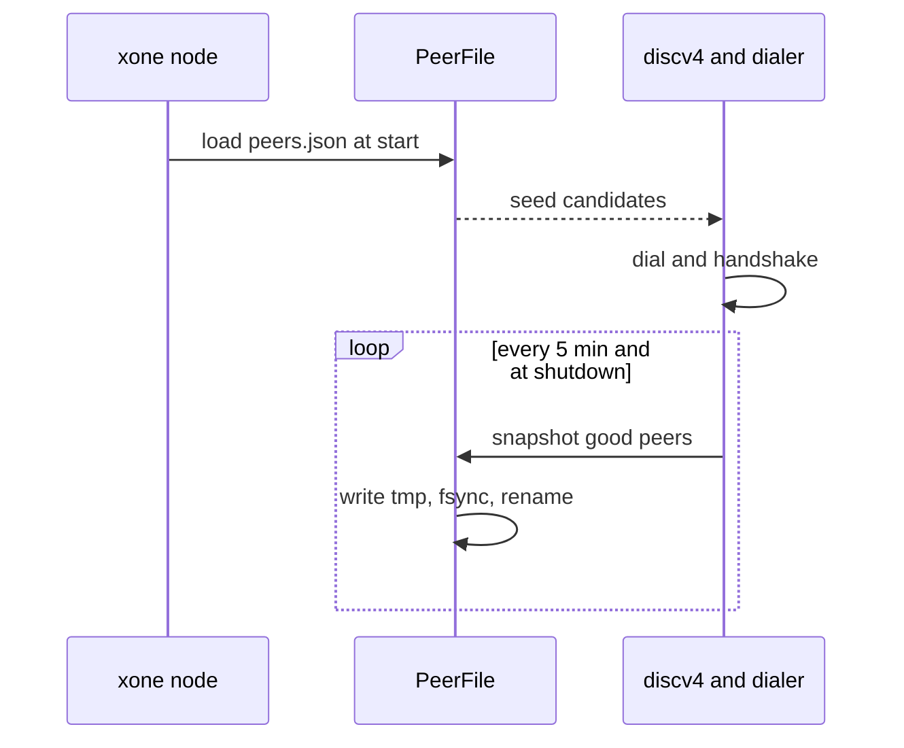
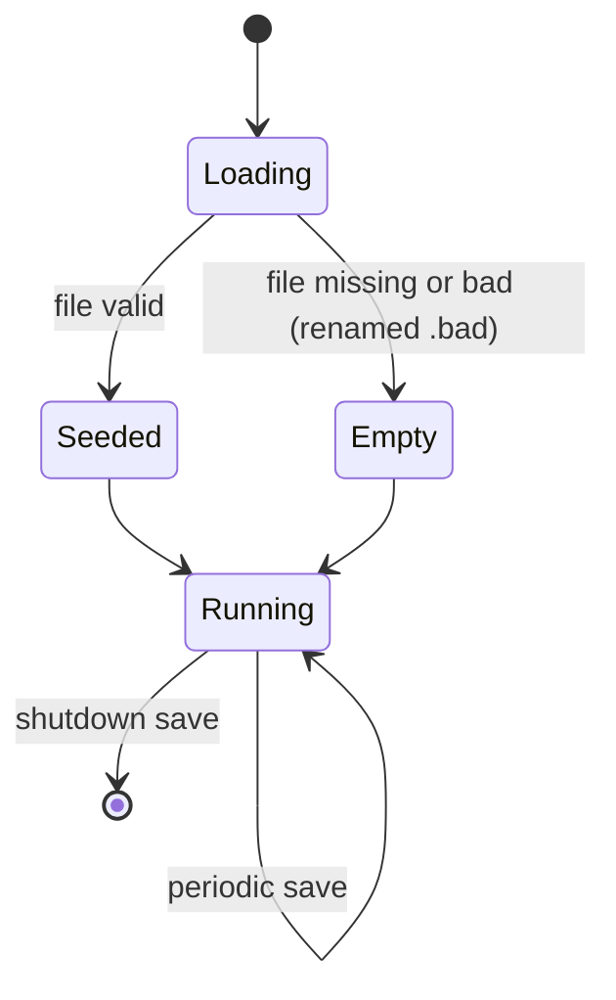
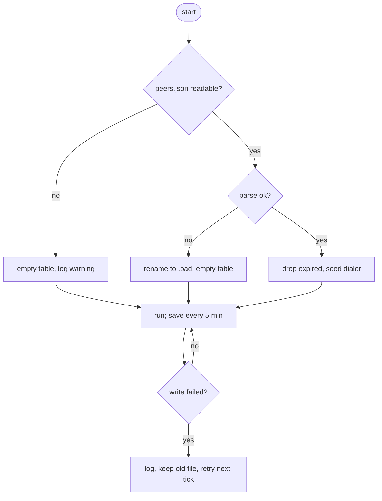

## What

After a restart xOneRS knows only the bootnodes and the static and trusted lists; every peer it found by discovery is lost. geth-XDC keeps a node database under `<datadir>/nodes` and seeds discovery and dialling from it, so a restarted node reconnects in seconds even when the XDC bootnodes are slow or down. A validator that restarts during an upgrade loses eligible turns while it searches for peers.

## Why

9 of the 14 selected competitors have this capability; the geth-XDC oracle pin has it too (file evidence at the audited commit; competitor commits in `.gap-audit/gap-ledger.json`):

- `ethereum/go-ethereum`: [p2p/enode/nodedb.go](https://github.com/ethereum/go-ethereum/blob/8059ff8beb3170eb8b977169ac51bb0423c97ee1/p2p/enode/nodedb.go)
- `bnb-chain/bsc`: [p2p/enode/nodedb.go](https://github.com/bnb-chain/bsc/blob/54afaff4da31ac9e49ba646a4f65104edac5a2f3/p2p/enode/nodedb.go)
- `0xPolygon/bor`: [p2p/enode/nodedb.go](https://github.com/0xPolygon/bor/blob/ee09efd5dd9ef75917368990b272581b0e2c2665/p2p/enode/nodedb.go)
- `XinFinOrg/XDPoSChain`: [p2p/enode/nodedb.go](https://github.com/XinFinOrg/XDPoSChain/blob/cb1ef79073c05f50b9df75b1e740387b9d72af99/p2p/enode/nodedb.go)
- `BuildOnViction/victionchain`: [p2p/discover/database.go](https://github.com/BuildOnViction/victionchain/blob/31fe7cb935b46b8b5b115d070e64b30d6b8165b1/p2p/discover/database.go)
- `erigontech/erigon`: [p2p/enode/nodedb.go](https://github.com/erigontech/erigon/blob/bbb5524e53fb057e7d47a5066e152f1091ac4ba4/p2p/enode/nodedb.go)
- `paradigmxyz/reth`: [crates/node/core/src/args/network.rs](https://github.com/paradigmxyz/reth/blob/36600d5ff9628465475dd4c7608e2e9f2fe24273/crates/node/core/src/args/network.rs) (`--peers-file`, `--no-persist-peers`)
- `NethermindEth/nethermind`: [src/Nethermind/Nethermind.Network/NetworkStorage.cs](https://github.com/NethermindEth/nethermind/blob/a7dd73052e696ad934d228aad3f33e660701fdb7/src/Nethermind/Nethermind.Network/NetworkStorage.cs)
- `kaiachain/kaia`: [networks/p2p/discover/database.go](https://github.com/kaiachain/kaia/blob/0f9ad843d1ccb7381cc43070ce13002cca7b1ed9/networks/p2p/discover/database.go)
- geth-XDC oracle pin `XDCIndia/go-ethereum@6fc8e8c2`: [p2p/enode/nodedb.go](https://github.com/XDCIndia/go-ethereum/blob/6fc8e8c2088b7f18264f5663036669d04fa7becf/p2p/enode/nodedb.go)
- geth-XDC oracle pin `XDCIndia/go-ethereum@6fc8e8c2`: [node/config.go](https://github.com/XDCIndia/go-ethereum/blob/6fc8e8c2088b7f18264f5663036669d04fa7becf/node/config.go) (`datadirNodeDatabase = "nodes"`)
- Docs: https://geth.ethereum.org/docs/fundamentals/data-files (the `nodes` directory)

Priority: P1: base P2 (restarts depend on bootnodes; the workaround is a hand-kept static-nodes.json), raised because 9 of 14 competitors and both canonical XDC clients keep a node database.

Our code today: `crates/xone-net/src/discv4.rs` and `crates/xone-net/src/peers` (in-memory table only); `crates/xone-node/src/enode.rs` reads static-nodes.json and trusted-nodes.json; `crates/xone-node/src/services/net.rs` (nodekey only in the datadir)

Related xOneRS issues: #32 (p2p), #178 (GAP-0027 devp2p tooling), #199 (GAP-0044 allowlist). This issue adds the capability; it does not replace their gates.

## 80% of the way to

1. `crates/xone-net/src/peers`: `PeerFile` at `<datadir>/peers.json`: enode URL, last-seen time, last successful handshake, score; at most 1,000 entries, oldest dropped.
2. Write the file every 5 minutes and on clean shutdown, atomically (tmp, fsync, rename); never on the import path.
3. On start, after static and trusted peers, dial up to `--maxpeers` entries ordered by last successful handshake and seed the discv4 table with them; entries not seen for 7 days are dropped (geth `nodeDBNodeExpiration` is 24 h for discovery results; keep 7 d for handshake-proven peers and record the choice).
4. Flags `--peers.file <path>` and `--peers.nopersist` (reth names in the docs table).
5. Tests: restart a two-node in-process network with no bootnodes: the second start reconnects from the file; a corrupt file is renamed `.bad` and the node starts with an empty table.

Acceptance criteria:

- [ ] A node restarted with no bootnodes reconnects to a previously known peer within 30 s (test).
- [ ] A truncated or corrupt peers file never stops the node (test).
- [ ] The file is written only by the 5-minute timer and at shutdown (code review plus test).

## ASD-STE100

1. The node MUST write the peer file atomically.
2. The node MUST start when the peer file is missing or bad.
3. The node MUST NOT write the peer file on the block import path.
4. The node MUST remove entries that are older than the expiry time.

## Diagrams



## Images

None. Measurements (timings, sizes) go in the PR description as tables.

## Prompt

```text
You work in XDCIndia/xOneRS (Rust XDC client). Implement GAP-0049: Persistent peer table: remember good peers across restarts (geth nodes DB, reth peers file).

Context: After a restart xOneRS knows only the bootnodes and the static and trusted lists; every peer it found by discovery is lost. geth-XDC keeps a node database under `<datadir>/nodes` and seeds discovery and dialling from it, so a restarted node reconnects in seconds even when the XDC bootnodes are slow or down. A validator that restarts during an upgrade loses eligible turns while it searches for peers.

Read the evidence links in the Why section first.

Reference behaviour: geth-XDC at XDCIndia/go-ethereum 6fc8e8c2088b7f18264f5663036669d04fa7becf (conformance/PIN) for anything consensus-visible or RPC-visible; this issue must not change consensus, execution or wire formats. Where geth-XDC lacks the feature, follow the first source in the Why section and record the choice in the PR.

Steps:
1. `crates/xone-net/src/peers`: `PeerFile` at `<datadir>/peers.json`: enode URL, last-seen time, last successful handshake, score; at most 1,000 entries, oldest dropped.
2. Write the file every 5 minutes and on clean shutdown, atomically (tmp, fsync, rename); never on the import path.
3. On start, after static and trusted peers, dial up to `--maxpeers` entries ordered by last successful handshake and seed the discv4 table with them; entries not seen for 7 days are dropped (geth `nodeDBNodeExpiration` is 24 h for discovery results; keep 7 d for handshake-proven peers and record the choice).
4. Flags `--peers.file <path>` and `--peers.nopersist` (reth names in the docs table).
5. Tests: restart a two-node in-process network with no bootnodes: the second start reconnects from the file; a corrupt file is renamed `.bad` and the node starts with an empty table.

Rules: one branch `feat/gap-0049-peerdb` from main, one PR that closes this issue. Write the tests first. Keep consensus, execution and storage formats unchanged unless a step says otherwise (then amend the ADR in the same PR). Run `cargo fmt --check`, `cargo clippy --all-targets -- -D warnings`, `cargo test --locked`, `ci/check-layering.sh` and `ci/check-fixtures.sh`. Update docs/cli/flags.md with `UPDATE_DOCS=1 cargo test -p xone flags_doc` if you add a flag. Never touch live nodes or validator hosts. Hand back in 25 lines or fewer: files changed, tests added, acceptance results.
```

## Workflow

1. Maintainer: confirms priority P1 and assigns the issue.
2. Engineer: creates branch `feat/gap-0049-peerdb` from `main`.
3. Engineer: writes the failing tests named in the steps (and the oracle vectors where the steps name them).
4. Engineer: implements the change in the files of Layout.
5. Engineer: runs the gates (fmt, clippy, test, layering, fixtures) and the checks in the acceptance criteria.
6. Engineer: opens one PR that says `Closes #<this issue>` and lists the acceptance results.
7. Reviewer: checks each acceptance criterion and the ASD-STE100 requirements.
8. Maintainer: merges.
9. Operator: tries the feature on one net2040 or Apothem test node (never a validator host) and records the result in this issue.

## Loop

Runtime: timer every 5 minutes plus one write at shutdown; expiry pass at start. Develop-verify: restart test until it passes.

## Graph



## Layout

```text
Files touched:
  crates/xone-net/src/peers
  crates/xone-net/src/discv4.rs
  crates/xone-node/src/services/net.rs
  bin/xone/src/flags.rs
  docs/cli/flags.md

Example:
<datadir>/peers.json
[{"enode":"enode://ab..@1.2.3.4:30303","last_ok":1763100000,"score":12}, ...]
```

## Flow



## Summary

Gap: xOneRS forgets every discovered peer at restart and depends on bootnodes to reconnect.
Fix: Keep a bounded peers.json, written atomically every 5 minutes and at shutdown, and seed dialing and discv4 from it.
Acceptance: Reconnect without bootnodes in 30 s after a restart; a bad file never blocks start.

<!-- gap-audit:GAP-0049 -->
