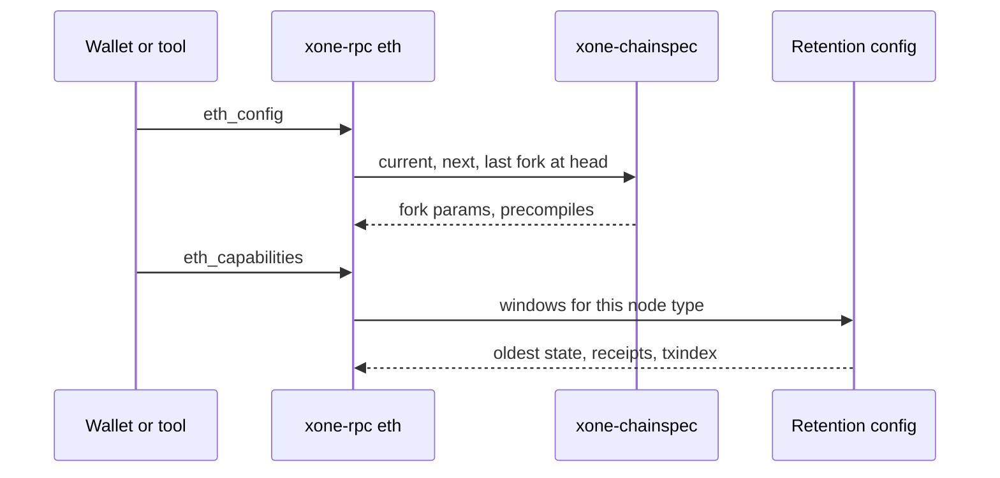
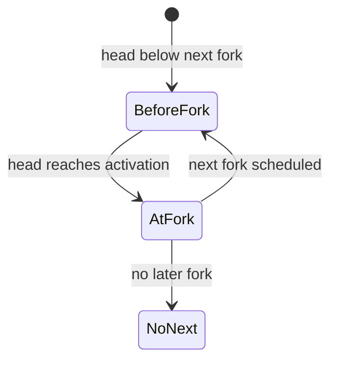
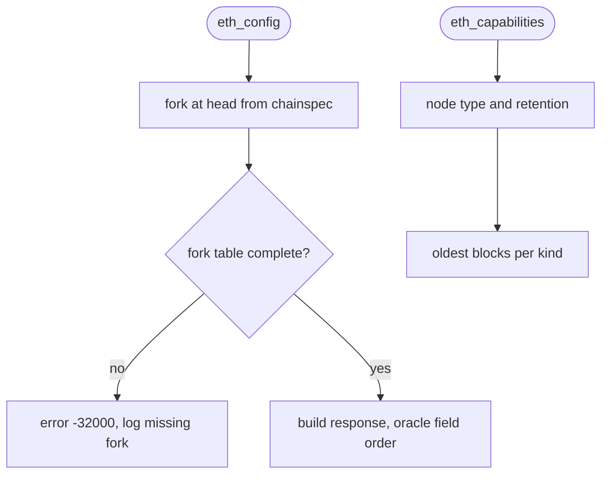

## What

Tools ask a node which fork rules are active and which history it can serve. `eth_config` (EIP-7910) returns the current and next fork configuration (chain id, fork activation, precompiles, system contracts); `eth_capabilities` returns the ranges of state, receipts and transaction index the node keeps. xOneRS answers `-32601` to both. For xOneRS this matters more than for a geth archive node: snap, fast and minimal nodes keep only a window, and today a client learns that only from a refusal (#121).

## Why

8 of the 14 selected competitors have this capability; the geth-XDC oracle pin has it too (file evidence at the audited commit; competitor commits in `.gap-audit/gap-ledger.json`):

- `ethereum/go-ethereum`: [internal/ethapi/api.go](https://github.com/ethereum/go-ethereum/blob/8059ff8beb3170eb8b977169ac51bb0423c97ee1/internal/ethapi/api.go) (`BlockChainAPI.Config`)
- `ethereum/go-ethereum`: [internal/ethapi/capabilities.go](https://github.com/ethereum/go-ethereum/blob/8059ff8beb3170eb8b977169ac51bb0423c97ee1/internal/ethapi/capabilities.go) (`Capabilities`)
- `bnb-chain/bsc`: [internal/ethapi/api.go](https://github.com/bnb-chain/bsc/blob/54afaff4da31ac9e49ba646a4f65104edac5a2f3/internal/ethapi/api.go) (`Config`)
- `0xPolygon/bor`: [internal/ethapi/api.go](https://github.com/0xPolygon/bor/blob/ee09efd5dd9ef75917368990b272581b0e2c2665/internal/ethapi/api.go) (`Config`)
- `besu-eth/besu`: [ethereum/api/src/main/java/org/hyperledger/besu/ethereum/api/jsonrpc/internal/methods/EthConfig.java](https://github.com/besu-eth/besu/blob/2b839d96863d01210f45a6f62127e6229e5b0889/ethereum/api/src/main/java/org/hyperledger/besu/ethereum/api/jsonrpc/internal/methods/EthConfig.java)
- `erigontech/erigon`: [rpc/jsonrpc/eth_system.go](https://github.com/erigontech/erigon/blob/bbb5524e53fb057e7d47a5066e152f1091ac4ba4/rpc/jsonrpc/eth_system.go) (`Config`)
- `NethermindEth/nethermind`: [src/Nethermind/Nethermind.JsonRpc/Modules/Eth/IEthRpcModule.cs](https://github.com/NethermindEth/nethermind/blob/a7dd73052e696ad934d228aad3f33e660701fdb7/src/Nethermind/Nethermind.JsonRpc/Modules/Eth/IEthRpcModule.cs) (`eth_config`, `eth_capabilities`)
- `paradigmxyz/reth`: [crates/rpc/rpc-eth-api/src/helpers/config.rs](https://github.com/paradigmxyz/reth/blob/36600d5ff9628465475dd4c7608e2e9f2fe24273/crates/rpc/rpc-eth-api/src/helpers/config.rs) (`eth_config`)
- `lambdaclass/ethrex`: [crates/networking/rpc/rpc.rs](https://github.com/lambdaclass/ethrex/blob/740ea493880b6c073b81537010df75e143c615c2/crates/networking/rpc/rpc.rs) (`eth_config`)
- geth-XDC oracle pin `XDCIndia/go-ethereum@6fc8e8c2`: [internal/ethapi/api.go](https://github.com/XDCIndia/go-ethereum/blob/6fc8e8c2088b7f18264f5663036669d04fa7becf/internal/ethapi/api.go) (`Config`, line 1294)
- geth-XDC oracle pin `XDCIndia/go-ethereum@6fc8e8c2`: [internal/ethapi/capabilities.go](https://github.com/XDCIndia/go-ethereum/blob/6fc8e8c2088b7f18264f5663036669d04fa7becf/internal/ethapi/capabilities.go) (`Capabilities`, `HistoryRetention`)
- Docs: https://eips.ethereum.org/EIPS/eip-7910

Priority: P2: base P3 (integrators and tooling), raised because 8 of 14 competitors and the geth-XDC oracle serve eth_config, in the eth namespace the fleet enables.

Our code today: `crates/xone-rpc/src/eth.rs` (not registered); fork data in `crates/xone-chainspec/generated/forks.json`; retention in `spec/retention.md` and `crates/xone-node/src/config.rs`

Related xOneRS issues: #121 (typed unsupported-history refusal), #6 (fork table), #42. This issue adds the capability; it does not replace their gates.

## 80% of the way to

1. `crates/xone-rpc/src/eth.rs`: `eth_config` built from `xone-chainspec` (current, next, last fork; precompile addresses per fork from `crates/xone-evm/src/precompiles.rs`; system contracts); field names and the fork-hash rule exactly as the oracle `configResponse`, including XDC forks.
2. `eth_capabilities`: report head, the oldest block with state, receipts and transaction index per node type (full, snap, fast, minimal) from the retention config; same JSON shape as the oracle `Capabilities`.
3. Golden vectors: record both answers from the geth-XDC oracle on Apothem and mainnet into `conformance/vectors/rpc/` and compare byte-equal after key ordering.
4. Class C0 for both.

Acceptance criteria:

- [ ] `eth_config` equals the geth-XDC answer on Apothem and mainnet (vectors).
- [ ] `eth_capabilities` on a snap node reports the pivot window that the typed refusal of #121 uses (test).
- [ ] Both methods are C0 and need no state read.

## ASD-STE100

1. The node MUST build eth_config from the chain spec only.
2. The eth_config answer MUST be equal to the geth-XDC answer for the same chain and head.
3. eth_capabilities MUST report the same window that the history refusal uses.

## Diagrams



## Images

None. Measurements (timings, sizes) go in the PR description as tables.

## Prompt

```text
You work in XDCIndia/xOneRS (Rust XDC client). Implement GAP-0050: Node self-description RPC: eth_config (EIP-7910 fork configuration) and eth_capabilities (served history ranges).

Context: Tools ask a node which fork rules are active and which history it can serve. `eth_config` (EIP-7910) returns the current and next fork configuration (chain id, fork activation, precompiles, system contracts); `eth_capabilities` returns the ranges of state, receipts and transaction index the node keeps. xOneRS answers `-32601` to both. For xOneRS this matters more than for a geth archive node: snap, fast and minimal nodes keep only a window, and today a client learns that only from a refusal (#121).

Read the evidence links in the Why section first.

Reference behaviour: geth-XDC at XDCIndia/go-ethereum 6fc8e8c2088b7f18264f5663036669d04fa7becf (conformance/PIN) for anything consensus-visible or RPC-visible; this issue must not change consensus, execution or wire formats. Where geth-XDC lacks the feature, follow the first source in the Why section and record the choice in the PR.

Steps:
1. `crates/xone-rpc/src/eth.rs`: `eth_config` built from `xone-chainspec` (current, next, last fork; precompile addresses per fork from `crates/xone-evm/src/precompiles.rs`; system contracts); field names and the fork-hash rule exactly as the oracle `configResponse`, including XDC forks.
2. `eth_capabilities`: report head, the oldest block with state, receipts and transaction index per node type (full, snap, fast, minimal) from the retention config; same JSON shape as the oracle `Capabilities`.
3. Golden vectors: record both answers from the geth-XDC oracle on Apothem and mainnet into `conformance/vectors/rpc/` and compare byte-equal after key ordering.
4. Class C0 for both.

Rules: one branch `feat/gap-0050-eth-config` from main, one PR that closes this issue. Write the tests first. Keep consensus, execution and storage formats unchanged unless a step says otherwise (then amend the ADR in the same PR). Run `cargo fmt --check`, `cargo clippy --all-targets -- -D warnings`, `cargo test --locked`, `ci/check-layering.sh` and `ci/check-fixtures.sh`. Update docs/cli/flags.md with `UPDATE_DOCS=1 cargo test -p xone flags_doc` if you add a flag. Never touch live nodes or validator hosts. Hand back in 25 lines or fewer: files changed, tests added, acceptance results.
```

## Workflow

1. Maintainer: confirms priority P2 and assigns the issue.
2. Engineer: creates branch `feat/gap-0050-eth-config` from `main`.
3. Engineer: writes the failing tests named in the steps (and the oracle vectors where the steps name them).
4. Engineer: implements the change in the files of Layout.
5. Engineer: runs the gates (fmt, clippy, test, layering, fixtures) and the checks in the acceptance criteria.
6. Engineer: opens one PR that says `Closes #<this issue>` and lists the acceptance results.
7. Reviewer: checks each acceptance criterion and the ASD-STE100 requirements.
8. Maintainer: merges.
9. Operator: tries the feature on one net2040 or Apothem test node (never a validator host) and records the result in this issue.

## Loop

None (per request). Develop-verify: compare with the oracle vectors.

## Graph



## Layout

```text
Files touched:
  crates/xone-rpc/src/eth.rs
  crates/xone-chainspec/src/lib.rs
  crates/xone-evm/src/precompiles.rs
  crates/xone-node/src/config.rs
  conformance/vectors/rpc/

Example:
{"method":"eth_config"} -> {"current":{"chainId":"0x33","activationTime":..,"precompiles":{..}},"next":null,"last":{..}}
```

## Flow



## Summary

Gap: xOneRS does not describe its active fork rules or its served history over RPC.
Fix: Add eth_config (EIP-7910, oracle shape) and eth_capabilities (retention windows per node type).
Acceptance: eth_config equals geth-XDC on Apothem and mainnet; eth_capabilities matches the #121 refusal window.

<!-- gap-audit:GAP-0050 -->
