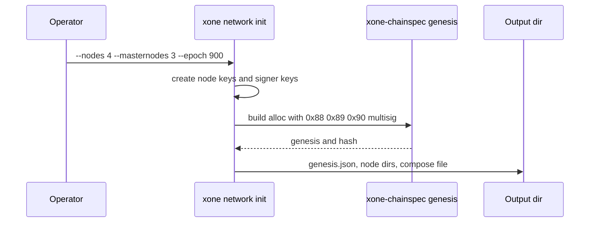
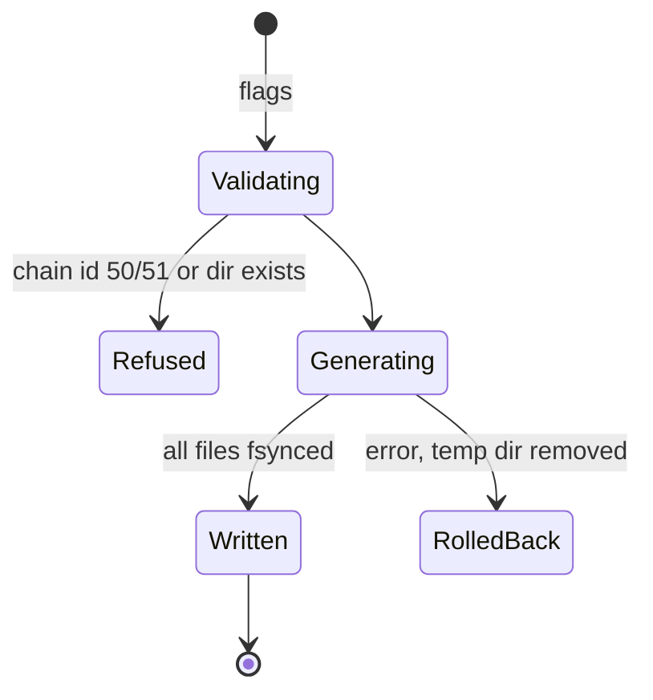
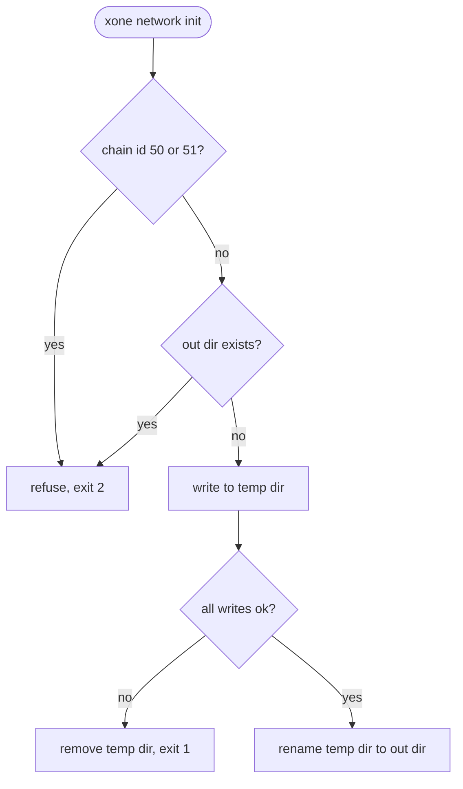

## What

Setting up a private XDPoS network (a devnet like net2040, a test network for a fork, an enterprise chain) needs a genesis with the validator (0x88), block-signer (0x89), randomize (0x90) and multisig contracts and the first masternode set, plus a key and a config per node. XDPoSChain does this with `puppeth` (`cmd/puppeth/wizard_genesis.go` deploys the four contracts). xOneRS loads such a genesis (`--override.genesis`, `--chainspec`) but cannot create one; GAP-0015 (`--dev`) covers one node only.

## Why

6 of the 14 selected competitors have this capability (file evidence at the audited commit; competitor commits in `.gap-audit/gap-ledger.json`):

- `XinFinOrg/XDPoSChain`: [cmd/puppeth/wizard_genesis.go](https://github.com/XinFinOrg/XDPoSChain/blob/cb1ef79073c05f50b9df75b1e740387b9d72af99/cmd/puppeth/wizard_genesis.go) (XDPoS genesis: masternodes, validator, blockSigner, randomize and multisig contracts)
- `BuildOnViction/victionchain`: [cmd/puppeth/wizard_genesis.go](https://github.com/BuildOnViction/victionchain/blob/31fe7cb935b46b8b5b115d070e64b30d6b8165b1/cmd/puppeth/wizard_genesis.go) (POSV genesis)
- `bnb-chain/bsc`: [cmd/geth/chaincmd.go](https://github.com/bnb-chain/bsc/blob/54afaff4da31ac9e49ba646a4f65104edac5a2f3/cmd/geth/chaincmd.go) (`init-network`: genesis, node keys and config files for N nodes)
- `besu-eth/besu`: [app/src/main/java/org/hyperledger/besu/cli/subcommands/operator/GenerateBlockchainConfig.java](https://github.com/besu-eth/besu/blob/2b839d96863d01210f45a6f62127e6229e5b0889/app/src/main/java/org/hyperledger/besu/cli/subcommands/operator/GenerateBlockchainConfig.java) (`operator generate-blockchain-config`)
- `kaiachain/kaia`: [cmd/homi/setup/cmd.go](https://github.com/kaiachain/kaia/blob/0f9ad843d1ccb7381cc43070ce13002cca7b1ed9/cmd/homi/setup/cmd.go) (`homi setup`: genesis, keys, docker-compose, Prometheus config)
- `tempoxyz/tempo`: [bin/tempo/src/localnet.rs](https://github.com/tempoxyz/tempo/blob/35d8b937fba89ae0bfdea1edf735fb6f8aa41c23/bin/tempo/src/localnet.rs) (batteries-included localnet)
- Docs: https://besu.hyperledger.org/private-networks/tutorials/qbft (generate-blockchain-config)

Priority: P2: base P3 (private networks and test networks), raised because the canonical XDPoSChain ships a generator (6 of 14 competitors).

Our code today: `crates/xone-chainspec/src/genesis.rs` (loads a genesis), `ops/devnet/`, `bin/xone/src/main.rs` (init, genesis-hash, dumpconfig); no generator

Related xOneRS issues: #166 (GAP-0015 --dev), #199 (GAP-0044 permissioning), #25 (genesis loader), #140 (net2040). This issue adds the capability; it does not replace their gates.

## 80% of the way to

1. `bin/xone/src/cmd/network.rs`: `xone network init --nodes N --masternodes M --epoch E --gap G --period P --chain-id ID --out DIR` writes `genesis.json`, `nodeN/nodekey`, `nodeN/keystore/*.json` (keystore v3, password file), `nodeN/config.toml`, `static-nodes.json` and `docker-compose.yml`.
2. Genesis alloc: the system contract bytecode and storage layout exactly as XDPoSChain `wizard_genesis.go` produces them (validator candidates and owners, block signer, randomize, multisig); V2 config block (switch block, timeouts, certificate threshold) from flags.
3. `xone dumpgenesis --network <name>` prints the built-in genesis JSON (geth `dumpgenesis`).
4. Tests: a generated genesis loads with `xone init` and its hash is stable for the same inputs; a 4-node in-process network from the generator produces V2 blocks past the first epoch switch; the 0x88 storage equals the puppeth output for the same inputs (golden file).

Acceptance criteria:

- [ ] Same inputs give a byte-identical genesis.json (test).
- [ ] Four generated nodes reach the second epoch with V2 QCs (sim test).
- [ ] The 0x88 contract storage equals the XDPoSChain puppeth output for the same masternodes (golden file).

## ASD-STE100

1. The generator MUST write each private key only to its node directory, with file mode 0600.
2. The generator MUST NOT overwrite an existing output directory.
3. The genesis contracts MUST be equal to the XDPoSChain genesis contracts.
4. The generator MUST NOT be able to create a chain with chain id 50 or 51.

## Diagrams



## Images

None. Measurements (timings, sizes) go in the PR description as tables.

## Prompt

```text
You work in XDCIndia/xOneRS (Rust XDC client). Implement GAP-0051: Private XDPoS network generator: genesis with masternodes and system contracts, node keys and per-node configs (xone network init).

Context: Setting up a private XDPoS network (a devnet like net2040, a test network for a fork, an enterprise chain) needs a genesis with the validator (0x88), block-signer (0x89), randomize (0x90) and multisig contracts and the first masternode set, plus a key and a config per node. XDPoSChain does this with `puppeth` (`cmd/puppeth/wizard_genesis.go` deploys the four contracts). xOneRS loads such a genesis (`--override.genesis`, `--chainspec`) but cannot create one; GAP-0015 (`--dev`) covers one node only.

Read the evidence links in the Why section first.

Reference behaviour: geth-XDC at XDCIndia/go-ethereum 6fc8e8c2088b7f18264f5663036669d04fa7becf (conformance/PIN) for anything consensus-visible or RPC-visible; this issue must not change consensus, execution or wire formats. Where geth-XDC lacks the feature, follow the first source in the Why section and record the choice in the PR.

Steps:
1. `bin/xone/src/cmd/network.rs`: `xone network init --nodes N --masternodes M --epoch E --gap G --period P --chain-id ID --out DIR` writes `genesis.json`, `nodeN/nodekey`, `nodeN/keystore/*.json` (keystore v3, password file), `nodeN/config.toml`, `static-nodes.json` and `docker-compose.yml`.
2. Genesis alloc: the system contract bytecode and storage layout exactly as XDPoSChain `wizard_genesis.go` produces them (validator candidates and owners, block signer, randomize, multisig); V2 config block (switch block, timeouts, certificate threshold) from flags.
3. `xone dumpgenesis --network <name>` prints the built-in genesis JSON (geth `dumpgenesis`).
4. Tests: a generated genesis loads with `xone init` and its hash is stable for the same inputs; a 4-node in-process network from the generator produces V2 blocks past the first epoch switch; the 0x88 storage equals the puppeth output for the same inputs (golden file).

Rules: one branch `feat/gap-0051-netgen` from main, one PR that closes this issue. Write the tests first. Keep consensus, execution and storage formats unchanged unless a step says otherwise (then amend the ADR in the same PR). Run `cargo fmt --check`, `cargo clippy --all-targets -- -D warnings`, `cargo test --locked`, `ci/check-layering.sh` and `ci/check-fixtures.sh`. Update docs/cli/flags.md with `UPDATE_DOCS=1 cargo test -p xone flags_doc` if you add a flag. Never touch live nodes or validator hosts. Hand back in 25 lines or fewer: files changed, tests added, acceptance results.
```

## Workflow

1. Maintainer: confirms priority P2 and assigns the issue.
2. Engineer: creates branch `feat/gap-0051-netgen` from `main`.
3. Engineer: writes the failing tests named in the steps (and the oracle vectors where the steps name them).
4. Engineer: implements the change in the files of Layout.
5. Engineer: runs the gates (fmt, clippy, test, layering, fixtures) and the checks in the acceptance criteria.
6. Engineer: opens one PR that says `Closes #<this issue>` and lists the acceptance results.
7. Reviewer: checks each acceptance criterion and the ASD-STE100 requirements.
8. Maintainer: merges.
9. Operator: tries the feature on one net2040 or Apothem test node (never a validator host) and records the result in this issue.

## Loop

None (one-shot command). Develop-verify: golden-file test against puppeth output.

## Graph



## Layout

```text
Files touched:
  bin/xone/src/cmd/network.rs
  bin/xone/src/cmd/mod.rs
  crates/xone-chainspec/src/genesis.rs
  ops/devnet/
  docs/ops/private-network.md

Example:
$ xone network init --nodes 4 --masternodes 3 --epoch 900 --chain-id 2040 --out ./net
wrote net/genesis.json (hash 0x9a..), net/node{1..4}/, net/static-nodes.json, net/docker-compose.yml
```

## Flow



## Summary

Gap: xOneRS cannot create a private XDPoS network; operators copy genesis files by hand or use XDPoSChain puppeth.
Fix: Add `xone network init` (genesis with system contracts, keys, configs, compose) and `xone dumpgenesis`.
Acceptance: Deterministic genesis, 0x88 storage equal to puppeth, and a generated 4-node network passes the second epoch.

<!-- gap-audit:GAP-0051 -->
