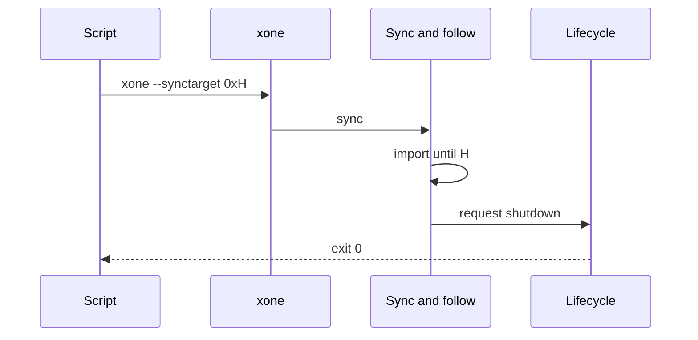
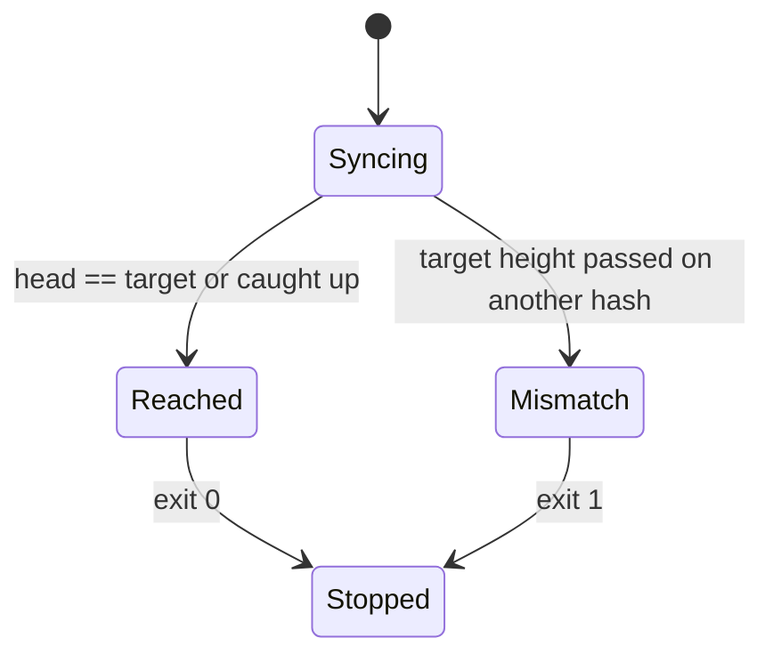
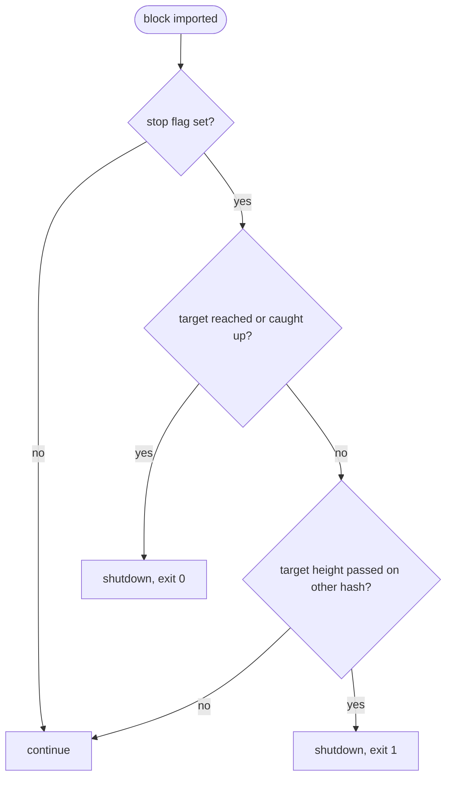

## What

Snapshot builders and CI jobs need a node that syncs to a point and exits cleanly: geth-XDC has `--exitwhensynced` (exit once the downloader reports caught up) and `--synctarget <hash>` (sync to that block and stop following). xOneRS runs until it is killed; scripts poll `eth_syncing` and send SIGTERM, which races with the next import.

## Why

4 of the 14 selected competitors have this capability; the geth-XDC oracle pin has it too (file evidence at the audited commit; competitor commits in `.gap-audit/gap-ledger.json`):

- `ethereum/go-ethereum`: [cmd/utils/flags.go](https://github.com/ethereum/go-ethereum/blob/8059ff8beb3170eb8b977169ac51bb0423c97ee1/cmd/utils/flags.go) (`exitwhensynced`, `synctarget`)
- `bnb-chain/bsc`: [cmd/utils/flags.go](https://github.com/bnb-chain/bsc/blob/54afaff4da31ac9e49ba646a4f65104edac5a2f3/cmd/utils/flags.go) (`exitwhensynced`, `synctarget`)
- `0xPolygon/bor`: [cmd/utils/flags.go](https://github.com/0xPolygon/bor/blob/ee09efd5dd9ef75917368990b272581b0e2c2665/cmd/utils/flags.go) (`exitwhensynced`)
- `paradigmxyz/reth`: [crates/node/core/src/args/debug.rs](https://github.com/paradigmxyz/reth/blob/36600d5ff9628465475dd4c7608e2e9f2fe24273/crates/node/core/src/args/debug.rs) (`--debug.terminate`, max block)
- geth-XDC oracle pin `XDCIndia/go-ethereum@6fc8e8c2`: [cmd/utils/flags.go](https://github.com/XDCIndia/go-ethereum/blob/6fc8e8c2088b7f18264f5663036669d04fa7becf/cmd/utils/flags.go) (`exitwhensynced` line 204, `synctarget` line 811)
- Docs: https://geth.ethereum.org/docs/fundamentals/command-line-options

Priority: P2: base P3 (snapshot builders and CI), raised because the geth-XDC oracle has both flags (4 of 14 competitors).

Our code today: `crates/xone-sync/src/follow.rs` (follow never ends), `crates/xone-node/src/lifecycle.rs` (bounded shutdown on signal), `--syncfromblock` exists for the start only

Related xOneRS issues: #34 (sync), #185 (GAP-0034 snapshot import), #38. This issue adds the capability; it does not replace their gates.

## 80% of the way to

1. `bin/xone/src/flags.rs`: `--exitwhensynced` and `--synctarget <hash>`; refuse `--mine` with either (typed error).
2. `crates/xone-sync/src/follow.rs`: when caught up (same rule as `eth_syncing` false) and `--exitwhensynced`, request the normal shutdown of `lifecycle.rs`; with `--synctarget`, import up to and including that hash, then stop fetching and request shutdown.
3. Exit code 0 after a clean stop at the target; 1 if the target hash is not on the canonical chain once its height is passed.
4. Tests: in-process sync to a target block exits 0 with head = target; a target on a side chain exits 1.

Acceptance criteria:

- [ ] `--synctarget H` leaves head = H and exits 0 (test).
- [ ] `--exitwhensynced` exits 0 within one block time of catching up (test).
- [ ] Both flags are refused with `--mine`.

## ASD-STE100

1. The node MUST use the normal shutdown path when it reaches a stop target.
2. The node MUST NOT import a block above the sync target.
3. The node MUST NOT accept a stop target together with --mine.

## Diagrams



## Images

None. Measurements (timings, sizes) go in the PR description as tables.

## Prompt

```text
You work in XDCIndia/xOneRS (Rust XDC client). Implement GAP-0052: Sync stop targets: --exitwhensynced and --synctarget (stop at a given block hash).

Context: Snapshot builders and CI jobs need a node that syncs to a point and exits cleanly: geth-XDC has `--exitwhensynced` (exit once the downloader reports caught up) and `--synctarget <hash>` (sync to that block and stop following). xOneRS runs until it is killed; scripts poll `eth_syncing` and send SIGTERM, which races with the next import.

Read the evidence links in the Why section first.

Reference behaviour: geth-XDC at XDCIndia/go-ethereum 6fc8e8c2088b7f18264f5663036669d04fa7becf (conformance/PIN) for anything consensus-visible or RPC-visible; this issue must not change consensus, execution or wire formats. Where geth-XDC lacks the feature, follow the first source in the Why section and record the choice in the PR.

Steps:
1. `bin/xone/src/flags.rs`: `--exitwhensynced` and `--synctarget <hash>`; refuse `--mine` with either (typed error).
2. `crates/xone-sync/src/follow.rs`: when caught up (same rule as `eth_syncing` false) and `--exitwhensynced`, request the normal shutdown of `lifecycle.rs`; with `--synctarget`, import up to and including that hash, then stop fetching and request shutdown.
3. Exit code 0 after a clean stop at the target; 1 if the target hash is not on the canonical chain once its height is passed.
4. Tests: in-process sync to a target block exits 0 with head = target; a target on a side chain exits 1.

Rules: one branch `feat/gap-0052-stop-targets` from main, one PR that closes this issue. Write the tests first. Keep consensus, execution and storage formats unchanged unless a step says otherwise (then amend the ADR in the same PR). Run `cargo fmt --check`, `cargo clippy --all-targets -- -D warnings`, `cargo test --locked`, `ci/check-layering.sh` and `ci/check-fixtures.sh`. Update docs/cli/flags.md with `UPDATE_DOCS=1 cargo test -p xone flags_doc` if you add a flag. Never touch live nodes or validator hosts. Hand back in 25 lines or fewer: files changed, tests added, acceptance results.
```

## Workflow

1. Maintainer: confirms priority P2 and assigns the issue.
2. Engineer: creates branch `feat/gap-0052-stop-targets` from `main`.
3. Engineer: writes the failing tests named in the steps (and the oracle vectors where the steps name them).
4. Engineer: implements the change in the files of Layout.
5. Engineer: runs the gates (fmt, clippy, test, layering, fixtures) and the checks in the acceptance criteria.
6. Engineer: opens one PR that says `Closes #<this issue>` and lists the acceptance results.
7. Reviewer: checks each acceptance criterion and the ASD-STE100 requirements.
8. Maintainer: merges.
9. Operator: tries the feature on one net2040 or Apothem test node (never a validator host) and records the result in this issue.

## Loop

None (one-shot run). Develop-verify: in-process sync tests.

## Graph



## Layout

```text
Files touched:
  bin/xone/src/flags.rs
  crates/xone-sync/src/follow.rs
  crates/xone-node/src/lifecycle.rs
  docs/cli/flags.md

Example:
$ xone --apothem --syncmode full --synctarget 0x5c..e1
... imported 0x5c..e1 (target), stopping
$ echo $?
0
```

## Flow



## Summary

Gap: xOneRS cannot sync to a point and exit; scripts race SIGTERM against imports.
Fix: Add --exitwhensynced and --synctarget using the normal shutdown path.
Acceptance: Head equals the target and exit code 0; a side-chain target exits 1; both refused with --mine.

<!-- gap-audit:GAP-0052 -->
