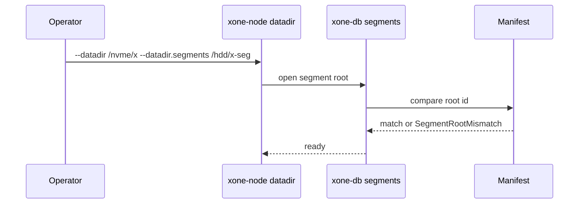
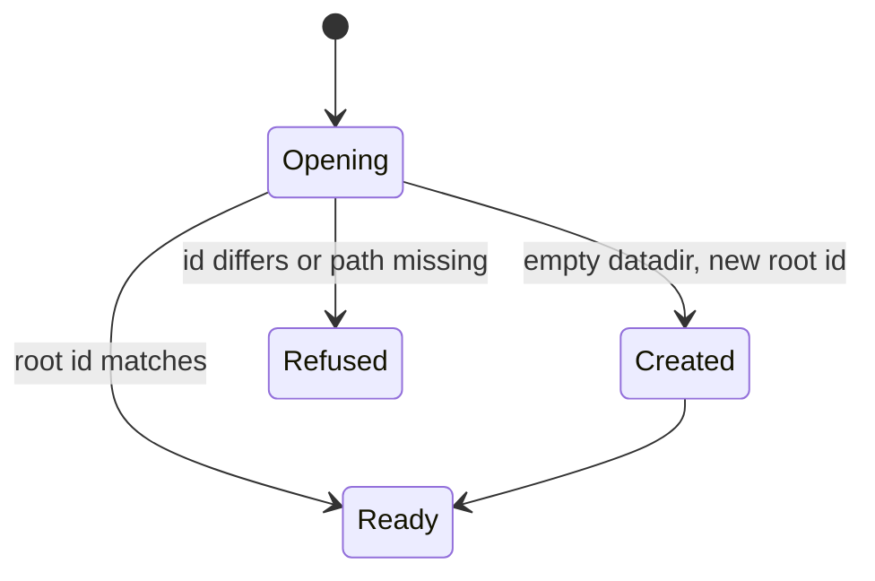
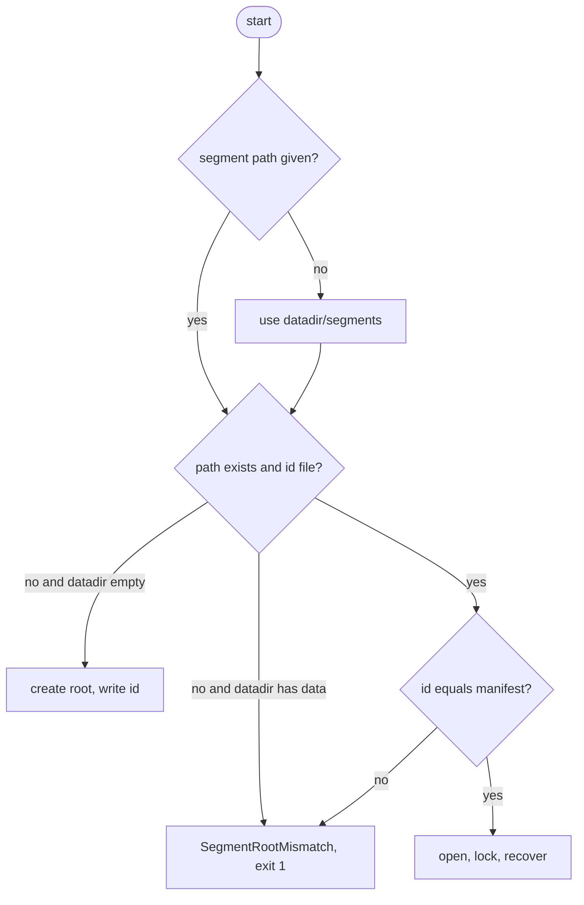

## What

Closed XSEG chunks (headers, bodies, receipts) are cold and append-only, while MDBX is hot. geth-XDC places its freezer with `--datadir.ancient` and reth its static files with `--datadir.static-files`, so operators put history on a large HDD or network volume and keep the hot store on NVMe. xOneRS always writes segments inside the datadir; the only workaround is a symlink, which the crash-recovery code (`recover.rs`) does not know about.

## Why

4 of the 14 selected competitors have this capability; the geth-XDC oracle pin has it too (file evidence at the audited commit; competitor commits in `.gap-audit/gap-ledger.json`):

- `ethereum/go-ethereum`: [cmd/utils/flags.go](https://github.com/ethereum/go-ethereum/blob/8059ff8beb3170eb8b977169ac51bb0423c97ee1/cmd/utils/flags.go) (`datadir.ancient`)
- `bnb-chain/bsc`: [cmd/utils/flags.go](https://github.com/bnb-chain/bsc/blob/54afaff4da31ac9e49ba646a4f65104edac5a2f3/cmd/utils/flags.go) (`datadir.ancient`)
- `0xPolygon/bor`: [cmd/utils/flags.go](https://github.com/0xPolygon/bor/blob/ee09efd5dd9ef75917368990b272581b0e2c2665/cmd/utils/flags.go) (`datadir.ancient`)
- `paradigmxyz/reth`: [crates/node/core/src/args/datadir_args.rs](https://github.com/paradigmxyz/reth/blob/36600d5ff9628465475dd4c7608e2e9f2fe24273/crates/node/core/src/args/datadir_args.rs) (`--datadir.static-files`)
- geth-XDC oracle pin `XDCIndia/go-ethereum@6fc8e8c2`: [cmd/utils/flags.go](https://github.com/XDCIndia/go-ethereum/blob/6fc8e8c2088b7f18264f5663036669d04fa7becf/cmd/utils/flags.go) (`datadir.ancient` line 110)
- Docs: https://geth.ethereum.org/docs/fundamentals/databases

Priority: P2: base P3 (a symlink works today), raised because the geth-XDC oracle has the flag (4 of 14 competitors); it also helps the datadir-size work of #149.

Our code today: `crates/xone-db/src/segments.rs` (`seg_dir` under the datadir), `crates/xone-db/src/recover.rs`, `crates/xone-db/src/manifest.rs`, `crates/xone-node/src/datadir.rs`

Related xOneRS issues: #149 (datadir size), #135 (storage decision), #11 (crash-safe publication), #194 (GAP-0039 compressed segments). This issue adds the capability; it does not replace their gates.

## 80% of the way to

1. `crates/xone-node/src/datadir.rs`: `--datadir.segments <path>` (alias `--datadir.ancient`); default `<datadir>/segments` as today.
2. `crates/xone-db/src/segments.rs` and `manifest.rs`: root the segment tree at the configured path; record its identity (a random id file written at creation) in the manifest so a start with the wrong or an empty path fails with a typed error instead of re-syncing.
3. `recover.rs`: the generation marker and the fsync order of ADR-005 apply to both roots; directory fsync on each.
4. The datadir lock covers both roots (lock file in each).
5. Tests: crash injection (`fault.rs`) with two roots on two tmpfs mounts; start with the segment path missing fails closed; moving the segment tree and passing the new path works.

Acceptance criteria:

- [ ] All existing fault-injection tests pass with segments on a second filesystem.
- [ ] A start with a wrong or missing segment path fails with a typed error and changes nothing.
- [ ] A moved segment tree is accepted with the new path (test).

## ASD-STE100

1. The node MUST refuse to start when the segment path does not match the manifest.
2. The node MUST apply the ADR-005 write order to both directories.
3. The node MUST lock both directories.

## Diagrams



## Images

None. Measurements (timings, sizes) go in the PR description as tables.

## Prompt

```text
You work in XDCIndia/xOneRS (Rust XDC client). Implement GAP-0053: Separate directory for frozen history segments (--datadir.ancient / --datadir.static-files) so history can sit on cheaper disk.

Context: Closed XSEG chunks (headers, bodies, receipts) are cold and append-only, while MDBX is hot. geth-XDC places its freezer with `--datadir.ancient` and reth its static files with `--datadir.static-files`, so operators put history on a large HDD or network volume and keep the hot store on NVMe. xOneRS always writes segments inside the datadir; the only workaround is a symlink, which the crash-recovery code (`recover.rs`) does not know about.

Read the evidence links in the Why section first.

Reference behaviour: geth-XDC at XDCIndia/go-ethereum 6fc8e8c2088b7f18264f5663036669d04fa7becf (conformance/PIN) for anything consensus-visible or RPC-visible; this issue must not change consensus, execution or wire formats. Where geth-XDC lacks the feature, follow the first source in the Why section and record the choice in the PR.

Steps:
1. `crates/xone-node/src/datadir.rs`: `--datadir.segments <path>` (alias `--datadir.ancient`); default `<datadir>/segments` as today.
2. `crates/xone-db/src/segments.rs` and `manifest.rs`: root the segment tree at the configured path; record its identity (a random id file written at creation) in the manifest so a start with the wrong or an empty path fails with a typed error instead of re-syncing.
3. `recover.rs`: the generation marker and the fsync order of ADR-005 apply to both roots; directory fsync on each.
4. The datadir lock covers both roots (lock file in each).
5. Tests: crash injection (`fault.rs`) with two roots on two tmpfs mounts; start with the segment path missing fails closed; moving the segment tree and passing the new path works.

Rules: one branch `feat/gap-0053-segment-dir` from main, one PR that closes this issue. Write the tests first. Keep consensus, execution and storage formats unchanged unless a step says otherwise (then amend the ADR in the same PR). Run `cargo fmt --check`, `cargo clippy --all-targets -- -D warnings`, `cargo test --locked`, `ci/check-layering.sh` and `ci/check-fixtures.sh`. Update docs/cli/flags.md with `UPDATE_DOCS=1 cargo test -p xone flags_doc` if you add a flag. Never touch live nodes or validator hosts. Hand back in 25 lines or fewer: files changed, tests added, acceptance results.
```

## Workflow

1. Maintainer: confirms priority P2 and assigns the issue.
2. Engineer: creates branch `feat/gap-0053-segment-dir` from `main`.
3. Engineer: writes the failing tests named in the steps (and the oracle vectors where the steps name them).
4. Engineer: implements the change in the files of Layout.
5. Engineer: runs the gates (fmt, clippy, test, layering, fixtures) and the checks in the acceptance criteria.
6. Engineer: opens one PR that says `Closes #<this issue>` and lists the acceptance results.
7. Reviewer: checks each acceptance criterion and the ASD-STE100 requirements.
8. Maintainer: merges.
9. Operator: tries the feature on one net2040 or Apothem test node (never a validator host) and records the result in this issue.

## Loop

None (start-up check); segment publication keeps its existing cadence. Develop-verify: fault-injection suite with two roots.

## Graph



## Layout

```text
Files touched:
  crates/xone-node/src/datadir.rs
  crates/xone-db/src/segments.rs
  crates/xone-db/src/manifest.rs
  crates/xone-db/src/recover.rs
  bin/xone/src/flags.rs
  docs/adr/ADR-005-storage-and-publication.md

Example:
xone --datadir /nvme/xone --datadir.segments /hdd/xone-segments
error: segment root mismatch: manifest a1b2.., found none at /hdd/xone-segments
```

## Flow



## Summary

Gap: xOneRS cannot place its frozen history segments on another disk except by an unchecked symlink.
Fix: Add --datadir.segments (alias --datadir.ancient) with a root id in the manifest and ADR-005 ordering on both roots.
Acceptance: Fault-injection suite passes on two filesystems; a wrong path fails closed; a moved tree is accepted.

<!-- gap-audit:GAP-0053 -->
