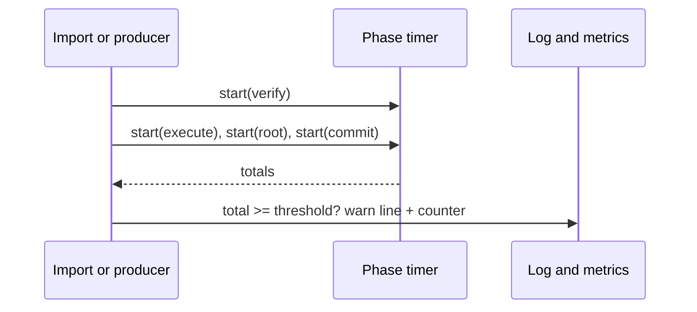
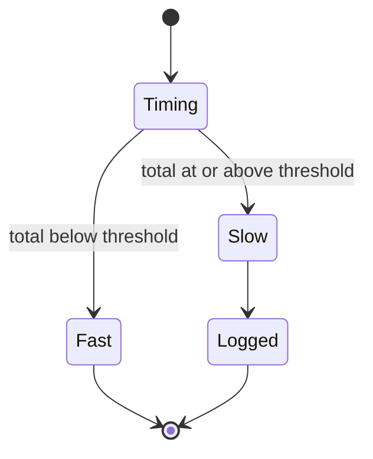
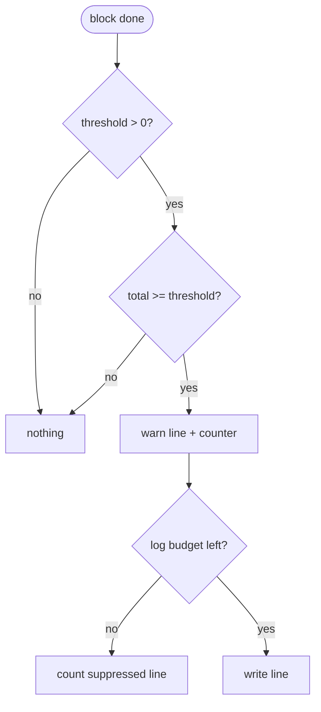

## What

XDC produces a block every 2 seconds; a block that takes 1.5 s to verify and execute costs a validator its turn. geth-XDC logs every block slower than `--debug.logslowblock` with its timings (execution, validation, commit), and Nethermind and reth log a JSON line with per-phase metrics. xOneRS exposes aggregate Prometheus metrics only, so an operator cannot find which block was slow or why.

## Why

5 of the 14 selected competitors have this capability; the geth-XDC oracle pin has it too (file evidence at the audited commit; competitor commits in `.gap-audit/gap-ledger.json`):

- `ethereum/go-ethereum`: [cmd/utils/flags.go](https://github.com/ethereum/go-ethereum/blob/8059ff8beb3170eb8b977169ac51bb0423c97ee1/cmd/utils/flags.go) (`debug.logslowblock`)
- `ethereum/go-ethereum`: [core/blockchain_stats.go](https://github.com/ethereum/go-ethereum/blob/8059ff8beb3170eb8b977169ac51bb0423c97ee1/core/blockchain_stats.go) (`slowBlockLog`)
- `bnb-chain/bsc`: [core/blockchain_stats.go](https://github.com/bnb-chain/bsc/blob/54afaff4da31ac9e49ba646a4f65104edac5a2f3/core/blockchain_stats.go)
- `erigontech/erigon`: [node/cli/default_flags.go](https://github.com/erigontech/erigon/blob/bbb5524e53fb057e7d47a5066e152f1091ac4ba4/node/cli/default_flags.go) (`SlowBlockThresholdFlag`)
- `NethermindEth/nethermind`: [src/Nethermind/Nethermind.Config/IBlocksConfig.cs](https://github.com/NethermindEth/nethermind/blob/a7dd73052e696ad934d228aad3f33e660701fdb7/src/Nethermind/Nethermind.Config/IBlocksConfig.cs) (slow block diagnostics threshold)
- `paradigmxyz/reth`: [crates/node/core/src/args/engine.rs](https://github.com/paradigmxyz/reth/blob/36600d5ff9628465475dd4c7608e2e9f2fe24273/crates/node/core/src/args/engine.rs) (`slow_block_threshold`)
- geth-XDC oracle pin `XDCIndia/go-ethereum@6fc8e8c2`: [cmd/utils/flags.go](https://github.com/XDCIndia/go-ethereum/blob/6fc8e8c2088b7f18264f5663036669d04fa7becf/cmd/utils/flags.go) (`debug.logslowblock` line 796)
- Docs: https://geth.ethereum.org/docs/fundamentals/command-line-options

Priority: P2: base P3 (diagnostics), raised because the geth-XDC oracle has it (5 of 14 competitors); it serves the eligible-turn accounting of #13 and #47.

Our code today: `crates/xone-node/src/observe/metrics.rs` (aggregates), `crates/xone-node/src/observe/logs.rs`, `crates/xone-sync/src/stages`, `crates/xone-node/src/services/core.rs`

Related xOneRS issues: #13 (perf contract), #47 (gate E eligible turns), #164 (GAP-0013 JSON logs). This issue adds the capability; it does not replace their gates.

## 80% of the way to

1. `crates/xone-node/src/services/core.rs`: time the phases of each imported or produced block: header and QC verify, sender recovery, execution, state root, commit; keep them in a small struct.
2. When the total is at or above `--debug.logslowblock` (default 1 s, 0 = off), log one `warn` line with number, hash, tx count, gas used and each phase in ms; JSON fields when GAP-0013 JSON logs are on.
3. Counter `xone_slow_blocks_total` and a histogram of block processing time if not present.
4. Tests: a threshold of 0 ms logs every block in a sync test; the line has all fields; threshold off logs nothing.

Acceptance criteria:

- [ ] A block above the threshold produces exactly one line with all phases (test).
- [ ] Threshold 0 (off) produces no slow-block lines.
- [ ] The timing adds less than 1% to import time on the perf procedure of docs/perf.md.

## ASD-STE100

1. The node MUST write one line for each block that is slower than the threshold.
2. The line MUST name the block number, the hash and the time of each phase.
3. The timing MUST NOT change the import result.

## Diagrams



## Images

None. Measurements (timings, sizes) go in the PR description as tables.

## Prompt

```text
You work in XDCIndia/xOneRS (Rust XDC client). Implement GAP-0054: Slow-block log: one structured line with per-phase timings for each block slower than a threshold (--debug.logslowblock).

Context: XDC produces a block every 2 seconds; a block that takes 1.5 s to verify and execute costs a validator its turn. geth-XDC logs every block slower than `--debug.logslowblock` with its timings (execution, validation, commit), and Nethermind and reth log a JSON line with per-phase metrics. xOneRS exposes aggregate Prometheus metrics only, so an operator cannot find which block was slow or why.

Read the evidence links in the Why section first.

Reference behaviour: geth-XDC at XDCIndia/go-ethereum 6fc8e8c2088b7f18264f5663036669d04fa7becf (conformance/PIN) for anything consensus-visible or RPC-visible; this issue must not change consensus, execution or wire formats. Where geth-XDC lacks the feature, follow the first source in the Why section and record the choice in the PR.

Steps:
1. `crates/xone-node/src/services/core.rs`: time the phases of each imported or produced block: header and QC verify, sender recovery, execution, state root, commit; keep them in a small struct.
2. When the total is at or above `--debug.logslowblock` (default 1 s, 0 = off), log one `warn` line with number, hash, tx count, gas used and each phase in ms; JSON fields when GAP-0013 JSON logs are on.
3. Counter `xone_slow_blocks_total` and a histogram of block processing time if not present.
4. Tests: a threshold of 0 ms logs every block in a sync test; the line has all fields; threshold off logs nothing.

Rules: one branch `feat/gap-0054-slow-block-log` from main, one PR that closes this issue. Write the tests first. Keep consensus, execution and storage formats unchanged unless a step says otherwise (then amend the ADR in the same PR). Run `cargo fmt --check`, `cargo clippy --all-targets -- -D warnings`, `cargo test --locked`, `ci/check-layering.sh` and `ci/check-fixtures.sh`. Update docs/cli/flags.md with `UPDATE_DOCS=1 cargo test -p xone flags_doc` if you add a flag. Never touch live nodes or validator hosts. Hand back in 25 lines or fewer: files changed, tests added, acceptance results.
```

## Workflow

1. Maintainer: confirms priority P2 and assigns the issue.
2. Engineer: creates branch `feat/gap-0054-slow-block-log` from `main`.
3. Engineer: writes the failing tests named in the steps (and the oracle vectors where the steps name them).
4. Engineer: implements the change in the files of Layout.
5. Engineer: runs the gates (fmt, clippy, test, layering, fixtures) and the checks in the acceptance criteria.
6. Engineer: opens one PR that says `Closes #<this issue>` and lists the acceptance results.
7. Reviewer: checks each acceptance criterion and the ASD-STE100 requirements.
8. Maintainer: merges.
9. Operator: tries the feature on one net2040 or Apothem test node (never a validator host) and records the result in this issue.

## Loop

Runtime: per block (event driven). Develop-verify: run the sync test with threshold 0.

## Graph



## Layout

```text
Files touched:
  crates/xone-node/src/services/core.rs
  crates/xone-node/src/observe/logs.rs
  crates/xone-node/src/observe/metrics.rs
  bin/xone/src/flags.rs

Example:
WARN slow block  number=85214323 hash=0x5e1f.. txs=212 gas=18.2M total=1712ms verify=96ms senders=41ms exec=1288ms root=231ms commit=56ms
```

## Flow



## Summary

Gap: xOneRS cannot show which block was slow or which phase made it slow.
Fix: Time each block phase and log one structured line above --debug.logslowblock, plus a counter.
Acceptance: One complete line per slow block, none when off, under 1% overhead.

<!-- gap-audit:GAP-0054 -->
