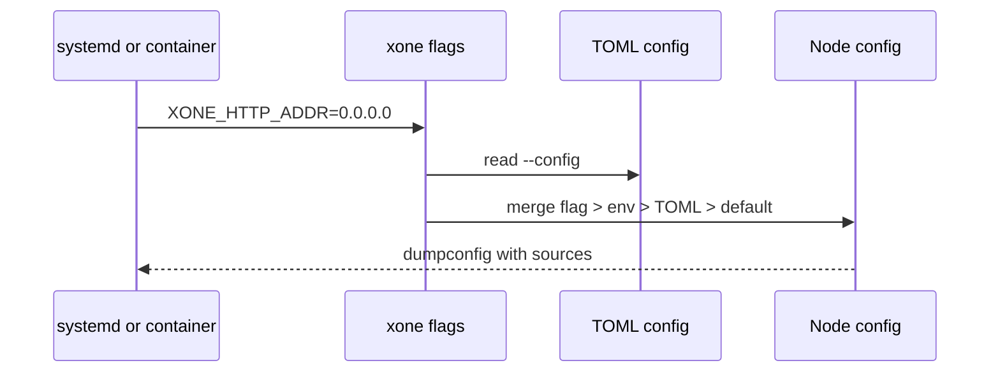
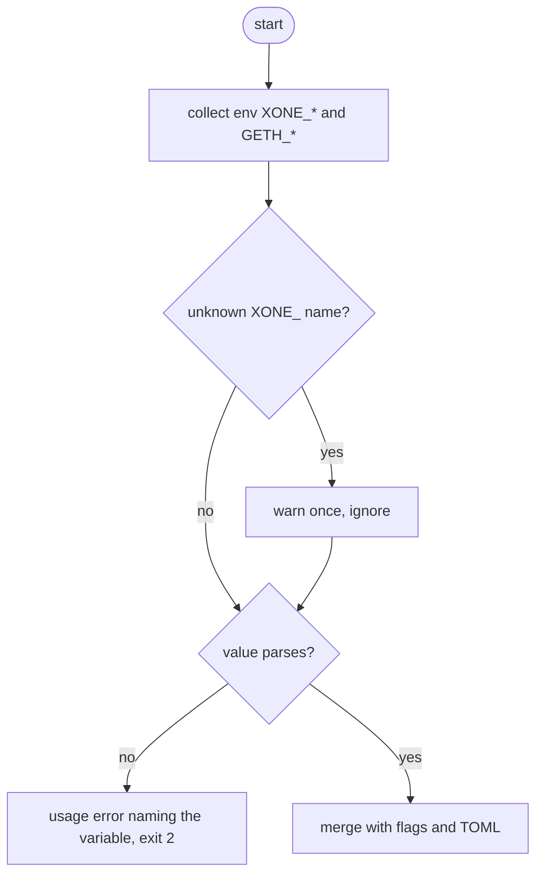

## What

Container platforms and systemd `EnvironmentFile` pass settings as environment variables. geth-XDC maps every flag to `GETH_<FLAG>` (`flags.AutoEnvVars`), Besu to `BESU_<OPTION>`, Nethermind to `NETHERMIND_<SECTION>_<KEY>`. xOneRS reads flags and TOML only; `ops/run-xone.sh` translates a handful of variables (NETWORK, DATADIR) by hand, so every new flag needs a launcher change.

## Why

7 of the 14 selected competitors have this capability; the geth-XDC oracle pin has it too (file evidence at the audited commit; competitor commits in `.gap-audit/gap-ledger.json`):

- `ethereum/go-ethereum`: [cmd/geth/main.go](https://github.com/ethereum/go-ethereum/blob/8059ff8beb3170eb8b977169ac51bb0423c97ee1/cmd/geth/main.go) (`flags.AutoEnvVars(app.Flags, "GETH")`)
- `bnb-chain/bsc`: [cmd/geth/main.go](https://github.com/bnb-chain/bsc/blob/54afaff4da31ac9e49ba646a4f65104edac5a2f3/cmd/geth/main.go) (`AutoEnvVars`)
- `0xPolygon/bor`: [cmd/geth/main.go](https://github.com/0xPolygon/bor/blob/ee09efd5dd9ef75917368990b272581b0e2c2665/cmd/geth/main.go) (`AutoEnvVars`)
- `besu-eth/besu`: [app/src/main/java/org/hyperledger/besu/cli/util/EnvironmentVariableDefaultProvider.java](https://github.com/besu-eth/besu/blob/2b839d96863d01210f45a6f62127e6229e5b0889/app/src/main/java/org/hyperledger/besu/cli/util/EnvironmentVariableDefaultProvider.java)
- `NethermindEth/nethermind`: [src/Nethermind/Nethermind.Config/EnvConfigSource.cs](https://github.com/NethermindEth/nethermind/blob/a7dd73052e696ad934d228aad3f33e660701fdb7/src/Nethermind/Nethermind.Config/EnvConfigSource.cs)
- `kaiachain/kaia`: [cmd/utils/flags.go](https://github.com/kaiachain/kaia/blob/0f9ad843d1ccb7381cc43070ce13002cca7b1ed9/cmd/utils/flags.go) (`EnvVars` on 254 flags)
- `lambdaclass/ethrex`: [cmd/ethrex/cli.rs](https://github.com/lambdaclass/ethrex/blob/740ea493880b6c073b81537010df75e143c615c2/cmd/ethrex/cli.rs) (`env = "ETHREX_..."`)
- geth-XDC oracle pin `XDCIndia/go-ethereum@6fc8e8c2`: [cmd/geth/main.go](https://github.com/XDCIndia/go-ethereum/blob/6fc8e8c2088b7f18264f5663036669d04fa7becf/cmd/geth/main.go) (`flags.AutoEnvVars(app.Flags, "GETH")` line 268)
- Docs: https://besu.hyperledger.org/public-networks/how-to/configuration-file (environment variables)

Priority: P2: base P3 (the launcher works for the common flags), raised because the geth-XDC oracle maps every flag (7 of 14 competitors).

Our code today: `bin/xone/src/flags.rs` (clap flags, TOML via `--config`), `ops/run-xone.sh` (hand-written env mapping), `ops/xone@.service` (`EnvironmentFile=-/etc/xone/%i.env`)

Related xOneRS issues: #39 (cli compatibility), #60 (secrets in env must stay redacted). This issue adds the capability; it does not replace their gates.

## 80% of the way to

1. `bin/xone/src/flags.rs`: give each flag `env = "XONE_<NAME>"` (dots and dashes to `_`, upper case), generated by one helper so no flag is missed; precedence flag > env > TOML > default, as clap does.
2. Accept `GETH_<FLAG>` for flags that exist in geth-XDC, so an existing env file works; warn once per variable used.
3. `dumpconfig` shows the source of each value; secrets (`--password`, JWT paths) are redacted (#60).
4. Simplify `ops/run-xone.sh` to pass the env through; keep its presets.
5. Tests: a table test over all flags proves each has an env name; precedence test; `ci/test-packaging.sh` checks a unit with only an env file.

Acceptance criteria:

- [ ] Every flag in docs/cli/flags.md has an XONE_ variable (generated test).
- [ ] A flag on the command line wins over the same variable (test).
- [ ] A systemd unit with only an EnvironmentFile starts a node with the expected config (ci/test-packaging.sh).

## ASD-STE100

1. Each flag MUST have one environment variable.
2. A command-line flag MUST override the environment variable.
3. The node MUST NOT print secret values that come from the environment.

## Diagrams



## Images

None. Measurements (timings, sizes) go in the PR description as tables.

## Prompt

```text
You work in XDCIndia/xOneRS (Rust XDC client). Implement GAP-0055: Environment-variable configuration: every flag settable as XONE_<FLAG> (container and systemd deployments).

Context: Container platforms and systemd `EnvironmentFile` pass settings as environment variables. geth-XDC maps every flag to `GETH_<FLAG>` (`flags.AutoEnvVars`), Besu to `BESU_<OPTION>`, Nethermind to `NETHERMIND_<SECTION>_<KEY>`. xOneRS reads flags and TOML only; `ops/run-xone.sh` translates a handful of variables (NETWORK, DATADIR) by hand, so every new flag needs a launcher change.

Read the evidence links in the Why section first.

Reference behaviour: geth-XDC at XDCIndia/go-ethereum 6fc8e8c2088b7f18264f5663036669d04fa7becf (conformance/PIN) for anything consensus-visible or RPC-visible; this issue must not change consensus, execution or wire formats. Where geth-XDC lacks the feature, follow the first source in the Why section and record the choice in the PR.

Steps:
1. `bin/xone/src/flags.rs`: give each flag `env = "XONE_<NAME>"` (dots and dashes to `_`, upper case), generated by one helper so no flag is missed; precedence flag > env > TOML > default, as clap does.
2. Accept `GETH_<FLAG>` for flags that exist in geth-XDC, so an existing env file works; warn once per variable used.
3. `dumpconfig` shows the source of each value; secrets (`--password`, JWT paths) are redacted (#60).
4. Simplify `ops/run-xone.sh` to pass the env through; keep its presets.
5. Tests: a table test over all flags proves each has an env name; precedence test; `ci/test-packaging.sh` checks a unit with only an env file.

Rules: one branch `feat/gap-0055-env-config` from main, one PR that closes this issue. Write the tests first. Keep consensus, execution and storage formats unchanged unless a step says otherwise (then amend the ADR in the same PR). Run `cargo fmt --check`, `cargo clippy --all-targets -- -D warnings`, `cargo test --locked`, `ci/check-layering.sh` and `ci/check-fixtures.sh`. Update docs/cli/flags.md with `UPDATE_DOCS=1 cargo test -p xone flags_doc` if you add a flag. Never touch live nodes or validator hosts. Hand back in 25 lines or fewer: files changed, tests added, acceptance results.
```

## Workflow

1. Maintainer: confirms priority P2 and assigns the issue.
2. Engineer: creates branch `feat/gap-0055-env-config` from `main`.
3. Engineer: writes the failing tests named in the steps (and the oracle vectors where the steps name them).
4. Engineer: implements the change in the files of Layout.
5. Engineer: runs the gates (fmt, clippy, test, layering, fixtures) and the checks in the acceptance criteria.
6. Engineer: opens one PR that says `Closes #<this issue>` and lists the acceptance results.
7. Reviewer: checks each acceptance criterion and the ASD-STE100 requirements.
8. Maintainer: merges.
9. Operator: tries the feature on one net2040 or Apothem test node (never a validator host) and records the result in this issue.

## Loop

None (start-up only). Develop-verify: the generated flag table test.

## Graph

```mermaid
stateDiagram-v2
    [*] --> Default
    Default --> Toml: --config value
    Toml --> Env: XONE_ variable
    Env --> Flag: command-line flag
    Flag --> [*]
```

## Layout

```text
Files touched:
  bin/xone/src/flags.rs
  ops/run-xone.sh
  ops/xone@.service
  ci/test-packaging.sh
  docs/cli/flags.md

Example:
/etc/xone/apothem.env
XONE_HTTP=true
XONE_HTTP_ADDR=127.0.0.1
XONE_SYNCMODE=snap
```

## Flow



## Summary

Gap: xOneRS settings cannot come from environment variables except through a hand-written launcher.
Fix: Give every flag an XONE_ variable (and accept GETH_ names), with flag > env > TOML precedence.
Acceptance: All flags covered by a generated test, precedence proven, env-only systemd start passes.

<!-- gap-audit:GAP-0055 -->
