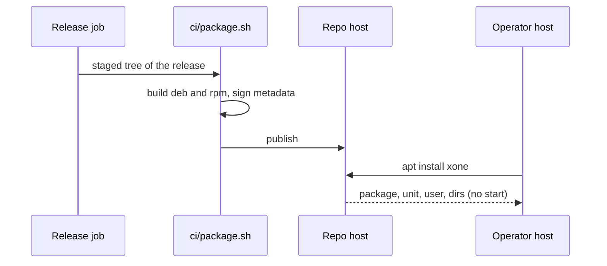
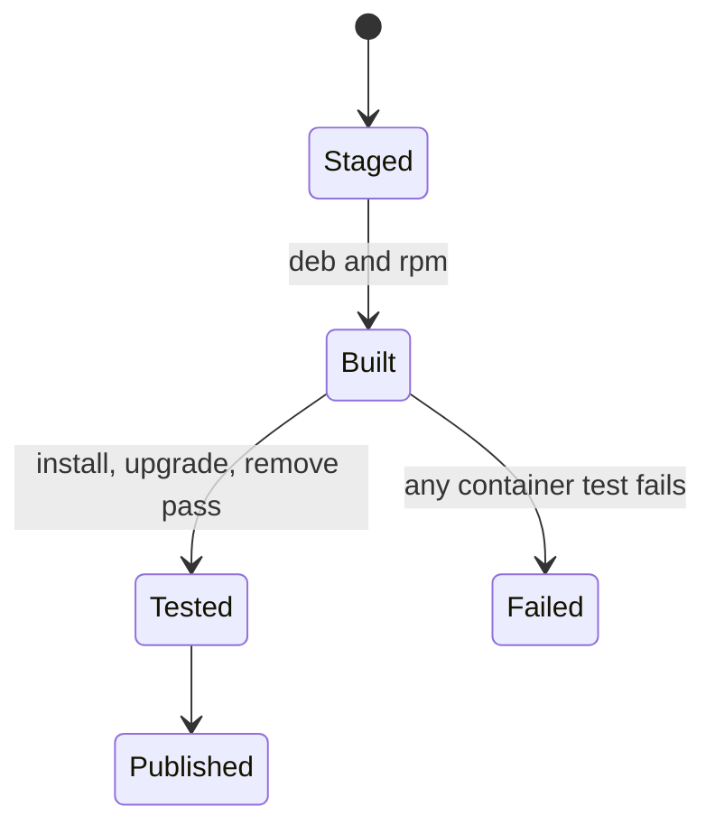
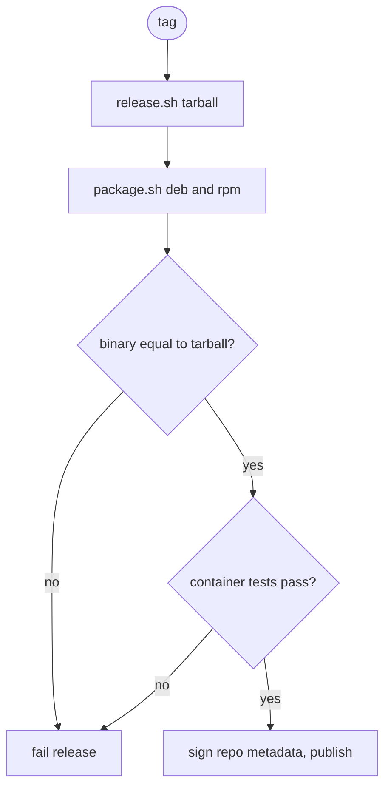

## What

xOneRS ships a tarball with the binary, the launcher and the systemd unit (`ci/release.sh`); install and upgrade are manual copy steps (`ops/install.md`). geth, bsc, bor, Erigon, reth, Nethermind, Kaia and Harmony build Debian packages (several also RPM and a PPA), so operators install and upgrade with `apt` and get the unit, the user and the directories from the package.

## Why

8 of the 14 selected competitors have this capability (file evidence at the audited commit; competitor commits in `.gap-audit/gap-ledger.json`):

- `ethereum/go-ethereum`: [build/ci.go](https://github.com/ethereum/go-ethereum/blob/8059ff8beb3170eb8b977169ac51bb0423c97ee1/build/ci.go) (`debsrc` / PPA upload)
- `ethereum/go-ethereum`: [build/deb](https://github.com/ethereum/go-ethereum/tree/8059ff8beb3170eb8b977169ac51bb0423c97ee1/build/deb)
- `bnb-chain/bsc`: [build/deb](https://github.com/bnb-chain/bsc/tree/54afaff4da31ac9e49ba646a4f65104edac5a2f3/build/deb)
- `0xPolygon/bor`: [packaging/rpm](https://github.com/0xPolygon/bor/tree/ee09efd5dd9ef75917368990b272581b0e2c2665/packaging/rpm)
- `erigontech/erigon`: [.github/workflows/release.yml](https://github.com/erigontech/erigon/blob/bbb5524e53fb057e7d47a5066e152f1091ac4ba4/.github/workflows/release.yml) (`build-debian-pkg` for amd64 and arm64)
- `paradigmxyz/reth`: [Makefile](https://github.com/paradigmxyz/reth/blob/36600d5ff9628465475dd4c7608e2e9f2fe24273/Makefile) (`build-deb-%`)
- `NethermindEth/nethermind`: [.github/workflows/publish-packages.yml](https://github.com/NethermindEth/nethermind/blob/a7dd73052e696ad934d228aad3f33e660701fdb7/.github/workflows/publish-packages.yml) (`publish-ppa`)
- `kaiachain/kaia`: [build/ci.go](https://github.com/kaiachain/kaia/blob/0f9ad843d1ccb7381cc43070ce13002cca7b1ed9/build/ci.go) (`debExecutables`)
- `harmony-one/harmony`: [scripts/package/rpm](https://github.com/harmony-one/harmony/tree/a41e194761c81fe846994864e789a7d306bbc439/scripts/package/rpm)
- `harmony-one/harmony`: [scripts/package/deb](https://github.com/harmony-one/harmony/tree/a41e194761c81fe846994864e789a7d306bbc439/scripts/package/deb)
- Docs: https://geth.ethereum.org/docs/getting-started/installing-geth (PPA)

Priority: P2: base P3 (the tarball and runbook work), raised because 8 of 14 competitors ship packages.

Our code today: `ci/release.sh` (tarball, SHA256SUMS, gpg signature), `ci/test-packaging.sh`, `ops/xone@.service`, `ops/install.md`, `ops/upgrade-rollback.md`

Related xOneRS issues: #46 (release packaging, closed), #193 (GAP-0038 static binaries, aarch64), #62 (release assurance on packaged bytes). This issue adds the capability; it does not replace their gates.

## 80% of the way to

1. `ci/package.sh`: build `xone_<version>_<arch>.deb` and `xone-<version>.<arch>.rpm` from the same staged tree as the tarball (nfpm config in `ops/packaging/nfpm.yaml`): `/usr/bin/xone`, `/usr/lib/systemd/system/xone@.service`, `/usr/share/xone/bootnodes/`, `/etc/xone/` (conffiles), a `xone` system user, `/var/lib/xone`.
2. Post-install never starts or restarts a unit; upgrade keeps `/etc/xone` and the datadir; the rollback runbook gains `apt install xone=<old>`.
3. Repository: `apt` and `yum` metadata signed with the release key used for SHA256SUMS; publish as release assets plus a static repo (GitHub Pages) — the owner decides the host.
4. `ci/test-packaging.sh`: install, upgrade and remove in Debian 12, Ubuntu 24.04 and Rocky 9 containers; `systemd-analyze verify` on the installed unit; the binary in the package is byte-equal to the tarball binary (#62).

Acceptance criteria:

- [ ] The .deb and .rpm install, upgrade and remove cleanly in the three containers (CI).
- [ ] The packaged binary is byte-equal to the tarball binary of the same release.
- [ ] No package script starts, stops or restarts a node.

## ASD-STE100

1. The package MUST NOT start or restart a node.
2. An upgrade MUST keep the configuration files and the datadir.
3. The package binary MUST be equal to the release tarball binary.

## Diagrams



## Images

None. Measurements (timings, sizes) go in the PR description as tables.

## Prompt

```text
You work in XDCIndia/xOneRS (Rust XDC client). Implement GAP-0056: OS packages: .deb and .rpm with the systemd unit, and a signed APT/YUM repository.

Context: xOneRS ships a tarball with the binary, the launcher and the systemd unit (`ci/release.sh`); install and upgrade are manual copy steps (`ops/install.md`). geth, bsc, bor, Erigon, reth, Nethermind, Kaia and Harmony build Debian packages (several also RPM and a PPA), so operators install and upgrade with `apt` and get the unit, the user and the directories from the package.

Read the evidence links in the Why section first.

Reference behaviour: geth-XDC at XDCIndia/go-ethereum 6fc8e8c2088b7f18264f5663036669d04fa7becf (conformance/PIN) for anything consensus-visible or RPC-visible; this issue must not change consensus, execution or wire formats. Where geth-XDC lacks the feature, follow the first source in the Why section and record the choice in the PR.

Steps:
1. `ci/package.sh`: build `xone_<version>_<arch>.deb` and `xone-<version>.<arch>.rpm` from the same staged tree as the tarball (nfpm config in `ops/packaging/nfpm.yaml`): `/usr/bin/xone`, `/usr/lib/systemd/system/xone@.service`, `/usr/share/xone/bootnodes/`, `/etc/xone/` (conffiles), a `xone` system user, `/var/lib/xone`.
2. Post-install never starts or restarts a unit; upgrade keeps `/etc/xone` and the datadir; the rollback runbook gains `apt install xone=<old>`.
3. Repository: `apt` and `yum` metadata signed with the release key used for SHA256SUMS; publish as release assets plus a static repo (GitHub Pages) — the owner decides the host.
4. `ci/test-packaging.sh`: install, upgrade and remove in Debian 12, Ubuntu 24.04 and Rocky 9 containers; `systemd-analyze verify` on the installed unit; the binary in the package is byte-equal to the tarball binary (#62).

Rules: one branch `feat/gap-0056-os-packages` from main, one PR that closes this issue. Write the tests first. Keep consensus, execution and storage formats unchanged unless a step says otherwise (then amend the ADR in the same PR). Run `cargo fmt --check`, `cargo clippy --all-targets -- -D warnings`, `cargo test --locked`, `ci/check-layering.sh` and `ci/check-fixtures.sh`. Update docs/cli/flags.md with `UPDATE_DOCS=1 cargo test -p xone flags_doc` if you add a flag. Never touch live nodes or validator hosts. Hand back in 25 lines or fewer: files changed, tests added, acceptance results.
```

## Workflow

1. Maintainer: confirms priority P2 and assigns the issue.
2. Engineer: creates branch `feat/gap-0056-os-packages` from `main`.
3. Engineer: writes the failing tests named in the steps (and the oracle vectors where the steps name them).
4. Engineer: implements the change in the files of Layout.
5. Engineer: runs the gates (fmt, clippy, test, layering, fixtures) and the checks in the acceptance criteria.
6. Engineer: opens one PR that says `Closes #<this issue>` and lists the acceptance results.
7. Reviewer: checks each acceptance criterion and the ASD-STE100 requirements.
8. Maintainer: merges.
9. Operator: tries the feature on one net2040 or Apothem test node (never a validator host) and records the result in this issue.

## Loop

Runtime: none. Release: once per tag, after the tarball. Develop-verify: container install tests.

## Graph



## Layout

```text
Files touched:
  ci/package.sh
  ops/packaging/nfpm.yaml
  ci/release.sh
  ci/test-packaging.sh
  ops/install.md
  ops/upgrade-rollback.md

Example:
$ sudo apt install xone
$ sudo cp /usr/share/xone/apothem.env.example /etc/xone/apothem.env
$ sudo systemctl enable --now xone@apothem
```

## Flow



## Summary

Gap: xOneRS installs and upgrades only by hand from a tarball; most competitors ship OS packages.
Fix: Build .deb and .rpm from the release tree and publish a signed repository.
Acceptance: Clean install, upgrade and remove in three distros; packaged binary equals tarball binary; no auto-start.

<!-- gap-audit:GAP-0056 -->
