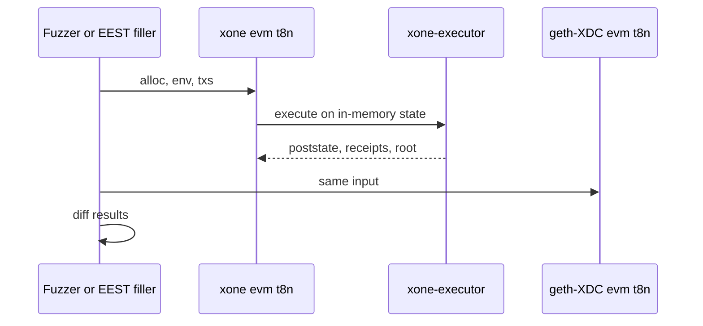
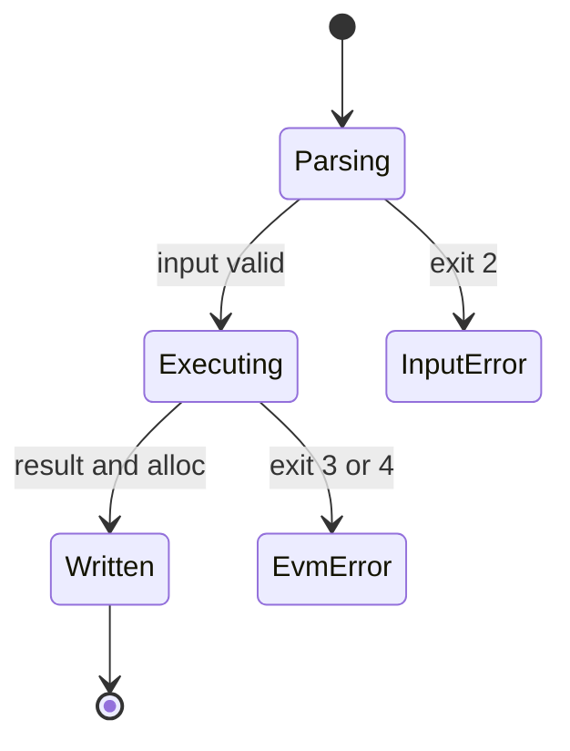
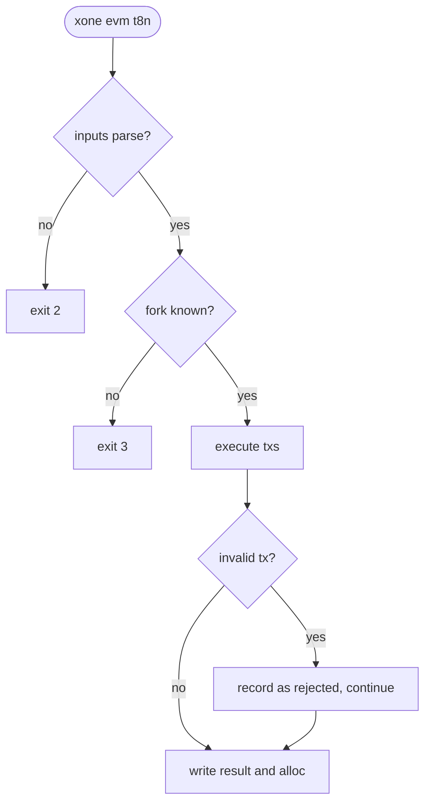

## What

The execution-spec tests and cross-client fuzzers (goevmlab) drive clients through a common command-line interface: `evm t8n` (apply transactions to a prestate, print the poststate and receipts) and `evm statetest` / `blocktest`. geth-XDC, geth, Erigon, Besu, Nethermind, ethrex and Nimbus ship it; XDPoSChain ships the state-test runner. xOneRS has none, so its EVM cannot join differential fuzzing against geth-XDC without the full node and a database.

## Why

9 of the 14 selected competitors have this capability; the geth-XDC oracle pin has it too (file evidence at the audited commit; competitor commits in `.gap-audit/gap-ledger.json`):

- `ethereum/go-ethereum`: [cmd/evm/internal/t8ntool](https://github.com/ethereum/go-ethereum/tree/8059ff8beb3170eb8b977169ac51bb0423c97ee1/cmd/evm/internal/t8ntool)
- `bnb-chain/bsc`: [cmd/evm/internal/t8ntool](https://github.com/bnb-chain/bsc/tree/54afaff4da31ac9e49ba646a4f65104edac5a2f3/cmd/evm/internal/t8ntool)
- `0xPolygon/bor`: [cmd/evm/internal/t8ntool](https://github.com/0xPolygon/bor/tree/ee09efd5dd9ef75917368990b272581b0e2c2665/cmd/evm/internal/t8ntool)
- `XinFinOrg/XDPoSChain`: [cmd/evm/staterunner.go](https://github.com/XinFinOrg/XDPoSChain/blob/cb1ef79073c05f50b9df75b1e740387b9d72af99/cmd/evm/staterunner.go) (state tests only)
- `erigontech/erigon`: [cmd/evm/internal/t8ntool](https://github.com/erigontech/erigon/tree/bbb5524e53fb057e7d47a5066e152f1091ac4ba4/cmd/evm/internal/t8ntool)
- `besu-eth/besu`: [ethereum/evmtool/src/main/java/org/hyperledger/besu/evmtool/T8nSubCommand.java](https://github.com/besu-eth/besu/blob/2b839d96863d01210f45a6f62127e6229e5b0889/ethereum/evmtool/src/main/java/org/hyperledger/besu/evmtool/T8nSubCommand.java)
- `NethermindEth/nethermind`: [tools/Evm/Evm/T8n](https://github.com/NethermindEth/nethermind/tree/a7dd73052e696ad934d228aad3f33e660701fdb7/tools/Evm/Evm/T8n)
- `lambdaclass/ethrex`: [tooling/ethrex-evm/src/t8n](https://github.com/lambdaclass/ethrex/tree/740ea493880b6c073b81537010df75e143c615c2/tooling/ethrex-evm/src/t8n)
- `status-im/nimbus-eth1`: [tools/t8n](https://github.com/status-im/nimbus-eth1/tree/5e3fd7e9d19177980cc1c086c46c4e1dcf38eced/tools/t8n)
- geth-XDC oracle pin `XDCIndia/go-ethereum@6fc8e8c2`: [cmd/evm/internal/t8ntool](https://github.com/XDCIndia/go-ethereum/blob/6fc8e8c2088b7f18264f5663036669d04fa7becf/cmd/evm/internal/t8ntool)
- Docs: https://github.com/ethereum/execution-specs (t8n interface used by the test filler and goevmlab)

Priority: P2: base P3 (maintainers; no operator effect), raised because 9 of 14 competitors and both canonical XDC clients ship it. It makes #10 (EEST) and #120 (EVM oracle gaps) cheaper.

Our code today: `crates/xone-executor/src/lib.rs` and `crates/xone-evm/src/` (library only), `conformance/harness` (replay against the oracle), `fuzz/` (cargo-fuzz targets); no t8n CLI

Related xOneRS issues: #10 (EEST and independent test sources), #120 (EVM oracle gaps), #26 (revm integration). This issue adds the capability; it does not replace their gates.

## 80% of the way to

1. `bin/xone/src/cmd/evm.rs`: `xone evm t8n --input.alloc --input.env --input.txs --output.result --output.alloc --state.fork --state.chainid` with the t8n JSON formats of geth's `t8ntool` (same field names, same exit codes 0, 2, 3, 4).
2. Fork names: the Ethereum names map to the XDC fork table of `xone-chainspec`; add `--state.xdc <fork>` for XDC rules (TRC21 fee routing, special transactions, fixed base fee).
3. `xone evm statetest <file>` and `xone evm blocktest <file>` on the executor with an in-memory state (no MDBX).
4. CI: run the t8n of xOneRS and of geth-XDC (oracle sidecar, test only) on 1,000 fuzzer cases per night and diff the results; differences open a divergence record.
5. Tests: the geth `cmd/evm/testdata` t8n cases that apply to XDC forks pass byte-equal.

Acceptance criteria:

- [ ] `xone evm t8n` passes the applicable geth t8n test vectors byte-equal.
- [ ] `xone evm statetest` runs a pinned EEST state-test release with the documented XDC skips.
- [ ] A nightly differential job against the geth-XDC t8n runs and reports 0 unexplained differences.

## ASD-STE100

1. The tool MUST use the same executor code as the node.
2. The tool MUST write only to the output paths that the operator gives.
3. The tool MUST use the t8n exit codes of geth.

## Diagrams



## Images

None. Measurements (timings, sizes) go in the PR description as tables.

## Prompt

```text
You work in XDCIndia/xOneRS (Rust XDC client). Implement GAP-0057: Standalone EVM tool: t8n (transition), state-test and block-test runners on the xOneRS executor (xone evm).

Context: The execution-spec tests and cross-client fuzzers (goevmlab) drive clients through a common command-line interface: `evm t8n` (apply transactions to a prestate, print the poststate and receipts) and `evm statetest` / `blocktest`. geth-XDC, geth, Erigon, Besu, Nethermind, ethrex and Nimbus ship it; XDPoSChain ships the state-test runner. xOneRS has none, so its EVM cannot join differential fuzzing against geth-XDC without the full node and a database.

Read the evidence links in the Why section first.

Reference behaviour: geth-XDC at XDCIndia/go-ethereum 6fc8e8c2088b7f18264f5663036669d04fa7becf (conformance/PIN) for anything consensus-visible or RPC-visible; this issue must not change consensus, execution or wire formats. Where geth-XDC lacks the feature, follow the first source in the Why section and record the choice in the PR.

Steps:
1. `bin/xone/src/cmd/evm.rs`: `xone evm t8n --input.alloc --input.env --input.txs --output.result --output.alloc --state.fork --state.chainid` with the t8n JSON formats of geth's `t8ntool` (same field names, same exit codes 0, 2, 3, 4).
2. Fork names: the Ethereum names map to the XDC fork table of `xone-chainspec`; add `--state.xdc <fork>` for XDC rules (TRC21 fee routing, special transactions, fixed base fee).
3. `xone evm statetest <file>` and `xone evm blocktest <file>` on the executor with an in-memory state (no MDBX).
4. CI: run the t8n of xOneRS and of geth-XDC (oracle sidecar, test only) on 1,000 fuzzer cases per night and diff the results; differences open a divergence record.
5. Tests: the geth `cmd/evm/testdata` t8n cases that apply to XDC forks pass byte-equal.

Rules: one branch `feat/gap-0057-evm-tool` from main, one PR that closes this issue. Write the tests first. Keep consensus, execution and storage formats unchanged unless a step says otherwise (then amend the ADR in the same PR). Run `cargo fmt --check`, `cargo clippy --all-targets -- -D warnings`, `cargo test --locked`, `ci/check-layering.sh` and `ci/check-fixtures.sh`. Update docs/cli/flags.md with `UPDATE_DOCS=1 cargo test -p xone flags_doc` if you add a flag. Never touch live nodes or validator hosts. Hand back in 25 lines or fewer: files changed, tests added, acceptance results.
```

## Workflow

1. Maintainer: confirms priority P2 and assigns the issue.
2. Engineer: creates branch `feat/gap-0057-evm-tool` from `main`.
3. Engineer: writes the failing tests named in the steps (and the oracle vectors where the steps name them).
4. Engineer: implements the change in the files of Layout.
5. Engineer: runs the gates (fmt, clippy, test, layering, fixtures) and the checks in the acceptance criteria.
6. Engineer: opens one PR that says `Closes #<this issue>` and lists the acceptance results.
7. Reviewer: checks each acceptance criterion and the ASD-STE100 requirements.
8. Maintainer: merges.
9. Operator: tries the feature on one net2040 or Apothem test node (never a validator host) and records the result in this issue.

## Loop

CI: nightly differential run of 1,000 cases; a failing case is minimized and kept as a vector. Develop-verify: geth t8n vectors.

## Graph



## Layout

```text
Files touched:
  bin/xone/src/cmd/evm.rs
  bin/xone/src/cmd/mod.rs
  crates/xone-executor/src/lib.rs
  crates/xone-chainspec/src/networks.rs
  ci/
  conformance/vectors/

Example:
$ xone evm t8n --input.alloc alloc.json --input.env env.json --input.txs txs.rlp --state.fork Shanghai --state.xdc TIPTRC21Fee --output.result result.json
```

## Flow



## Summary

Gap: xOneRS has no t8n or state-test CLI, so its EVM cannot join EEST filling or differential fuzzing against geth-XDC.
Fix: Add `xone evm t8n|statetest|blocktest` on the node's executor with geth's formats and exit codes.
Acceptance: geth t8n vectors pass byte-equal, a pinned EEST release runs, nightly diff against geth-XDC reports 0 unexplained differences.

<!-- gap-audit:GAP-0057 -->
