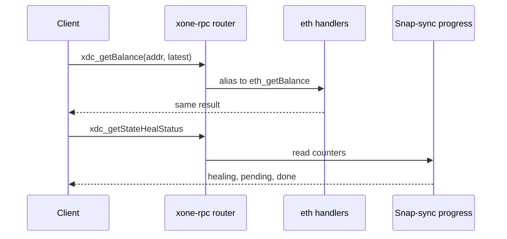
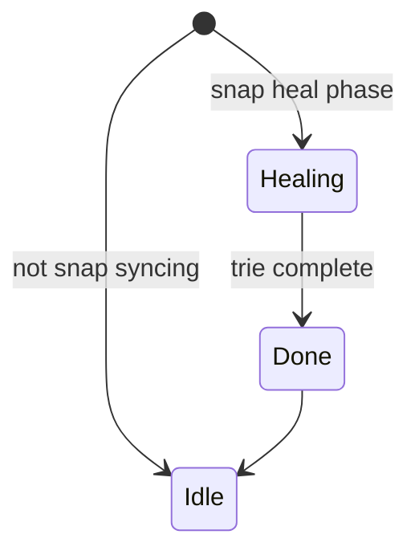
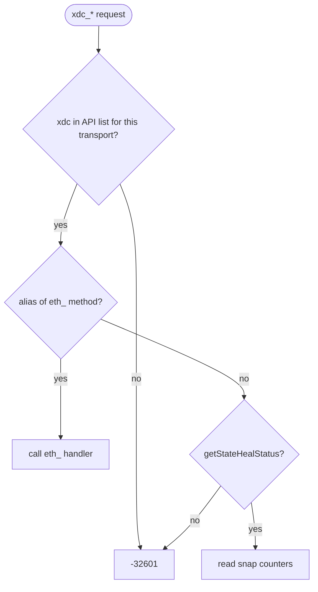

## What

geth-XDC registers its block-chain API a second time under the `xdc` namespace (`eth/backend.go`, A.97.2, refs #894 of the oracle repository), so `xdc_getBalance`, `xdc_getBlockByNumber`, `xdc_getBlockSignersByNumber` and siblings answer like their `eth_` twins, and adds `xdc_getStateHealStatus` (and `eth_getStateHealStatus`) to poll snap heal progress. xOneRS answers `-32601` for every `xdc_` method and has no heal-status method.

## Why

0 of the 14 selected competitors have this capability; the geth-XDC oracle pin has it too (file evidence at the audited commit; competitor commits in `.gap-audit/gap-ledger.json`):

- geth-XDC oracle pin `XDCIndia/go-ethereum@6fc8e8c2`: [eth/backend.go](https://github.com/XDCIndia/go-ethereum/blob/6fc8e8c2088b7f18264f5663036669d04fa7becf/eth/backend.go) (`Namespace: "xdc"`, `ethapi.NewBlockChainAPI`)
- geth-XDC oracle pin `XDCIndia/go-ethereum@6fc8e8c2`: [internal/ethapi/api_xdc.go](https://github.com/XDCIndia/go-ethereum/blob/6fc8e8c2088b7f18264f5663036669d04fa7becf/internal/ethapi/api_xdc.go) (`GetStateHealStatus` line 643)

Priority: P3: integrators and operators of snap nodes; only the geth-XDC oracle serves it and the fleet's default `--http.api` list (`eth,net,web3,admin,debug,txpool,XDPoS`) does not enable `xdc`, so the canonical-client raise does not apply.

Our code today: `crates/xone-rpc/src/eth.rs`, `crates/xone-rpc/src/xdc_ext.rs` (eth_ names only), `crates/xone-rpc/src/policy.rs` (namespace list), `crates/xone-node/src/services/snapsync.rs` (heal progress in logs and metrics only)

Related xOneRS issues: #168 (GAP-0017 XDC extensions), #42, #60 (namespace exposure per transport). This issue adds the capability; it does not replace their gates.

## 80% of the way to

1. `crates/xone-rpc/src/api.rs`: register each method of the oracle `BlockChainAPI` that xOneRS serves under `eth_` also under `xdc_`, through one alias table (no copied handlers); `xdc` becomes a namespace name in `--http.api`/`--ws.api` and is off unless listed.
2. `xdc_getStateHealStatus` and `eth_getStateHealStatus`: the oracle's JSON shape, from the snap-sync progress counters of `services/snapsync.rs`; on a node that is not healing, the oracle's idle answer.
3. Vectors: record `xdc_getBlockByNumber`, `xdc_getBalance` and `xdc_getStateHealStatus` from the oracle into `conformance/vectors/rpc/` and compare.
4. Amend `spec/rpc/scope-adr-008.md` and `spec/rpc/xdc-eth-extensions.md`.

Acceptance criteria:

- [ ] Each `xdc_` alias returns the same bytes as its `eth_` twin (table test).
- [ ] `xdc_getStateHealStatus` matches the oracle shape on a healing and on an idle node (vectors).
- [ ] The `xdc` namespace is not served unless the API list names it (test).

## ASD-STE100

1. Each xdc_ method MUST give the same result as the eth_ method with the same name.
2. The node MUST NOT serve the xdc namespace when the API list does not name it.
3. The heal status MUST use the snap-sync counters of the node.

## Diagrams



## Images

None. Measurements (timings, sizes) go in the PR description as tables.

## Prompt

```text
You work in XDCIndia/xOneRS (Rust XDC client). Implement GAP-0058: xdc_ RPC namespace served by geth-XDC: the eth block-chain methods under xdc_ plus xdc_getStateHealStatus.

Context: geth-XDC registers its block-chain API a second time under the `xdc` namespace (`eth/backend.go`, A.97.2, refs #894 of the oracle repository), so `xdc_getBalance`, `xdc_getBlockByNumber`, `xdc_getBlockSignersByNumber` and siblings answer like their `eth_` twins, and adds `xdc_getStateHealStatus` (and `eth_getStateHealStatus`) to poll snap heal progress. xOneRS answers `-32601` for every `xdc_` method and has no heal-status method.

Read the evidence links in the Why section first.

Reference behaviour: geth-XDC at XDCIndia/go-ethereum 6fc8e8c2088b7f18264f5663036669d04fa7becf (conformance/PIN) for anything consensus-visible or RPC-visible; this issue must not change consensus, execution or wire formats. Where geth-XDC lacks the feature, follow the first source in the Why section and record the choice in the PR.

Steps:
1. `crates/xone-rpc/src/api.rs`: register each method of the oracle `BlockChainAPI` that xOneRS serves under `eth_` also under `xdc_`, through one alias table (no copied handlers); `xdc` becomes a namespace name in `--http.api`/`--ws.api` and is off unless listed.
2. `xdc_getStateHealStatus` and `eth_getStateHealStatus`: the oracle's JSON shape, from the snap-sync progress counters of `services/snapsync.rs`; on a node that is not healing, the oracle's idle answer.
3. Vectors: record `xdc_getBlockByNumber`, `xdc_getBalance` and `xdc_getStateHealStatus` from the oracle into `conformance/vectors/rpc/` and compare.
4. Amend `spec/rpc/scope-adr-008.md` and `spec/rpc/xdc-eth-extensions.md`.

Rules: one branch `feat/gap-0058-xdc-namespace` from main, one PR that closes this issue. Write the tests first. Keep consensus, execution and storage formats unchanged unless a step says otherwise (then amend the ADR in the same PR). Run `cargo fmt --check`, `cargo clippy --all-targets -- -D warnings`, `cargo test --locked`, `ci/check-layering.sh` and `ci/check-fixtures.sh`. Update docs/cli/flags.md with `UPDATE_DOCS=1 cargo test -p xone flags_doc` if you add a flag. Never touch live nodes or validator hosts. Hand back in 25 lines or fewer: files changed, tests added, acceptance results.
```

## Workflow

1. Maintainer: confirms priority P3 and assigns the issue.
2. Engineer: creates branch `feat/gap-0058-xdc-namespace` from `main`.
3. Engineer: writes the failing tests named in the steps (and the oracle vectors where the steps name them).
4. Engineer: implements the change in the files of Layout.
5. Engineer: runs the gates (fmt, clippy, test, layering, fixtures) and the checks in the acceptance criteria.
6. Engineer: opens one PR that says `Closes #<this issue>` and lists the acceptance results.
7. Reviewer: checks each acceptance criterion and the ASD-STE100 requirements.
8. Maintainer: merges.
9. Operator: tries the feature on one net2040 or Apothem test node (never a validator host) and records the result in this issue.

## Loop

None (per request). Develop-verify: oracle vectors.

## Graph



## Layout

```text
Files touched:
  crates/xone-rpc/src/api.rs
  crates/xone-rpc/src/xdc_ext.rs
  crates/xone-rpc/src/policy.rs
  crates/xone-node/src/services/snapsync.rs
  spec/rpc/xdc-eth-extensions.md

Example:
xone --http --http.api eth,net,web3,XDPoS,xdc
{"method":"xdc_getStateHealStatus"} -> {"healing":true,"pendingTrienodes":1203,...}
```

## Flow



## Summary

Gap: xOneRS does not serve the xdc_ namespace or the heal-status method of geth-XDC.
Fix: Alias the served eth_ block-chain methods under xdc_ and add xdc_/eth_getStateHealStatus, off unless listed.
Acceptance: Aliases byte-equal to eth_, heal status equal to the oracle shape, namespace off by default.

<!-- gap-audit:GAP-0058 -->
