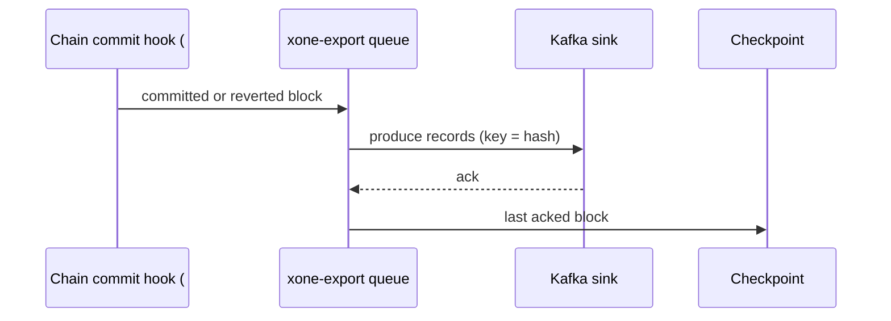
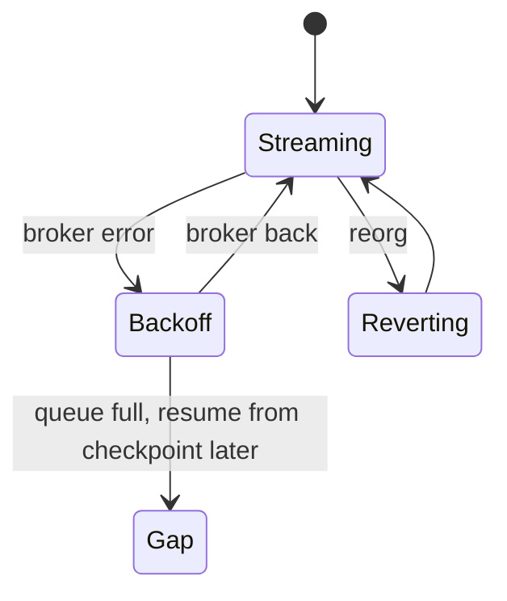
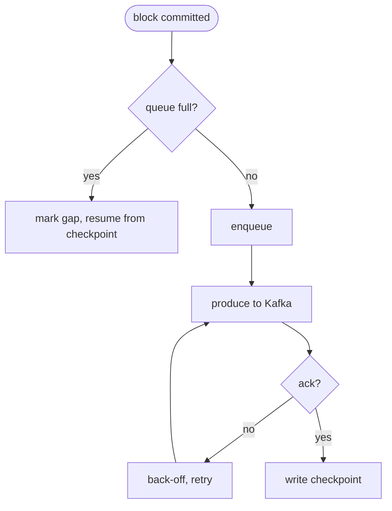

## What

Explorers and indexers (XDCScan, Blockscout) poll RPC for every block, receipt and trace. Kaia ships a chain-data fetcher that pushes blocks, transactions, token transfers and traces to Kafka with resumable checkpoints and reorg handling, and a DB syncer that writes to MySQL. xOneRS has no push export; GAP-0036 (#187) adds the in-process hooks such an exporter would use, not the exporter.

## Why

1 of the 14 selected competitors have this capability (file evidence at the audited commit; competitor commits in `.gap-audit/gap-ledger.json`):

- `kaiachain/kaia`: [datasync/chaindatafetcher/kafka](https://github.com/kaiachain/kaia/tree/0f9ad843d1ccb7381cc43070ce13002cca7b1ed9/datasync/chaindatafetcher/kafka)
- `kaiachain/kaia`: [datasync/chaindatafetcher/chaindata_fetcher.go](https://github.com/kaiachain/kaia/blob/0f9ad843d1ccb7381cc43070ce13002cca7b1ed9/datasync/chaindatafetcher/chaindata_fetcher.go)
- `kaiachain/kaia`: [datasync/dbsyncer/dbsync.go](https://github.com/kaiachain/kaia/blob/0f9ad843d1ccb7381cc43070ce13002cca7b1ed9/datasync/dbsyncer/dbsync.go) (MySQL sink)
- `kaiachain/kaia`: [cmd/utils/flags.go](https://github.com/kaiachain/kaia/blob/0f9ad843d1ccb7381cc43070ce13002cca7b1ed9/cmd/utils/flags.go) (`chaindatafetcher.*` flags)
- Docs: https://docs.kaia.io/ (chaindatafetcher)

Priority: P3: integrators (explorers, indexers, analytics); 1 of 14 competitors; builds on #187.

Our code today: `crates/xone-rpc/src/subscriptions.rs` (newHeads and logs over WebSocket), no exporter; hooks planned in #187 (GAP-0036)

Related xOneRS issues: #187 (GAP-0036 live hooks), #198 (GAP-0043 library), #183 (GAP-0032 ots). This issue adds the capability; it does not replace their gates.

## 80% of the way to

1. New crate `crates/xone-export` (optional cargo feature `export`, off in the default build): consumes the committed-block hook of #187; never runs on the import thread (bounded channel, drop to a resumable checkpoint on overflow).
2. Kafka sink (`rdkafka` behind the feature): topics `blocks`, `receipts`, `logs`, `traces` (callTracer); key = block hash; at-least-once with a checkpoint file `<datadir>/export.ckpt` (last acked block); reorg emits `revert` records for removed blocks before new ones.
3. Flags `--export.kafka.brokers`, `--export.topics`, `--export.from <n>` (backfill from the retention window).
4. Tests: an embedded Kafka (testcontainers in CI only) receives every block of a 1,000-block sync in order; a forced reorg produces revert records; a broker outage does not slow import (import time within 5%).

Acceptance criteria:

- [ ] Every committed block appears once in order after a broker restart (at-least-once with dedupe key).
- [ ] A reorg emits revert records before the new branch (test).
- [ ] Import time with the exporter on and the broker down stays within 5% of off.

## ASD-STE100

1. The exporter MUST NOT block block import.
2. The exporter MUST send a revert record for each removed block before the new blocks.
3. The exporter MUST continue from its checkpoint after a restart.

## Diagrams



## Images

None. Measurements (timings, sizes) go in the PR description as tables.

## Prompt

```text
You work in XDCIndia/xOneRS (Rust XDC client). Implement GAP-0059: Chain-data exporter: stream blocks, receipts, logs and traces to Kafka (reorg-aware, resumable), for explorers and indexers.

Context: Explorers and indexers (XDCScan, Blockscout) poll RPC for every block, receipt and trace. Kaia ships a chain-data fetcher that pushes blocks, transactions, token transfers and traces to Kafka with resumable checkpoints and reorg handling, and a DB syncer that writes to MySQL. xOneRS has no push export; GAP-0036 (#187) adds the in-process hooks such an exporter would use, not the exporter.

Read the evidence links in the Why section first.

Reference behaviour: geth-XDC at XDCIndia/go-ethereum 6fc8e8c2088b7f18264f5663036669d04fa7becf (conformance/PIN) for anything consensus-visible or RPC-visible; this issue must not change consensus, execution or wire formats. Where geth-XDC lacks the feature, follow the first source in the Why section and record the choice in the PR.

Steps:
1. New crate `crates/xone-export` (optional cargo feature `export`, off in the default build): consumes the committed-block hook of #187; never runs on the import thread (bounded channel, drop to a resumable checkpoint on overflow).
2. Kafka sink (`rdkafka` behind the feature): topics `blocks`, `receipts`, `logs`, `traces` (callTracer); key = block hash; at-least-once with a checkpoint file `<datadir>/export.ckpt` (last acked block); reorg emits `revert` records for removed blocks before new ones.
3. Flags `--export.kafka.brokers`, `--export.topics`, `--export.from <n>` (backfill from the retention window).
4. Tests: an embedded Kafka (testcontainers in CI only) receives every block of a 1,000-block sync in order; a forced reorg produces revert records; a broker outage does not slow import (import time within 5%).

Rules: one branch `feat/gap-0059-chain-data-export` from main, one PR that closes this issue. Write the tests first. Keep consensus, execution and storage formats unchanged unless a step says otherwise (then amend the ADR in the same PR). Run `cargo fmt --check`, `cargo clippy --all-targets -- -D warnings`, `cargo test --locked`, `ci/check-layering.sh` and `ci/check-fixtures.sh`. Update docs/cli/flags.md with `UPDATE_DOCS=1 cargo test -p xone flags_doc` if you add a flag. Never touch live nodes or validator hosts. Hand back in 25 lines or fewer: files changed, tests added, acceptance results.
```

## Workflow

1. Maintainer: confirms priority P3 and assigns the issue.
2. Engineer: creates branch `feat/gap-0059-chain-data-export` from `main`.
3. Engineer: writes the failing tests named in the steps (and the oracle vectors where the steps name them).
4. Engineer: implements the change in the files of Layout.
5. Engineer: runs the gates (fmt, clippy, test, layering, fixtures) and the checks in the acceptance criteria.
6. Engineer: opens one PR that says `Closes #<this issue>` and lists the acceptance results.
7. Reviewer: checks each acceptance criterion and the ASD-STE100 requirements.
8. Maintainer: merges.
9. Operator: tries the feature on one net2040 or Apothem test node (never a validator host) and records the result in this issue.

## Loop

Runtime: continuous consumer; retry with back-off 1 s to 60 s while the broker is down; checkpoint after each ack batch.

## Graph



## Layout

```text
Files touched:
  crates/xone-export/src/lib.rs
  crates/xone-export/src/kafka.rs
  crates/xone-node/src/services/mod.rs
  bin/xone/src/flags.rs
  Cargo.toml (feature export)

Example:
xone --apothem --export.kafka.brokers 10.0.0.5:9092 --export.topics blocks,receipts,logs
```

## Flow



## Summary

Gap: xOneRS cannot push chain data to an indexer; explorers must poll RPC.
Fix: Add an optional, reorg-aware, resumable Kafka exporter on the #187 hooks.
Acceptance: Ordered at-least-once delivery, revert records on reorg, under 5% import cost with the broker down.

<!-- gap-audit:GAP-0059 -->
